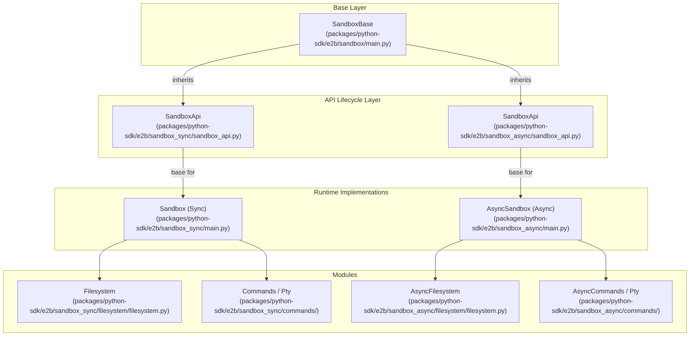
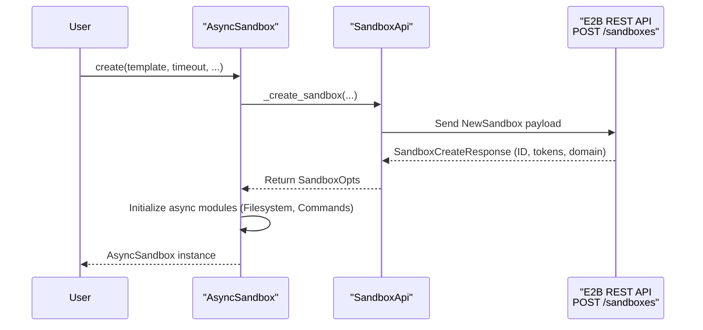

<!-- source: DeepWiki mcp.deepwiki.com · repo e2b-dev/E2B · page 3.1 Sandbox Management (Sync and Async) · fetched 2026-10-29 -->

# Sandbox Management (Sync and Async)

<details>
<summary>Relevant source files</summary>

The following files were used as context for generating this wiki page:

- [packages/js-sdk/src/index.ts](packages/js-sdk/src/index.ts)
- [packages/js-sdk/src/sandbox/index.ts](packages/js-sdk/src/sandbox/index.ts)
- [packages/js-sdk/src/sandbox/sandboxApi.ts](packages/js-sdk/src/sandbox/sandboxApi.ts)
- [packages/js-sdk/tests/sandbox/connect.test.ts](packages/js-sdk/tests/sandbox/connect.test.ts)
- [packages/js-sdk/tests/sandbox/create.test.ts](packages/js-sdk/tests/sandbox/create.test.ts)
- [packages/python-sdk/e2b/__init__.py](packages/python-sdk/e2b/__init__.py)
- [packages/python-sdk/e2b/sandbox/main.py](packages/python-sdk/e2b/sandbox/main.py)
- [packages/python-sdk/e2b/sandbox/sandbox_api.py](packages/python-sdk/e2b/sandbox/sandbox_api.py)
- [packages/python-sdk/e2b/sandbox_async/main.py](packages/python-sdk/e2b/sandbox_async/main.py)
- [packages/python-sdk/e2b/sandbox_async/sandbox_api.py](packages/python-sdk/e2b/sandbox_async/sandbox_api.py)
- [packages/python-sdk/e2b/sandbox_sync/main.py](packages/python-sdk/e2b/sandbox_sync/main.py)
- [packages/python-sdk/e2b/sandbox_sync/sandbox_api.py](packages/python-sdk/e2b/sandbox_sync/sandbox_api.py)
- [packages/python-sdk/tests/async/sandbox_async/test_connect.py](packages/python-sdk/tests/async/sandbox_async/test_connect.py)
- [packages/python-sdk/tests/async/sandbox_async/test_create.py](packages/python-sdk/tests/async/sandbox_async/test_create.py)
- [packages/python-sdk/tests/sync/sandbox_sync/test_connect.py](packages/python-sdk/tests/sync/sandbox_sync/test_connect.py)
- [packages/python-sdk/tests/sync/sandbox_sync/test_create.py](packages/python-sdk/tests/sync/sandbox_sync/test_create.py)

</details>


## Purpose and Scope
This page covers the implementation of sandbox management in the E2B Python SDK, detailing both synchronous (`Sandbox`) and asynchronous (`AsyncSandbox`) interfaces, their shared base class (`SandboxBase`), and the API interaction layer (`SandboxApi`). It explains core lifecycle methods, URL and signature generation for file transfers, host and port mapping for sandbox services, and the architectural differences between sync and async execution models.

Sources: [packages/python-sdk/e2b/sandbox/main.py:27-51](), [packages/python-sdk/e2b/sandbox_sync/main.py:49-110](), [packages/python-sdk/e2b/sandbox_async/main.py:50-112]()

---

## Core Class Hierarchy and Architecture
The Python SDK implements sandbox control using a shared base architecture where platform-agnostic configuration and utility methods reside in `SandboxBase`, while runtime operations diverge into synchronous (`Sandbox`) and asynchronous (`AsyncSandbox`) models.


Title: "Python Sandbox Class Hierarchy"

Sources: [packages/python-sdk/e2b/sandbox/main.py:27-57](), [packages/python-sdk/e2b/sandbox_sync/main.py:49-130](), [packages/python-sdk/e2b/sandbox_async/main.py:50-134]()

### Shared Properties and State
`SandboxBase` encapsulates connection configurations, environment tokens, URLs, and port bindings:

| Property | Type | Description |
| :--- | :--- | :--- |
| `sandbox_id` | `str` | Unique sandbox instance identifier |
| `sandbox_domain` | `str` | Host domain where sandbox services run |
| `envd_api_url` | `str` | Base URL for `envd` API communication |
| `envd_direct_url` | `str` | Direct host URL for accessing mapped sandbox ports |
| `traffic_access_token` | `Optional[str]` | Token for accessing restricted public traffic |
| `_envd_access_token` | `Optional[str]` | Internal token for securing `envd` RPC endpoints |

Sources: [packages/python-sdk/e2b/sandbox/main.py:35-101]()

---

## Lifecycle Methods
Both `Sandbox` and `AsyncSandbox` provide class methods to provision, connect to, pause, resume, and terminate environments through the control plane REST API (`SandboxApi`).


Title: "Async Sandbox Creation Sequence"

Sources: [packages/python-sdk/e2b/sandbox_async/sandbox_api.py:210-250](), [packages/python-sdk/e2b/sandbox_async/main.py:171-190]()

### Lifecycle Operations Table
| Operation | Sync Method (`Sandbox`) | Async Method (`AsyncSandbox`) | Description |
| :--- | :--- | :--- | :--- |
| **Create** | `Sandbox.create(...)` | `await AsyncSandbox.create(...)` | Provisions a new sandbox instance. |
| **Connect** | `Sandbox.connect(sandbox_id)` | `await AsyncSandbox.connect(sandbox_id)` | Attaches to an existing sandbox. |
| **Kill** | `sandbox.kill()` | `await sandbox.kill()` | Terminates the sandbox and frees resources. |
| **Pause** | `sandbox.pause(...)` | `await sandbox.pause(...)` | Suspends execution and saves disk/memory state. |
| **Set Timeout** | `sandbox.set_timeout(timeout)` | `await sandbox.set_timeout(timeout)` | Updates the sandbox idle/maximum lifetime timeout. |
| **Get Info** | `sandbox.get_info()` | `await sandbox.get_info()` | Retrieves runtime metadata and current state. |

Sources: [packages/python-sdk/e2b/sandbox_sync/main.py:168-230](), [packages/python-sdk/e2b/sandbox_async/main.py:171-220]()

---

## URL and Signature Generation
`SandboxBase` manages signed URL construction for file upload and download operations. When a sandbox is created in secure mode (`secure=True`), file endpoints require HMAC signatures generated via `get_signature()`.

```python
# Internal file URL builder in SandboxBase
def _file_url(
    self,
    path: str,
    user: Optional[str] = None,
    signature: Optional[str] = None,
    signature_expiration: Optional[int] = None,
) -> str:
    ...
```

*   **`download_url(...)`**: Constructs a secure or public URL to download files from the sandbox [packages/python-sdk/e2b/sandbox/main.py:131-170]().
*   **`upload_url(...)`**: Constructs a secure or public URL to upload files via `multipart/form-data` [packages/python-sdk/e2b/sandbox/main.py:171-212]().

Sources: [packages/python-sdk/e2b/sandbox/main.py:102-212]()

---

## Host and Port Mapping
Sandboxes expose internal services (like web servers or databases) via dynamic host-port mapping.

```python
def get_host(self, port: int) -> str:
    """Get the public host address to connect to a sandbox port."""
    ...

def get_port(self, port: int) -> int:
    """Get the public port mapped to an internal sandbox port."""
    ...
```

*   **`get_host(port)`**: Returns the external hostname mapped for the given internal port [packages/python-sdk/e2b/sandbox/main.py:213-220]().
*   **`get_port(port)`**: Resolves the externally accessible port mapping [packages/python-sdk/e2b/sandbox/main.py:221-232]().
*   **Default Ports**: `envd` operates on port `49983`, and MCP gateway services operate on port `50005` [packages/python-sdk/e2b/sandbox/main.py:28]().

Sources: [packages/python-sdk/e2b/sandbox/main.py:213-232]()

---

## Sync vs Async Implementation Differences
While both `Sandbox` and `AsyncSandbox` share identical API contracts and method names, their internal transport mechanisms and execution models differ:

1.  **HTTP Client**: `Sandbox` utilizes synchronous `httpx.Client`, whereas `AsyncSandbox` utilizes `httpx.AsyncClient` through `get_envd_api` and `get_api_client`.
2.  **Concurrency Model**: Synchronous methods block the calling thread during RPC execution and file transfers. Asynchronous methods use `async`/`await` primitives, returning coroutines that integrate cleanly into `asyncio` event loops.
3.  **Exception Handling**: Sync methods raise synchronous exceptions handled via `handle_envd_api_exception` [packages/python-sdk/e2b/sandbox_sync/main.py:157](), while async methods invoke `ahandle_envd_api_exception` [packages/python-sdk/e2b/sandbox_async/main.py:161]() within asynchronous contexts.

Sources: [packages/python-sdk/e2b/sandbox_sync/main.py:110-165](), [packages/python-sdk/e2b/sandbox_async/main.py:114-169]()

---

