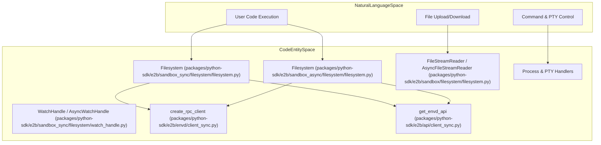
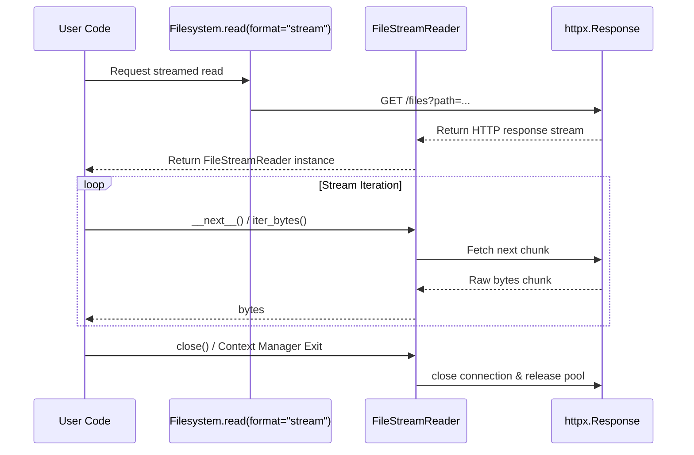
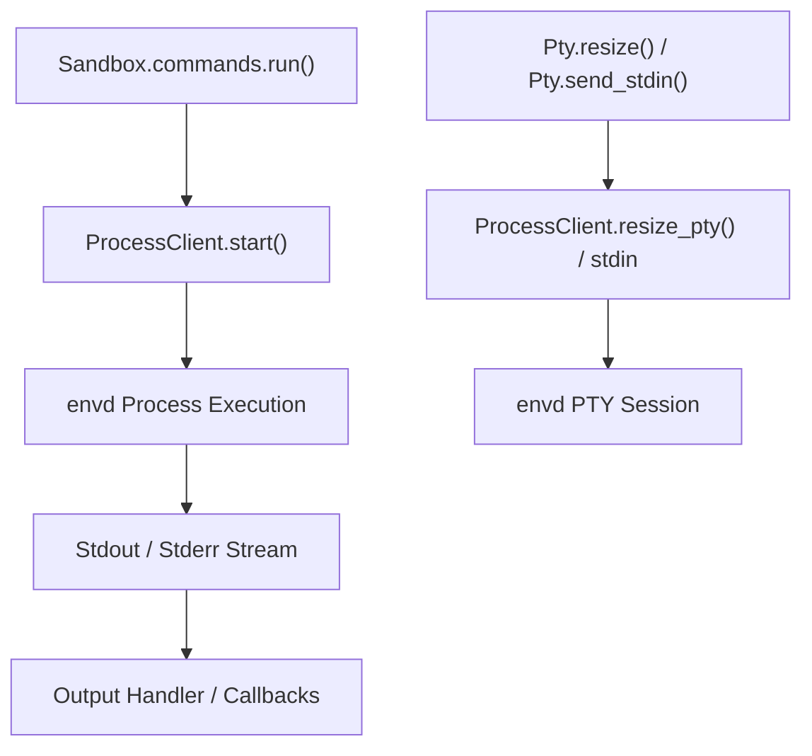

<!-- source: DeepWiki mcp.deepwiki.com · repo e2b-dev/E2B · page 3.2 Filesystem, Commands and PTY · fetched 2026-10-29 -->

# Filesystem, Commands and PTY

Relevant source files

The following files were used as context for generating this wiki page:

- [packages/js-sdk/src/envd/filesystem/filesystem_connect.ts](packages/js-sdk/src/envd/filesystem/filesystem_connect.ts)
- [packages/js-sdk/src/envd/process/process_connect.ts](packages/js-sdk/src/envd/process/process_connect.ts)
- [packages/js-sdk/src/envd/process/process_pb.ts](packages/js-sdk/src/envd/process/process_pb.ts)
- [packages/js-sdk/src/envd/versions.ts](packages/js-sdk/src/envd/versions.ts)
- [packages/js-sdk/src/sandbox/filesystem/index.ts](packages/js-sdk/src/sandbox/filesystem/index.ts)
- [packages/js-sdk/tests/sandbox/files/watch.test.ts](packages/js-sdk/tests/sandbox/files/watch.test.ts)
- [packages/js-sdk/tests/sandbox/files/write.test.ts](packages/js-sdk/tests/sandbox/files/write.test.ts)
- [packages/python-sdk/e2b/envd/filesystem/filesystem_connect.py](packages/python-sdk/e2b/envd/filesystem/filesystem_connect.py)
- [packages/python-sdk/e2b/envd/process/process_connect.py](packages/python-sdk/e2b/envd/process/process_connect.py)
- [packages/python-sdk/e2b/envd/versions.py](packages/python-sdk/e2b/envd/versions.py)
- [packages/python-sdk/e2b/sandbox/filesystem/filesystem.py](packages/python-sdk/e2b/sandbox/filesystem/filesystem.py)
- [packages/python-sdk/e2b/sandbox/filesystem/watch_handle.py](packages/python-sdk/e2b/sandbox/filesystem/watch_handle.py)
- [packages/python-sdk/e2b/sandbox_async/filesystem/filesystem.py](packages/python-sdk/e2b/sandbox_async/filesystem/filesystem.py)
- [packages/python-sdk/e2b/sandbox_async/filesystem/watch_handle.py](packages/python-sdk/e2b/sandbox_async/filesystem/watch_handle.py)
- [packages/python-sdk/e2b/sandbox_sync/filesystem/filesystem.py](packages/python-sdk/e2b/sandbox_sync/filesystem/filesystem.py)
- [packages/python-sdk/e2b/sandbox_sync/filesystem/watch_handle.py](packages/python-sdk/e2b/sandbox_sync/filesystem/watch_handle.py)
- [packages/python-sdk/tests/async/sandbox_async/files/test_watch.py](packages/python-sdk/tests/async/sandbox_async/files/test_watch.py)
- [packages/python-sdk/tests/async/sandbox_async/files/test_write.py](packages/python-sdk/tests/async/sandbox_async/files/test_write.py)
- [packages/python-sdk/tests/sync/sandbox_sync/files/test_watch.py](packages/python-sdk/tests/sync/sandbox_sync/files/test_watch.py)
- [packages/python-sdk/tests/sync/sandbox_sync/files/test_write.py](packages/python-sdk/tests/sync/sandbox_sync/files/test_write.py)
- [spec/envd/process/process.proto](spec/envd/process/process.proto)

This page documents the implementation of the Filesystem module (sync and async Python classes, `FileStreamReader`, watch handles), command execution, and PTY implementations in the E2B SDKs, along with their underlying `envd` ConnectRPC and REST stubs.

## 1. Architecture and Communication Overview

The E2B runtime handles file transfers, command execution, and pseudo-terminal (PTY) interactions via a dual-protocol model: HTTP/REST (via `EnvdApiClient` / `httpx`) for bulk data and file streaming, and ConnectRPC over HTTP/2 for structured control messages, process streaming, and watch events.

**Diagram: Protocol and Component Architecture bridging Natural Language to Code Entities**

Sources: [packages/python-sdk/e2b/sandbox_sync/filesystem/filesystem.py:76-104](), [packages/python-sdk/e2b/sandbox_async/filesystem/filesystem.py:82-108](), [packages/python-sdk/e2b/sandbox/filesystem/filesystem.py:158-224]()

## 2. Python Filesystem Classes and Stream Readers

The `Filesystem` class provides methods for interacting with the sandbox file tree. It features synchronous (`packages/python-sdk/e2b/sandbox_sync/filesystem/filesystem.py`) and asynchronous (`packages/python-sdk/e2b/sandbox_async/filesystem/filesystem.py`) implementations.

- `read()` supports `text`, `bytes`, and `stream` formats.
- When `format="stream"` is selected, it returns a `FileStreamReader` (sync) or `AsyncFileStreamReader` (async) which wraps an `httpx.Response` iterator (`packages/python-sdk/e2b/sandbox/filesystem/filesystem.py`).
- `WriteEntry` and `WriteInfo` handle multi-file and metadata payloads.

**Diagram: File Stream Consumption Data Flow**

Sources: [packages/python-sdk/e2b/sandbox_sync/filesystem/filesystem.py:105-182](), [packages/python-sdk/e2b/sandbox/filesystem/filesystem.py:158-224]()

## 3. Filesystem Watch Handles

Real-time directory watching is managed via `WatchHandle` (sync) and `AsyncWatchHandle` (async), leveraging ConnectRPC `FilesystemClient` stubs (`packages/python-sdk/e2b/sandbox_sync/filesystem/watch_handle.py`).

- `watch_dir()` registers a watcher with `envd`.
- `get_new_events()` polls accumulated `FilesystemEvent` items (such as `CREATE`, `WRITE`, `REMOVE`, `RENAME`, `CHMOD`).
- `stop()` unregisters the watcher via `remove_watcher`.

Sources: [packages/python-sdk/e2b/sandbox_sync/filesystem/watch_handle.py:18-103](), [packages/python-sdk/e2b/sandbox/filesystem/watch_handle.py:9-70]()

## 4. Command Execution and PTY Implementations

Commands and pseudo-terminal (PTY) sessions run processes inside the sandbox via `envd` Process ConnectRPC stubs (`packages/python-sdk/e2b/envd/process/process_connect.py`).

- `CommandHandle` manages process execution, stdout/stderr streaming, and stdin writing.
- `Pty` manages interactive terminal sessions, handling terminal resize (`resize_pty`) and signal/kill operations.

**Diagram: Process Execution and PTY Control Flow**

Sources: [packages/python-sdk/e2b/envd/process/process_connect.py:1-50]()

## 5. envd ConnectRPC Stubs and Error Handling

Both filesystem and process subsystems rely on ConnectRPC code-generated stubs (`filesystem_connect.py`, `process_connect.py`) and error translation utilities (`handle_rpc_exception_with_health`).

- RPC errors (like `Code.NOT_FOUND`) are mapped to SDK exceptions (`FileNotFoundException`, `InvalidArgumentException`).
- Health checks are triggered automatically if an RPC fails, ensuring stale connections or terminated sandboxes raise appropriate errors.

Sources: [packages/python-sdk/e2b/sandbox_sync/filesystem/filesystem.py:57-74](), [packages/python-sdk/e2b/envd/rpc.py:1-50]()

---

