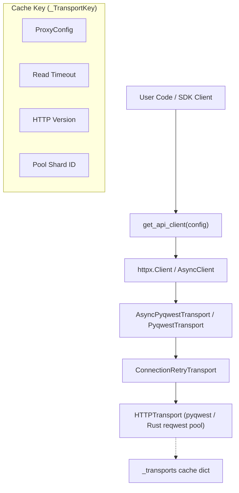
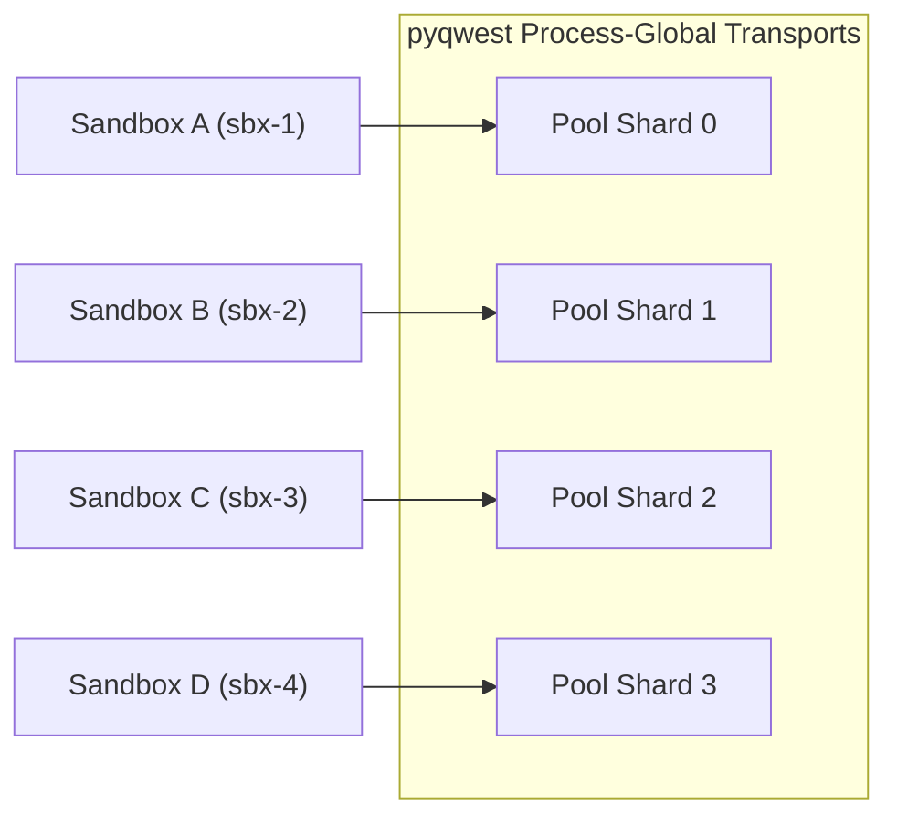
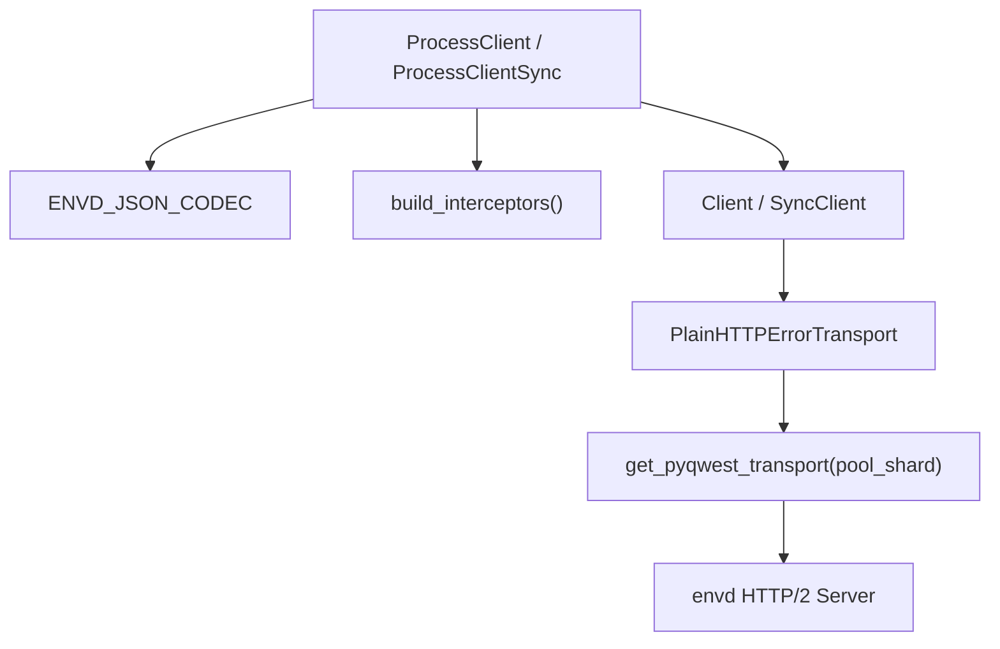
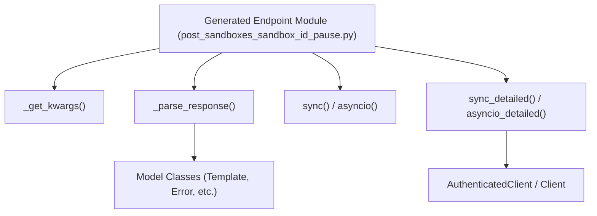

<!-- source: DeepWiki mcp.deepwiki.com · repo e2b-dev/E2B · page 3.3 HTTP Transport and Generated API Client · fetched 2026-10-29 -->

# HTTP Transport and Generated API Client

Relevant source files

The following files were used as context for generating this wiki page:

- [.github/assets/envd-pool-sharding-benchmark.svg](.github/assets/envd-pool-sharding-benchmark.svg)
- [packages/python-sdk/e2b/api/client/api/sandboxes/delete_sandboxes_sandbox_id.py](packages/python-sdk/e2b/api/client/api/sandboxes/delete_sandboxes_sandbox_id.py)
- [packages/python-sdk/e2b/api/client/api/sandboxes/get_sandboxes.py](packages/python-sdk/e2b/api/client/api/sandboxes/get_sandboxes.py)
- [packages/python-sdk/e2b/api/client/api/sandboxes/get_sandboxes_metrics.py](packages/python-sdk/e2b/api/client/api/sandboxes/get_sandboxes_metrics.py)
- [packages/python-sdk/e2b/api/client/api/sandboxes/get_sandboxes_sandbox_id.py](packages/python-sdk/e2b/api/client/api/sandboxes/get_sandboxes_sandbox_id.py)
- [packages/python-sdk/e2b/api/client/api/sandboxes/get_sandboxes_sandbox_id_logs.py](packages/python-sdk/e2b/api/client/api/sandboxes/get_sandboxes_sandbox_id_logs.py)
- [packages/python-sdk/e2b/api/client/api/sandboxes/get_sandboxes_sandbox_id_metrics.py](packages/python-sdk/e2b/api/client/api/sandboxes/get_sandboxes_sandbox_id_metrics.py)
- [packages/python-sdk/e2b/api/client/api/sandboxes/post_sandboxes.py](packages/python-sdk/e2b/api/client/api/sandboxes/post_sandboxes.py)
- [packages/python-sdk/e2b/api/client/api/sandboxes/post_sandboxes_sandbox_id_pause.py](packages/python-sdk/e2b/api/client/api/sandboxes/post_sandboxes_sandbox_id_pause.py)
- [packages/python-sdk/e2b/api/client/api/sandboxes/post_sandboxes_sandbox_id_refreshes.py](packages/python-sdk/e2b/api/client/api/sandboxes/post_sandboxes_sandbox_id_refreshes.py)
- [packages/python-sdk/e2b/api/client/api/sandboxes/post_sandboxes_sandbox_id_resume.py](packages/python-sdk/e2b/api/client/api/sandboxes/post_sandboxes_sandbox_id_resume.py)
- [packages/python-sdk/e2b/api/client/api/sandboxes/post_sandboxes_sandbox_id_timeout.py](packages/python-sdk/e2b/api/client/api/sandboxes/post_sandboxes_sandbox_id_timeout.py)
- [packages/python-sdk/e2b/api/client/models/listed_sandbox.py](packages/python-sdk/e2b/api/client/models/listed_sandbox.py)
- [packages/python-sdk/e2b/api/client/models/sandbox_detail.py](packages/python-sdk/e2b/api/client/models/sandbox_detail.py)
- [packages/python-sdk/e2b/api/client/models/sandbox_log_entry.py](packages/python-sdk/e2b/api/client/models/sandbox_log_entry.py)
- [packages/python-sdk/e2b/api/client/models/sandbox_log_entry_fields.py](packages/python-sdk/e2b/api/client/models/sandbox_log_entry_fields.py)
- [packages/python-sdk/e2b/api/client/models/sandbox_logs.py](packages/python-sdk/e2b/api/client/models/sandbox_logs.py)
- [packages/python-sdk/e2b/api/client/models/template.py](packages/python-sdk/e2b/api/client/models/template.py)
- [packages/python-sdk/e2b/api/client/models/template_build_file_upload.py](packages/python-sdk/e2b/api/client/models/template_build_file_upload.py)
- [packages/python-sdk/e2b/api/client/models/template_build_start_v2.py](packages/python-sdk/e2b/api/client/models/template_build_start_v2.py)
- [packages/python-sdk/e2b/api/client_async/__init__.py](packages/python-sdk/e2b/api/client_async/__init__.py)
- [packages/python-sdk/e2b/api/client_sync/__init__.py](packages/python-sdk/e2b/api/client_sync/__init__.py)
- [packages/python-sdk/e2b/envd/client_async/__init__.py](packages/python-sdk/e2b/envd/client_async/__init__.py)
- [packages/python-sdk/e2b/envd/client_sync/__init__.py](packages/python-sdk/e2b/envd/client_sync/__init__.py)
- [packages/python-sdk/tests/envd_frame_server.py](packages/python-sdk/tests/envd_frame_server.py)
- [packages/python-sdk/tests/test_api_client_transport.py](packages/python-sdk/tests/test_api_client_transport.py)
- [packages/python-sdk/tests/test_env_var_parsing.py](packages/python-sdk/tests/test_env_var_parsing.py)

This page documents the HTTP transport infrastructure, connection pool sharding, `envd` RPC client integration, and the OpenAPI-generated API client modules and models located under `packages/python-sdk/e2b/api/` and `packages/python-sdk/e2b/envd/`.

---

## 1. Transport Architecture and `pyqwest` / `httpx` Integration

The Python SDK delegates low-level HTTP networking to `pyqwest`—a Python binding over Rust's `reqwest` HTTP client library—while exposing standard `httpx` interfaces for the generated control-plane client and `connectrpc` interfaces for the runtime `envd` client.

Client transport factories are defined in `packages/python-sdk/e2b/api/client_sync/__init__.py` and `packages/python-sdk/e2b/api/client_async/__init__.py`. 

### Connection Retry Transport
`ConnectionRetryTransport` (inheriting from `RetryTransport`) ensures that retries are strictly restricted to connection-establishment failures (`ConnectionError`) before any request bytes are written to the socket [packages/python-sdk/e2b/api/client_async/__init__.py:32-55](). This prevents unsafe replays of non-idempotent REST mutations or unary RPCs. Streamed request bodies remain unbuffered.

### Process-Global Transport Caching
Transports and connection pools are cached process-global rather than per-event-loop or per-thread, keyed by `_TransportKey` tuples consisting of proxy configuration, idle read timeout bounds, HTTP version constraints, and connection-pool shards [packages/python-sdk/e2b/api/client_async/__init__.py:57-75]().

*Sources: [packages/python-sdk/e2b/api/client_async/__init__.py:24-129](), [packages/python-sdk/e2b/api/client_sync/__init__.py:24-128]()*

---

## 2. Connection Pool Sharding

To prevent HTTP/2 concurrency bottlenecks when communicating intensively with a stable `envd` runtime host inside a sandbox, the SDK implements connection-pool sharding via `envd_pool_shard` [packages/python-sdk/e2b/api/client_async/__init__.py:15]().

Sandboxes are hashed or assigned across a configurable number of connection pool shards (`E2B_ENVD_POOL_SHARDS`, defaulting to `4`) [packages/python-sdk/tests/test_env_var_parsing.py:29]()]. Each shard maintains an isolated `pyqwest` connection pool, enabling bounded parallel HTTP/2 streams to the same target without saturating single-connection settings.

*Sources: [packages/python-sdk/e2b/api/client_async/__init__.py:78-106](), [packages/python-sdk/tests/test_api_client_transport.py:56-68]() *

---

## 3. `envd` RPC Client Integration

Runtime interaction with sandbox `envd` processes utilizes `connectrpc` over HTTP/2. Client factories and transport wrappers are implemented in `packages/python-sdk/e2b/envd/client_sync/__init__.py` and `packages/python-sdk/e2b/envd/client_async/__init__.py`.

### Plain HTTP Error Normalization
Edge proxies or load balancers sitting in front of `envd` may occasionally return non-Connect-encoded HTTP error responses (e.g., HTML gateway error pages). `PlainHTTPErrorTransport` inspects responses with HTTP status codes `>= 400`, passes them through `plain_http_error`, and normalizes them into structured `ConnectError` exceptions [packages/python-sdk/e2b/envd/client_async/__init__.py:33-61]()].

### Client Construction
`create_rpc_client` binds generated ConnectRPC client stubs (such as `ProcessClient` or `ProcessClientSync`) with the shared `pyqwest` transport, `ENVD_JSON_CODEC`, and default authentication/logging interceptors [packages/python-sdk/e2b/envd/client_async/__init__.py:63-96]()].

*Sources: [packages/python-sdk/e2b/envd/client_async/__init__.py:63-96](), [packages/python-sdk/e2b/envd/client_sync/__init__.py:56-91]()*

---

## 4. Generated API Client, Endpoints, and Models (`e2b/api/client`)

The control plane REST API client is generated from the OpenAPI specification into `packages/python-sdk/e2b/api/client/`.

### Per-Endpoint Modules
Each API endpoint is represented by an individual module under `e2b/api/client/api/`. For example, sandbox pausing (`POST /sandboxes/{id}/pause`) is implemented in `packages/python-sdk/e2b/api/client/api/sandboxes/post_sandboxes_sandbox_id_pause.py` [packages/python-sdk/e2b/api/client/api/sandboxes/post_sandboxes_sandbox_id_pause.py:1-203]().

Every endpoint module exports four standard functions:
1. `_get_kwargs`: Constructs HTTP method, URL path, headers, and serialized JSON payloads.
2. `_parse_response`: Maps HTTP status codes to SDK models or `errors.UnexpectedStatus`.
3. `sync` / `asyncio`: Convenience functions returning parsed response models or unions.
4. `sync_detailed` / `asyncio_detailed`: Low-level functions returning full `Response` wrapper objects containing status codes, raw content, and headers.

### Data Models
Data transfer objects and response types (such as `Template` and `TemplateBuildStartV2`) are defined under `e2b/api/client/models/` using `attrs` [packages/python-sdk/e2b/api/client/models/template.py:18-56](), [packages/python-sdk/e2b/api/client/models/template_build_start_v2.py:19-43]()]. They provide bidirectional serialization via `to_dict()` and deserialization via `from_dict()`.

*Sources: [packages/python-sdk/e2b/api/client/api/sandboxes/post_sandboxes_sandbox_id_pause.py:13-112](), [packages/python-sdk/e2b/api/client/models/template.py:18-124]()*

---

