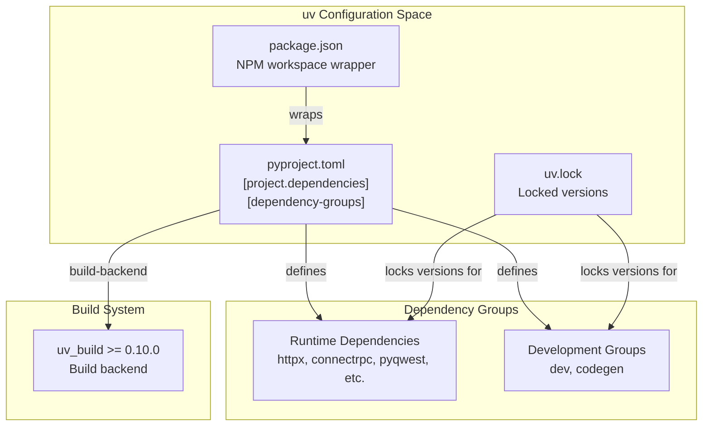
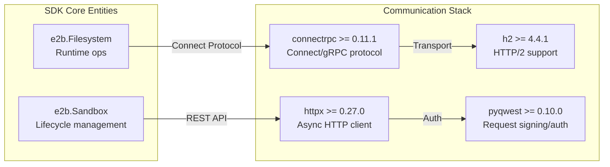
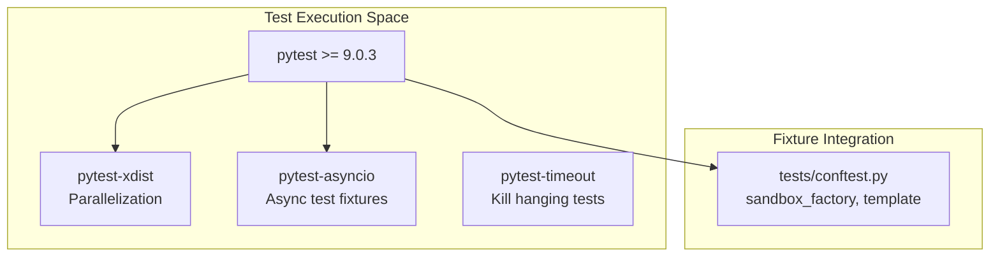

<!-- source: DeepWiki mcp.deepwiki.com · repo e2b-dev/E2B · page 3.4 Dependencies and Environment · fetched 2026-10-29 -->

# Dependencies and Environment

<details>
<summary>Relevant source files</summary>

The following files were used as context for generating this wiki page:

- [.tool-versions](.tool-versions)
- [package.json](package.json)
- [packages/cli/CHANGELOG.md](packages/cli/CHANGELOG.md)
- [packages/cli/package.json](packages/cli/package.json)
- [packages/code-interpreter-python/uv.lock](packages/code-interpreter-python/uv.lock)
- [packages/desktop-python/uv.lock](packages/desktop-python/uv.lock)
- [packages/js-sdk/CHANGELOG.md](packages/js-sdk/CHANGELOG.md)
- [packages/js-sdk/package.json](packages/js-sdk/package.json)
- [packages/js-sdk/src/volume/schema.gen.ts](packages/js-sdk/src/volume/schema.gen.ts)
- [packages/python-sdk/CHANGELOG.md](packages/python-sdk/CHANGELOG.md)
- [packages/python-sdk/Makefile](packages/python-sdk/Makefile)
- [packages/python-sdk/package.json](packages/python-sdk/package.json)
- [packages/python-sdk/pyproject.toml](packages/python-sdk/pyproject.toml)
- [packages/python-sdk/pytest.ini](packages/python-sdk/pytest.ini)
- [packages/python-sdk/tests/async/sandbox_async/test_internet_access.py](packages/python-sdk/tests/async/sandbox_async/test_internet_access.py)
- [packages/python-sdk/tests/sync/sandbox_sync/test_internet_access.py](packages/python-sdk/tests/sync/sandbox_sync/test_internet_access.py)
- [packages/python-sdk/uv.lock](packages/python-sdk/uv.lock)
- [pnpm-lock.yaml](pnpm-lock.yaml)
- [redocly.yaml](redocly.yaml)

</details>


This document covers the Python SDK's dependency management, runtime requirements, development tools, and code generation pipeline. The Python SDK utilizes **uv** for dependency management, relying on `uv.lock` for deterministic builds and `pyproject.toml` for configuration.

For information about Python SDK installation and usage, see [Python SDK](#3). For details about the build system and CI/CD pipeline, see [CI/CD and Release Process](#7.2).

## Dependency Management with uv

The Python SDK uses `uv` as its primary dependency manager and build backend, configured via [packages/python-sdk/pyproject.toml](). The transition to `uv` provides high-speed dependency resolution and lockfile management.

**Key Configuration Files:**

| File | Purpose |
|------|---------|
| `pyproject.toml` | Defines package metadata, dependencies, and build configuration using the `[project]` and `[tool.uv]` tables. |
| `uv.lock` | Lock file containing exact version pins for all runtime, development, and codegen dependencies. |
| `package.json` | NPM/pnpm integration scripts wrapping `uv` commands in the workspace [packages/python-sdk/package.json:5-13](). |

**Dependency Flow Diagram:**



Sources: [packages/python-sdk/pyproject.toml:1-58](), [packages/python-sdk/uv.lock:1-10](), [packages/python-sdk/package.json:5-13]()

## Python Version Requirements

The Python SDK requires **Python 3.10** or higher, as specified in [packages/python-sdk/pyproject.toml:8]():

```toml
requires-python = ">=3.10"
```

This version requirement ensures compatibility with modern type hints (such as PEP 728 `closed` TypedDicts used in MCP integration) and `asyncio` constructs [packages/python-sdk/pyproject.toml:17-19]().

Sources: [packages/python-sdk/pyproject.toml:8,17-19](), [.tool-versions:4]()

## Runtime Dependencies

Runtime dependencies are packages required when executing the Python SDK in production environments, defined in the `[project.dependencies]` block of `pyproject.toml` [packages/python-sdk/pyproject.toml:9-24]().

### Communication Stack (HTTP & RPC)

The SDK uses `httpx` for REST API communication and `connectrpc` for gRPC-compatible runtime operations with `envd` inside sandboxes.



**Key Networking Dependencies:**
- `httpx`: Used for REST lifecycle calls (`>=0.27.0, <1.0.0`) [packages/python-sdk/pyproject.toml:13]().
- `connectrpc`: Implementation of the Connect protocol for `envd` communication (`>=0.11.1, <0.12`) [packages/python-sdk/pyproject.toml:22]().
- `h2`: Required for HTTP/2 support mandatory for gRPC/Connect streams (`>=4.4.1, <5`) [packages/python-sdk/pyproject.toml:14]().
- `pyqwest`: Handles request signing and authentication (`>=0.10.0, <0.11`) [packages/python-sdk/pyproject.toml:23]().

Sources: [packages/python-sdk/pyproject.toml:13-14,22-23]()

### Core Utilities

| Package | Version Constraint | Purpose |
|---------|--------------------|---------|
| `protobuf-py` | `>=0.1.1,<0.2` | Protocol Buffer serialization for `envd` [packages/python-sdk/pyproject.toml:12]() |
| `wcmatch` | `>=10.1,<12` | Advanced wildcard matching for filesystem operations [packages/python-sdk/pyproject.toml:11]() |
| `attrs` | `>=23.2.0` | Class definition boilerplate reduction [packages/python-sdk/pyproject.toml:15]() |
| `rich` | `>=14.0.0` | Terminal formatting for logs and output [packages/python-sdk/pyproject.toml:21]() |
| `dockerfile-parse` | `>=2.0.1,<3` | Parsing Dockerfiles for template building [packages/python-sdk/pyproject.toml:20]() |
| `typing-extensions` | `>=4.10.0` | Extended type hinting support (PEP 728) [packages/python-sdk/pyproject.toml:19]() |

Sources: [packages/python-sdk/pyproject.toml:10-24]()

## Development and Tooling

Development dependencies are organized into groups using `uv` dependency groups (`dev` and `codegen`) [packages/python-sdk/pyproject.toml:31-54]().

### Testing Environment

The SDK uses `pytest` with plugins for parallelization, async support, and timeouts [packages/python-sdk/pyproject.toml:32-41]().



Tests are executed using `uv run pytest` with parallel workers [packages/python-sdk/package.json:6]().

Sources: [packages/python-sdk/pyproject.toml:32-41](), [packages/python-sdk/package.json:6]()

### Code Generation Pipeline

The SDK relies on automated generation for API clients, protobufs, and MCP models, isolated in the `codegen` group [packages/python-sdk/pyproject.toml:43-54]().

**Codegen Tools:**
- `e2b-openapi-python-client == 0.26.2`: Generates REST API client [packages/python-sdk/pyproject.toml:50]().
- `datamodel-code-generator == 0.64.0`: Generates Python models from JSON schemas (e.g., MCP) [packages/python-sdk/pyproject.toml:51]().
- `protoc-gen-connectrpc == 0.11.1`: Plugin for generating Connect-compatible Python code [packages/python-sdk/pyproject.toml:52]().

Sources: [packages/python-sdk/pyproject.toml:48-54]()

### Code Quality (Ruff)

The project uses `ruff` (pinned via the `dev` group) for linting and formatting [packages/python-sdk/pyproject.toml:38]().

Sources: [packages/python-sdk/pyproject.toml:38]()

## Build System Integration

The SDK uses `uv_build` as its PEP 517 build backend [packages/python-sdk/pyproject.toml:56-58]().

```toml
[build-system]
requires = ["uv_build>=0.10.0,<0.11.0"]
build-backend = "uv_build"

[tool.uv.build-backend]
module-name = ["e2b"]
```

Integration with monorepo release scripts is managed through `package.json` [packages/python-sdk/package.json:5-13]().

Sources: [packages/python-sdk/pyproject.toml:56-62](), [packages/python-sdk/package.json:5-13]()

---

