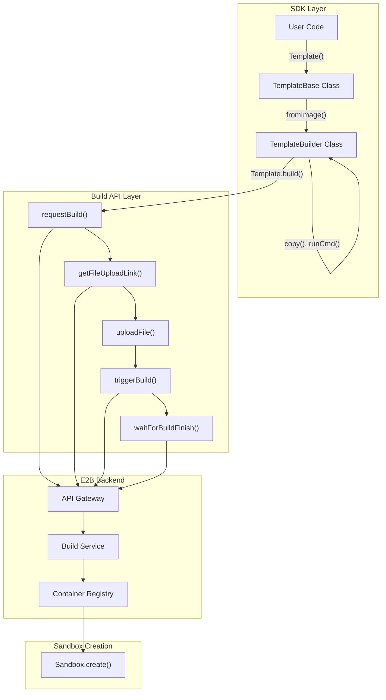
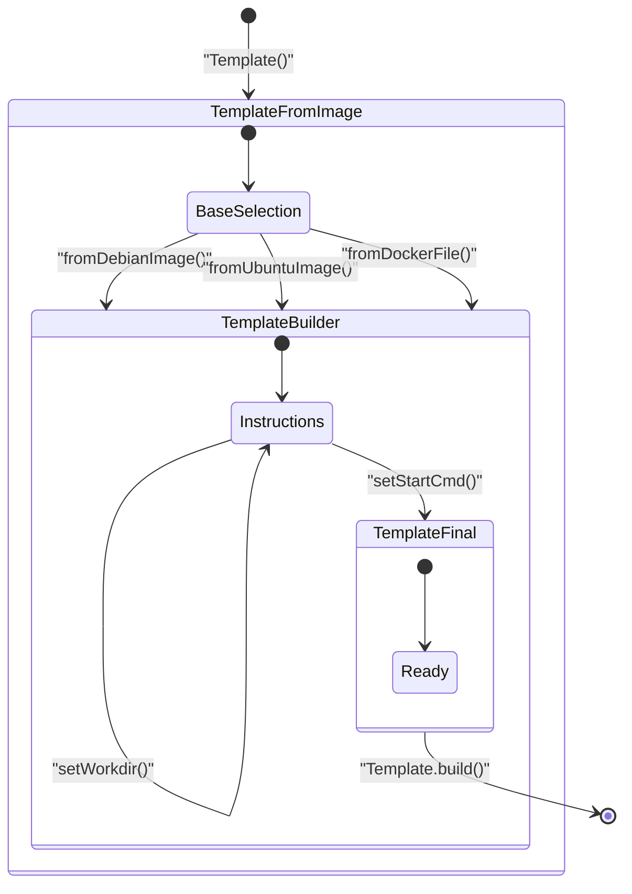
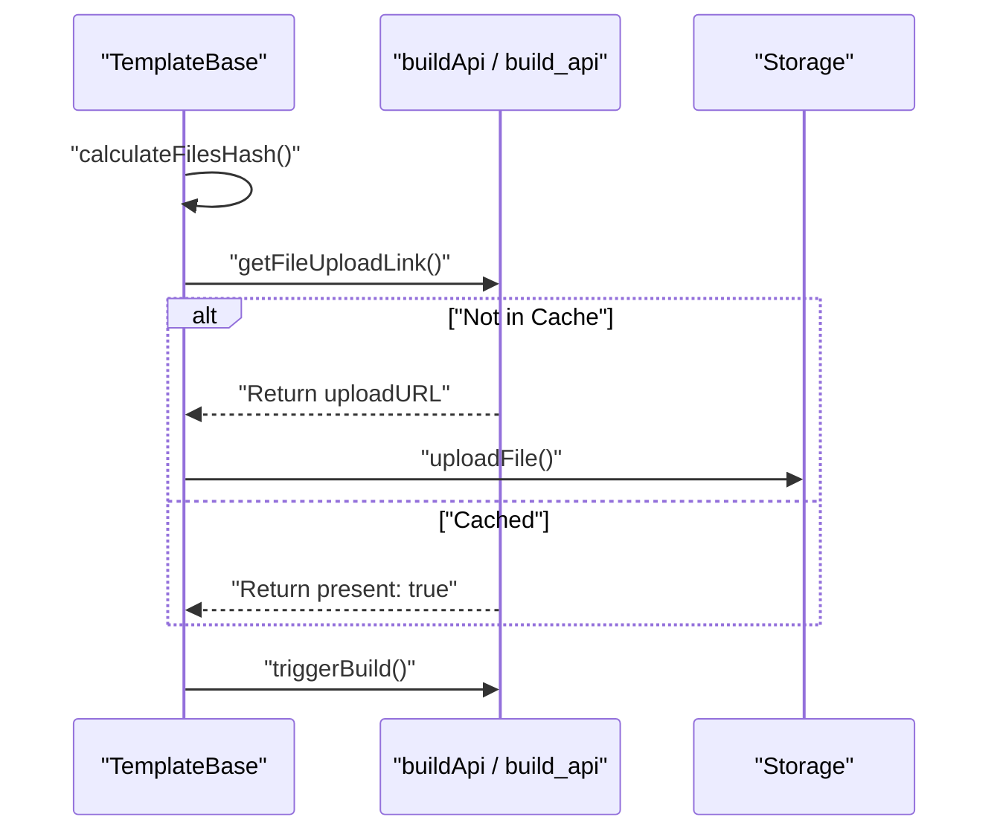

<!-- source: DeepWiki mcp.deepwiki.com · repo e2b-dev/E2B · page 4 Template System · fetched 2026-10-29 -->

# Template System

Relevant source files

The following files were used as context for generating this wiki page:

- [packages/js-sdk/src/template/index.ts](packages/js-sdk/src/template/index.ts)
- [packages/js-sdk/src/template/types.ts](packages/js-sdk/src/template/types.ts)
- [packages/js-sdk/tests/template/stacktrace.test.ts](packages/js-sdk/tests/template/stacktrace.test.ts)
- [packages/python-sdk/e2b/template/main.py](packages/python-sdk/e2b/template/main.py)
- [packages/python-sdk/e2b/template/types.py](packages/python-sdk/e2b/template/types.py)
- [packages/python-sdk/tests/async/template_async/test_stacktrace.py](packages/python-sdk/tests/async/template_async/test_stacktrace.py)
- [packages/python-sdk/tests/sync/template_sync/test_stacktrace.py](packages/python-sdk/tests/sync/template_sync/test_stacktrace.py)

The Template System provides a programmatic API for defining custom sandbox environments in E2B. It allows developers to specify base images, install packages, copy files, set environment variables, and configure startup commands that will be pre-built into reusable sandbox templates.

This is a parent page providing a high-level overview of the template system. For detailed information, see the following child pages:
- [Template Builder API](#4.1) — Fluent builder: base-image selectors, instruction types (`COPY`, `RUN`, `ENV`, `WORKDIR`, `USER`), package installers, `addMcpServer`, `gitClone`, `skipCache`, `setStartCmd`/`setReadyCmd`, and the builder state machine.
- [Build Process, Upload and Caching](#4.2) — `buildApi`/`build_api`: file hashing and context upload, tar spooling, layer cache invalidation, build status polling, build logs, and stack-trace mapping to user code.
- [Registries, Dockerfiles and Tags](#4.3) — `RegistryConfig` variants (generic, AWS ECR, GCP GAR/GCR), Dockerfile parsing and conversion to instructions, template tag assignment and lookup.
- [Prebuilt Templates and Template CI](#4.4) — The `templates/` directory (`base`, `httpbin` `e2b.Dockerfile`s) and the GitHub workflow that builds and publishes them.

Sources: [packages/js-sdk/src/template/index.ts:55-106](), [packages/python-sdk/e2b/template/main.py:31-105]()

## Purpose and Design Goals

The template system addresses the need to create reproducible, customized sandbox environments without rebuilding them on every sandbox creation. Templates are built once and can be instantiated many times as sandboxes, significantly improving startup performance and ensuring consistency across sandbox instances.

Key design principles:
- **Builder Pattern**: Fluent API for chaining operations [packages/js-sdk/src/template/types.ts:231-333]().
- **Hash-Based Caching**: Efficient incremental builds using content-addressable file storage [packages/js-sdk/src/template/index.ts:47-47]().
- **Cross-Language Parity**: Identical functionality in JavaScript and Python SDKs.
- **Registry Flexibility**: Support for Docker Hub, AWS ECR, GCP GCR, and private registries [packages/js-sdk/src/template/types.ts:135-168]().

Sources: [packages/js-sdk/src/template/index.ts:55-106](), [packages/python-sdk/e2b/template/main.py:31-105]()

## Architecture Overview

The template system sits between the SDK client code and the E2B build infrastructure, transforming high-level template definitions into executable build instructions through the builder state machine and the build API.

**Template System Architecture**: The diagram maps natural language workflows to specific code entities such as `TemplateBase`, `TemplateBuilder`, `requestBuild()`, and `uploadFile()`. For details on the builder API, see [Template Builder API](#4.1).

Sources: [packages/js-sdk/src/template/index.ts:55-199](), [packages/python-sdk/e2b/template/main.py:32-106]()

## Template Builder Pattern

The template system enforces a type-safe building process through distinct states (`TemplateFromImage`, `TemplateBuilder`, and `TemplateFinal`), preventing invalid operation sequences.

**Template State Transitions**: State transitions in `TemplateBase` and `TemplateBuilder` enforce workflow ordering. For detailed method signatures and usage, see [Template Builder API](#4.1).

Sources: [packages/js-sdk/src/template/types.ts:231-320](), [packages/python-sdk/e2b/template/main.py:32-106]()

## Build Process, Upload and Caching

The template system implements content-addressable file caching to avoid redundant uploads via `calculateFilesHash` and `getFileUploadLink`. For a comprehensive breakdown of tar spooling, layer cache invalidation, build status polling, and stack-trace mapping to user code, see [Build Process, Upload and Caching](#4.2).

**File Caching Workflow**: Hashing and upload check interactions between `TemplateBase` and `buildApi`. For details, see [Build Process, Upload and Caching](#4.2).

Sources: [packages/js-sdk/src/template/index.ts:47-55](), [packages/python-sdk/e2b/template/utils.py:18-28]()

## Registries, Dockerfiles and Tags

Templates support initializing from custom container registries (`RegistryConfig` variants for generic registries, AWS ECR, and GCP GAR/GCR) and parsing Dockerfiles directly into build instructions via `parseDockerfile`. For details on registry authentication, Dockerfile conversion, and template tag assignment/lookup, see [Registries, Dockerfiles and Tags](#4.3).

Sources: [packages/js-sdk/src/template/index.ts:25-25](), [packages/python-sdk/e2b/template/types.py:135-168]()

## Prebuilt Templates and Template CI

The repository maintains standard prebuilt templates (such as `base` and `httpbin` `e2b.Dockerfile`s) under the root `templates/` directory, built and published automatically via GitHub Actions workflows. For details, see [Prebuilt Templates and Template CI](#4.4).

Sources: [packages/js-sdk/src/template/index.ts:66-66]()

---

