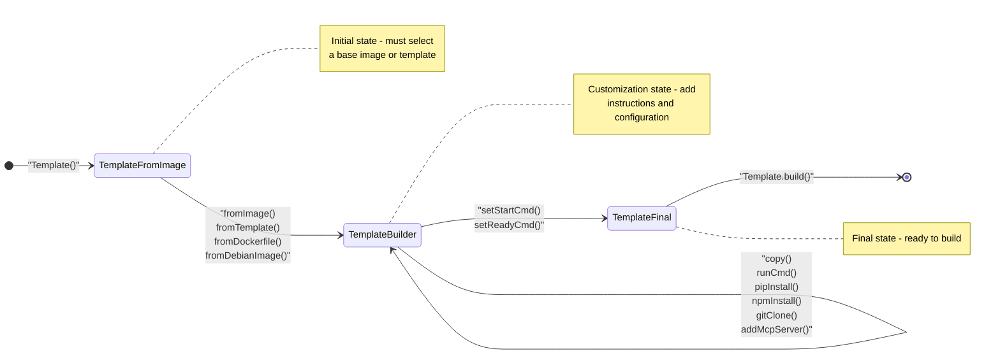
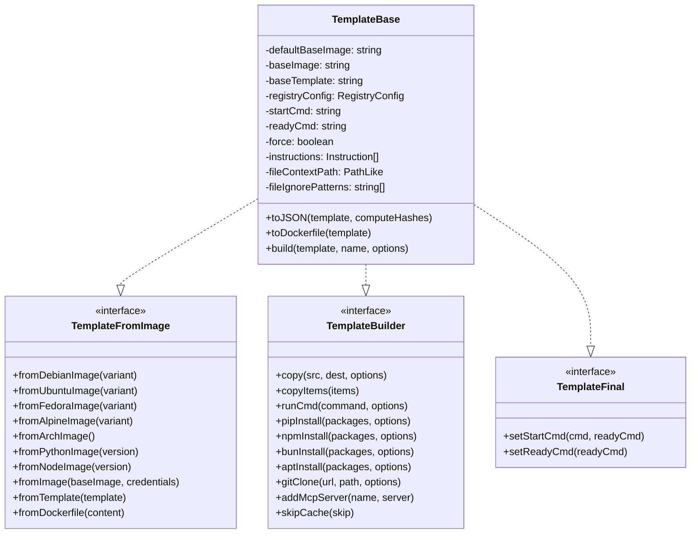
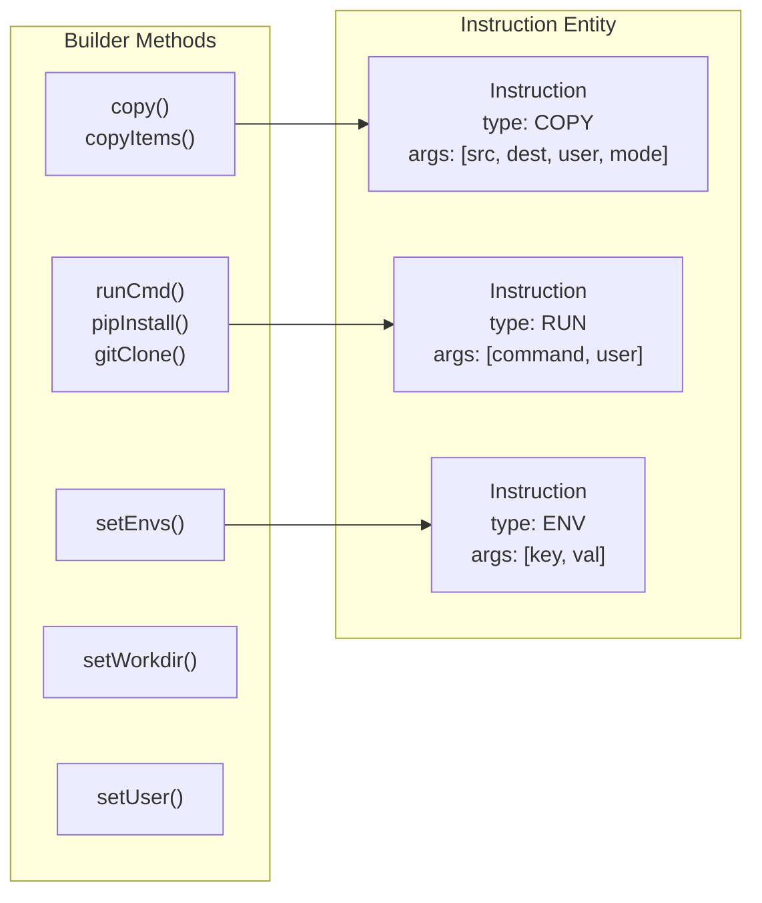
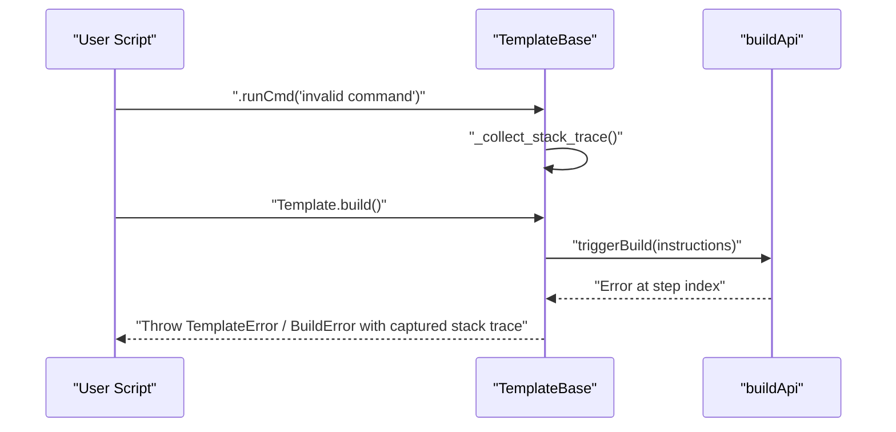

<!-- source: DeepWiki mcp.deepwiki.com · repo e2b-dev/E2B · page 4.1 Template Builder API · fetched 2026-10-29 -->

# Template Builder API

<details>
<summary>Relevant source files</summary>

The following files were used as context for generating this wiki page:

- [packages/js-sdk/src/template/consts.ts](packages/js-sdk/src/template/consts.ts)
- [packages/js-sdk/src/template/index.ts](packages/js-sdk/src/template/index.ts)
- [packages/js-sdk/src/template/types.ts](packages/js-sdk/src/template/types.ts)
- [packages/js-sdk/src/template/utils.ts](packages/js-sdk/src/template/utils.ts)
- [packages/js-sdk/tests/stripAnsi.test.ts](packages/js-sdk/tests/stripAnsi.test.ts)
- [packages/js-sdk/tests/template/stacktrace.test.ts](packages/js-sdk/tests/template/stacktrace.test.ts)
- [packages/python-sdk/e2b/template/consts.py](packages/python-sdk/e2b/template/consts.py)
- [packages/python-sdk/e2b/template/main.py](packages/python-sdk/e2b/template/main.py)
- [packages/python-sdk/e2b/template/types.py](packages/python-sdk/e2b/template/types.py)
- [packages/python-sdk/e2b/template/utils.py](packages/python-sdk/e2b/template/utils.py)
- [packages/python-sdk/tests/async/template_async/test_stacktrace.py](packages/python-sdk/tests/async/template_async/test_stacktrace.py)
- [packages/python-sdk/tests/shared/template/utils/test_strip_ansi_escape_codes.py](packages/python-sdk/tests/shared/template/utils/test_strip_ansi_escape_codes.py)
- [packages/python-sdk/tests/sync/template_sync/test_stacktrace.py](packages/python-sdk/tests/sync/template_sync/test_stacktrace.py)

</details>


The Template Builder API provides a **fluent interface** for defining E2B sandbox templates. It implements a type-safe builder pattern that guides developers through template construction using distinct states: selecting a base image, customizing the environment, and finalizing the template with startup commands.

This page documents the builder pattern interface, instruction types, state transitions, and the fluent API methods available for template construction. For information about the build execution process and caching, see [Build Process, Upload and Caching](#4.2). For Dockerfile conversion, see [Prebuilt Templates and Template CI](#4.4).

---

## Builder Pattern State Machine

The Template Builder API enforces a type-safe construction flow using three interface states that prevent invalid template configurations at compile time:



Sources: [packages/js-sdk/src/template/types.ts:231-388](), [packages/python-sdk/e2b/template/main.py:32-37]()

---

## Template Construction Classes and Interfaces

The builder pattern is implemented using `TemplateBase` in TypeScript, which implements all state interfaces concurrently while preserving type-safety via compile-time interface casting. In Python, `TemplateBuilder` manages method chaining and instruction collection atop `TemplateBase`.



**JavaScript Implementation:**
- Base class: [packages/js-sdk/src/template/index.ts:62-89]()
- State interfaces: [packages/js-sdk/src/template/types.ts:231-500]()

**Python Implementation:**
- Builder wrapper: [packages/python-sdk/e2b/template/main.py:32-40]()

Sources: [packages/js-sdk/src/template/index.ts:62-89](), [packages/python-sdk/e2b/template/main.py:32-40]()

---

## Instruction Types

Templates are built from core instruction types defined in `InstructionType` that map to container build operations:

| Instruction Type | Purpose | Generated By |
|-----------------|---------|--------------|
| `COPY` | Copy files from local filesystem into template | `copy()`, `copyItems()` |
| `RUN` | Execute shell commands during build | `runCmd()`, `pipInstall()`, `npmInstall()`, `aptInstall()`, `gitClone()`, etc. |
| `ENV` | Set environment variables | `setEnvs()` |
| `WORKDIR` | Change working directory | `setWorkdir()` |
| `USER` | Change user context | `setUser()` |



Each `Instruction` object encapsulates its type, argument list, and cache-control flags (`force`, `filesHash`, `resolveSymlinks`, `gzip`).

Sources: [packages/js-sdk/src/template/types.ts:188-207](), [packages/python-sdk/e2b/template/types.py:95-133]()

---

## Base Image Selection Methods

The `TemplateFromImage` interface provides methods for selecting the foundation of your template.

### Convenience Methods

| Method | Default Image | Example |
|--------|---------------|---------|
| `fromDebianImage(variant?)` | `debian:stable` | `fromDebianImage('bookworm')` |
| `fromUbuntuImage(variant?)` | `ubuntu:latest` | `fromUbuntuImage('24.04')` |
| `fromFedoraImage(variant?)` | `fedora:44` | `fromFedoraImage('44')` |
| `fromAlpineImage(variant?)` | `alpine:3.24` | `fromAlpineImage('3.24')` |
| `fromPythonImage(version?)` | `python:3` | `fromPythonImage('3.11')` |
| `fromNodeImage(version?)` | `node:lts` | `fromNodeImage('20')` |
| `fromBaseImage()` | `e2bdev/base` | E2B's default environment |

Sources: [packages/js-sdk/src/template/types.ts:231-318](), [packages/python-sdk/e2b/template/types.py:171-184]()

### Registry and Custom Images

For images in private registries or existing E2B templates:

- `fromTemplate(template: string)`: Inherits from an existing E2B template ID or name.
- `fromDockerfile(dockerfile: string)`: Parses and converts a Dockerfile string into template instructions using `parseDockerfile` [packages/js-sdk/src/template/index.ts:25]().
- `fromAWSRegistry(image: string, credentials: AWSRegistry)`: Authenticates against AWS ECR.
- `fromGCPRegistry(image: string, credentials: GCPRegistry)`: Authenticates against GCP GCR/Artifact Registry.

Sources: [packages/js-sdk/src/template/types.ts:320-388](), [packages/python-sdk/e2b/template/types.py:135-168]()

---

## Template Customization Methods

The `TemplateBuilder` interface provides methods to customize your template. All methods return the builder instance to enable method chaining.

### File Operations and Path Validation

| Method | Purpose | Arguments |
|--------|---------|-----------|
| `copy(src, dest, options?)` | Copy files into template | `src`: local path(s), `dest`: template path |
| `copyItems(items)` | Copy multiple files | List of `CopyItem` objects |
| `remove(path, options?)` | Remove files/dirs | `path`: path(s) to remove |
| `rename(src, dest, options?)` | Move/Rename | `src`, `dest` paths |

**Path Validation:** The `copy()` and `copyItems()` methods validate source paths via `validateRelativePath()` [packages/js-sdk/src/template/utils.ts:31-34](), [packages/python-sdk/e2b/template/utils.py:34-37]() to ensure they stay within the context directory (`fileContextPath`) and prevent path traversal attacks.

Sources: [packages/js-sdk/src/template/utils.ts:31-65](), [packages/python-sdk/e2b/template/utils.py:34-84](), [packages/python-sdk/e2b/template/main.py:42-208]()

### Command Execution, Package Installers, and Advanced Helpers

| Method | Purpose | Example |
|--------|---------|---------|
| `runCmd(command, options?)` | Execute shell command | `runCmd('apt-get update')` |
| `pipInstall(packages?, options?)` | Install Python packages | `pipInstall(['numpy', 'pandas'])` |
| `npmInstall(packages?, options?)` | Install Node.js packages | `npmInstall('express', { g: true })` |
| `bunInstall(packages?, options?)` | Install Bun packages | `bunInstall('typescript')` |
| `aptInstall(packages, options?)` | Install system packages | `aptInstall('curl')` |
| `gitClone(url, path?, options?)` | Clone Git repository | `gitClone('https://github.com/e2b-dev/E2B')` |
| `addMcpServer(name, server)` | Register an MCP server | `addMcpServer('github', ...)` |
| `skipCache(skip?)` | Force layer rebuild | `skipCache(true)` |

Sources: [packages/js-sdk/src/template/index.ts:668-851](), [packages/python-sdk/e2b/template/main.py:269-556]()

---

## Template Finalization

Templates must be finalized with a start command and readiness check before building.

### Start and Ready Commands

```typescript
setStartCmd(startCommand: string, readyCommand?: string | ReadyCmd): TemplateFinal
setReadyCmd(readyCommand: string | ReadyCmd): TemplateFinal
```

The `ReadyCmd` helper provides structured checks to determine when a sandbox is ready:
- `waitForPort(port)`: Wait for a TCP port to open.
- `waitForURL(url)`: Wait for an HTTP 200 response.
- `waitForFile(path)`: Wait for a specific file to exist.

Sources: [packages/js-sdk/src/template/readycmd.ts:1-48](), [packages/python-sdk/e2b/template/readycmd.py:12-61](), [packages/python-sdk/e2b/template/main.py:677-747]()

---

## Static Build Methods

The `Template` class provides static methods to normalize build arguments via `normalizeBuildArguments()` [packages/js-sdk/src/template/utils.ts:76-82](), [packages/python-sdk/e2b/template/utils.py:85-103]() and trigger the build process on E2B infrastructure.

```typescript
// Build and wait for completion
static async build(
    template: TemplateClass,
    name: string,
    options?: Omit<BuildOptions, 'alias'>
): Promise<BuildInfo>

// Build in background without waiting
static async buildInBackground(
    template: TemplateClass,
    name: string,
    options?: Omit<BuildOptions, 'alias'>
): Promise<BuildInfo>
```

The build pipeline execution flow:
1. `normalizeBuildArguments()` processes the target template name and tags [packages/js-sdk/src/template/utils.ts:76-101](), [packages/python-sdk/e2b/template/utils.py:85-103]().
2. `requestBuild` requests a build ID and template ID from the control plane [packages/python-sdk/tests/sync/template_sync/test_stacktrace.py:53-61]().
3. `calculateFilesHash()` computes local file hashes for context cache invalidation [packages/js-sdk/src/template/utils.ts:190-194](), [packages/python-sdk/e2b/template/utils.py:186-199]().
4. `getFileUploadLink` checks whether the build context archive needs uploading [packages/js-sdk/src/template/index.ts:17-17](), [packages/python-sdk/tests/sync/template_sync/test_stacktrace.py:66-69]().
5. `triggerBuild` initiates the container build process [packages/js-sdk/src/template/index.ts:19-19]().
6. `waitForBuildFinish` polls build status and streams logs [packages/js-sdk/src/template/index.ts:22-22]().

Sources: [packages/js-sdk/src/template/index.ts:135-216](), [packages/js-sdk/src/template/utils.ts:76-101](), [packages/python-sdk/e2b/template/utils.py:85-103]()

---

## Error Handling and Stack Traces

The Template Builder API preserves caller stack traces from the point of instruction definition. If a build fails at a specific step (e.g., a `RUN` or `COPY` command fails), the SDK reports the exact line in user code where that instruction was added.



**Implementation Details:**
- Stack collection captures caller frames via `get_caller_frame()` [packages/python-sdk/e2b/template/main.py:74-75]() and `make_traceback()` [packages/python-sdk/e2b/template/utils.py:17-31]().
- `stackTraces` internal array in `TemplateBase` maps instruction indices to their respective code call sites [packages/js-sdk/src/template/index.ts:80-80]().

Sources: [packages/js-sdk/src/template/index.ts:80-80](), [packages/python-sdk/e2b/template/main.py:74-75](), [packages/python-sdk/e2b/template/utils.py:17-31](), [packages/python-sdk/tests/sync/template_sync/test_stacktrace.py:51-113](), [packages/js-sdk/tests/template/stacktrace.test.ts:87-141]()

---

