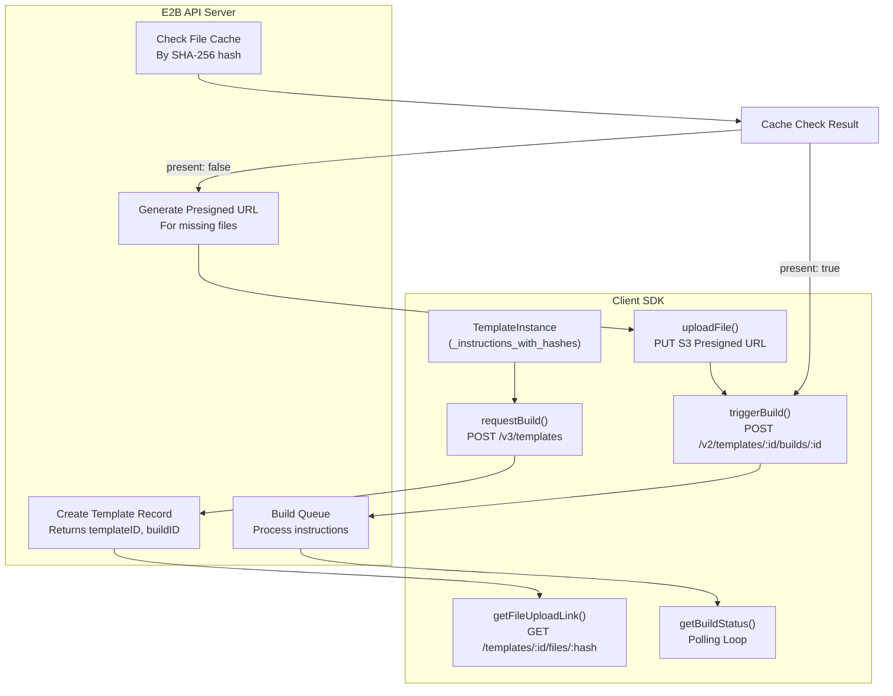
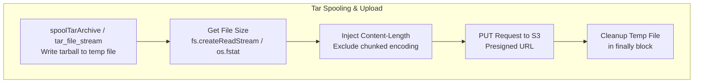
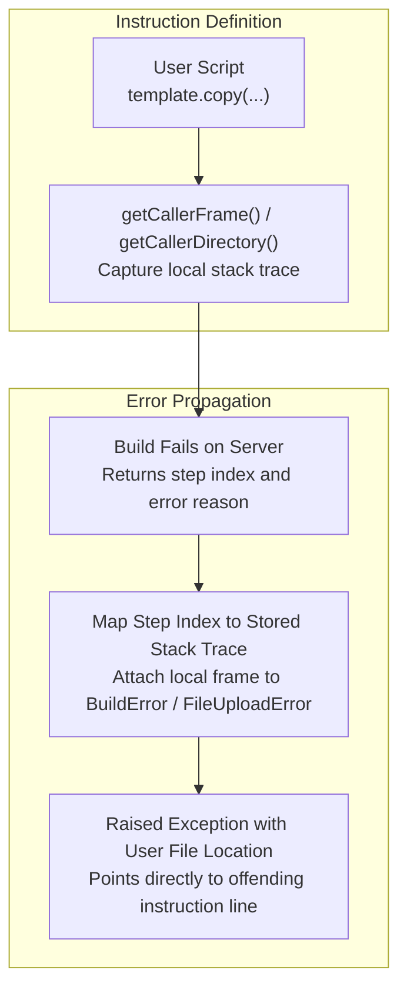

<!-- source: DeepWiki mcp.deepwiki.com · repo e2b-dev/E2B · page 4.2 Build Process, Upload and Caching · fetched 2026-10-29 -->

# Build Process, Upload and Caching

Relevant source files

The following files were used as context for generating this wiki page:

- [.changeset/azure-template-upload-headers.md](.changeset/azure-template-upload-headers.md)
- [packages/cli/tests/commands/template/migrate.test.ts](packages/cli/tests/commands/template/migrate.test.ts)
- [packages/js-sdk/src/template/buildApi.ts](packages/js-sdk/src/template/buildApi.ts)
- [packages/js-sdk/tests/template/build.test.ts](packages/js-sdk/tests/template/build.test.ts)
- [packages/js-sdk/tests/template/uploadFile.test.ts](packages/js-sdk/tests/template/uploadFile.test.ts)
- [packages/js-sdk/tests/template/utils/getAllFilesInPath.test.ts](packages/js-sdk/tests/template/utils/getAllFilesInPath.test.ts)
- [packages/js-sdk/tests/template/utils/getCallerDirectory.test.ts](packages/js-sdk/tests/template/utils/getCallerDirectory.test.ts)
- [packages/js-sdk/tests/template/utils/spoolTarArchive.test.ts](packages/js-sdk/tests/template/utils/spoolTarArchive.test.ts)
- [packages/python-sdk/e2b/template_async/build_api.py](packages/python-sdk/e2b/template_async/build_api.py)
- [packages/python-sdk/e2b/template_async/main.py](packages/python-sdk/e2b/template_async/main.py)
- [packages/python-sdk/e2b/template_sync/build_api.py](packages/python-sdk/e2b/template_sync/build_api.py)
- [packages/python-sdk/e2b/template_sync/main.py](packages/python-sdk/e2b/template_sync/main.py)
- [packages/python-sdk/tests/async/template_async/test_build.py](packages/python-sdk/tests/async/template_async/test_build.py)
- [packages/python-sdk/tests/async/template_async/test_upload_file.py](packages/python-sdk/tests/async/template_async/test_upload_file.py)
- [packages/python-sdk/tests/sync/template_sync/test_build.py](packages/python-sdk/tests/sync/template_sync/test_build.py)
- [packages/python-sdk/tests/sync/template_sync/test_upload_file.py](packages/python-sdk/tests/sync/template_sync/test_upload_file.py)

This page documents the template build pipeline implemented in `buildApi` (JavaScript SDK) and `build_api` (Python SDK). It covers file hashing, tar spooling, context uploads with exact content-length handling for S3 compatibility, layer cache invalidation, build status polling, and stack-trace mapping to user code. For information about the Template Builder API itself, see [Template Builder API](#4.1). For registry authentication and image pulling, see [Registries, Dockerfiles and Tags](#4.3).

## Overview and Build Pipeline Architecture

The E2B template build system implements a layer-based caching strategy similar to Docker. Each instruction creates an immutable layer that can be cached and reused across builds. The system uses SHA-256 file hashing to detect changes and optimize uploads, only transferring files that have been modified or are not already present on the server cache.

**Sources:** [packages/js-sdk/src/template/buildApi.ts:52-230](), [packages/python-sdk/e2b/template_async/main.py:35-189](), [packages/python-sdk/e2b/template_sync/main.py:35-189]()

---

## File Hashing, Context Uploads, and Tar Spooling

### Hashing and Context Filtering
The SDKs analyze local file contexts for `COPY` instructions by building file lists, applying `.dockerignore` patterns, and calculating SHA-256 `filesHash` values. Symlinks are handled according to the `resolveSymlinks` parameter (either following them or preserving them as link entries).

**Sources:** [packages/python-sdk/e2b/template_async/main.py:97-116](), [packages/python-sdk/e2b/template_sync/main.py:97-116](), [packages/js-sdk/tests/template/utils/getAllFilesInPath.test.ts:1-82]()

### S3 Compatibility and Transfer-Encoding Fix
S3 presigned `PUT` URLs reject `Transfer-Encoding: chunked` requests with a `501 NotImplemented` error (`e2b-dev/e2b#1243`). To ensure compatibility:
1. The SDKs spool the build context archive to a temporary file on disk using `spoolTarArchive` (JavaScript) or `tar_file_stream` (Python).
2. The exact file size (`Content-Length`) is determined via file stats (`os.fstat` or Node stream lengths).
3. In JavaScript, `loadUndici()` or global `fetch` streams the file from disk with an explicit `Content-Length` header and `duplex: 'half'` mode. In Python, `httpx` with `pyqwest` streams chunks from the spooled temp file.

**Sources:** [packages/js-sdk/src/template/buildApi.ts:138-211](), [packages/python-sdk/e2b/template_async/build_api.py:130-178](), [packages/python-sdk/e2b/template_sync/build_api.py:128-176](), [packages/js-sdk/tests/template/uploadFile.test.ts:9-80]()

---

## Cache Invalidation and Layer Cache Control

Templates support fine-grained cache control at both the global build level and instruction level:
- **`skipCache` / `skip_cache`**: When enabled on a build call, it sets `_force = True` on the template instance, forcing the build worker to ignore all cached layers and rebuild from scratch.
- **`forceUpload`**: Bypasses the server-side cache check for individual `COPY` instructions, forcing re-upload of archive files.
- **`filesHash`**: Used by the E2B control plane to verify whether file layers already exist on the storage backend (`present: true`).

**Sources:** [packages/python-sdk/e2b/template_async/main.py:58-63](), [packages/python-sdk/e2b/template_sync/main.py:58-63](), [packages/js-sdk/src/template/buildApi.ts:80-128]()

---

## Build Status Polling and Logs

Once files are uploaded and the build is triggered via `triggerBuild` (`POST /v2/templates/{templateID}/builds/{buildID}`), the SDK polls build status through `getBuildStatus` / `wait_for_build_finish`.

| Build Status | Description |
|--------------|-------------|
| `building` | Build is actively executing instructions on a worker node. |
| `ready` | Build finished successfully; template image is pushed and ready. |
| `error` | Build encountered an error; contains step information and failure reason. |

**Sources:** [packages/js-sdk/src/template/buildApi.ts:213-236](), [packages/python-sdk/e2b/template_async/main.py:185-210](), [packages/python-sdk/e2b/template_sync/main.py:185-210]()

---

## Stack-Trace Mapping to User Code

To provide actionable debugging information when a build fails on the remote builder, E2B captures local call stack frames when template instructions are defined.

- **JavaScript SDK**: Passes `stackTrace` parameters through `getFileUploadLink` and `uploadFile` to associate API errors with user code frames.
- **Python SDK**: Uses `.with_traceback(stack_trace)` when raising `FileUploadException` or `BuildException` to preserve the originating user code line.

**Sources:** [packages/js-sdk/src/template/buildApi.ts:80-109](), [packages/python-sdk/e2b/template_async/main.py:118-125](), [packages/python-sdk/e2b/template_sync/main.py:118-125](), [packages/js-sdk/tests/template/utils/getCallerDirectory.test.ts:1-37]()

---

