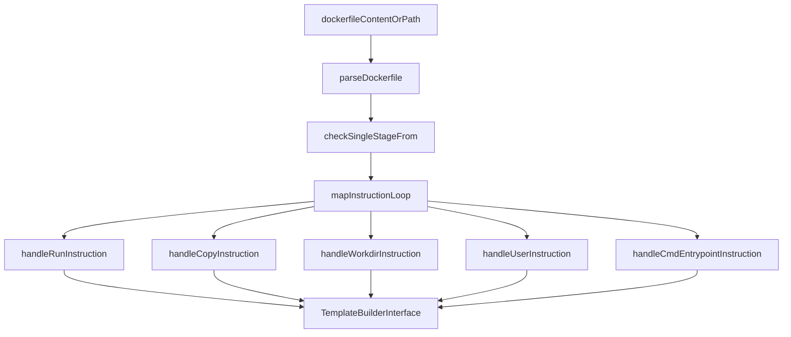
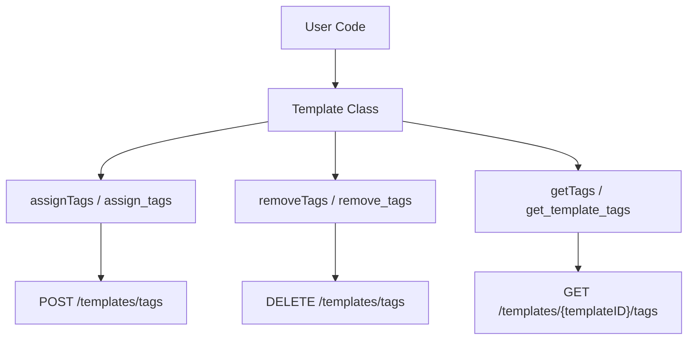

<!-- source: DeepWiki mcp.deepwiki.com · repo e2b-dev/E2B · page 4.3 Registries, Dockerfiles and Tags · fetched 2026-10-29 -->

# Registries, Dockerfiles and Tags

Relevant source files

The following files were used as context for generating this wiki page:

- [packages/cli/tests/commands/sandbox/exec_close_stdin.test.ts](packages/cli/tests/commands/sandbox/exec_close_stdin.test.ts)
- [packages/cli/tests/commands/sandbox/exec_stdin_flag.test.ts](packages/cli/tests/commands/sandbox/exec_stdin_flag.test.ts)
- [packages/js-sdk/src/template/dockerfileParser.ts](packages/js-sdk/src/template/dockerfileParser.ts)
- [packages/js-sdk/tests/template/boundOpts.test.ts](packages/js-sdk/tests/template/boundOpts.test.ts)
- [packages/js-sdk/tests/template/methods/fromDockerfile.test.ts](packages/js-sdk/tests/template/methods/fromDockerfile.test.ts)
- [packages/js-sdk/tests/template/tags.test.ts](packages/js-sdk/tests/template/tags.test.ts)
- [packages/python-sdk/e2b/template/dockerfile_parser.py](packages/python-sdk/e2b/template/dockerfile_parser.py)
- [packages/python-sdk/tests/async/template_async/methods/test_from_dockerfile.py](packages/python-sdk/tests/async/template_async/methods/test_from_dockerfile.py)
- [packages/python-sdk/tests/async/template_async/test_bound_api_params.py](packages/python-sdk/tests/async/template_async/test_bound_api_params.py)
- [packages/python-sdk/tests/async/template_async/test_tags.py](packages/python-sdk/tests/async/template_async/test_tags.py)
- [packages/python-sdk/tests/sync/template_sync/methods/test_from_dockerfile.py](packages/python-sdk/tests/sync/template_sync/methods/test_from_dockerfile.py)
- [packages/python-sdk/tests/sync/template_sync/test_bound_api_params.py](packages/python-sdk/tests/sync/template_sync/test_bound_api_params.py)
- [packages/python-sdk/tests/sync/template_sync/test_tags.py](packages/python-sdk/tests/sync/template_sync/test_tags.py)

## Purpose and Scope

This page details the integration of container registries, Dockerfile parsing, and template tagging within the E2B infrastructure. It covers the `RegistryConfig` variants (generic Docker registries, AWS ECR, and GCP GAR/GCR), the implementation of Dockerfile parsing and instruction conversion across both the TypeScript and Python SDKs (`parseDockerfile`), and template tag assignment, removal, and lookup utilities (`Template.assignTags`, `Template.getTags`, `Template.removeTags`).

Sources: [packages/js-sdk/src/template/dockerfileParser.ts:1-166](), [packages/python-sdk/e2b/template/dockerfile_parser.py:55-144](), [packages/js-sdk/src/template/types.ts:678-716]()

---

## 1. Registry Configuration Variants (`RegistryConfig`)

E2B templates support pulling base images from private or public container registries by supplying a registry configuration object (`RegistryConfig`). The control plane and build service recognize three primary authentication variants:

| Registry Type | Internal Type Identifier | Required Configuration Fields | Use Case |
|--------------|--------------------------|-------------------------------|----------|
| Generic Docker | `registry` | `username`, `password` | DockerHub, self-hosted registries, private mirrors with basic auth |
| AWS ECR | `aws` | `awsAccessKeyId`, `awsSecretAccessKey`, `awsRegion` | AWS Elastic Container Registry (ECR) |
| GCP GAR/GCR | `gcp` | `serviceAccountJson` | Google Cloud Artifact Registry (GAR) or Container Registry (GCR) |

These configurations are serialized into the template build payload when invoking image-based template instantiation.

Sources: [packages/js-sdk/src/template/types.ts:678-716](), [packages/python-sdk/e2b/template/types.py:1-93]()

---

## 2. Dockerfile Parsing and Conversion

Both the JavaScript SDK and Python SDK provide robust Dockerfile ingestion via `parseDockerfile`. This function parses raw Dockerfile content or file paths into native E2B template builder instructions (`RUN`, `COPY`, `WORKDIR`, `USER`, `ENV`, `CMD`).

### Implementation Details

1. **Input Resolution**: The parser checks whether the input string is a valid file path using `fs.existsSync` / `os.path.isfile`; if so, it reads the file contents; otherwise, it treats the input string directly as Dockerfile syntax [packages/js-sdk/src/template/dockerfileParser.ts:48-68](), [packages/python-sdk/e2b/template/dockerfile_parser.py:68-75]().
2. **AST Parsing**: It utilizes `dockerfile-ast` in TypeScript and `dockerfile_parse` in Python to construct a structural representation of instructions [packages/js-sdk/src/template/dockerfileParser.ts:70-71](), [packages/python-sdk/e2b/template/dockerfile_parser.py:84]().
3. **Multi-Stage Validation**: Multi-stage builds (containing more than one `FROM` instruction) are explicitly unsupported and raise an error [packages/js-sdk/src/template/dockerfileParser.ts:74-80](), [packages/python-sdk/e2b/template/dockerfile_parser.py:86-94]().
4. **Instruction Mapping**:
   - `FROM`: Extracts the base image, stripping any `AS` alias clauses [packages/js-sdk/src/template/dockerfileParser.ts:86-94](), [packages/python-sdk/e2b/template/dockerfile_parser.py:100-104]().
   - `RUN`: Normalizes line continuations and appends a `runCmd` instruction [packages/js-sdk/src/template/dockerfileParser.ts:168-179](), [packages/python-sdk/e2b/template/dockerfile_parser.py:147-155]().
   - `COPY` / `ADD`: Parses source and destination paths, extracts `--chown` flags, and expands multi-source copies into individual instruction entries [packages/js-sdk/src/template/dockerfileParser.ts:181-203](), [packages/python-sdk/e2b/template/dockerfile_parser.py:158-198]().
   - `WORKDIR` / `USER`: Tracks explicit modifications and applies defaults (`root` user and `/` workdir initially, followed by E2B runtime defaults `user` and `/home/user` if not overridden) [packages/js-sdk/src/template/dockerfileParser.ts:96-161](), [packages/python-sdk/e2b/template/dockerfile_parser.py:108-143]().

**Diagram: `parseDockerfile` Code Entity Flow**

Sources: [packages/js-sdk/src/template/dockerfileParser.ts:1-228](), [packages/python-sdk/e2b/template/dockerfile_parser.py:55-198]()

---

## 3. Template Tag Assignment and Lookup

E2B templates support semantic versioning and tagging via static methods on the `Template` class (and `TemplateBase` / `AsyncTemplate`). Tags link human-readable specifiers (e.g., `production`, `v1.0`) to immutable `buildID` records.

### Core Operations

- **`assignTags` / `assign_tags`**: Binds one or more tags to a template build target (expressed as `alias:tag` or template identifier). Validates tag string formats and posts updates to the control plane API [packages/js-sdk/tests/template/tags.test.ts:67-83](), [packages/python-sdk/tests/sync/template_sync/test_tags.py:15-60]().
- **`removeTags` / `remove_tags`**: Disassociates specified tags from a template name [packages/js-sdk/tests/template/tags.test.ts:85-105](), [packages/python-sdk/tests/sync/template_sync/test_tags.py:62-108]().
- **`getTags` / `get_template_tags`**: Fetches all active tags, associated build IDs, and creation timestamps for a given template ID [packages/js-sdk/tests/template/tags.test.ts:107-122](), [packages/python-sdk/tests/sync/template_sync/test_tags.py:110-161]().

**Diagram: Template Tag Management API Flow**

Sources: [packages/js-sdk/tests/template/tags.test.ts:1-123](), [packages/python-sdk/tests/sync/template_sync/test_tags.py:1-161]()

---

