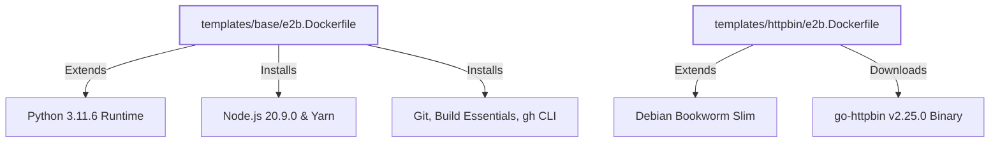
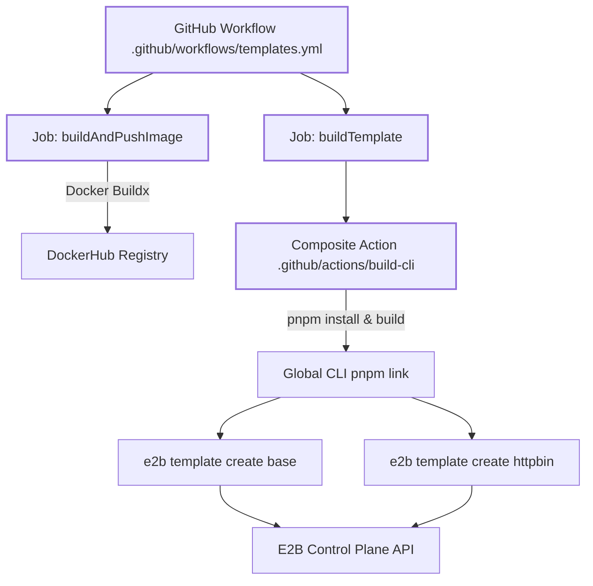

<!-- source: DeepWiki mcp.deepwiki.com · repo e2b-dev/E2B · page 4.4 Prebuilt Templates and Template CI · fetched 2026-10-29 -->

# Prebuilt Templates and Template CI

Relevant source files

The following files were used as context for generating this wiki page:

- [.github/actions/build-cli/action.yml](.github/actions/build-cli/action.yml)
- [.github/workflows/pkg_artifacts.yml](.github/workflows/pkg_artifacts.yml)
- [.github/workflows/templates.yml](.github/workflows/templates.yml)
- [packages/js-sdk/tests/template.ts](packages/js-sdk/tests/template.ts)
- [templates/base/e2b.Dockerfile](templates/base/e2b.Dockerfile)
- [templates/httpbin/e2b.Dockerfile](templates/httpbin/e2b.Dockerfile)

This page details the prebuilt sandbox templates located in the `templates/` directory (`base` and `httpbin`) and the automated GitHub Actions workflow responsible for building, testing, and publishing them [.github/workflows/templates.yml:1-80](). These prebuilt templates serve as the foundational execution environments for E2B sandboxes and support internal SDK integration tests [packages/js-sdk/tests/template.ts:3-7]().

---

## 1. Prebuilt Template Specifications

E2B maintains core templates that ship with pre-configured developer tooling, runtimes, and utility binaries. 

### Base Template (`templates/base`)
The `base` template acts as the primary default environment for Python and Node.js execution. It is defined in `templates/base/e2b.Dockerfile` [templates/base/e2b.Dockerfile:1-58]() and incorporates:
- **Base Image:** `python:3.11.6` [templates/base/e2b.Dockerfile:1-1]()
- **System Utilities:** `build-essential`, `curl`, `git`, `util-linux`, `libbluetooth-dev`, `tk-dev`, `uuid-dev`, and the GitHub CLI (`gh`) [templates/base/e2b.Dockerfile:4-8]().
- **Node.js Environment:** Installs Node.js version `20.9.0` (validated across architectures using GnuPG release key verification) and symlinks `node` to `nodejs` [templates/base/e2b.Dockerfile:12-56]().
- **Package Managers:** Installs `yarn` (`1.22.19`) globally [templates/base/e2b.Dockerfile:57-58]().

### Httpbin Template (`templates/httpbin`)
The `httpbin` template is a specialized sidecar environment used by SDK network egress and firewall transformation tests [templates/httpbin/e2b.Dockerfile:1-10](), [packages/js-sdk/tests/template.ts:3-7](). It provides a publicly reachable echo server without relying on external services [templates/httpbin/e2b.Dockerfile:5-7]().
- **Base Image:** `debian:bookworm-slim` [templates/httpbin/e2b.Dockerfile:11-11]()
- **Binary:** Downloads and verifies the static `go-httpbin` binary (`v2.25.0`) for `amd64` and `arm64` architectures using SHA-256 checksum validation [templates/httpbin/e2b.Dockerfile:13-29]().

*Sources: [templates/base/e2b.Dockerfile:1-58](), [templates/httpbin/e2b.Dockerfile:1-32](), [packages/js-sdk/tests/template.ts:1-7]()*

---

## 2. Template Build and Publish CI Pipeline

The CI workflow [.github/workflows/templates.yml:1-80]() automates the compilation, testing, and registration of templates via `workflow_dispatch` [github/workflows/templates.yml:4-15]().

### Workflow Trigger and Inputs
The workflow can be triggered manually for all templates or a specific subset (`base`, `httpbin`) [.github/workflows/templates.yml:3-15]().

### Jobs Breakdown

1. **`buildAndPushImage`**:
   - Targets only the `base` template to push a multi-architecture (`linux/amd64`, `linux/arm64`) Docker image to DockerHub via Docker Buildx [.github/workflows/templates.yml:20-49]().

2. **`buildTemplate`**:
   - Sets up the E2B CLI from source using the composite action `.github/actions/build-cli/action.yml` [.github/workflows/templates.yml:50-58](), [.github/actions/build-cli/action.yml:1-44]().
   - **Base Template Registration**: Executes `e2b template create base --memory-mb 512` using `E2B_API_KEY` [.github/workflows/templates.yml:60-65]().
   - **Httpbin Template Registration**: Executes `e2b template create httpbin` with a custom start command (`--cmd`) and ready verification command (`--ready-cmd`) which asserts that `go-httpbin` successfully responds on port `8080` before the build completes [.github/workflows/templates.yml:72-80]().

*Sources: [.github/workflows/templates.yml:1-80](), [.github/actions/build-cli/action.yml:1-44]()*

---

