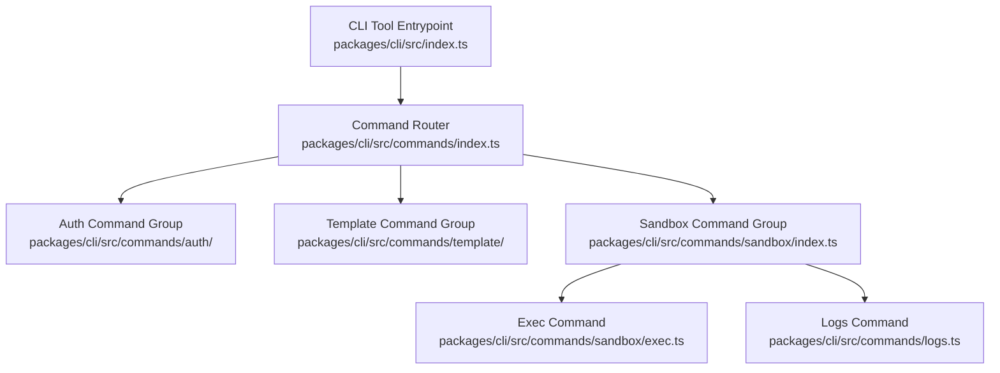
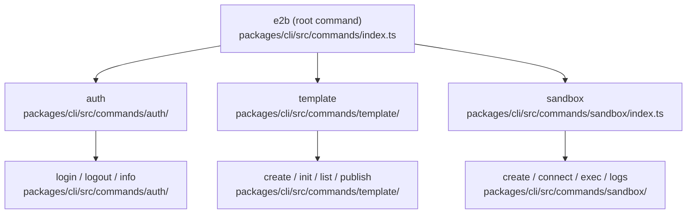

<!-- source: DeepWiki mcp.deepwiki.com · repo e2b-dev/E2B · page 5 CLI Tool · fetched 2026-10-29 -->

# CLI Tool

Relevant source files

The following files were used as context for generating this wiki page:

- [CONTRIBUTING.md](CONTRIBUTING.md)
- [README.md](README.md)
- [packages/cli/README.md](packages/cli/README.md)
- [packages/cli/src/commands/index.ts](packages/cli/src/commands/index.ts)
- [packages/cli/src/commands/sandbox/exec.ts](packages/cli/src/commands/sandbox/exec.ts)
- [packages/cli/src/commands/sandbox/exec_helpers.ts](packages/cli/src/commands/sandbox/exec_helpers.ts)
- [packages/cli/src/commands/sandbox/index.ts](packages/cli/src/commands/sandbox/index.ts)
- [packages/cli/src/commands/sandbox/logs.ts](packages/cli/src/commands/sandbox/logs.ts)
- [packages/cli/src/commands/sandbox/utils.ts](packages/cli/src/commands/sandbox/utils.ts)
- [packages/cli/src/index.ts](packages/cli/src/index.ts)
- [packages/cli/tests/commands/sandbox/exec_helpers.test.ts](packages/cli/tests/commands/sandbox/exec_helpers.test.ts)
- [packages/cli/tests/commands/sandbox/exec_passthrough.test.ts](packages/cli/tests/commands/sandbox/exec_passthrough.test.ts)
- [packages/js-sdk/README.md](packages/js-sdk/README.md)
- [packages/python-sdk/README.md](packages/python-sdk/README.md)

The E2B CLI (`@e2b/cli`) is the command-line interface for managing sandbox templates, running sandboxes, and authenticating with the E2B platform [packages/cli/README.md:9-11](). Implemented as a TypeScript package in [packages/cli/](), the CLI uses `commander.js` [packages/cli/src/index.ts:4]() and relies on the underlying JavaScript SDK (`e2b`) to perform operations such as template creation, sandbox execution, and terminal connection [packages/cli/src/commands/sandbox/exec.ts:5]().

For a high-level view of the SDK architecture, see [JavaScript SDK](#2). For details on the template build pipeline, see [Template System](#4).

## Overview and Package Structure

The CLI package entry point initializes the CLI program, checks for package updates via `simple-update-notifier`, and parses arguments through `commander` [packages/cli/src/index.ts:1-44](). The root command configures sub-commands for authentication (`auth`), templates (`template`), and sandboxes (`sandbox`) [packages/cli/src/commands/index.ts:8-25]().

**Diagram: CLI Package to Code Entities**

**Sources:** [packages/cli/src/index.ts:1-44](), [packages/cli/src/commands/index.ts:1-25](), [packages/cli/src/commands/sandbox/index.ts:1-30]()

## Command Tree and Child Pages

The E2B CLI command tree is divided into three primary resource domains: authentication, templates, and sandboxes [packages/cli/src/commands/index.ts:23-25](). 

**Diagram: Command Tree Structure**

**Sources:** [packages/cli/src/commands/index.ts:1-25](), [packages/cli/src/commands/sandbox/index.ts:1-30]()

### 1. CLI Configuration and Authentication
The CLI handles user credentials through interactive login flows or non-interactive environment variables (`E2B_API_KEY`, `E2B_ACCESS_TOKEN`), storing persistent configuration securely [packages/cli/README.md:27-38](). 

For full details on authentication commands, credential storage, and environment hierarchies, see [CLI Configuration and Authentication](#5.1).

**Sources:** [packages/cli/README.md:27-38]()

### 2. Template Commands
Template commands manage sandbox build definitions, initialization from Dockerfiles, publishing, and migration [packages/cli/src/commands/index.ts:14-16](). 

For details on building templates via `template create`, scaffolding, and prompts, see [Template Commands](#5.2).

**Sources:** [packages/cli/src/commands/index.ts:14-16]()

### 3. Sandbox Commands
Sandbox commands provide runtime inspection and interaction, including listing active instances, attaching PTY terminals via `sandbox connect`, streaming filtered logs [packages/cli/src/commands/sandbox/logs.ts:48-62](), metrics inspection, and executing commands with stdin piping (`sandbox exec`) [packages/cli/src/commands/sandbox/exec.ts:21-41]().

For detailed documentation on sandbox lifecycle actions, see [Sandbox Commands](#5.3).

**Sources:** [packages/cli/src/commands/sandbox/logs.ts:48-62](), [packages/cli/src/commands/sandbox/exec.ts:21-41]()

### 4. CLI Testing
The CLI codebase includes comprehensive unit and integration tests under the `tests/` directory, verifying helper functions and command execution paths.

For details on the test suites, Vitest setup, and testground fixtures, see [CLI Testing](#5.4).

**Sources:** [packages/cli/src/index.ts:1-44]()

---

