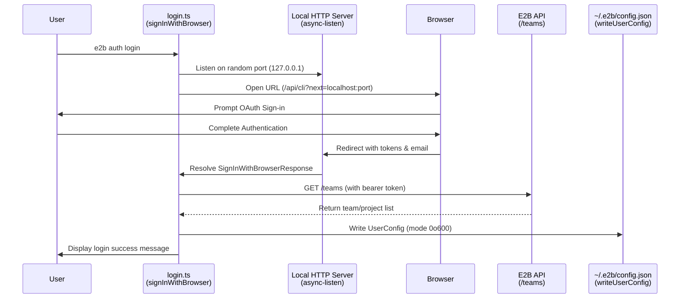

<!-- source: DeepWiki mcp.deepwiki.com · repo e2b-dev/E2B · page 5.1 CLI Configuration and Authentication · fetched 2026-10-29 -->

# CLI Configuration and Authentication

<details>
<summary>Relevant source files</summary>

The following files were used as context for generating this wiki page:

- [packages/cli/src/api.ts](packages/cli/src/api.ts)
- [packages/cli/src/commands/auth/configure.ts](packages/cli/src/commands/auth/configure.ts)
- [packages/cli/src/commands/auth/index.ts](packages/cli/src/commands/auth/index.ts)
- [packages/cli/src/commands/auth/info.ts](packages/cli/src/commands/auth/info.ts)
- [packages/cli/src/commands/auth/login.ts](packages/cli/src/commands/auth/login.ts)
- [packages/cli/src/commands/auth/logout.ts](packages/cli/src/commands/auth/logout.ts)
- [packages/cli/src/commands/template/delete.ts](packages/cli/src/commands/template/delete.ts)
- [packages/cli/src/commands/template/publish.ts](packages/cli/src/commands/template/publish.ts)
- [packages/cli/src/config/index.ts](packages/cli/src/config/index.ts)
- [packages/cli/src/options.ts](packages/cli/src/options.ts)
- [packages/cli/src/user.ts](packages/cli/src/user.ts)
- [packages/cli/src/utils/errors.ts](packages/cli/src/utils/errors.ts)
- [packages/cli/src/utils/format.ts](packages/cli/src/utils/format.ts)
- [packages/cli/tests/attribution.test.ts](packages/cli/tests/attribution.test.ts)
- [packages/cli/tests/commands/template/create.test.ts](packages/cli/tests/commands/template/create.test.ts)
- [packages/cli/tests/user_config_permissions.test.ts](packages/cli/tests/user_config_permissions.test.ts)
- [packages/cli/tests/utils/errors.test.ts](packages/cli/tests/utils/errors.test.ts)

</details>


This document covers the E2B command-line interface (`@e2b/cli`) configuration management, authentication workflows (`auth login`, `auth logout`, `auth info`, `auth configure`), user configuration storage with secure file permissions, configuration hierarchy (`e2b.toml`, environment variables, and CLI flags), and the underlying API client wiring and formatting utilities.

Sources: [packages/cli/src/api.ts:1-88](), [packages/cli/src/user.ts:1-154](), [packages/cli/src/config/index.ts:1-64]()

---

## User Configuration Storage and File Permissions

The CLI stores user identity, OAuth tokens, and active project credentials in a persistent JSON configuration file located at `~/.e2b/config.json` (`USER_CONFIG_PATH`) [packages/cli/src/user.ts:37]().

The configuration is structured around the `UserConfig` interface [packages/cli/src/user.ts:23-33]():
* `version`: Config schema version (currently `2`) [packages/cli/src/user.ts:24]().
* `identity`: User email info (`UserIdentity`) [packages/cli/src/user.ts:8-10]().
* `oauth`: OAuth endpoints and client ID (`UserOAuth`) [packages/cli/src/user.ts:12-16]().
* `tokens`: Access and refresh tokens (`UserTokens`) [packages/cli/src/user.ts:18-21]().
* `projectName`, `projectId`, `projectApiKey`: Active project context [packages/cli/src/user.ts:29-31]().

Because this file contains sensitive credentials and API keys, `writeUserConfig()` enforces restrictive Unix file permissions [packages/cli/src/user.ts:148-154]():
1. The parent directory `~/.e2b` is created with mode `0o700` (`fs.mkdirSync` and `fs.chmodSync`) [packages/cli/src/user.ts:150-151]().
2. The config file `config.json` is written with mode `0o600` (owner-readable and writable only) [packages/cli/src/user.ts:152-153]().

Additionally, `getUserConfig()` handles backward compatibility by migrating legacy version 1 configurations (which used `teamId` naming) to version 2 (`projectId`) in-memory [packages/cli/src/user.ts:117-137]().

Sources: [packages/cli/src/user.ts:1-154]()

---

## Authentication Commands (`auth login`, `logout`, `info`, `configure`)

The CLI provides authentication commands under `e2b auth`:

* **`e2b auth login`**: Initiates an interactive browser-based OAuth login flow [packages/cli/src/commands/auth/login.ts:20-96](). It spawns a local HTTP server on a random port using `async-listen` [packages/cli/src/commands/auth/login.ts:108-109](), opens the user's browser to the docs authentication endpoint with a `next` callback parameter [packages/cli/src/commands/auth/login.ts:110-112](), captures the returned tokens (`SignInWithBrowserResponse`) [packages/cli/src/commands/auth/login.ts:98-149](), fetches the user's projects via `ApiClient` [packages/cli/src/commands/auth/login.ts:48-57](), selects the default project, and persists the result using `writeUserConfig()` [packages/cli/src/commands/auth/login.ts:59-87]().
* **`e2b auth configure`**: Allows users to switch their active project interactively [packages/cli/src/commands/auth/configure.ts:16-70](). It validates the current access token via `ensureValidAccessToken()` [packages/cli/src/commands/auth/configure.ts:33](), fetches available teams/projects from the API [packages/cli/src/commands/auth/configure.ts:41](), prompts the user via `inquirer` [packages/cli/src/commands/auth/configure.ts:48-60](), and updates `UserConfig` on disk [packages/cli/src/commands/auth/configure.ts:63-67]().
* **`e2b auth info`**: Displays the currently logged-in user and active project formatted via `asFormattedConfig()` [packages/cli/src/utils/format.ts:11-18]().
* **`e2b auth logout`**: Clears or unlinks local user configuration credentials.



Sources: [packages/cli/src/commands/auth/login.ts:20-169](), [packages/cli/src/commands/auth/configure.ts:16-70](), [packages/cli/src/user.ts:148-154]()

---

## Configuration Hierarchy (`e2b.toml`, Environment Variables, and CLI Flags)

The CLI resolves projects, API keys, and configuration parameters through a structured precedence order:

1. **CLI Flags** (highest priority) — e.g., `--project <project-id>` [packages/cli/src/api.ts:68-69]() or `--path` [packages/cli/src/options.ts:42-47]().
2. **Environment Variables** — `E2B_API_KEY`, `E2B_PROJECT_ID` (or deprecated `E2B_TEAM_ID`) [packages/cli/src/api.ts:15-16]().
3. **User Configuration (`~/.e2b/config.json`)** — Loaded via `getUserConfig()` [packages/cli/src/user.ts:56-78]().

### Project ID Resolution

The function `resolveProjectId()` implements this exact precedence hierarchy [packages/cli/src/api.ts:68-76]():
```typescript
export function resolveProjectId(cliProjectId?: string): string | undefined {
  if (cliProjectId) return cliProjectId
  if (projectId) return projectId
  if (!process.env.E2B_API_KEY) {
    const config = getUserConfig()
    return config?.projectId
  }
  return undefined
}
```
If `E2B_API_KEY` is present in the environment, fallback to the config file project ID is bypassed to prevent credential-project mismatches [packages/cli/src/api.ts:71-74]().

### Local Template Configuration (`e2b.toml`)

For commands operating on local templates (such as `template migrate`), the CLI loads configuration files named `e2b.toml` using `loadConfig()` [packages/cli/src/config/index.ts:52-58](). 
* The schema is validated using `yup` (`configSchema`) [packages/cli/src/config/index.ts:8-16]():
  * `template_id` (string, required) [packages/cli/src/config/index.ts:9]()
  * `template_name` (string, optional) [packages/cli/src/config/index.ts:10]()
  * `dockerfile` (string, required) [packages/cli/src/config/index.ts:11]()
  * `start_cmd` / `ready_cmd` (string, optional) [packages/cli/src/config/index.ts:12-13]()
  * `cpu_count` / `memory_mb` (integer limits) [packages/cli/src/config/index.ts:14-15]()
* Automatic field migrations (`applyMigrations()`) convert legacy keys (such as `id` -> `template_id`, `name` -> `template_name`) during parsing [packages/cli/src/config/index.ts:27-50]().
* Most modern template commands ignore local `e2b.toml` files in favor of arguments and flags (`warnIgnoredConfigOption()`) [packages/cli/src/options.ts:68-78]().

```mermaid
graph TD
    [Start] "Configuration Request"
    [CLI_Flag] "CLI Flag Provided?<br/>(e.g., --project)"
    [Env_Var] "Environment Variable Set?<br/>(E2B_PROJECT_ID / E2B_API_KEY)"
    [User_Config] "User Config Exists?<br/>(~/.e2b/config.json)"
    [TOML_Config] "Local e2b.toml?<br/>(loadConfig / configSchema)"

    [Use_CLI] "Use CLI Flag Value"
    [Use_Env] "Use Environment Variable"
    [Use_User] "Use UserConfig Object"
    [Use_Toml] "Use Validated E2BConfig"

    [Start] --> [CLI_Flag]
    [CLI_Flag] -->|Yes| [Use_CLI]
    [CLI_Flag] -->|No| [Env_Var]

    [Env_Var] -->|Yes| [Use_Env]
    [Env_Var] -->|No| [User_Config]

    [User_Config] -->|Yes| [Use_User]
    [User_Config] -->|No| [TOML_Config]

    [TOML_Config] -->|Found| [Use_Toml]
    [TOML_Config] -->|Missing| [Error]
```

Sources: [packages/cli/src/api.ts:68-76](), [packages/cli/src/options.ts:42-111](), [packages/cli/src/config/index.ts:1-64]()

---

## API Client and Formatting Utilities

### API Client Wiring

The CLI instantiates a shared connection and API client in `packages/cli/src/api.ts` [packages/cli/src/api.ts:80-88]():
* **`connectionConfig`**: An instance of `e2b.ConnectionConfig` initialized with `process.env.E2B_API_KEY` or `userConfig.projectApiKey` [packages/cli/src/api.ts:80-82](). It also automatically registers the CLI version integration string (`e2b-cli/${version}`) prior to client construction [packages/cli/src/api.ts:10]().
* **`client`**: An instance of `e2b.ApiClient` constructed with `requireApiKey: false` [packages/cli/src/api.ts:86-88](), allowing unauthenticated or token-authenticated discovery commands (like `e2b auth login` and listing teams) to execute successfully without throwing pre-flight validation errors.
* **`ensureAPIKey()`**: Validates that an API key is present (either from environment variables or `UserConfig`), otherwise rendering `authErrorBox()` and exiting with status `1` [packages/cli/src/api.ts:37-50]().

### Formatting and Error Utilities

* **`packages/cli/src/utils/format.ts`**: Provides display helpers using `chalk`, `boxen`, and `cli-highlight` [packages/cli/src/utils/format.ts:1-140](). Key formatting functions include `asFormattedConfig()` [packages/cli/src/utils/format.ts:11-18](), `asFormattedTeam()` [packages/cli/src/utils/format.ts:20-29](), `asFormattedSandboxTemplate()` [packages/cli/src/utils/format.ts:38-45](), and syntax highlighters (`asTypescript()`, `asPython()`) [packages/cli/src/utils/format.ts:87-96]().
* **`packages/cli/src/utils/errors.ts`**: Defines `E2BRequestError` and `handleE2BRequestError()`, which inspects OpenAPI response errors and maps HTTP status codes (400, 401, 403, 404, 500) into descriptive error outputs [packages/cli/src/utils/errors.ts:6-54]().

```mermaid
graph TB
    subgraph "Initialization & Attribution"
        [PackageJSON] "package.json<br/>version string"
        [SetIntegration] "e2b.ConnectionConfig.setIntegration()<br/>api.ts:10"
        [ConnConfig] "connectionConfig<br/>e2b.ConnectionConfig<br/>api.ts:80"
        [ApiClient] "client<br/>e2b.ApiClient<br/>api.ts:86"
    end

    subgraph "Execution & Validation"
        [EnsureKey] "ensureAPIKey()<br/>api.ts:37"
        [EnsureUser] "ensureUserConfig()<br/>api.ts:52"
        [ResolveProj] "resolveProjectId()<br/>api.ts:68"
        [HandleErr] "handleE2BRequestError()<br/>errors.ts:56"
    end

    subgraph "Formatting Utilities"
        [FmtConfig] "asFormattedConfig()<br/>format.ts:11"
        [FmtTeam] "asFormattedTeam()<br/>format.ts:20"
        [FmtError] "asFormattedError()<br/>format.ts:51"
    end

    [PackageJSON] -->|[version]| [SetIntegration]
    [SetIntegration] --> [ConnConfig]
    [ConnConfig] --> [ApiClient]
    [EnsureKey] --> [ConnConfig]
    [EnsureUser] --> [UserConfig]
    [ResolveProj] --> [UserConfig]
    [HandleErr] --> [E2BRequestError]
```

Sources: [packages/cli/src/api.ts:1-88](), [packages/cli/src/utils/format.ts:1-140](), [packages/cli/src/utils/errors.ts:1-72]()

---

