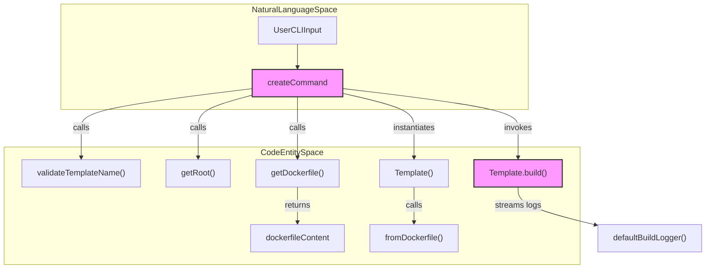
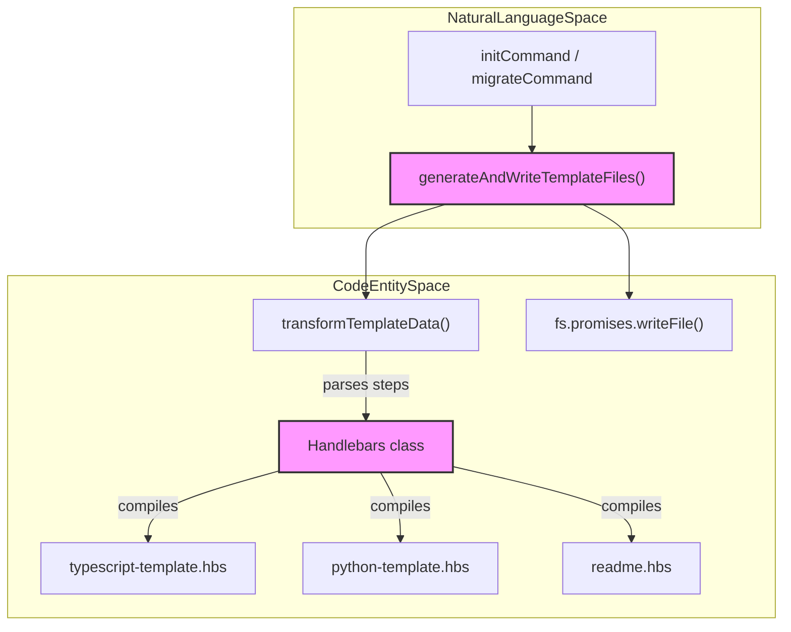

<!-- source: DeepWiki mcp.deepwiki.com · repo e2b-dev/E2B · page 5.2 Template Commands · fetched 2026-10-29 -->

# Template Commands

Relevant source files

The following files were used as context for generating this wiki page:

- [packages/cli/.prettierignore](packages/cli/.prettierignore)
- [packages/cli/src/commands/sandbox/pause.ts](packages/cli/src/commands/sandbox/pause.ts)
- [packages/cli/src/commands/sandbox/resume.ts](packages/cli/src/commands/sandbox/resume.ts)
- [packages/cli/src/commands/template/create.ts](packages/cli/src/commands/template/create.ts)
- [packages/cli/src/commands/template/generators/handlebars.ts](packages/cli/src/commands/template/generators/handlebars.ts)
- [packages/cli/src/commands/template/generators/template-generator.ts](packages/cli/src/commands/template/generators/template-generator.ts)
- [packages/cli/src/commands/template/index.ts](packages/cli/src/commands/template/index.ts)
- [packages/cli/src/commands/template/init.ts](packages/cli/src/commands/template/init.ts)
- [packages/cli/src/commands/template/migrate.ts](packages/cli/src/commands/template/migrate.ts)
- [packages/cli/src/templates/python-build-async.hbs](packages/cli/src/templates/python-build-async.hbs)
- [packages/cli/src/templates/python-build-sync.hbs](packages/cli/src/templates/python-build-sync.hbs)
- [packages/cli/src/templates/readme.hbs](packages/cli/src/templates/readme.hbs)
- [packages/cli/src/templates/typescript-build.hbs](packages/cli/src/templates/typescript-build.hbs)
- [packages/cli/src/utils/confirm.ts](packages/cli/src/utils/confirm.ts)
- [packages/cli/src/utils/templatePrompt.ts](packages/cli/src/utils/templatePrompt.ts)
- [packages/cli/src/utils/templateSort.ts](packages/cli/src/utils/templateSort.ts)

## Purpose and Scope

This page documents the template management commands in the E2B CLI (`@e2b/cli`), focusing on the implementation, data flows, and code structures under `packages/cli/src/commands/template/`. It covers template creation (v2 build pipeline), project initialization (`init`), legacy migration (`migrate`), listing, deletion, publishing/unpublishing, Handlebars-based code generators, and prompt/validation utilities.

Sources: [packages/cli/src/commands/template/index.ts:1-19]()

---

## 1. Command Namespace and Index

All template-related commands are grouped under the `template` command namespace (aliased as `tpl`) defined in [packages/cli/src/commands/template/index.ts:10-19](). 

| Subcommand | Alias | Implementation File | Purpose |
|------------|-------|---------------------|---------|
| `create` | `ct` | `packages/cli/src/commands/template/create.ts` | Build a Dockerfile as a sandbox template via the v2 SDK build pipeline. |
| `init` | `it` | `packages/cli/src/commands/template/init.ts` | Initialize a new template project using Handlebars code generators. |
| `migrate` | N/A | `packages/cli/src/commands/template/migrate.ts` | Migrate legacy `e2b.Dockerfile` and `e2b.toml` setups to the SDK format. |
| `list` | `ls` | `packages/cli/src/commands/template/list.ts` | List all accessible sandbox templates. |
| `delete` | `dl` | `packages/cli/src/commands/template/delete.ts` | Delete remote templates and local configurations. |
| `publish` | `pb` | `packages/cli/src/commands/template/publish.ts` | Make templates publicly accessible. |
| `unpublish` | `upb` | `packages/cli/src/commands/template/publish.ts` | Make templates private. |

Sources: [packages/cli/src/commands/template/index.ts:1-19]()

---

## 2. Template Creation (`createCommand`)

The `create` command (`packages/cli/src/commands/template/create.ts`) reads a local Dockerfile, sets up template parameters, and invokes the SDK's `Template.build()` function to execute a remote build [packages/cli/src/commands/template/create.ts:23-154]().

### Parameters and Validation
* **`template-name`**: Must be lowercase and contain only letters, numbers, dashes, and underscores, validated via `validateTemplateName` [packages/cli/src/commands/template/create.ts:27-30](), [packages/cli/src/commands/template/create.ts:78]().
* **Memory (`--memory-mb`)**: Must be an even number; otherwise, the process exits with status `1` [packages/cli/src/commands/template/create.ts:52-55](), [packages/cli/src/commands/template/create.ts:89-96]().
* **Dockerfiles**: Discovered via `getDockerfile()` looking for default or fallback names [packages/cli/src/commands/template/create.ts:109-112]().

Sources: [packages/cli/src/commands/template/create.ts:23-153]()

---

## 3. Project Initialization (`initCommand`)

The `init` command (`packages/cli/src/commands/template/init.ts`) bootstraps a local directory with SDK template files, build scripts, and README documentation [packages/cli/src/commands/template/init.ts:141-218]().

### Initialization Flow
1. **Name & Language Prompts**: Uses `@inquirer/prompts` (`input` and `select`) if options are omitted [packages/cli/src/commands/template/init.ts:178-218]().
2. **File Generation**: Calls `generateAndWriteTemplateFiles()` to output template code based on the target language (`Language.TypeScript`, `Language.PythonSync`, or `Language.PythonAsync`) [packages/cli/src/commands/template/init.ts:24-40]().
3. **Build Script Injection**: Automatically appends `e2b:build:dev` and `e2b:build:prod` scripts into `package.json` (via `@npmcli/package-json`) or a `Makefile` [packages/cli/src/commands/template/init.ts:46-139]().

Sources: [packages/cli/src/commands/template/init.ts:1-139]()

---

## 4. Template Migration (`migrateCommand`)

The `migrate` command (`packages/cli/src/commands/template/migrate.ts`) upgrades deprecated v1 `e2b.Dockerfile` and `e2b.toml` setups into the modern SDK-based format [packages/cli/src/commands/template/migrate.ts:87-155]().

### Migration Logic
* Loads existing configuration via `loadConfig()` [packages/cli/src/commands/template/migrate.ts:182]().
* Parses `dockerfileContent` using `template.fromDockerfile()` [packages/cli/src/commands/template/migrate.ts:37](). If parsing fails, it outputs a warning and falls back to a custom image placeholder [packages/cli/src/commands/template/migrate.ts:39-58]().
* Applies `start_cmd` and `ready_cmd` configurations to the template instance [packages/cli/src/commands/template/migrate.ts:60-69]().
* Writes out updated files for the specified target language using `generateAndWriteTemplateFiles()` [packages/cli/src/commands/template/migrate.ts:77-84]().

Sources: [packages/cli/src/commands/template/migrate.ts:22-85]()

---

## 5. Generators and Handlebars Scaffolds

The template generation layer (`packages/cli/src/commands/template/generators/handlebars.ts`) uses Handlebars to compile template structures and build scripts [packages/cli/src/commands/template/generators/handlebars.ts:12-39]().

### Key Functions
* `transformTemplateData(template)`: Converts a `TemplateClass` instance into JSON with normalized steps (such as collapsing `ENV` pairs and formatting `COPY` destinations) [packages/cli/src/commands/template/generators/handlebars.ts:52-104]().
* `generateTypeScriptCode(...)`: Compiles `typescript-template.hbs` and `typescript-build.hbs` [packages/cli/src/commands/template/generators/handlebars.ts:109-150]().
* `generatePythonCode(...)`: Compiles `python-template.hbs` alongside sync or async build scripts [packages/cli/src/commands/template/generators/handlebars.ts:155-196]().
* `generateReadmeContent(...)`: Renders `packages/cli/src/templates/readme.hbs` with language-specific instructions and code blocks [packages/cli/src/templates/readme.hbs:1-99](), [packages/cli/src/commands/template/generators/handlebars.ts:199-233]().

Sources: [packages/cli/src/commands/template/generators/handlebars.ts:12-233](), [packages/cli/src/templates/readme.hbs:1-99]()

---

## 6. Prompt, Confirmation, and Name Utilities

CLI interactions rely on helper utilities for validation and prompts:
* **`validateTemplateName`**: Enforces naming rules (lowercase, alphanumeric, dashes, underscores) [packages/cli/src/commands/template/create.ts:27-30]().
* **`getPromptTemplates`**: Prompts the user with a checkbox list of templates using `inquirer` [packages/cli/src/utils/templatePrompt.ts:6-27]().
* **`confirm`**: Renders confirmation dialogs for destructive actions like template deletion [packages/cli/src/utils/confirm.ts:1-13]().

Sources: [packages/cli/src/utils/templatePrompt.ts:6-27](), [packages/cli/src/utils/confirm.ts:1-13]()

---

