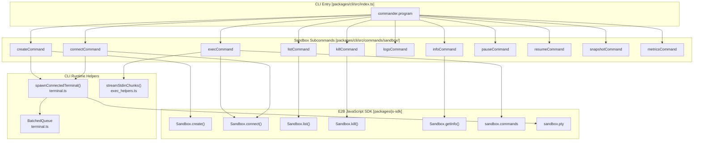
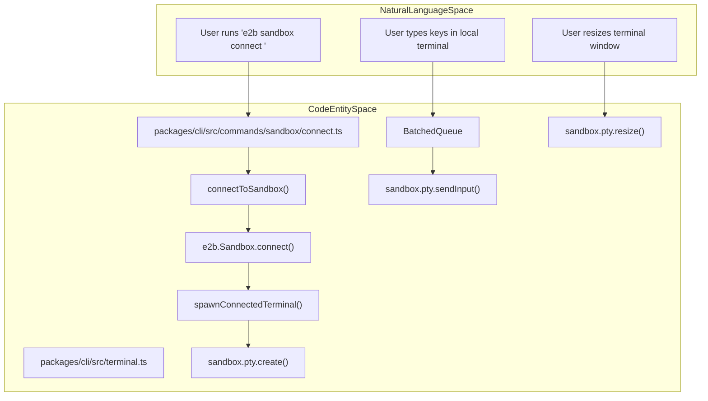
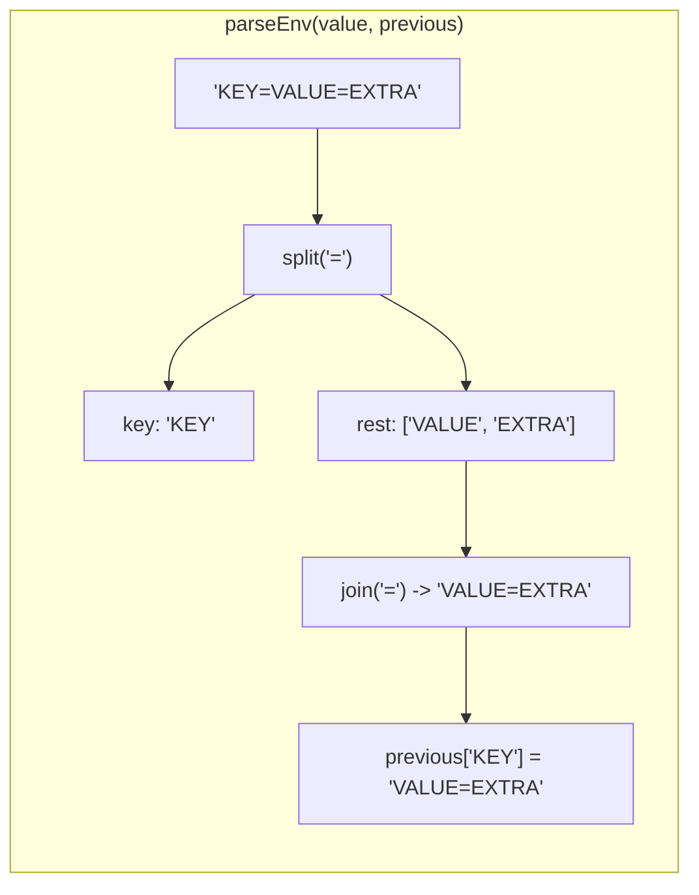

<!-- source: DeepWiki mcp.deepwiki.com · repo e2b-dev/E2B · page 5.3 Sandbox Commands · fetched 2026-10-29 -->

# Sandbox Commands

<details>
<summary>Relevant source files</summary>

The following files were used as context for generating this wiki page:

- [packages/cli/src/commands/index.ts](packages/cli/src/commands/index.ts)
- [packages/cli/src/commands/sandbox/connect.ts](packages/cli/src/commands/sandbox/connect.ts)
- [packages/cli/src/commands/sandbox/create.ts](packages/cli/src/commands/sandbox/create.ts)
- [packages/cli/src/commands/sandbox/exec.ts](packages/cli/src/commands/sandbox/exec.ts)
- [packages/cli/src/commands/sandbox/exec_helpers.ts](packages/cli/src/commands/sandbox/exec_helpers.ts)
- [packages/cli/src/commands/sandbox/index.ts](packages/cli/src/commands/sandbox/index.ts)
- [packages/cli/src/commands/sandbox/kill.ts](packages/cli/src/commands/sandbox/kill.ts)
- [packages/cli/src/commands/sandbox/list.ts](packages/cli/src/commands/sandbox/list.ts)
- [packages/cli/src/commands/sandbox/logs.ts](packages/cli/src/commands/sandbox/logs.ts)
- [packages/cli/src/commands/sandbox/snapshot.ts](packages/cli/src/commands/sandbox/snapshot.ts)
- [packages/cli/src/commands/sandbox/utils.ts](packages/cli/src/commands/sandbox/utils.ts)
- [packages/cli/src/commands/template/list.ts](packages/cli/src/commands/template/list.ts)
- [packages/cli/src/index.ts](packages/cli/src/index.ts)
- [packages/cli/src/terminal.ts](packages/cli/src/terminal.ts)
- [packages/cli/src/utils/env.ts](packages/cli/src/utils/env.ts)
- [packages/cli/src/utils/table.ts](packages/cli/src/utils/table.ts)
- [packages/cli/tests/commands/sandbox/create_lifecycle.test.ts](packages/cli/tests/commands/sandbox/create_lifecycle.test.ts)
- [packages/cli/tests/commands/sandbox/exec_helpers.test.ts](packages/cli/tests/commands/sandbox/exec_helpers.test.ts)
- [packages/cli/tests/commands/sandbox/exec_passthrough.test.ts](packages/cli/tests/commands/sandbox/exec_passthrough.test.ts)
- [packages/cli/tests/commands/sandbox/list.test.ts](packages/cli/tests/commands/sandbox/list.test.ts)
- [packages/cli/tests/utils/env.test.ts](packages/cli/tests/utils/env.test.ts)
- [packages/cli/tests/utils/table.test.ts](packages/cli/tests/utils/table.test.ts)

</details>


This page documents the CLI commands for managing and interacting with running E2B sandboxes. These commands operate on sandbox instances and provide functionality for creation, listing, connecting, monitoring, terminating, pausing, resuming, snapshotting, and executing commands with stdin piping. For information about template-related commands, see [Template Commands](#5.2). For general CLI setup and authentication, see [CLI Configuration and Authentication](#5.1).

## Overview

The CLI provides a suite of sandbox operation commands located in [packages/cli/src/commands/sandbox/](). The `sandbox` command (alias `sbx`) serves as the entry point for these subcommands [packages/cli/src/commands/sandbox/index.ts:15-30]().

| Command | Alias | Purpose |
|---------|-------|---------|
| `create` (`spawn`) | `cr` (`sp`) | Create a new sandbox from a template and connect to it [packages/cli/src/commands/sandbox/index.ts:25-26]() |
| `list` | `ls` | List sandboxes with filtering and pagination [packages/cli/src/commands/sandbox/list.ts:11-13]() |
| `connect` | `cn` | Open an interactive PTY session to a running sandbox [packages/cli/src/commands/sandbox/connect.ts:10-21]() |
| `kill` | `kl` | Terminate one or more sandboxes [packages/cli/src/commands/sandbox/kill.ts:18-24]() |
| `logs` | `lg` | Stream or display logs from a sandbox [packages/cli/src/commands/sandbox/logs.ts:48-54]() |
| `exec` | `ex` | Execute a non-interactive command in a sandbox [packages/cli/src/commands/sandbox/exec.ts:1-30]() |
| `info` | `in` | Show detailed information for a specific sandbox [packages/cli/src/commands/sandbox/info.ts:1-40]() |
| `pause` | - | Pause a running sandbox [packages/cli/src/commands/sandbox/pause.ts:1-20]() |
| `resume` | - | Resume a paused sandbox [packages/cli/src/commands/sandbox/resume.ts:1-20]() |
| `snapshot` | - | Create a snapshot from a running sandbox [packages/cli/src/commands/sandbox/snapshot.ts:1-25]() |
| `metrics` | - | Show real-time CPU and memory metrics [packages/cli/src/commands/sandbox/metrics.ts:1-25]() |

**Sources:** [packages/cli/src/commands/sandbox/index.ts:1-30](), [packages/cli/src/commands/sandbox/create.ts:27-54](), [packages/cli/src/commands/sandbox/list.ts:11-18](), [packages/cli/src/commands/sandbox/connect.ts:10-21]()

## Command Architecture



**Sources:** [packages/cli/src/index.ts:20-40](), [packages/cli/src/commands/sandbox/index.ts:14-30](), [packages/cli/src/terminal.ts:18-75](), [packages/cli/src/commands/sandbox/exec.ts:36-93]()

## Natural Language to Code Entity Space: PTY and Connection Flow

The following diagram bridges user-facing connection and terminal interaction intent with the underlying codebase modules and function symbols.



**Sources:** [packages/cli/src/commands/sandbox/connect.ts:10-77](), [packages/cli/src/terminal.ts:18-75]()

## Create Command

The `create` command instantiates a new sandbox from a template. By default, it automatically connects an interactive terminal session to the new instance [packages/cli/src/commands/sandbox/create.ts:25-35]().

### Command Signature
```bash
e2b sandbox create [template] [options]
```

### Key Options
- `--detach (-d)`: Create the sandbox without connecting a terminal [packages/cli/src/commands/sandbox/create.ts:32]().
- `--lifecycle.ontimeout <action>`: Action when timeout is reached (`pause` or `kill`) [packages/cli/src/commands/sandbox/create.ts:34-37]().
- `--lifecycle.autoresume`: Enable auto-resume (requires `ontimeout pause`) [packages/cli/src/commands/sandbox/create.ts:38-41]().
- `--timeout <seconds>`: Set sandbox timeout (minimum 30s) [packages/cli/src/commands/sandbox/create.ts:42]().
- `--user`, `--cwd`, `--env`: Configure the initial terminal session [packages/cli/src/commands/sandbox/create.ts:43-50]().

### Lifecycle Management
The command handles the `SandboxLifecycle` configuration, mapping CLI flags to the SDK's lifecycle object [packages/cli/src/commands/sandbox/create.ts:80-88](). If a terminal is attached, the CLI maintains a keep-alive loop by calling `sandbox.setTimeout()` every 5 seconds to prevent the sandbox from timing out while the user is active [packages/cli/src/commands/sandbox/create.ts:178-183]().

**Sources:** [packages/cli/src/commands/sandbox/create.ts:11-165](), [packages/cli/src/commands/sandbox/create.ts:178-202](), [packages/cli/tests/commands/sandbox/create_lifecycle.test.ts:1-77]()

## Exec Command and Stdin Piping

The `exec` command runs a non-interactive command inside an existing sandbox. It supports foreground execution, background execution, and streaming stdin data [packages/cli/src/commands/sandbox/exec.ts:21-34]().

### Implementation Details
1. **Connection**: Connects to the sandbox using `Sandbox.connect(sandboxID)` [packages/cli/src/commands/sandbox/exec.ts:42]().
2. **Stdin Piping**: If stdin is piped into the CLI command (e.g., `echo 'hello' | e2b sandbox exec <ID> cat`), the helper `streamStdinChunks` processes incoming binary or text buffers and pipes them directly to the remote process via `sandbox.commands.sendStdin()` [packages/cli/src/commands/sandbox/exec.ts:155-180]().
3. **Signal Propagation**: Uses signal handlers to ensure that sending a `SIGINT` (Ctrl+C) to the CLI propagates a termination signal to the remote process in the sandbox [packages/cli/src/commands/sandbox/exec.ts:126-129]().
4. **Background Mode**: When `--background` is specified, the CLI returns the remote PID and exits immediately after detaching [packages/cli/src/commands/sandbox/exec.ts:55-83]().

**Sources:** [packages/cli/src/commands/sandbox/exec.ts:21-180]()

## List Command

The `list` command displays sandboxes with support for filtering, pagination, and multiple output formats.

### Options
| Option | Type | Default | Description |
|--------|------|---------|-------------|
| `-s, --state <state>` | string[] | `['running']` | Comma-separated states: `running`, `paused` [packages/cli/src/commands/sandbox/list.ts:14-18]() |
| `-m, --metadata <metadata>` | string | - | Filter by metadata key-value pair (e.g., `key1=value1`) [packages/cli/src/commands/sandbox/list.ts:19]() |
| `-t, --template <template>` | string | - | Filter by template ID or alias [packages/cli/src/commands/sandbox/list.ts:20-23]() |
| `-l, --limit <limit>` | number | `1000` | Maximum sandboxes to return (0 for no limit) [packages/cli/src/commands/sandbox/list.ts:50-53]() |
| `-f, --format <format>` | string | `pretty` | Output format: `pretty` or `json` [packages/cli/src/commands/sandbox/list.ts:54]() |

**Sources:** [packages/cli/src/commands/sandbox/list.ts:11-89]()

## Connect Command and PTY Operations

The `connect` command opens an interactive terminal session to a running sandbox using PTY (pseudo-terminal).

### Terminal Implementation
The terminal connection is implemented in [packages/cli/src/terminal.ts:18-75]():
1. **Raw Mode**: Sets `process.stdin.setRawMode(true)` to capture all keystrokes [packages/cli/src/terminal.ts:25]().
2. **PTY Session**: Creates a PTY using `sandbox.pty.create()` and wires up `onData` to `process.stdout` [packages/cli/src/terminal.ts:28-37]().
3. **Input Batching**: Uses `BatchedQueue<Buffer>` to buffer stdin input and flush it every 10ms to reduce RPC overhead [packages/cli/src/terminal.ts:39-42]().
4. **Resize Handling**: Listens to local terminal resize events and updates the remote PTY size [packages/cli/src/terminal.ts:44-46]().

**Sources:** [packages/cli/src/commands/sandbox/connect.ts:10-77](), [packages/cli/src/terminal.ts:18-120]()

## Logs Command

The `logs` command retrieves logs from a sandbox with real-time streaming capabilities [packages/cli/src/commands/sandbox/logs.ts:48-67]().

### Log Level Hierarchy
The CLI filters logs based on a hierarchy implemented in `isLevelIncluded()` [packages/cli/src/commands/sandbox/logs.ts:19-38]():
- `DEBUG` includes everything.
- `INFO` includes INFO, WARN, ERROR.
- `WARN` includes WARN, ERROR.
- `ERROR` includes only ERROR.

### Streaming Logic
If `--follow` is enabled, the CLI enters a loop [packages/cli/src/commands/sandbox/logs.ts:106-158]():
1. Calls `listSandboxLogs()` with the current `start` timestamp [packages/cli/src/commands/sandbox/logs.ts:107]().
2. Prints new logs and updates the `start` timestamp to the latest log time + 1ms [packages/cli/src/commands/sandbox/logs.ts:150-154]().
3. Waits 400ms before the next poll [packages/cli/src/commands/sandbox/logs.ts:156]().
4. Checks if the sandbox is still running using `isRunning(sandboxID)` [packages/cli/src/commands/sandbox/logs.ts:126]().

**Sources:** [packages/cli/src/commands/sandbox/logs.ts:19-240]()

## Kill Command

The `kill` command terminates sandboxes. It supports single ID termination or bulk termination using the `--all` flag combined with filters [packages/cli/src/commands/sandbox/kill.ts:18-35]().

### Operation Modes
- **Explicit IDs**: Iterates over `sandboxIDs` and calls `e2b.Sandbox.kill()` for each [packages/cli/src/commands/sandbox/kill.ts:98-101]().
- **Bulk Mode**: Uses `Sandbox.list()` with filters to find target sandboxes, then kills them in batches using `Promise.all()` [packages/cli/src/commands/sandbox/kill.ts:71-88]().

**Sources:** [packages/cli/src/commands/sandbox/kill.ts:9-107]()

## Info Command

The `info` command retrieves detailed metadata about a sandbox instance using `Sandbox.getInfo()` [packages/cli/src/commands/sandbox/info.ts:1-72]().

### Displayed Fields
The command formats and displays fields including:
- `sandboxId`, `templateId`, `state` [packages/cli/src/commands/sandbox/info.ts:25-28]().
- `cpuCount` (vCPUs), `memoryMB` (RAM) [packages/cli/src/commands/sandbox/info.ts:31-32]().
- `envdVersion`, `sandboxDomain`, and `metadata` [packages/cli/src/commands/sandbox/info.ts:33-38]().

**Sources:** [packages/cli/src/commands/sandbox/info.ts:1-72]()

## Pause and Resume Commands

The `pause` and `resume` commands control the active state of sandboxes without destroying their root filesystem and memory state.
- **Pause (`pause.ts`)**: Calls the SDK method to transition a running sandbox into a suspended/paused state, saving resources.
- **Resume (`resume.ts`)**: Restores a paused sandbox back to a running state so that connections and execution can continue.

**Sources:** [packages/cli/src/commands/sandbox/pause.ts:1-25](), [packages/cli/src/commands/sandbox/resume.ts:1-25]()

## Snapshot Command

The `snapshot` command generates a template snapshot from a running sandbox instance. This allows users to persist changes made inside a sandbox (such as installed packages or modified files) into a reusable template via [packages/cli/src/commands/sandbox/snapshot.ts]().

**Sources:** [packages/cli/src/commands/sandbox/snapshot.ts:1-30]()

## Metrics Command

The `metrics` command streams or queries real-time resource utilization metrics (CPU usage, memory consumption, and disk statistics) for a specified sandbox instance via [packages/cli/src/commands/sandbox/metrics.ts]().

**Sources:** [packages/cli/src/commands/sandbox/metrics.ts:1-30]()

## Utility: Environment Variable Parsing

CLI commands that accept environment variables (`create`, `connect`, `exec`) use the `parseEnv` utility [packages/cli/src/utils/env.ts:7-16]().



**Sources:** [packages/cli/src/utils/env.ts:7-16](), [packages/cli/tests/utils/env.test.ts:1-30]()

---

