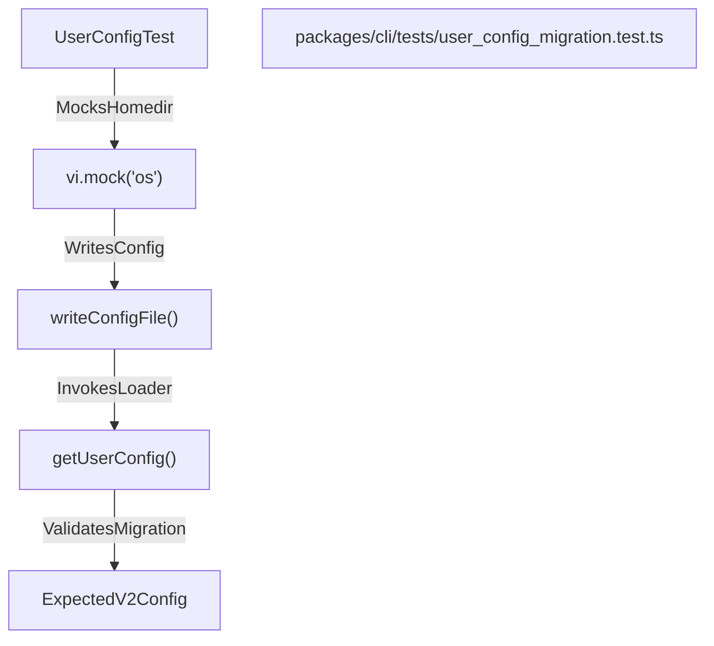
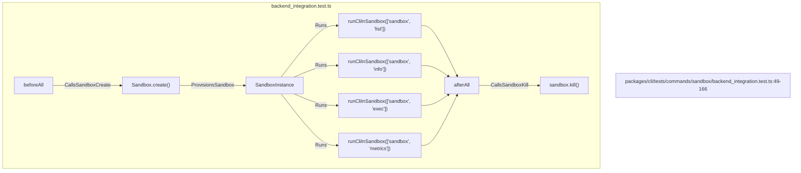

<!-- source: DeepWiki mcp.deepwiki.com · repo e2b-dev/E2B · page 5.4 CLI Testing · fetched 2026-10-29 -->

# CLI Testing

<details>
<summary>Relevant source files</summary>

The following files were used as context for generating this wiki page:

- [packages/cli/src/commands/sandbox/info.ts](packages/cli/src/commands/sandbox/info.ts)
- [packages/cli/src/utils/commands2md.ts](packages/cli/src/utils/commands2md.ts)
- [packages/cli/tests/commands/sandbox/backend_integration.test.ts](packages/cli/tests/commands/sandbox/backend_integration.test.ts)
- [packages/cli/tests/commands/sandbox/exec_pipe.test.ts](packages/cli/tests/commands/sandbox/exec_pipe.test.ts)
- [packages/cli/tests/setup.ts](packages/cli/tests/setup.ts)
- [packages/cli/tests/user_config_migration.test.ts](packages/cli/tests/user_config_migration.test.ts)
- [packages/cli/vitest.config.ts](packages/cli/vitest.config.ts)

</details>


This page documents the testing architecture, Vitest configuration, unit tests for configuration helpers, and live backend integration test suites for the `@e2b/cli` package.

## Vitest Configuration and Test Setup

The CLI package uses [Vitest](https://vitest.dev/) as its test runner, configured via `packages/cli/vitest.config.ts`. The environment is set to `node`, with a default test timeout of 30 seconds [packages/cli/vitest.config.ts:1-12](). 

The configuration explicitly excludes the `testground/` sandbox playground directory and maps the `e2b` package import alias directly to the local TypeScript source (`../js-sdk/src`) to avoid requiring a pre-built SDK package during test runs [packages/cli/vitest.config.ts:10-19]().

```typescript
// packages/cli/vitest.config.ts:4-21
export default defineConfig({
  test: {
    globals: false,
    environment: 'node',
    testTimeout: 30_000,
    include: ['tests/**/*.test.ts'],
    exclude: ['node_modules', 'dist', 'testground'],
    globalSetup: ['tests/setup.ts'],
  },
  resolve: {
    alias: {
      src: path.resolve(__dirname, './src'),
      e2b: path.resolve(__dirname, '../js-sdk/src'),
    },
  },
})
```

The test framework provides execution helpers in `packages/cli/tests/setup.ts` to spawn the bundled CLI binary (`dist/index.js`) synchronously using `runCli` or asynchronously with piped standard input using `runCliWithPipedStdin` [packages/cli/tests/setup.ts:22-85]().

Sources: [packages/cli/vitest.config.ts:1-22](), [packages/cli/tests/setup.ts:1-102]()

---

## Unit Tests and Configuration Helpers

Unit tests validate local utility modules, such as user configuration loading and legacy schema migration. For instance, `packages/cli/tests/user_config_migration.test.ts` mocks `os.homedir()` using `vi.mock` to intercept file path lookups and tests whether legacy v1 team configuration files are cleanly migrated to the v2 project format in memory [packages/cli/tests/user_config_migration.test.ts:1-72]().


*Figure 1: Unit Test Flow for Configuration Migration*

Sources: [packages/cli/tests/user_config_migration.test.ts:1-105]()

---

## Backend Integration Tests

Live backend integration tests verify that CLI commands successfully communicate with the E2B control plane and active sandboxes. These tests are conditionally skipped if `E2B_API_KEY` is missing or `E2B_DEBUG` is active [packages/cli/tests/commands/sandbox/backend_integration.test.ts:23-25]().

### Sandbox Lifecycle and Operations

`packages/cli/tests/commands/sandbox/backend_integration.test.ts` provisions a live sandbox in `beforeAll` using `Sandbox.create()`, executes various CLI commands against it (`sandbox list`, `sandbox info`, `sandbox exec`, `sandbox metrics`), and guarantees teardown via `sandbox.kill()` in `afterAll` [packages/cli/tests/commands/sandbox/backend_integration.test.ts:49-166]().


*Figure 2: Sandbox Integration Test Lifecycle*

### Stdin Piping Tests

Stdin piping is tested rigorously in `packages/cli/tests/commands/sandbox/exec_pipe.test.ts`. This suite verifies that buffers of various sizes (empty, newline-terminated, multi-byte UTF-8, binary NUL bytes, and 64KB chunks) are correctly streamed into remote processes via `runCliWithPipedStdin` [packages/cli/tests/commands/sandbox/exec_pipe.test.ts:56-100]() and [packages/cli/tests/setup.ts:40-85]().

Sources: [packages/cli/tests/commands/sandbox/backend_integration.test.ts:1-207](), [packages/cli/tests/commands/sandbox/exec_pipe.test.ts:1-188](), [packages/cli/tests/setup.ts:1-102]()

---

