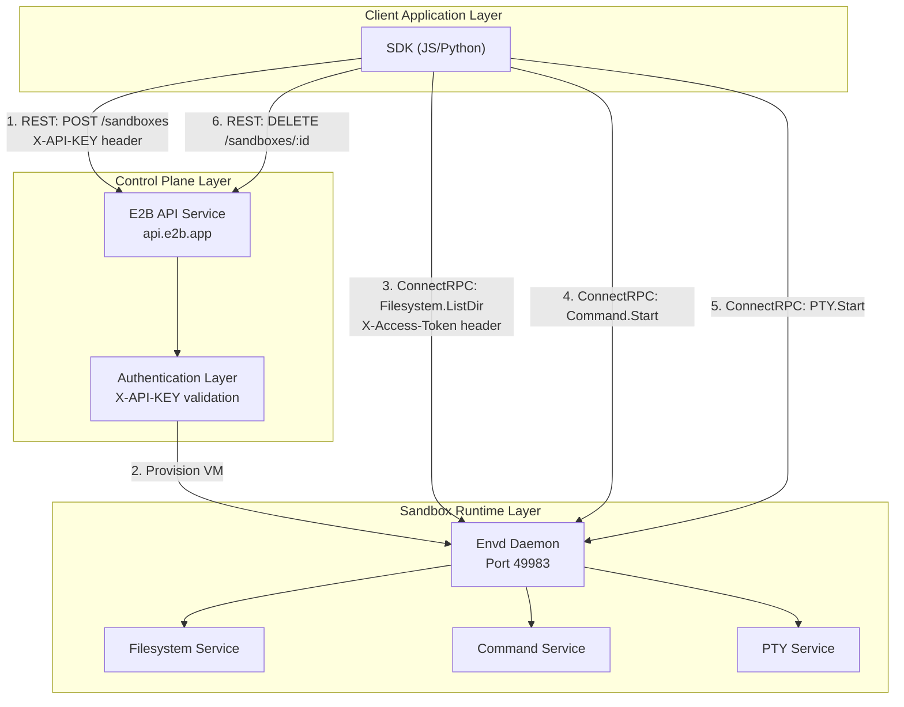
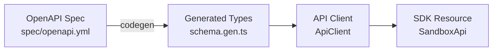
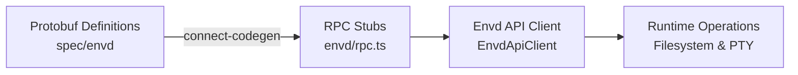

<!-- source: DeepWiki mcp.deepwiki.com · repo e2b-dev/E2B · page 6 API and Communication · fetched 2026-10-29 -->

# API and Communication

Relevant source files

The following files were used as context for generating this wiki page:

- [packages/js-sdk/src/api/schema.gen.ts](packages/js-sdk/src/api/schema.gen.ts)
- [packages/python-sdk/e2b/api/client/models/__init__.py](packages/python-sdk/e2b/api/client/models/__init__.py)
- [spec/openapi.yml](spec/openapi.yml)

This page provides a high-level overview of the communication layers and security protocols connecting E2B SDKs to the control plane and runtime sandboxes. E2B uses a dual-protocol architecture: a control-plane REST API for sandbox lifecycle management, and a data-plane ConnectRPC protocol for low-latency sandbox operations.

For deep technical details, refer to the following child pages:
- [REST API and OpenAPI Spec](#6.1)
- [envd Protocol and RPC Layer](#6.2)
- [Authentication, Signing and Security](#6.3)

---

## Architecture Overview

E2B's communication layer splits operations between managing cloud resources via HTTP/REST and executing runtime tasks via HTTP/2 and ConnectRPC inside sandboxes.

### Dual-Protocol Communication Flow

Sources: [packages/js-sdk/src/api/index.ts:90-136](), [packages/python-sdk/e2b/api/__init__.py:154-206](), [packages/js-sdk/src/envd/api.ts:193-225]()

---

## Control-Plane REST API

The control-plane REST API manages resources that outlive individual sandboxes or orchestrate their high-level lifecycles, such as creating sandboxes, managing templates, volumes, and secrets.

### Control Plane Code Entity Mapping

Title: Control Plane Component Mapping

Sources: [spec/openapi.yml:1-30](), [packages/js-sdk/src/api/schema.gen.ts:1-50]()

For complete details on endpoints, schema generation, and OpenAPI specifications, see [REST API and OpenAPI Spec](#6.1).

---

## Data-Plane ConnectRPC and envd

Once a sandbox is provisioned, the SDK communicates directly with the `envd` daemon running inside the sandbox over HTTP/2 using ConnectRPC stubs and Protocol Buffers.

### Data Plane Code Entity Mapping

Title: Data Plane Component Mapping

Sources: [packages/js-sdk/src/envd/api.ts:1-50](), [packages/python-sdk/e2b/envd/__init__.py:1]()

For complete details on protobuf definitions, connection pooling, and error handling over gRPC/Connect, see [envd Protocol and RPC Layer](#6.2).

---

## Authentication, Signing and Security

E2B secures communication channels across different trust boundaries using API keys, bearer access tokens, and cryptographic signatures.

- **Developer API Keys (`X-API-KEY`)**: Authenticate SDK clients against the control plane [packages/js-sdk/src/api/index.ts:118]().
- **Sandbox Access Tokens (`X-Access-Token`)**: Authenticate SDKs directly against individual `envd` instances [packages/js-sdk/src/envd/api.ts:215-217]().
- **Traffic and IAM Tokens**: Secure ingress/egress proxying and workload identity propagation [packages/python-sdk/e2b/api/__init__.py:80]().

For detailed security mechanics, token issuance, and file URL signatures, see [Authentication, Signing and Security](#6.3).

Sources: [packages/js-sdk/src/api/index.ts:110-125](), [packages/js-sdk/src/envd/api.ts:200-220]()

---

## Error Handling and Transport

The communication layers map protocol-specific HTTP and gRPC status codes into unified SDK exceptions for cross-language consistency.

### SDK Error Mapping

| Protocol Code | SDK Error Class | Description |
| :--- | :--- | :--- |
| HTTP 401 / gRPC `Unauthenticated` | `AuthenticationError` | Invalid credentials or expired token |
| HTTP 404 / gRPC `NotFound` | `NotFoundError` | Resource (file/sandbox) not found |
| HTTP 429 / gRPC `ResourceExhausted` | `RateLimitError` | Request limit exceeded |
| HTTP 502 / gRPC `Unavailable` | `TimeoutError` | Sandbox is gone or unreachable |
| HTTP 507 | `NotEnoughSpaceError` | Disk space exhausted in sandbox |

Sources: [packages/js-sdk/src/api/index.ts:40-53](), [packages/js-sdk/src/envd/api.ts:24-32](), [packages/js-sdk/src/envd/rpc.ts:69-86](), [packages/python-sdk/e2b/envd/api.py:21-30]()

---

