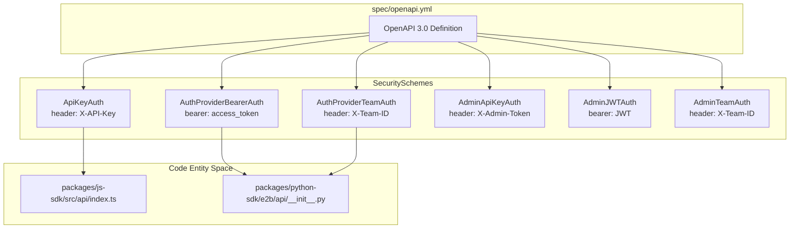
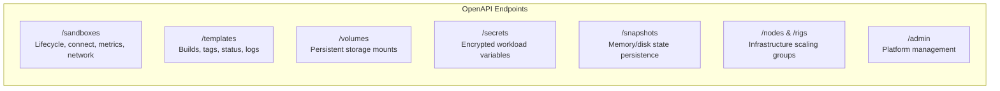
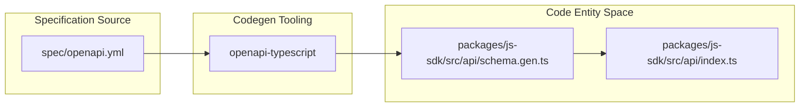
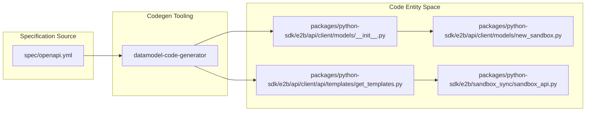

<!-- source: DeepWiki mcp.deepwiki.com · repo e2b-dev/E2B · page 6.1 REST API and OpenAPI Spec · fetched 2026-10-29 -->

# REST API and OpenAPI Spec

Relevant source files

The following files were used as context for generating this wiki page:

- [packages/js-sdk/src/api/schema.gen.ts](packages/js-sdk/src/api/schema.gen.ts)
- [packages/python-sdk/e2b/api/client/api/templates/delete_templates_template_id.py](packages/python-sdk/e2b/api/client/api/templates/delete_templates_template_id.py)
- [packages/python-sdk/e2b/api/client/api/templates/get_templates.py](packages/python-sdk/e2b/api/client/api/templates/get_templates.py)
- [packages/python-sdk/e2b/api/client/api/templates/get_templates_template_id_builds_build_id_status.py](packages/python-sdk/e2b/api/client/api/templates/get_templates_template_id_builds_build_id_status.py)
- [packages/python-sdk/e2b/api/client/models/__init__.py](packages/python-sdk/e2b/api/client/models/__init__.py)
- [packages/python-sdk/e2b/api/client/models/new_sandbox.py](packages/python-sdk/e2b/api/client/models/new_sandbox.py)
- [spec/openapi.yml](spec/openapi.yml)

This page documents the E2B REST API, its OpenAPI specification (`spec/openapi.yml`), code generation workflows, bundling via Redocly, and how control-plane operations are implemented across JavaScript and Python SDKs. The REST API manages sandbox and template lifecycles, team resources, volumes, secrets, snapshots, nodes, and administrative functions, while data-plane communication uses ConnectRPC/gRPC over HTTP/2 [packages/python-sdk/e2b/sandbox_sync/main.py:103-118]().

## Overview

The E2B REST API acts as the control plane for the E2B infrastructure. Located at `https://api.e2b.app`, it handles:
- **Sandbox Lifecycle**: Creating, connecting, pausing, resuming, forking, and killing sandboxes (`/sandboxes` endpoints) [packages/js-sdk/src/api/schema.gen.ts:7-203]().
- **Template Management**: Building, listing, inspecting, and deleting custom sandbox templates (`/templates` endpoints) [packages/python-sdk/e2b/api/client/api/templates/get_templates.py:1-184]().
- **Volumes and Secrets**: Managing persistent storage volumes and encrypted secret configurations (`/volumes`, `/secrets`).
- **Snapshots and Checkpoints**: Managing memory and disk snapshots of sandboxes (`/snapshots`).
- **Nodes and Rigs**: Managing orchestrator node pools and cloud scaling groups (`/nodes`, `/rigs`).
- **Admin and Teams**: Administrative tooling and multi-tenant authentication contexts.

The specification is defined using OpenAPI 3.0 in `spec/openapi.yml` [spec/openapi.yml:1-8](). Automatic code generation produces type-safe clients and models:
- **JavaScript/TypeScript**: `openapi-typescript` generates type definitions in `packages/js-sdk/src/api/schema.gen.ts` [packages/js-sdk/src/api/schema.gen.ts:1-5]().
- **Python**: `datamodel-code-generator` generates Pydantic-compatible models and functional API clients in `packages/python-sdk/e2b/api/client/models/` and `packages/python-sdk/e2b/api/client/api/` [packages/python-sdk/e2b/api/client/models/__init__.py:1-159]().

Sources: [spec/openapi.yml:1-8](), [packages/js-sdk/src/api/schema.gen.ts:1-6](), [packages/python-sdk/e2b/sandbox_sync/sandbox_api.py:13-37]()

---

## OpenAPI Specification Structure

### Security Schemes and Authentication

The OpenAPI specification defines multiple security schemes to support team API keys, user access tokens, and administrative tokens [spec/openapi.yml:10-39]().

The naming convention ensures that bearer authentication schemes are evaluated before team headers [spec/openapi.yml:15-38]().

| Security Scheme | Header / Location | Purpose |
|-----------------|-------------------|---------|
| `ApiKeyAuth` | `X-API-Key` (header) | Team-level API key authentication [spec/openapi.yml:11-14]() |
| `AuthProviderBearerAuth` | `Authorization: Bearer` | User access token authentication [spec/openapi.yml:17-20]() |
| `AuthProviderTeamAuth` | `X-Team-ID` (header) | Team context scope for multi-tenant requests [spec/openapi.yml:21-24]() |
| `AdminApiKeyAuth` | `X-Admin-Token` (header) | Platform administrator token [spec/openapi.yml:27-30]() |
| `AdminJWTAuth` | `Authorization: Bearer` | Administrator JWT authentication [spec/openapi.yml:31-34]() |
| `AdminTeamAuth` | `X-Team-ID` (header) | Administrative team context [spec/openapi.yml:35-38]() |

Sources: [spec/openapi.yml:10-39]()

### Core Endpoints Overview

The OpenAPI spec organizes routes into logical resource domains:

- **Sandboxes**: `/sandboxes`, `/sandboxes/{sandboxID}`, `/sandboxes/{sandboxID}/connect`, `/sandboxes/{sandboxID}/pause`, `/sandboxes/{sandboxID}/timeout`, `/sandboxes/{sandboxID}/network` [packages/js-sdk/src/api/schema.gen.ts:7-203]()
- **Templates**: `/templates`, `/templates/{templateID}`, `/templates/{templateID}/builds`, `/templates/{templateID}/builds/{buildID}/status` [packages/python-sdk/e2b/api/client/api/templates/get_templates.py:1-184](), [packages/python-sdk/e2b/api/client/api/templates/get_templates_template_id_builds_build_id_status.py:1-228]()
- **Volumes & Secrets**: Manage team-scoped persistent volumes (`/volumes`) and secure secrets (`/secrets`).
- **Snapshots**: Manage sandbox fork and state snapshots (`/snapshots`).
- **Nodes & Rigs**: Orchestration control for cloud provider scaling groups (`/rigs`, `/nodes`) [spec/openapi.yml:230-257]().

Sources: [spec/openapi.yml:230-257](), [packages/js-sdk/src/api/schema.gen.ts:7-203](), [packages/python-sdk/e2b/api/client/api/templates/get_templates.py:1-184]()

---

## Code Generation Workflow

### TypeScript Code Generation

The JavaScript/TypeScript SDK relies on `openapi-typescript` to convert `spec/openapi.yml` into a strongly-typed TypeScript declaration file (`schema.gen.ts`) [packages/js-sdk/src/api/schema.gen.ts:1-5]().

The generated `paths` and `components` interfaces allow `openapi-fetch` wrappers in `packages/js-sdk/src/api/index.ts` to enforce strict request/response payloads [packages/js-sdk/src/api/schema.gen.ts:6-40]().

Sources: [packages/js-sdk/src/api/schema.gen.ts:1-40](), [packages/js-sdk/src/api/index.ts:1-136]()

### Python Code Generation

The Python SDK utilizes `datamodel-code-generator` to ingest the OpenAPI spec and generate Pydantic v2 models and functional API call modules [packages/python-sdk/e2b/api/client/models/__init__.py:1-159]().

The generated modules provide both synchronous (`sync`, `sync_detailed`) and asynchronous (`asyncio`, `asyncio_detailed`) functions for every endpoint [packages/python-sdk/e2b/api/client/api/templates/get_templates.py:73-184]().

Sources: [packages/python-sdk/e2b/api/client/models/__init__.py:1-159](), [packages/python-sdk/e2b/api/client/api/templates/get_templates.py:73-184]()

---

## Redocly Bundling and Spec Management

The repository uses Redocly tooling to bundle, lint, and validate OpenAPI specifications before code generation. 
- **Bundling**: Split specification files are compiled into a unified `openapi.yml` document.
- **Validation**: CI workflows execute spec validation to ensure breaking changes are caught.
- **Syncing**: Scripts like `fetch-spec.sh` and Copybara sync specifications across internal and public repositories [spec/openapi.yml:1-8]().

Sources: [spec/openapi.yml:1-8]()

---

## API Client Implementation & Abstraction

Both SDKs wrap generated HTTP clients in an abstraction layer (`SandboxApi`) to handle authentication headers, retries, and error mapping.

### Error Translation and Handling

API error responses (conforming to the `Error` schema in `spec/openapi.yml`) are caught and translated into SDK-specific exception hierarchies [spec/openapi.yml:153-228]().

- **JavaScript**: Maps 401 errors to `AuthenticationError`, 429 to `RateLimitError`, and general failures to `SandboxError` [packages/js-sdk/src/api/index.ts:31-53]().
- **Python**: Maps 401 to `AuthenticationException`, 429 to `RateLimitException`, and others to `SandboxException` [packages/python-sdk/e2b/api/__init__.py:83-107]().

Sources: [spec/openapi.yml:153-228](), [packages/js-sdk/src/api/index.ts:31-53](), [packages/python-sdk/e2b/api/__init__.py:83-107]()

---

