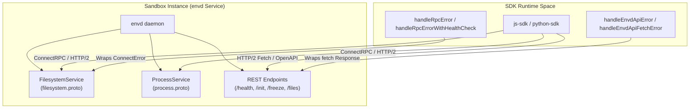
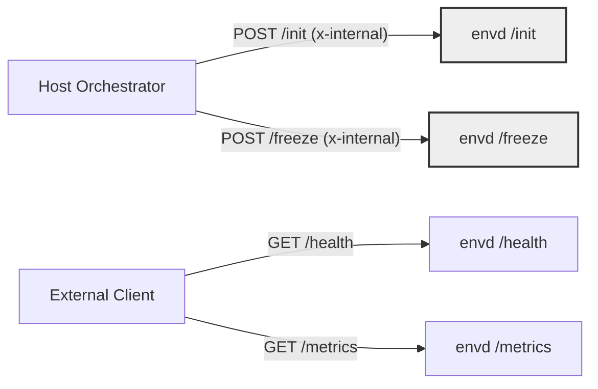

<!-- source: DeepWiki mcp.deepwiki.com · repo e2b-dev/E2B · page 6.2 envd Protocol and RPC Layer · fetched 2026-10-29 -->

# envd Protocol and RPC Layer

Relevant source files

The following files were used as context for generating this wiki page:

- [packages/js-sdk/src/envd/api.ts](packages/js-sdk/src/envd/api.ts)
- [packages/js-sdk/src/envd/filesystem/filesystem_connect.ts](packages/js-sdk/src/envd/filesystem/filesystem_connect.ts)
- [packages/js-sdk/src/envd/filesystem/filesystem_pb.ts](packages/js-sdk/src/envd/filesystem/filesystem_pb.ts)
- [packages/js-sdk/src/envd/process/process_connect.ts](packages/js-sdk/src/envd/process/process_connect.ts)
- [packages/js-sdk/src/envd/process/process_pb.ts](packages/js-sdk/src/envd/process/process_pb.ts)
- [packages/js-sdk/src/envd/rpc.ts](packages/js-sdk/src/envd/rpc.ts)
- [packages/js-sdk/src/envd/schema.gen.ts](packages/js-sdk/src/envd/schema.gen.ts)
- [packages/js-sdk/src/sandbox/filesystem/watchHandle.ts](packages/js-sdk/src/sandbox/filesystem/watchHandle.ts)
- [packages/js-sdk/tests/cmdHelper.ts](packages/js-sdk/tests/cmdHelper.ts)
- [packages/js-sdk/tests/envd/handleEnvdApiError.test.ts](packages/js-sdk/tests/envd/handleEnvdApiError.test.ts)
- [packages/js-sdk/tests/envd/handleRpcError.test.ts](packages/js-sdk/tests/envd/handleRpcError.test.ts)
- [packages/js-sdk/tests/runtime.test.ts](packages/js-sdk/tests/runtime.test.ts)
- [packages/js-sdk/tests/sandbox/commands/run.test.ts](packages/js-sdk/tests/sandbox/commands/run.test.ts)
- [packages/python-sdk/e2b/envd/api.py](packages/python-sdk/e2b/envd/api.py)
- [packages/python-sdk/e2b/envd/filesystem/filesystem_connect.py](packages/python-sdk/e2b/envd/filesystem/filesystem_connect.py)
- [packages/python-sdk/e2b/envd/process/process_connect.py](packages/python-sdk/e2b/envd/process/process_connect.py)
- [packages/python-sdk/e2b/envd/rpc.py](packages/python-sdk/e2b/envd/rpc.py)
- [packages/python-sdk/tests/test_envd_rpc_exception.py](packages/python-sdk/tests/test_envd_rpc_exception.py)
- [spec/envd/envd.yaml](spec/envd/envd.yaml)
- [spec/envd/filesystem/filesystem.proto](spec/envd/filesystem/filesystem.proto)
- [spec/envd/process/process.proto](spec/envd/process/process.proto)

## Purpose and Scope

This document details the `envd` protocol, Protocol Buffers (`spec/envd/`), OpenAPI specification (`spec/envd/envd.yaml`), generated filesystem/process ConnectRPC clients, error handling layers, HTTP/2 transports, and version gating mechanism. The `envd` service runs inside each sandbox container and exposes both gRPC/ConnectRPC and HTTP/2 endpoints for high-performance filesystem operations, process execution, and terminal management.

For REST API specifications covering sandbox lifecycle management, see [REST API and OpenAPI Spec](#6.1). For authentication details including `envdAccessToken`, see [Authentication, Signing and Security](#6.3).

Sources: [spec/envd/envd.yaml:1-166](), [spec/envd/filesystem/filesystem.proto:1-153]()

---

## Envd Service Architecture & HTTP/2 Transports

The `envd` service is a daemon running inside each sandbox container. It operates as the core execution layer, communicating over HTTP/2 using ConnectRPC for gRPC-style services and OpenAPI-generated fetch clients for REST endpoints.

**Diagram: Envd Service Architecture and Code Entities**

The service exposes:
- **ConnectRPC Services**: Defined via `.proto` files for streaming and unary RPCs (`Filesystem`, `Process`).
- **HTTP REST Endpoints**: Defined in `spec/envd/envd.yaml` for services like `/health` [spec/envd/envd.yaml:17-23](), `/metrics` [spec/envd/envd.yaml:24-37](), `/init` [spec/envd/envd.yaml:38-84](), and `/freeze` [spec/envd/envd.yaml:85-166]().

Sources: [spec/envd/envd.yaml:1-166](), [packages/js-sdk/src/envd/rpc.ts:1-182](), [packages/python-sdk/e2b/envd/rpc.py:1-148]()

---

## Protocol Buffer Definitions and Generated Clients

The `envd` protocol is defined using Protocol Buffers in `spec/envd/`. These files generate type-safe client code for JavaScript (`packages/js-sdk/src/envd/`) and Python (`packages/python-sdk/e2b/envd/`).

### Service Definitions

| Service | Proto File | Key Methods / Capabilities |
|---------|-----------|----------------------------|
| `Filesystem` | `spec/envd/filesystem/filesystem.proto` | `Stat`, `MakeDir`, `Move`, `ListDir`, `Remove`, `WatchDir` (streaming), `CreateWatcher` [spec/envd/filesystem/filesystem.proto:7-20]() |
| `Process` | `spec/envd/process/process.proto` | Process execution, stdin/stdout/stderr streaming, terminal management |

### Filesystem Protocol Buffers and Watch Handles

The `Filesystem` service supports structured directory watching via `WatchDir` and non-polling watcher APIs (`CreateWatcher`, `GetWatcherEvents`, `RemoveWatcher`) [spec/envd/filesystem/filesystem.proto:14-19](). 
- `EntryInfo`: Carries comprehensive file metadata including `name`, `type`, `path`, `size`, `mode`, `permissions`, `owner`, `group`, `modified_time`, `symlink_target`, and extended attributes (`metadata`) [spec/envd/filesystem/filesystem.proto:53-69]().
- `WatchDirRequest`: Configures recursive monitoring, `include_entry`, and `allow_network_mounts` for NFS/CIFS/FUSE volumes [spec/envd/filesystem/filesystem.proto:87-95]().
- `WatchHandle`: Consumes `WatchDirResponse` streams in the JS SDK, mapping `EventType` values (`CHMOD`, `CREATE`, `REMOVE`, `RENAME`, `WRITE`) and handling clean exit or stream errors [packages/js-sdk/src/sandbox/filesystem/watchHandle.ts:14-152]().

Sources: [spec/envd/filesystem/filesystem.proto:1-153](), [packages/js-sdk/src/sandbox/filesystem/watchHandle.ts:1-152](), [packages/python-sdk/e2b/envd/filesystem/filesystem_connect.py:28-55]()

---

## OpenAPI Spec (`envd.yaml`) and Control Plane Endpoints

The internal orchestrator communicates directly with `envd` over the host network using REST endpoints declared in `spec/envd/envd.yaml`. Operations marked with `x-internal: true` are restricted to the orchestrator control plane and blocked by the sandbox proxy for external traffic [spec/envd/envd.yaml:10-16]().

**Diagram: Control Plane vs Public Endpoints in envd.yaml**

Key endpoints defined in `spec/envd/envd.yaml`:
- `GET /health`: Probes service health, returning `204` when healthy [spec/envd/envd.yaml:17-23]().
- `GET /metrics`: Returns resource usage metrics [spec/envd/envd.yaml:24-37]().
- `POST /init`: Internal endpoint (`x-internal: true`) for setting initial environment variables, volume mounts (`VolumeMount`), hyperloop IP, lifecycle ID, access tokens (`SecureToken`), default user, working directory, and CA certificate bundles [spec/envd/envd.yaml:38-84]().
- `POST /freeze`: Internal endpoint (`x-internal: true`) that freezes user/PTY cgroups before pausing sandboxes, supporting `hierarchy` or `legacy` modes and configurable `maxWaitMs` [spec/envd/envd.yaml:85-166]().

Sources: [spec/envd/envd.yaml:1-166]()

---

## Error Handling and Mapping (`envd` API & RPC)

Errors returned by `envd` over HTTP REST or ConnectRPC are intercepted and mapped into robust SDK exceptions.

### ConnectRPC Error Mapping (`handleRpcError`)
The SDK translates gRPC status codes (`Code`) into domain-specific exceptions via `handleRpcError` in JS [packages/js-sdk/src/envd/rpc.ts:97-117]() and Python [packages/python-sdk/e2b/envd/rpc.py:76-116]():

| gRPC Code | JavaScript Exception | Python Exception | Source |
|-----------|----------------------|------------------|--------|
| `InvalidArgument` | `InvalidArgumentError` | `InvalidArgumentException` | [packages/js-sdk/src/envd/rpc.ts:72](), [packages/python-sdk/e2b/envd/rpc.py:19]() |
| `Unauthenticated` | `AuthenticationError` | `AuthenticationException` | [packages/js-sdk/src/envd/rpc.ts:73](), [packages/python-sdk/e2b/envd/rpc.py:20]() |
| `NotFound` | `NotFoundError` | `NotFoundException` | [packages/js-sdk/src/envd/rpc.ts:74](), [packages/python-sdk/e2b/envd/rpc.py:21]() |
| `ResourceExhausted` | `RateLimitError` | `RateLimitException` | [packages/js-sdk/src/envd/rpc.ts:75](), [packages/python-sdk/e2b/envd/rpc.py:23-25]() |
| `Unavailable` | `TimeoutError` | `TimeoutException` | [packages/js-sdk/src/envd/rpc.ts:79](), [packages/python-sdk/e2b/envd/rpc.py:22]() |
| `DeadlineExceeded` | `TimeoutError` | `TimeoutException` | [packages/js-sdk/src/envd/rpc.ts:84](), [packages/python-sdk/e2b/envd/rpc.py:29-31]() |
| `Canceled` | `TimeoutError` | `asyncio.CancelledError` (restored) | [packages/js-sdk/src/envd/rpc.ts:80](), [packages/python-sdk/e2b/envd/rpc.py:93-94]() |

### HTTP API Error Mapping (`handleEnvdApiError`)
For REST endpoints (e.g., file downloads/uploads via OpenAPI-fetch), HTTP status codes are mapped through `handleEnvdApiError`:
- `400`: `InvalidArgumentError` [packages/js-sdk/src/envd/api.ts:25]()
- `401`: `AuthenticationError` [packages/js-sdk/src/envd/api.ts:27]()
- `404`: `NotFoundError` [packages/js-sdk/src/envd/api.ts:27]()
- `429`: `RateLimitError` [packages/js-sdk/src/envd/api.ts:28-29]()
- `502`: `TimeoutError` via `formatSandboxTimeoutError` [packages/js-sdk/src/envd/api.ts:30]()
- `507`: `NotEnoughSpaceError` [packages/js-sdk/src/envd/api.ts:31]()

### Connection Disambiguation and Health Probing
When HTTP/2 streams or TCP connections drop mid-request across various runtimes (Node `terminated`, Bun socket close, Deno read error, browser network error), the SDKs invoke `handleEnvdApiFetchError` [packages/js-sdk/src/envd/api.ts:72-91]() or `handleRpcErrorWithHealthCheck` [packages/js-sdk/src/envd/rpc.ts:131-147](), [packages/python-sdk/e2b/envd/rpc.py:118-134](). They query `GET /health` (`checkSandboxHealth`) to distinguish whether the sandbox was killed or terminated versus a transient network failure. If the health check returns `false`, a `TimeoutError` / `TimeoutException` is raised [packages/js-sdk/src/envd/api.ts:83-87](), [packages/python-sdk/e2b/envd/rpc.py:69-72]().

Sources: [packages/js-sdk/src/envd/rpc.ts:1-182](), [packages/js-sdk/src/envd/api.ts:24-91](), [packages/python-sdk/e2b/envd/rpc.py:1-148](), [packages/js-sdk/tests/envd/handleEnvdApiError.test.ts:1-154](), [packages/python-sdk/tests/test_envd_rpc_exception.py:1-197]()

---

## Version-Aware Protocol Features and Authentication Headers

The `envd` protocol gates advanced features by server version and adjusts request parameters accordingly.

### Version Milestones
- Recursive Watch: Supported on `0.1.4+` [packages/js-sdk/src/envd/versions.ts:1]()
- Stdin Support: Supported on `0.3.0+` [packages/js-sdk/src/envd/versions.ts:3]()
- Default User Change: Supported on `0.4.0+` [packages/js-sdk/src/envd/versions.ts:4]()
- File Metadata (xattrs): Supported on `0.6.2+` [packages/js-sdk/src/envd/versions.ts:9]()
- Filesystem Event Entry Info: Supported on `0.6.3+` [packages/js-sdk/src/envd/versions.ts:8]()
- Network Mount Support: Supported on `0.6.4+` [packages/js-sdk/src/envd/versions.ts:9]()

### Authentication Header Construction
The SDK builds authentication headers dynamically via `authenticationHeader` [packages/js-sdk/src/envd/rpc.ts:162-182](). For `envd` versions older than `ENVD_DEFAULT_USER` (`0.4.0`), it falls back to a default username and encodes a Basic Auth header (`Authorization: Basic <base64>`) if a user is specified [packages/js-sdk/src/envd/rpc.ts:166-181]().

Sources: [packages/js-sdk/src/envd/rpc.ts:162-182](), [packages/js-sdk/src/envd/api.ts:193-211]()

---

