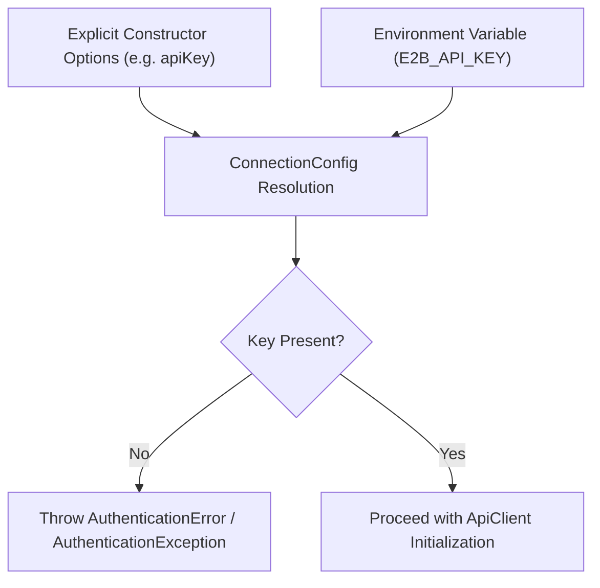
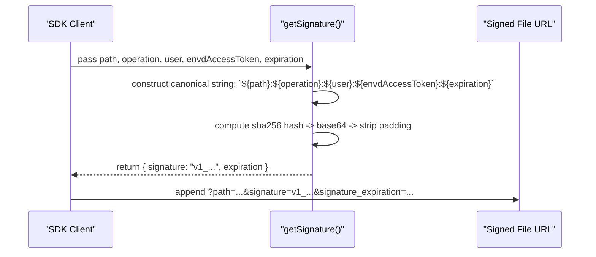

<!-- source: DeepWiki mcp.deepwiki.com · repo e2b-dev/E2B · page 6.3 Authentication, Signing and Security · fetched 2026-10-29 -->

# Authentication, Signing and Security

<details>
<summary>Relevant source files</summary>

The following files were used as context for generating this wiki page:

- [packages/js-sdk/src/api/metadata.ts](packages/js-sdk/src/api/metadata.ts)
- [packages/js-sdk/src/sandbox/iam.ts](packages/js-sdk/src/sandbox/iam.ts)
- [packages/js-sdk/src/sandbox/signature.ts](packages/js-sdk/src/sandbox/signature.ts)
- [packages/js-sdk/src/secret.ts](packages/js-sdk/src/secret.ts)
- [packages/js-sdk/src/volume/client.ts](packages/js-sdk/src/volume/client.ts)
- [packages/js-sdk/tests/api/apiKey.test.ts](packages/js-sdk/tests/api/apiKey.test.ts)
- [packages/js-sdk/tests/sandbox/iam.test.ts](packages/js-sdk/tests/sandbox/iam.test.ts)
- [packages/js-sdk/tests/sandbox/networkTransform.test.ts](packages/js-sdk/tests/sandbox/networkTransform.test.ts)
- [packages/python-sdk/e2b/sandbox/iam.py](packages/python-sdk/e2b/sandbox/iam.py)
- [packages/python-sdk/e2b/sandbox/signature.py](packages/python-sdk/e2b/sandbox/signature.py)
- [packages/python-sdk/tests/async/sandbox_async/files/test_secured.py](packages/python-sdk/tests/async/sandbox_async/files/test_secured.py)
- [packages/python-sdk/tests/async/sandbox_async/test_secure.py](packages/python-sdk/tests/async/sandbox_async/test_secure.py)
- [packages/python-sdk/tests/sync/sandbox_sync/files/test_secured.py](packages/python-sdk/tests/sync/sandbox_sync/files/test_secured.py)
- [packages/python-sdk/tests/sync/sandbox_sync/test_secure.py](packages/python-sdk/tests/sync/sandbox_sync/test_secure.py)
- [packages/python-sdk/tests/test_api_key.py](packages/python-sdk/tests/test_api_key.py)
- [packages/python-sdk/tests/test_sandbox_urls.py](packages/python-sdk/tests/test_sandbox_urls.py)

</details>


This page covers the authentication, signing, and security mechanisms in E2B, including API keys, access tokens, traffic tokens, file URL signatures, secure sandbox mode, and IAM workload identity tokens. The architecture uses a multi-tier security model that separates control plane operations (E2B API), data plane communications (`envd`), volume storage APIs, and egress proxy IAM injection.

---

## 1. Control Plane Authentication (E2B API)

Control plane operations—such as managing sandboxes, templates, and secrets—rely on API key authentication against the E2B API service (defaulting to `api.e2b.app`).

### Configuration and Precedence
API keys are configured via the `ConnectionConfig` class and can be supplied either through explicit constructor parameters or the `E2B_API_KEY` environment variable. 



The SDKs enforce that an API key is provided unless explicitly bypassed (e.g., when `requireApiKey` is set to `false`). If missing, an `AuthenticationError` (JavaScript) or `AuthenticationException` (Python) is thrown immediately upon client instantiation.

Sources: [packages/js-sdk/src/connectionConfig.ts:17-40](), [packages/python-sdk/e2b/connection_config.py:34-42](), [packages/js-sdk/tests/api/apiKey.test.ts:1-26](), [packages/python-sdk/tests/test_api_key.py:1-12]()

---

## 2. Data Plane Authentication: Access Tokens and Traffic Tokens

Data plane operations communicate directly with the `envd` daemon running inside each sandbox or with dedicated management microservices like the Volume API.

### `envdAccessToken` and `X-Access-Token`
When a sandbox is created in secure mode, the control plane generates an `envdAccessToken`. This token must be passed in the `X-Access-Token` header for all gRPC or HTTP requests targeting the sandbox's `envd` API. Control-plane headers (like the API key's `Authorization`) are intentionally omitted from data-plane payloads to prevent credential leakage into guest environments.

### Volume API Authentication
The Volume API client (`VolumeApiClient`) utilizes project-scoped tokens via the `VolumeConnectionConfig` class, injecting an `Authorization: Bearer <token>` header alongside standard telemetry metadata headers.

```typescript
// packages/js-sdk/src/volume/client.ts
class VolumeApiClient {
  readonly api: ReturnType<typeof createClient<paths>>

  constructor(config: VolumeConnectionConfig) {
    this.api = createClient<paths>({
      baseUrl: config.apiUrl,
      fetch: createApiFetch(config.proxy),
      headers: {
        ...defaultHeaders,
        ...(config.token && { Authorization: `Bearer ${config.token}` }),
        ...config.headers,
      },
    })
    // ...
  }
}
```

Sources: [packages/js-sdk/src/volume/client.ts:68-135](), [packages/js-sdk/tests/sandbox/rpcHeaders.test.ts:20-49]()

---

## 3. File URL Signatures and Secure Mode

When sandboxes run in secure mode, direct file upload and download endpoints require cryptographic signatures embedded in query parameters to authorize file transfer operations without exposing raw access tokens.

### Signature Generation Mechanics
The `getSignature` utility computes an HMAC-SHA256 hash (formatted with a `v1_` prefix) over a canonical string representation combining the target file path, operation type (`read` or `write`), user identity, `envdAccessToken`, and an optional expiration timestamp.



**Canonical String Formats:**
- Without Expiration: `${path}:${operation}:${user}:${envdAccessToken}`
- With Expiration: `${path}:${operation}:${user}:${envdAccessToken}:${signatureExpiration}`

If an expiration is specified and has passed, the egress proxy or `envd` daemon rejects the request with a `401 Unauthorized` response.

Sources: [packages/js-sdk/src/sandbox/signature.ts:1-61](), [packages/python-sdk/e2b/sandbox/signature.py:1-47](), [packages/python-sdk/tests/sync/sandbox_sync/files/test_secured.py:1-59]()

---

## 4. IAM Workload Identity Tokens and Network Transforms

E2B sandboxes support injecting IAM workload identity tokens into egress requests via network transforms. The SDK provides helper utilities under `Secret.iamToken` and `iamTokenPlaceholders` to map dynamic credentials safely.

### Placeholder Interpolation
Workload tokens are referenced inside network transform callback functions using a structured placeholder grammar interpreted by the sandbox's egress proxy:
`${e2b.identity.tokens.<name>}`

```typescript
// packages/js-sdk/src/sandbox/iam.ts
export function iamTokenPlaceholders(
  tokenNames: string[],
  { validate }: { validate: boolean }
): Record<string, string> {
  const tokens: Record<string, string> = {}
  for (const name of tokenNames) {
    tokens[name] = iamTokenPlaceholder(name)
  }
  // ... Proxy wrapper protecting against unregistered keys and runtime probes ...
}
```

### Proxy Safeguards and Validation
The SDK wraps token name lookups in a JavaScript `Proxy` object (and equivalent Python mappings) to enforce strict security boundaries:
1. **Name Validation:** Token names cannot be empty or contain control characters or braces (`{`, `}`) which would break the egress proxy's placeholder parsing grammar (`INVALID_IAM_TOKEN_NAME_CHARS`).
2. **Unregistered Access:** Accessing a token name that was not registered during `Sandbox.create` throws an `InvalidArgumentError` rather than silently injecting an invalid placeholder.
3. **Runtime Probes:** Properties probed automatically by runtimes and JSON serialization engines (`toJSON`, `then`, `toString`, `valueOf`) are guarded to prevent malformed serialization or security exceptions.

Sources: [packages/js-sdk/src/sandbox/iam.ts:1-149](), [packages/js-sdk/tests/sandbox/networkTransform.test.ts:38-219](), [packages/js-sdk/tests/sandbox/iam.test.ts:1-184]()

---

## 5. User Context and Secrets Management

### Execution User Context
Commands and file operations can be executed on behalf of specific Linux users (e.g., `user` or `root`). This identity is transmitted securely within request headers or gRPC metadata context.

### Secrets Storage
Team-scoped `Secret` resources store write-only configuration values managed via the control plane API. Secret values are accepted upon creation or update but are never returned via read APIs, safeguarding sensitive API credentials and keys from exposure in logs or client memory dumps.

Sources: [packages/js-sdk/src/secret.ts:156-251]()

---

