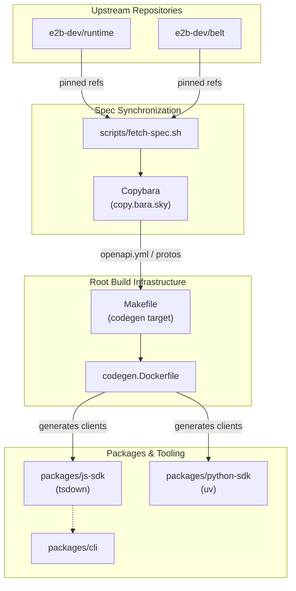

<!-- source: DeepWiki mcp.deepwiki.com · repo e2b-dev/E2B · page 7 Development Infrastructure · fetched 2026-10-29 -->

# Development Infrastructure

Relevant source files

The following files were used as context for generating this wiki page:

- [CLAUDE.md](CLAUDE.md)
- [Makefile](Makefile)
- [copy.bara.sky](copy.bara.sky)
- [packages/cli/src/utils/templateName.ts](packages/cli/src/utils/templateName.ts)
- [packages/cli/tests/commands/template/init.test.ts](packages/cli/tests/commands/template/init.test.ts)
- [scripts/fetch-spec.sh](scripts/fetch-spec.sh)

This page provides a high-level overview of the build tooling, CI/CD pipelines, code generation workflows, and repository conventions that power the E2B monorepo. It summarizes how packages are built, tested, and synchronized across languages, and links to detailed child pages for each sub-topic.

Sources: [Makefile:1-35](), [copy.bara.sky:1-79](), [scripts/fetch-spec.sh:1-61]()

---

## 7.1. Monorepo Build System and Tooling

The E2B repository is organized as a **pnpm workspace monorepo** for JavaScript/TypeScript packages (`packages/js-sdk`, `packages/cli`, etc.) alongside `uv`-managed Python packages (`packages/python-sdk`). Tooling configurations are maintained at the root level via `package.json`, `.tool-versions`, `.npmrc`, and the root `Makefile` [Makefile:1-35]().

Workspace conventions and contributor guidelines are established in `CLAUDE.md`, which defines mandatory workflow rules such as using `pnpm` and `uv`, executing formatting (`pnpm run format`), linting, and typechecking prior to commits [CLAUDE.md:1-2](). Repository governance is supported via `.vscode` settings, `CODEOWNERS`, and standardized build tools like `tsdown` and `uv` [packages/js-sdk/package.json:27](), [packages/python-sdk/pyproject.toml:57-58]().

For details on workspace layout, tsdown/tsconfig setups, editor configurations, and repo conventions, see [Monorepo Build System and Tooling](#7.1).

Sources: [CLAUDE.md:1-11](), [Makefile:1-35](), [package.json:1-18]()

---

## 7.2. CI/CD and Release Process

Automated validation, testing, and publishing are orchestrated via GitHub Actions workflows. The pipeline executes multi-runtime test suites (`sdk_tests`, `js/python/cli tests`), static analysis (`lint`, `typecheck`), and validation checks (`generated_files`) to guarantee complete consistency between source code and generated specifications.

Releases and package publishing are coordinated using **changesets** (`pnpm changeset`) [CLAUDE.md:7]() and automated release workflows that upload built artifacts to npm and PyPI, accompanied by Slack notifications.

For complete workflow definitions, publishing scripts, changesets versioning rules, and CI diagnostics, see [CI/CD and Release Process](#7.2).

Sources: [CLAUDE.md:7](), [package.json:5-6]()

---

## 7.3. Code Generation and Spec Sync

E2B relies on an automated **code generation pipeline** to maintain type safety and protocol compatibility across the control plane REST API, `envd` runtime daemons, and volume content services. Specifications are fetched from source-of-truth repositories (`e2b-dev/runtime` and `e2b-dev/belt`) via **Copybara** (`copy.bara.sky`) and `scripts/fetch-spec.sh` using commit hashes pinned in `spec/runtime-ref` and `spec/belt-ref` [CLAUDE.md:5](), [copy.bara.sky:14-15](), [scripts/fetch-spec.sh:8-12]().

Developers trigger code generation through the root `Makefile`, which builds a containerized environment via `codegen.Dockerfile` or executes code generation tools like `openapi-typescript`, `buf`, and `datamodel-code-generator` [Makefile:16-23]().

For detailed documentation on the codegen pipeline, Copybara sync rules, redocly configuration, and spec fetching scripts, see [Code Generation and Spec Sync](#7.3).

Sources: [CLAUDE.md:5](), [Makefile:1-35](), [copy.bara.sky:1-79](), [scripts/fetch-spec.sh:1-61]()

---

## 7.4. Testing Strategy

The repository utilizes robust testing frameworks tailored to each language runtime:
- **Vitest** for JavaScript/TypeScript packages, supporting multi-runtime test suites across Node.js, Bun, Deno, Cloudflare Workers (`workerd`), and browsers [packages/js-sdk/package.json:30-42]().
- **Pytest** with parallel execution (`uv run pytest -n 4`) for the Python SDK and associated fixtures (`conftest.py`) [packages/python-sdk/package.json:7]().
- Specialized test fixtures and mock `envd` frame servers to simulate sandbox network and process interactions.

For comprehensive details on test configurations, shared fixtures, multi-runtime execution matrices, and testground suites, see [Testing Strategy](#7.4).

Sources: [packages/js-sdk/package.json:30-42](), [packages/python-sdk/package.json:7]()

---

## Child Pages
- [Monorepo Build System and Tooling](#7.1)
- [CI/CD and Release Process](#7.2)
- [Code Generation and Spec Sync](#7.3)
- [Testing Strategy](#7.4)

---

