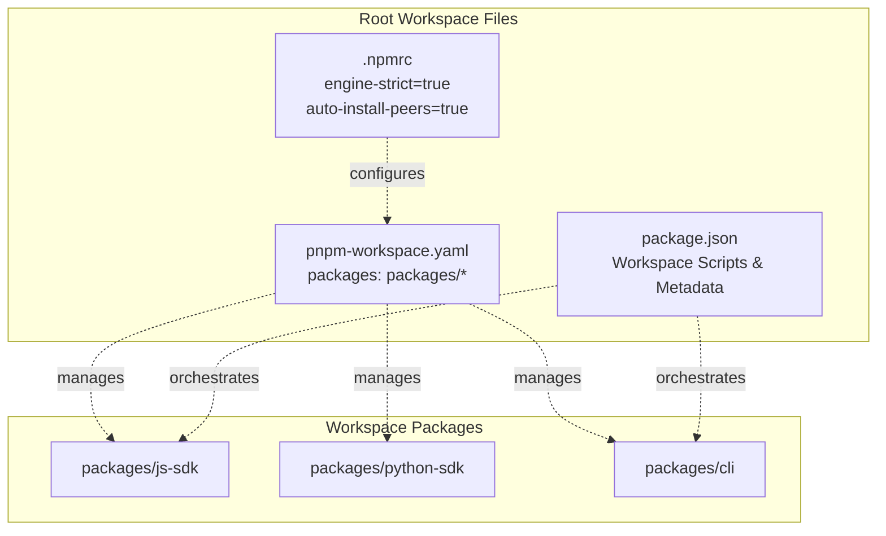
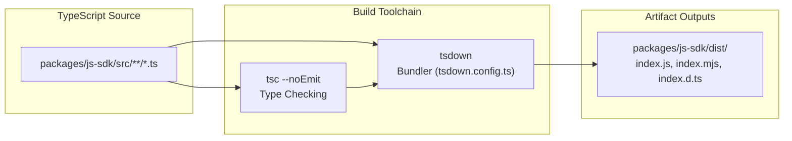
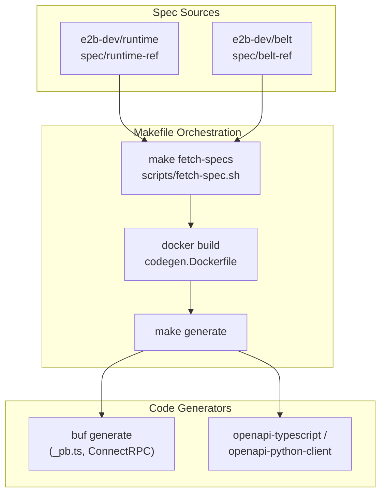

<!-- source: DeepWiki mcp.deepwiki.com · repo e2b-dev/E2B · page 7.1 Monorepo Build System and Tooling · fetched 2026-10-29 -->

# Monorepo Build System and Tooling

Relevant source files

The following files were used as context for generating this wiki page:

- [.changeset/connectrpc-minor-bump.md](.changeset/connectrpc-minor-bump.md)
- [.changeset/undici-security-patch.md](.changeset/undici-security-patch.md)
- [.gitattributes](.gitattributes)
- [.gitignore](.gitignore)
- [.npmrc](.npmrc)
- [.vscode/settings.json](.vscode/settings.json)
- [CLAUDE.md](CLAUDE.md)
- [CODEOWNERS](CODEOWNERS)
- [Makefile](Makefile)
- [codegen.Dockerfile](codegen.Dockerfile)
- [copy.bara.sky](copy.bara.sky)
- [packages/cli/src/utils/templateName.ts](packages/cli/src/utils/templateName.ts)
- [packages/cli/tests/commands/template/init.test.ts](packages/cli/tests/commands/template/init.test.ts)
- [packages/js-sdk/tsconfig.json](packages/js-sdk/tsconfig.json)
- [packages/js-sdk/tsdown.config.ts](packages/js-sdk/tsdown.config.ts)
- [pnpm-workspace.yaml](pnpm-workspace.yaml)
- [scripts/fetch-spec.sh](scripts/fetch-spec.sh)

This document details the E2B monorepo's workspace structure, build tooling, compilation pipelines, code generation orchestrations, editor settings, and repository governance conventions. The repository relies on **pnpm workspaces** for Node.js packages, **uv** for Python packages, **tsdown** for TypeScript bundling, and a containerized code generation pipeline orchestrated via a root `Makefile`.

---

## 1. Workspace Configuration and pnpm Tooling

The root workspace is governed by `pnpm-workspace.yaml` and `.npmrc`, defining package scopes, dependency catalogs, and strict runtime engine requirements across packages such as `packages/js-sdk`, `packages/python-sdk`, and `packages/cli`.

### Workspace Layout and Catalogs

The `pnpm-workspace.yaml` file defines the workspace packages glob and centrally manages dependency versions using catalogs and build rules:
- **Packages**: `packages/*` [pnpm-workspace.yaml:1-2]()
- **Ignored Build Dependencies**: Built-in native packages like `bufferutil`, `msw`, and `utf-8-validate` [pnpm-workspace.yaml:8-11]()
- **Catalog**: Centralizes shared dev dependencies such as `@types/node` (`^20.19.19`), `tsdown` (`^0.22.14`), `typescript`, and `vitest` (`^4.1.11`) [pnpm-workspace.yaml:41-49]()
- **Security Policy**: Sets `minimumReleaseAge: 4320` (3 days) to protect against supply-chain compromises in freshly published dependencies [pnpm-workspace.yaml:51-53]().

The package installation and linkage behavior are tightly controlled via `.npmrc`:
- `enable-pre-post-scripts=true` [\.npmrc:1]()
- `auto-install-peers=true` [\.npmrc:2]()
- `engine-strict=true` [\.npmrc:6]() to enforce Node/pnpm engine constraints.

Sources: [pnpm-workspace.yaml:1-53](), [.npmrc:1-6]()

---

## 2. TypeScript Build System: tsdown and tsconfig

TypeScript packages (`packages/js-sdk`, `packages/cli`) share a common compiler configuration base and leverage **tsdown** for zero-config bundling.

### Compilation Hierarchy

Packages extend root TypeScript configurations (e.g., `packages/js-sdk/tsconfig.json` extends `../../tsconfig.sdk.json`) to enforce strict type checking and output management:
- **Output Directory**: `dist/` [packages/js-sdk/tsconfig.json:4]()
- **Bundling Configuration**: Defined in `packages/js-sdk/tsdown.config.ts`, which wraps `createSdkTsdownConfig` [packages/js-sdk/tsdown.config.ts:3-6]()
- **External Dependencies**: Inlines specific ESM-only dependencies like `error-stack-parser-es` via `noExternal` to guarantee CommonJS interoperability [packages/js-sdk/tsdown.config.ts:8-10]().

Sources: [packages/js-sdk/tsconfig.json:1-8](), [packages/js-sdk/tsdown.config.ts:1-11]()

---

## 3. Makefile and Code Generation Pipeline

Because API specifications (`spec/openapi_generated.yml`) and gRPC definitions (`spec/envd/*.proto`) originate from separate repositories (`e2b-dev/runtime` and `e2b-dev/belt`), the monorepo uses a containerized code generation pipeline managed by the root `Makefile` and `codegen.Dockerfile`.

### Pipeline Execution Flow

When updating definitions or generating SDK stubs:
1. `make fetch-specs` invokes `./scripts/fetch-spec.sh` to pull specs from pinned repository commits [Makefile:6-11]().
2. `make codegen` builds or utilizes a cached Docker image (`codegen-env`) defined in `codegen.Dockerfile` [Makefile:15-22]() running Go, Python, Node, `buf`, and `openapi-python-client`.
3. `make generate` triggers package-specific generation targets (`generate-js`, `generate-python`) [Makefile:24-30]().

Sources: [Makefile:1-31](), [codegen.Dockerfile:1-47]()

---

## 4. Repository Conventions and Governance

Monorepo governance, editor integrations, and contribution workflows are defined through specific configuration and documentation files.

### Editor Settings and Governance Files

- **VS Code Configuration**: `.vscode/settings.json` enforces formatting rules, excludes build artifacts (`lib/**`, `.venv/**`, `dist/**`), sets the default TypeScript SDK path (`node_modules/typescript/lib`), configures Black as the Python formatter, and sets Pylance paths pointing to the Python SDK virtual environment [\.vscode/settings.json:1-88]().
- **Repository Guidelines (`CLAUDE.md`)**: Documents operational rules such as using `pnpm` and `uv`, running `format`, `lint`, and `typecheck` pre-commit, updating parity across JS and Python implementations, and generating changesets via `pnpm changeset` for public-facing modifications [CLAUDE.md:1-11]().
- **Code Owners (`CODEOWNERS`)**: Maps default repository ownership to `@mishushakov` [CODEOWNERS:1-3]().
- **Generated File Attributes (`.gitattributes`)**: Marks generated client stubs (`linguist-generated=true`) to exclude them from GitHub pull request diff noise [\.gitattributes:1-5]().

Sources: [\.vscode/settings.json:1-88](), [CLAUDE.md:1-11](), [CODEOWNERS:1-3](), [\.gitattributes:1-5]()

---

