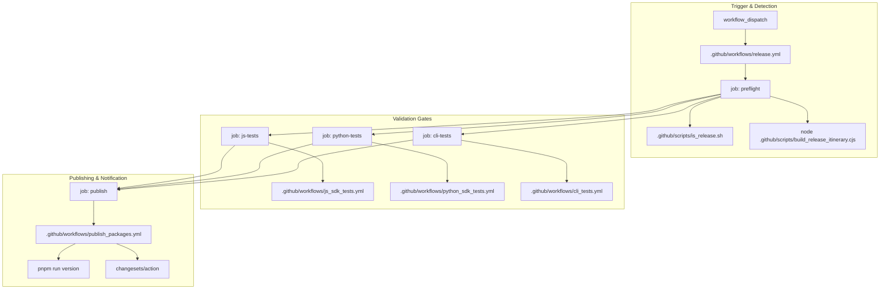
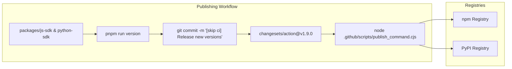

<!-- source: DeepWiki mcp.deepwiki.com · repo e2b-dev/E2B · page 7.2 CI/CD and Release Process · fetched 2026-10-29 -->

# CI/CD and Release Process

Relevant source files

The following files were used as context for generating this wiki page:

- [.changeset/README.md](.changeset/README.md)
- [.changeset/config.json](.changeset/config.json)
- [.github/scripts/publish_command.cjs](.github/scripts/publish_command.cjs)
- [.github/scripts/publish_python_sdk.sh](.github/scripts/publish_python_sdk.sh)
- [.github/workflows/cli_tests.yml](.github/workflows/cli_tests.yml)
- [.github/workflows/codegen_image_cache.yml](.github/workflows/codegen_image_cache.yml)
- [.github/workflows/generated_files.yml](.github/workflows/generated_files.yml)
- [.github/workflows/js_sdk_tests.yml](.github/workflows/js_sdk_tests.yml)
- [.github/workflows/lint.yml](.github/workflows/lint.yml)
- [.github/workflows/publish_packages.yml](.github/workflows/publish_packages.yml)
- [.github/workflows/python_sdk_tests.yml](.github/workflows/python_sdk_tests.yml)
- [.github/workflows/release.yml](.github/workflows/release.yml)
- [.github/workflows/sdk_tests.yml](.github/workflows/sdk_tests.yml)
- [.github/workflows/typecheck.yml](.github/workflows/typecheck.yml)

## Purpose and Scope

This document describes the Continuous Integration and Continuous Deployment (CI/CD) infrastructure for the E2B monorepo. The pipeline orchestrates automated testing, code quality checks, version management, and package publishing across JavaScript SDK, Python SDK, and CLI packages using GitHub Actions. The system is designed to handle multi-runtime environments (Node.js, Bun, Deno, Cloudflare Workers) and multi-platform validation (Ubuntu, Windows).

Sources: [.github/workflows/release.yml:1-159](), [.github/workflows/sdk_tests.yml:1-136]()

## Pipeline Architecture

The CI/CD system consists of several primary workflow categories executed via GitHub Actions:
1. **Pull Request Quality Gates**: Automated linting, typechecking, and generated file verification (`lint.yml`, `typecheck.yml`, `generated_files.yml`).
2. **SDK & CLI Testing**: Comprehensive test suites across production and staging environments (`sdk_tests.yml`, `js_sdk_tests.yml`, `python_sdk_tests.yml`, `cli_tests.yml`).
3. **Release Orchestration**: A coordinated workflow for detecting version changes and publishing packages (`release.yml`, `publish_packages.yml`).
4. **Build Caching**: Optimized container build caches for code generation and copybara syncing (`codegen_image_cache.yml`).

### Natural Language to Code Entity Mapping: Release Flow

The following diagram maps the high-level release concepts to specific workflow files and job identifiers within the repository.

Sources: [.github/workflows/release.yml:1-196](), [.github/workflows/publish_packages.yml:1-126]()

## Tool Version Management

All workflows use centralized tool version definitions from `.tool-versions`. The `wistia/parse-tool-versions` action is used consistently across workflows to parse and export these as environment variables.

| Tool | Usage | Workflow Variable |
| :--- | :--- | :--- |
| `pnpm` | Node.js monorepo management | `TOOL_VERSION_PNPM` |
| `nodejs` | Runtime for SDK and CLI | `TOOL_VERSION_NODEJS` |
| `uv` | Python dependency and build management | `TOOL_VERSION_UV` |
| `python` | Python SDK runtime | `TOOL_VERSION_PYTHON` |
| `deno` | Deno runtime testing for JS SDK | `TOOL_VERSION_DENO` |
| `bun` | Bun runtime testing for JS SDK | `TOOL_VERSION_BUN` |

Sources: [.github/workflows/release.yml:41-47](), [.github/workflows/publish_packages.yml:35-46](), [.github/workflows/js_sdk_tests.yml:67-73]()

## Pull Request Quality Gates

Every pull request triggers a suite of checks to ensure code health via path filtering.

### Linting and Formatting (`lint.yml`)
Detects changes in code paths using `dorny/paths-filter` and executes `pnpm run lint` and `pnpm run format` [.github/workflows/lint.yml:18-36](). It verifies that no uncommitted changes remain after formatting [.github/workflows/lint.yml:92-101]().

### Typechecking (`typecheck.yml`)
Runs `pnpm run typecheck` across the monorepo packages [.github/workflows/typecheck.yml:80-82](). For the Python SDK, it executes `uv sync --locked` prior to typechecking [.github/workflows/typecheck.yml:75-79]().

### Generated Files Verification (`generated_files.yml`)
Ensures that files generated from specs (OpenAPI, Protobuf) are up to date. It builds two container images using Docker Buildx with GitHub Actions cache integration:
* `codegen.Dockerfile`: Used for general code generation [.github/workflows/generated_files.yml:81-91]().
* `copybara.Dockerfile`: Used for syncing specs across repositories [.github/workflows/generated_files.yml:93-103]().
The workflow runs `make codegen` and fails if `git status` or `git diff` detects modifications [.github/workflows/generated_files.yml:123-140]().

Sources: [.github/workflows/lint.yml:1-101](), [.github/workflows/typecheck.yml:1-82](), [.github/workflows/generated_files.yml:1-140]()

## SDK and CLI Testing Strategy

The repository employs a matrix-based testing strategy across production and staging environments.

### JavaScript SDK Matrix
The `js_sdk_tests.yml` workflow tests the SDK against multiple runtimes and operating systems:
* **Runtimes & OS**: `node` (`ubuntu-22.04`, `windows-latest`), `bun` (`ubuntu-22.04`), `deno` (`ubuntu-22.04`), `cloudflare` (workerd), `cloudflare-deploy`, and `browser` (Chromium via Playwright) [.github/workflows/js_sdk_tests.yml:31-50]().
* **Staging Validation**: The `sdk_tests.yml` workflow triggers test legs against a staging environment (`E2B_DOMAIN_STAGING`) using a `node-only` flag to validate backend compatibility [.github/workflows/sdk_tests.yml:143-155]().

### Python SDK Matrix
The `python_sdk_tests.yml` workflow uses `uv` for environment management and `pytest` for execution:
* **Parallelization**: Tests run with `pytest --verbose --numprocesses=4` [.github/workflows/python_sdk_tests.yml:56-57]().
* **Build Validation**: Explicitly executes `uv build` before running tests [.github/workflows/python_sdk_tests.yml:53-54]().

### CLI Validation
The CLI test suite (`cli_tests.yml`) builds the core JS SDK as a prerequisite before building and testing the CLI package [.github/workflows/cli_tests.yml:62-72]().

Sources: [.github/workflows/sdk_tests.yml:1-250](), [.github/workflows/js_sdk_tests.yml:1-178](), [.github/workflows/python_sdk_tests.yml:1-60](), [.github/workflows/cli_tests.yml:1-75]()

## Release and Publishing Workflow

E2B uses a Changesets-based workflow to manage versioning and publishing across packages.

### Release Preflight and Itinerary
The `release.yml` workflow validates that releases run exclusively on the `main` branch [.github/workflows/release.yml:27-36](). It checks package version statuses via `is_release.sh` and builds a release itinerary using `.cs-status.json` and `build_release_itinerary.cjs` [.github/workflows/release.yml:70-140]().

### The Publishing Process (`publish_packages.yml`)
The publish workflow performs the following steps:
1. **GitHub App Token Minting**: Generates an authenticated token using `actions/create-github-app-token` [.github/workflows/publish_packages.yml:24-29]().
2. **Version Bump**: Runs `pnpm run version` to execute `changeset version`, updating `package.json` and `CHANGELOG.md` files [.github/workflows/publish_packages.yml:80-84]().
3. **Commit Version Changes**: Commits updated files using `github-actions[bot]` credentials before publishing so release tags reference the version bump commit [.github/workflows/publish_packages.yml:85-101]().
4. **Registry Upload**: Uses `changesets/action` with a dynamic publish command determined by `publish_command.cjs` to publish to npm and PyPI while creating GitHub releases [.github/workflows/publish_packages.yml:103-111]().
5. **Branch Push and Merge**: Pushes tags and commits, handling mid-release upstream merges if necessary [.github/workflows/publish_packages.yml:112-126]().

### Natural Language to Code Entity Mapping: Publishing Pipeline

Sources: [.github/workflows/release.yml:1-196](), [.github/workflows/publish_packages.yml:1-126](), [.changeset/config.json:1-15]()

## Build Caching and Codegen Infrastructure

To accelerate pull request checks for generated files, the repository maintains dedicated Docker build caches.

### Codegen Image Cache (`codegen_image_cache.yml`)
The cache workflow seeds BuildKit caches for `codegen.Dockerfile` and `copybara.Dockerfile` whenever changes are pushed to `main` or triggered via `workflow_dispatch` [.github/workflows/codegen_image_cache.yml:1-44](). Pull request workflows (`generated_files.yml`) consume these caches read-only using `cache-from: type=gha`, avoiding redundant container image builds [.github/workflows/generated_files.yml:81-103]().

Sources: [.github/workflows/codegen_image_cache.yml:1-44](), [.github/workflows/generated_files.yml:1-140]()

---

