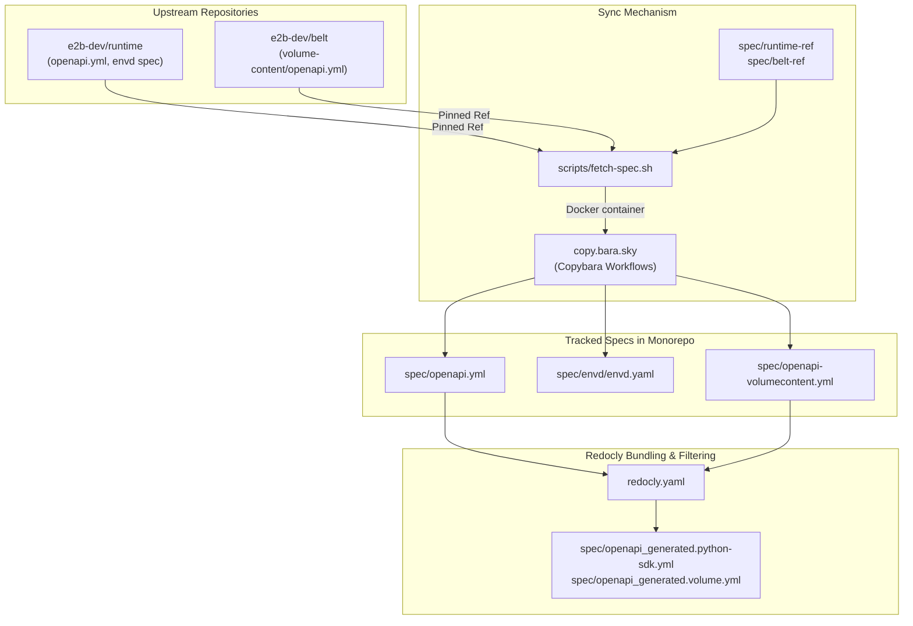
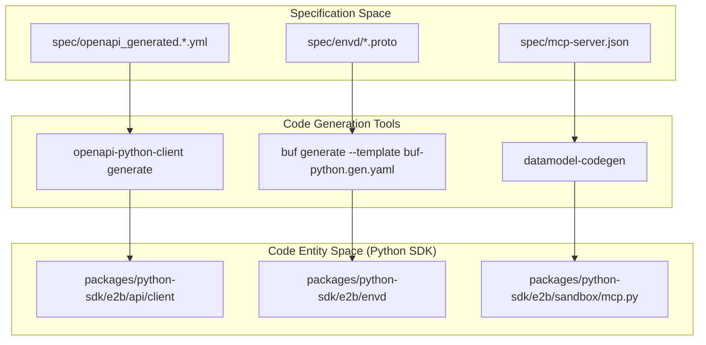

<!-- source: DeepWiki mcp.deepwiki.com · repo e2b-dev/E2B · page 7.3 Code Generation and Spec Sync · fetched 2026-10-29 -->

# Code Generation and Spec Sync

Relevant source files

The following files were used as context for generating this wiki page:

- [.changeset/connectrpc-minor-bump.md](.changeset/connectrpc-minor-bump.md)
- [.changeset/undici-security-patch.md](.changeset/undici-security-patch.md)
- [.tool-versions](.tool-versions)
- [CLAUDE.md](CLAUDE.md)
- [Makefile](Makefile)
- [codegen.Dockerfile](codegen.Dockerfile)
- [copy.bara.sky](copy.bara.sky)
- [packages/cli/src/utils/templateName.ts](packages/cli/src/utils/templateName.ts)
- [packages/cli/tests/commands/template/init.test.ts](packages/cli/tests/commands/template/init.test.ts)
- [packages/js-sdk/src/volume/schema.gen.ts](packages/js-sdk/src/volume/schema.gen.ts)
- [packages/python-sdk/Makefile](packages/python-sdk/Makefile)
- [pnpm-workspace.yaml](pnpm-workspace.yaml)
- [redocly.yaml](redocly.yaml)
- [scripts/fetch-spec.sh](scripts/fetch-spec.sh)

This document covers the specification synchronization pipeline (using Copybara and Redocly) and the automated code generation architecture used across the E2B monorepo to maintain type-safe clients for the JavaScript and Python SDKs.

## Specification Synchronization Architecture

E2B uses a specification-driven design where upstream repository specs (`e2b-dev/runtime` and `e2b-dev/belt`) serve as the source of truth for REST APIs, envd protocols, and volume content APIs [CLAUDE.md:5](), [copy.bara.sky:14-15](). 

The synchronization process relies on **Copybara** workflows defined in `copy.bara.sky` [copy.bara.sky:1-79](), executed via `scripts/fetch-spec.sh` [scripts/fetch-spec.sh:1-61](), and driven by the root `Makefile` [Makefile:6-11]().

**Spec Synchronization and Bundling Pipeline**

**Sources:** [copy.bara.sky:1-79](), [scripts/fetch-spec.sh:1-61](), [redocly.yaml:1-60](), [Makefile:6-11]()

### Copybara Workflows

The `copy.bara.sky` configuration defines three primary core workflows [copy.bara.sky:1-79]():
- `api-spec`: Pulls `spec/openapi.yml` from `e2b-dev/runtime` [copy.bara.sky:20-33]().
- `envd-spec`: Pulls `packages/envd/spec/envd.yaml` and related protobuf files from `e2b-dev/runtime` into `spec/envd/` [copy.bara.sky:36-61]().
- `volume-api-spec`: Pulls `packages/volume-content/openapi.yml` from the private `e2b-dev/belt` repository into `spec/openapi-volumecontent.yml` [copy.bara.sky:63-79]().

The script `scripts/fetch-spec.sh` resolves commit pins from `spec/runtime-ref` and `spec/belt-ref`, injects GitHub authentication tokens (`GITHUB_TOKEN` or `gh auth token`), and runs the Copybara migration container [scripts/fetch-spec.sh:23-60]().

**Sources:** [copy.bara.sky:1-79](), [scripts/fetch-spec.sh:1-61]()

## Redocly Bundling and Filtering

Before client generators consume the synced OpenAPI specifications, `redocly.yaml` filters and bundles the specs to strip out internal endpoints, administrative routes, and un-implemented features [redocly.yaml:1-60]().

Key decoration strategies configured in `redocly.yaml`:
- **`filter-in`**: Restricts exposed operations to specific tags per SDK (e.g., `sandboxes`, `snapshots`, `templates`, `tags`, `auth`, `volumes`, `secrets`) [redocly.yaml:23-42]().
- **`filter-out`**: Drops nodes marked with `x-not-implemented: true` or `x-internal: true` (which belong to the orchestrator control plane rather than client SDKs) [redocly.yaml:32-34](), [redocly.yaml:50-52]().
- **`remove-unused-components`**: Automatically discards component schemas that are no longer referenced by the filtered operations [redocly.yaml:31](), [redocly.yaml:53]().

**Sources:** [redocly.yaml:1-60](), [packages/python-sdk/Makefile:3-17]()

## Code Generation Pipeline and Toolchain

The code generation pipeline transforms the filtered specifications and protobuf definitions into strongly-typed SDK code. This execution runs within a containerized environment defined by `codegen.Dockerfile` [codegen.Dockerfile:1-47]().

### Code Generation Architecture

The following diagram bridges the Specification Space to the Code Entity Space across the JavaScript and Python SDK targets.

**Code Generation Architecture**

**Sources:** [codegen.Dockerfile:1-47](), [packages/python-sdk/Makefile:3-55](), [Makefile:13-31]()

### Toolchain Specification (`codegen.Dockerfile`)

The container pins exact versions for all generators to guarantee reproducible builds [codegen.Dockerfile:1-47]():
- **Protocol Buffers / Connect**: `buf` (`1.50.1`), `protoc-gen-go` (`1.28.1`), `protoc-gen-connect-go` (`1.18.1`), `protoc-gen-connect-es` (`1.6.1`), `@bufbuild/protoc-gen-es` (`2.6.2`) [codegen.Dockerfile:4-6](), [codegen.Dockerfile:43-44]().
- **Python Generators**: `openapi-python-client` (`0.26.2`), `datamodel-code-generator` (`0.64.0`), `protoc-gen-connectrpc` (`0.11.1`), `protoc-gen-py` (`0.1.1`) [codegen.Dockerfile:24]().
- **Node & CLI Utilities**: Node.js (`22.18.0`), `pnpm` (`10.34.5`), `@redocly/cli` (`251.2`) [codegen.Dockerfile:27](), [codegen.Dockerfile:40-45]().

**Sources:** [codegen.Dockerfile:1-47]()

### Execution Commands and Makefile Integration

Code generation is invoked from the repository root via `make codegen`, which fetches specs and runs the containerized generation step [Makefile:16-23](). 

In the Python SDK package (`packages/python-sdk/Makefile`), sub-targets execute specific generation tasks [packages/python-sdk/Makefile:1-55]():
- `generate-api`: Bundles the main OpenAPI spec and runs `openapi-python-client generate` [packages/python-sdk/Makefile:3-9]().
- `generate-volume-api`: Bundles the volume OpenAPI spec and generates client bindings under `e2b/volume/client` [packages/python-sdk/Makefile:11-17]().
- `generate-envd`: Invokes `buf generate` using `buf-python.gen.yaml` for ConnectRPC stubs [packages/python-sdk/Makefile:21-25]().
- `generate-mcp`: Runs `datamodel-codegen` against `spec/mcp-server.json` to produce typed definitions in `e2b/sandbox/mcp.py` [packages/python-sdk/Makefile:44-55]().

**Sources:** [Makefile:1-31](), [packages/python-sdk/Makefile:1-55]()

---

