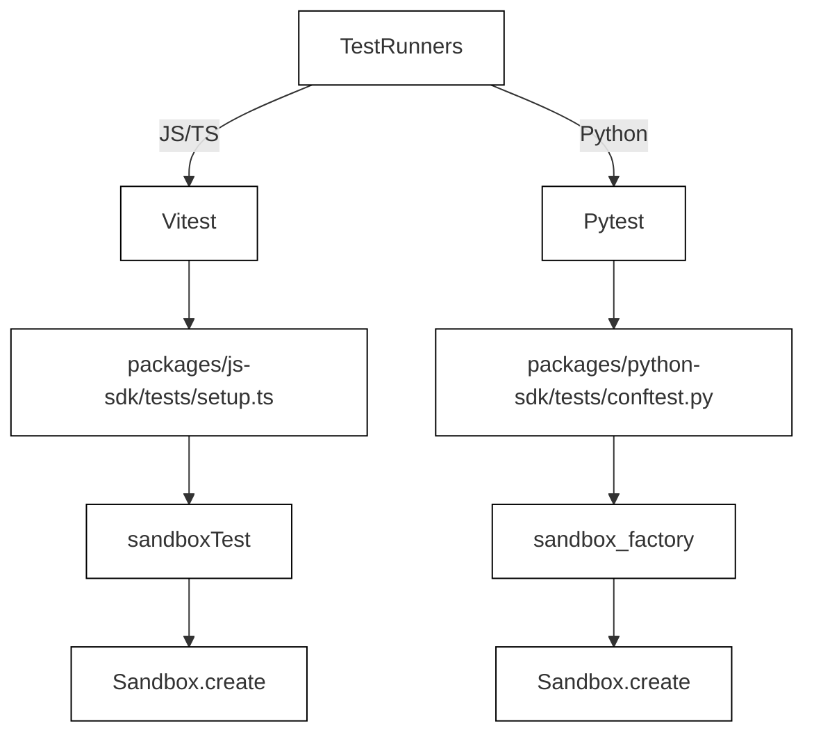
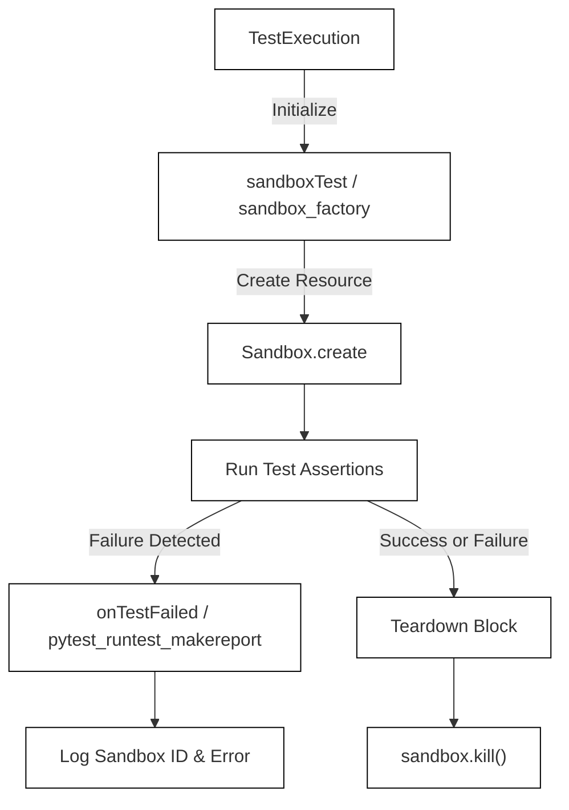
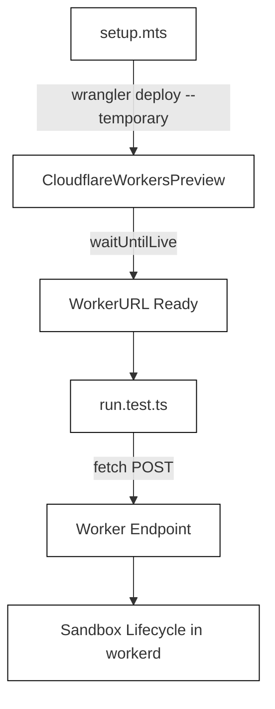

<!-- source: DeepWiki mcp.deepwiki.com · repo e2b-dev/E2B · page 7.4 Testing Strategy · fetched 2026-10-29 -->

# Testing Strategy

Relevant source files

The following files were used as context for generating this wiki page:

- [packages/code-interpreter-js/tsconfig.json](packages/code-interpreter-js/tsconfig.json)
- [packages/code-interpreter-js/tsdown.config.ts](packages/code-interpreter-js/tsdown.config.ts)
- [packages/code-interpreter-js/vitest.config.mts](packages/code-interpreter-js/vitest.config.mts)
- [packages/desktop-js/tsconfig.json](packages/desktop-js/tsconfig.json)
- [packages/desktop-js/tsdown.config.ts](packages/desktop-js/tsdown.config.ts)
- [packages/desktop-js/vitest.config.ts](packages/desktop-js/vitest.config.ts)
- [packages/js-sdk/.gitignore](packages/js-sdk/.gitignore)
- [packages/js-sdk/tests/runtimes/cloudflare-deploy/run.test.ts](packages/js-sdk/tests/runtimes/cloudflare-deploy/run.test.ts)
- [packages/js-sdk/tests/runtimes/cloudflare-deploy/setup.mts](packages/js-sdk/tests/runtimes/cloudflare-deploy/setup.mts)
- [packages/js-sdk/tests/runtimes/cloudflare-deploy/vitest.config.mts](packages/js-sdk/tests/runtimes/cloudflare-deploy/vitest.config.mts)
- [packages/js-sdk/tests/runtimes/cloudflare-deploy/worker.mjs](packages/js-sdk/tests/runtimes/cloudflare-deploy/worker.mjs)
- [packages/js-sdk/tests/runtimes/cloudflare-deploy/wrangler.jsonc](packages/js-sdk/tests/runtimes/cloudflare-deploy/wrangler.jsonc)
- [packages/js-sdk/tests/sandbox/host.test.ts](packages/js-sdk/tests/sandbox/host.test.ts)
- [packages/js-sdk/tests/sandbox/lifecyclePayload.test.ts](packages/js-sdk/tests/sandbox/lifecyclePayload.test.ts)
- [packages/js-sdk/tests/sandbox/network.test.ts](packages/js-sdk/tests/sandbox/network.test.ts)
- [packages/js-sdk/tests/sandbox/snapshot.test.ts](packages/js-sdk/tests/sandbox/snapshot.test.ts)
- [packages/js-sdk/tests/setup.ts](packages/js-sdk/tests/setup.ts)
- [packages/python-sdk/pytest.ini](packages/python-sdk/pytest.ini)
- [packages/python-sdk/tests/async/sandbox_async/test_internet_access.py](packages/python-sdk/tests/async/sandbox_async/test_internet_access.py)
- [packages/python-sdk/tests/async/sandbox_async/test_network.py](packages/python-sdk/tests/async/sandbox_async/test_network.py)
- [packages/python-sdk/tests/conftest.py](packages/python-sdk/tests/conftest.py)
- [packages/python-sdk/tests/sync/sandbox_sync/test_internet_access.py](packages/python-sdk/tests/sync/sandbox_sync/test_internet_access.py)
- [packages/python-sdk/tests/sync/sandbox_sync/test_network.py](packages/python-sdk/tests/sync/sandbox_sync/test_network.py)
- [vitest.sdk.config.mts](vitest.sdk.config.mts)

## Purpose and Scope
This page documents the testing strategy across the E2B monorepo, covering testing frameworks (Vitest for JavaScript/TypeScript and Pytest for Python), shared fixture architectures (`packages/js-sdk/tests/setup.ts` and `packages/python-sdk/tests/conftest.py`), multi-runtime verification (Node, Bun, Deno, Cloudflare Workers, and browser environments), and network/lifecycle simulation patterns.

---

## 1. Vitest and Pytest Setup Architectures

The E2B test suite is split between TypeScript packages (using Vitest) and Python packages (using Pytest). 

In the JavaScript SDK, Vitest projects are configured to support multiple execution environments, utilizing extension patterns in `packages/js-sdk/tests/setup.ts` to spin up live or mocked sandboxes. In the Python SDK, Pytest uses `packages/python-sdk/pytest.ini` with `asyncio_mode=auto` and an importlib import mode to execute both synchronous and asynchronous test cases seamlessly.

*Figure 1: Test runner architecture bridging configuration files to SDK instantiation methods.*

Sources: `packages/js-sdk/tests/setup.ts:1-106` [packages/js-sdk/tests/setup.ts:1-106](), `packages/python-sdk/tests/conftest.py:1-87` [packages/python-sdk/tests/conftest.py:1-87](), `packages/python-sdk/pytest.ini:1-16` [packages/python-sdk/pytest.ini:1-15]()

---

## 2. Shared Test Fixtures and Lifecycle Management

Both SDKs employ robust fixture systems to automate resource provisioning and guarantee teardown even when tests fail.

### JavaScript Fixtures (`sandboxTest`, `buildTemplateTest`, `volumeTest`)
Vitest fixtures extend base test contexts in `packages/js-sdk/tests/setup.ts`. The `sandboxTest` fixture automatically generates a unique `sandboxTestId`, instantiates a `Sandbox`, registers an error listener via `onTestFailed`, and guarantees cleanup by calling `sandbox.kill()` inside a `finally` block [packages/js-sdk/tests/setup.ts:70-106](). Similarly, `volumeTest` manages temporary `Volume` lifecycles [packages/js-sdk/tests/setup.ts:118-144]().

### Python Fixtures (`sandbox_factory`, `async_sandbox_factory`)
Pytest fixtures in `packages/python-sdk/tests/conftest.py` define sync and async factory functions (`sandbox_factory` and `async_sandbox_factory`) that inject test metadata, track failures using `pytest_runtest_makereport`, and execute teardown actions [packages/python-sdk/tests/conftest.py:43-124]().

*Figure 2: Fixture lifecycle management and error reporting sequence.*

Sources: `packages/js-sdk/tests/setup.ts:70-144` [packages/js-sdk/tests/setup.ts:70-144](), `packages/python-sdk/tests/conftest.py:43-124` [packages/python-sdk/tests/conftest.py:43-124]()

---

## 3. Multi-Runtime Test Suites

The JavaScript SDK is validated across multiple runtimes (Node.js, Bun, Deno, Cloudflare Workers, and browsers). Cloudflare Workers support is explicitly tested by packaging and deploying temporary preview workers using Wrangler (`packages/js-sdk/tests/runtimes/cloudflare-deploy/setup.mts`).

The setup script `setup()` invokes `wrangler deploy --temporary`, extracts the target worker URL, polls `waitUntilLive()` until the edge propagation succeeds, and injects the URL into the test context [packages/js-sdk/tests/runtimes/cloudflare-deploy/setup.mts:13-131](). The corresponding test suite (`packages/js-sdk/tests/runtimes/cloudflare-deploy/run.test.ts`) verifies sandbox creation and command execution from within the `workerd` runtime [packages/js-sdk/tests/runtimes/cloudflare-deploy/run.test.ts:5-59]().

*Figure 3: Cloudflare Workers deployment and validation data flow.*

Sources: `packages/js-sdk/tests/runtimes/cloudflare-deploy/setup.mts:13-131` [packages/js-sdk/tests/runtimes/cloudflare-deploy/setup.mts:13-131](), `packages/js-sdk/tests/runtimes/cloudflare-deploy/run.test.ts:5-59` [packages/js-sdk/tests/runtimes/cloudflare-deploy/run.test.ts:5-59]()

---

## 4. Network, Firewall, and Lifecycle Simulation

Testing advanced sandbox capabilities—such as network egress restrictions, firewall header injection, and auto-pause/auto-resume behavior—requires helper utilities defined in the test setup files.

Key helper functions include:
* `corsHttpServerCmd(port)`: Generates a Python HTTP server command with CORS headers enabled to allow browser and cross-origin fetch testing [packages/js-sdk/tests/setup.ts:172-188]().
* `waitForHttpStatus(url, expectedStatus)`: Polls sandbox endpoints with timeout and abort controller handling until the guest server responds [packages/js-sdk/tests/setup.ts:205-217]().

Network isolation tests (`packages/js-sdk/tests/sandbox/network.test.ts`, `packages/python-sdk/tests/sync/sandbox_sync/test_network.py`) apply `SandboxNetworkOpts` to verify `denyOut`, `allowOut`, and `allowPublicTraffic` rules [packages/js-sdk/tests/sandbox/network.test.ts:13-196](), [packages/python-sdk/tests/sync/sandbox_sync/test_network.py:50-194](). Lifecycle tests (`packages/js-sdk/tests/sandbox/lifecyclePayload.test.ts`) validate pause/resume state transitions and argument validation [packages/js-sdk/tests/sandbox/lifecyclePayload.test.ts:32-176]().

Sources: `packages/js-sdk/tests/setup.ts:172-217` [packages/js-sdk/tests/setup.ts:172-217](), `packages/js-sdk/tests/sandbox/network.test.ts:13-196` [packages/js-sdk/tests/sandbox/network.test.ts:13-196](), `packages/js-sdk/tests/sandbox/lifecyclePayload.test.ts:32-176` [packages/js-sdk/tests/sandbox/lifecyclePayload.test.ts:32-176](), `packages/python-sdk/tests/sync/sandbox_sync/test_network.py:50-194` [packages/python-sdk/tests/sync/sandbox_sync/test_network.py:50-194]()

---

