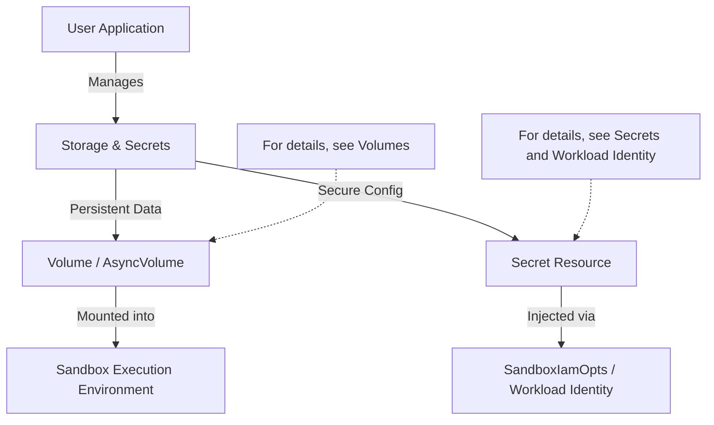
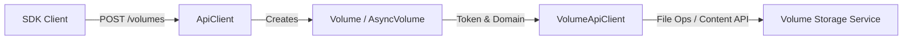
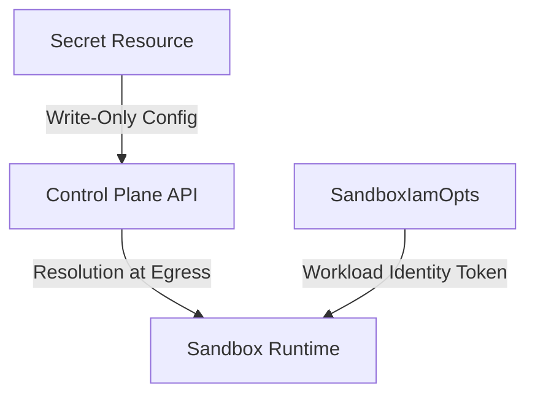

<!-- source: DeepWiki mcp.deepwiki.com · repo e2b-dev/E2B · page 8 Storage and Secrets · fetched 2026-10-29 -->

# Storage and Secrets

Relevant source files

The following files were used as context for generating this wiki page:

- [packages/js-sdk/src/volume/index.ts](packages/js-sdk/src/volume/index.ts)
- [packages/js-sdk/tests/volume/volume.test.ts](packages/js-sdk/tests/volume/volume.test.ts)
- [packages/python-sdk/e2b/volume/volume_async.py](packages/python-sdk/e2b/volume/volume_async.py)
- [packages/python-sdk/e2b/volume/volume_sync.py](packages/python-sdk/e2b/volume/volume_sync.py)
- [packages/python-sdk/tests/async/volume_async/test_volume.py](packages/python-sdk/tests/async/volume_async/test_volume.py)
- [packages/python-sdk/tests/sync/volume_sync/test_volume.py](packages/python-sdk/tests/sync/volume_sync/test_volume.py)

This page provides an overview of team-scoped resources in E2B that outlive ephemeral sandboxes. Unlike sandboxes, which are designed to be temporary and disposable, resources such as **Volumes** for persistent storage and **Secrets** for configuration management persist across multiple sandbox sessions and are scoped to the user or team.

Sources: `packages/js-sdk/src/volume/index.ts:49-54`, `packages/python-sdk/e2b/volume/volume_sync.py:69-71`

Sources: `packages/js-sdk/src/volume/index.ts:54-153`, `packages/python-sdk/e2b/volume/volume_sync.py:69-153`

---

## 8.1. Volumes

Volumes provide persistent block or file storage that can be attached to sandboxes across different sessions. In both the JavaScript and Python SDKs, volumes are represented by classes extending `ClientFactory` (`Volume` and `AsyncVolume`) [packages/js-sdk/src/volume/index.ts:54](), [packages/python-sdk/e2b/volume/volume_sync.py:69](). 

The volume management layer handles volume lifecycle operations—including creation via `Volume.create()` [packages/js-sdk/src/volume/index.ts:120](), connecting via `Volume.connect()` [packages/js-sdk/src/volume/index.ts:163](), querying info, listing, and destruction—alongside dedicated content APIs for reading, writing, and traversing files within the volume. Cross-cluster routing is supported via domain propagation (`domain`), ensuring that multi-region or BYOC (Bring Your Own Cloud) deployments correctly target regional volume endpoints.

For details, see [Volumes](#8.1).

Sources: `packages/js-sdk/src/volume/index.ts:120-180`, `packages/python-sdk/e2b/volume/volume_sync.py:115-175`

---

## 8.2. Secrets and Workload Identity

Secrets manage write-only configuration parameters and sensitive environment variables that need to be securely injected into sandboxes without exposing plaintext credentials in client code or template definitions. 

Workload identity bindings (`SandboxIamOpts`) work alongside secrets to assign fine-grained IAM tokens to sandboxes, enabling secure egress, authenticated network transforms, and controlled access to external cloud resources.

For details, see [Secrets and Workload Identity](#8.2).

Sources: `packages/js-sdk/src/volume/index.ts:1-25`

---

