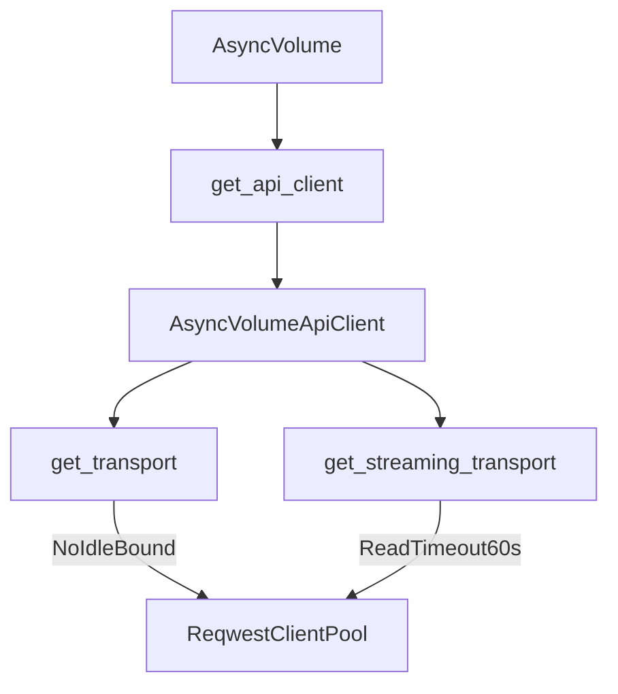

<!-- source: DeepWiki mcp.deepwiki.com · repo e2b-dev/E2B · page 8.1 Volumes · fetched 2026-10-29 -->

# Volumes

<details>
<summary>Relevant source files</summary>

The following files were used as context for generating this wiki page:

- [packages/js-sdk/src/retry.ts](packages/js-sdk/src/retry.ts)
- [packages/js-sdk/src/volume/index.ts](packages/js-sdk/src/volume/index.ts)
- [packages/js-sdk/src/volume/types.ts](packages/js-sdk/src/volume/types.ts)
- [packages/js-sdk/tests/client.test.ts](packages/js-sdk/tests/client.test.ts)
- [packages/js-sdk/tests/retry.test.ts](packages/js-sdk/tests/retry.test.ts)
- [packages/js-sdk/tests/volume/file.test.ts](packages/js-sdk/tests/volume/file.test.ts)
- [packages/js-sdk/tests/volume/volume.test.ts](packages/js-sdk/tests/volume/volume.test.ts)
- [packages/python-sdk/e2b/api/client/models/volume_and_token.py](packages/python-sdk/e2b/api/client/models/volume_and_token.py)
- [packages/python-sdk/e2b/volume/client_async/__init__.py](packages/python-sdk/e2b/volume/client_async/__init__.py)
- [packages/python-sdk/e2b/volume/client_sync/__init__.py](packages/python-sdk/e2b/volume/client_sync/__init__.py)
- [packages/python-sdk/e2b/volume/connection_config.py](packages/python-sdk/e2b/volume/connection_config.py)
- [packages/python-sdk/e2b/volume/types.py](packages/python-sdk/e2b/volume/types.py)
- [packages/python-sdk/e2b/volume/volume_async.py](packages/python-sdk/e2b/volume/volume_async.py)
- [packages/python-sdk/e2b/volume/volume_sync.py](packages/python-sdk/e2b/volume/volume_sync.py)
- [packages/python-sdk/tests/async/volume_async/test_volume.py](packages/python-sdk/tests/async/volume_async/test_volume.py)
- [packages/python-sdk/tests/async/volume_async/test_volume_content.py](packages/python-sdk/tests/async/volume_async/test_volume_content.py)
- [packages/python-sdk/tests/sync/volume_sync/test_volume.py](packages/python-sdk/tests/sync/volume_sync/test_volume.py)
- [packages/python-sdk/tests/sync/volume_sync/test_volume_content.py](packages/python-sdk/tests/sync/volume_sync/test_volume_content.py)
- [packages/python-sdk/tests/test_volume_client.py](packages/python-sdk/tests/test_volume_client.py)

</details>


## Purpose and Scope
This page details the implementation of E2B Volumes, which provide team-scoped, persistent storage resources that outlive individual sandboxes. It covers the `Volume` [packages/js-sdk/src/volume/index.ts:54]() and `AsyncVolume` [packages/python-sdk/e2b/volume/volume_async.py:70]() classes, the volume content API clients and transport layers, volume connection configurations, timeouts, and cross-cluster routing for Bring-Your-Own-Cloud (BYOC) deployments.

---

## Volume and AsyncVolume Classes
Volumes are managed through static factory methods and instance properties in both the JavaScript/TypeScript and Python SDKs. Each volume instance encapsulates a `volumeId`, `name`, access `token`, and optional `domain` and `proxy` configurations.

### JavaScript SDK Implementation
The `Volume` class extends `ClientFactory` [packages/js-sdk/src/volume/index.ts:54]() to manage control-plane lifecycle operations via the OpenAPI client (`ApiClient`).
- `Volume.create()`: Issues a `POST /volumes` request to provision a new volume and returns a configured `Volume` instance [packages/js-sdk/src/volume/index.ts:120-153]().
- `Volume.connect()`: Resolves volume metadata via `Volume.getInfo()` and instantiates a local reference without re-provisioning [packages/js-sdk/src/volume/index.ts:163-179]().
- `Volume.getInfo()`: Queries `GET /volumes/{volumeID}`, handling `404` errors by throwing `VolumeNotFoundError` [packages/js-sdk/src/volume/index.ts:189-221]().
- `Volume.list()`: Queries `GET /volumes` to retrieve all team volumes [packages/js-sdk/src/volume/index.ts:230-248]().
- `Volume.destroy()`: Issues a `DELETE /volumes/{volumeID}` request [packages/js-sdk/src/volume/index.ts:256-266]().

Title: Volume Lifecycle Data Flow
```mermaid
graph TD
    A["ClientCode"] --> B["Volume.create"]
    B --> C["ApiClient"]
    C -->|POST /volumes| D["ControlPlaneAPI"]
    D -->|VolumeAndToken| B
    B --> E["VolumeInstance"]
    
    F["Volume.connect"] --> G["Volume.getInfo"]
    G --> H["ApiClient"]
    H -->|GET /volumes/{volumeID}| D
    D --> G
    G --> E
```
Sources: [packages/js-sdk/src/volume/index.ts:54-266]()

### Python SDK Implementation
The Python SDK mirrors this design with synchronous (`Volume`) [packages/python-sdk/e2b/volume/volume_sync.py:69]() and asynchronous (`AsyncVolume`) [packages/python-sdk/e2b/volume/volume_async.py:70]() classes.
- `AsyncVolume.create()`: Calls `post_volumes.asyncio_detailed()` via the core API client [packages/python-sdk/e2b/volume/volume_async.py:116-154]().
- `AsyncVolume.connect()`: Resolves volume info and initializes the connection configuration [packages/python-sdk/e2b/volume/volume_async.py:157-175]().
- `AsyncVolume._class_get_info()`: Queries `get_volumes_volume_id.asyncio_detailed()`, translating `404` responses into `VolumeNotFoundException` [packages/python-sdk/e2b/volume/volume_async.py:177-217]().

Sources: [packages/python-sdk/e2b/volume/volume_async.py:70-217](), [packages/python-sdk/e2b/volume/volume_sync.py:69-217]()

---

## Volume Content API and Client
Volume file operations (reading, writing, directory management, and file stats) are routed through dedicated volume content clients separate from the control-plane REST API.

### Python Transport Layer and Clients
The Python volume client module (`e2b.volume.client_async` and `e2b.volume.client_sync`) configures `httpx` clients backed by `pyqwest` transports [packages/python-sdk/e2b/volume/client_async/__init__.py:15-90]().
- `get_api_client()`: Returns an `AsyncVolumeApiClient` configured with bearer token authentication (`Authorization: Bearer <token>`) [packages/python-sdk/e2b/volume/client_async/__init__.py:15-61]().
- `get_transport()`: Returns the shared `pyqwest`-backed transport for unary requests and uploads without an idle read timeout [packages/python-sdk/e2b/volume/client_async/__init__.py:64-77]().
- `get_streaming_transport()`: Returns a transport bound by `READ_TIMEOUT` (60 seconds) specifically for streamed downloads [packages/python-sdk/e2b/volume/client_async/__init__.py:79-90]().

Title: Volume Content Client Architecture

Sources: [packages/python-sdk/e2b/volume/client_async/__init__.py:15-90](), [packages/python-sdk/e2b/volume/client_sync/__init__.py:15-88]()

---

## Volume Connection Configuration and Types
Connection parameters for volume content operations are centralized in `VolumeConnectionConfig` [packages/python-sdk/e2b/volume/connection_config.py:60]().

### Timeout Definitions
The module defines distinct timeout boundaries for volume interactions:
- `REQUEST_TIMEOUT`: Default request deadline (60.0 seconds) [packages/python-sdk/e2b/volume/connection_config.py:11]().
- `FILE_TIMEOUT`: Extended timeout for large file streaming operations (3600.0 seconds) [packages/python-sdk/e2b/volume/connection_config.py:16]().
- `READ_TIMEOUT`: Idle read bound for streaming transports (60.0 seconds) [packages/python-sdk/e2b/volume/connection_config.py:27]().

### VolumeApiParams Structure
`VolumeApiParams` defines typed parameters accepted across volume creation and connection helpers [packages/python-sdk/e2b/volume/connection_config.py:30-58]():
- `domain`: Target base domain (defaults to `E2B_DOMAIN` or `e2b.app`) [packages/python-sdk/e2b/volume/connection_config.py:35]().
- `debug`: Enables local debug mode (`http://localhost:8080`) [packages/python-sdk/e2b/volume/connection_config.py:38]().
- `request_timeout`: Custom request duration in seconds [packages/python-sdk/e2b/volume/connection_config.py:41]().
- `headers`: Additional request headers [packages/python-sdk/e2b/volume/connection_config.py:44]().
- `token`: Volume-specific bearer token [packages/python-sdk/e2b/volume/connection_config.py:47]().
- `api_url`: Explicit volume API URL [packages/python-sdk/e2b/volume/connection_config.py:50]().
- `proxy`: Proxy configuration [packages/python-sdk/e2b/volume/connection_config.py:53]().

Sources: [packages/python-sdk/e2b/volume/connection_config.py:1-156]()

---

## Mounting and Cross-Cluster Routing
Volumes support multi-cluster and Bring-Your-Own-Cloud (BYOC) routing via the `domain` attribute returned during volume provisioning [packages/js-sdk/src/volume/index.ts:149]().

When a volume is created or connected, if the backend response includes a custom `domain` (e.g., `cluster.example.com`), the SDK dynamically constructs the volume content API URL as `https://api.<domain>`, overriding the default global endpoint [packages/python-sdk/tests/sync/volume_sync/test_volume.py:157-184]().

Title: Cross-Cluster Volume Routing
```mermaid
graph TD
    A["Volume.create"] -->|POST /volumes| B["ControlPlaneREST"]
    B -->|ResponseData{domain:cluster.example.com}| C["VolumeInstance"]
    C -->|ConstructsAPIUrl| D["https://api.cluster.example.com"]
    D --> E["VolumeContentAPI"]
```
Sources: [packages/js-sdk/src/volume/index.ts:120-153](), [packages/python-sdk/tests/sync/volume_sync/test_volume.py:157-184]()

---

