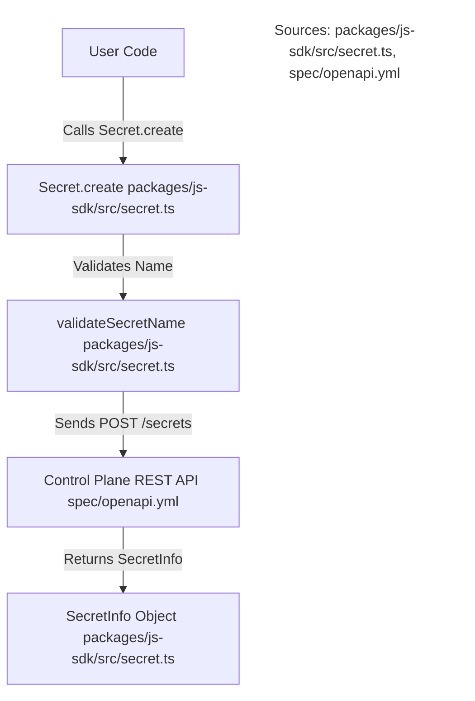
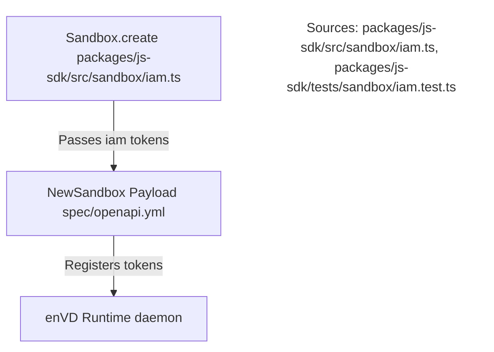
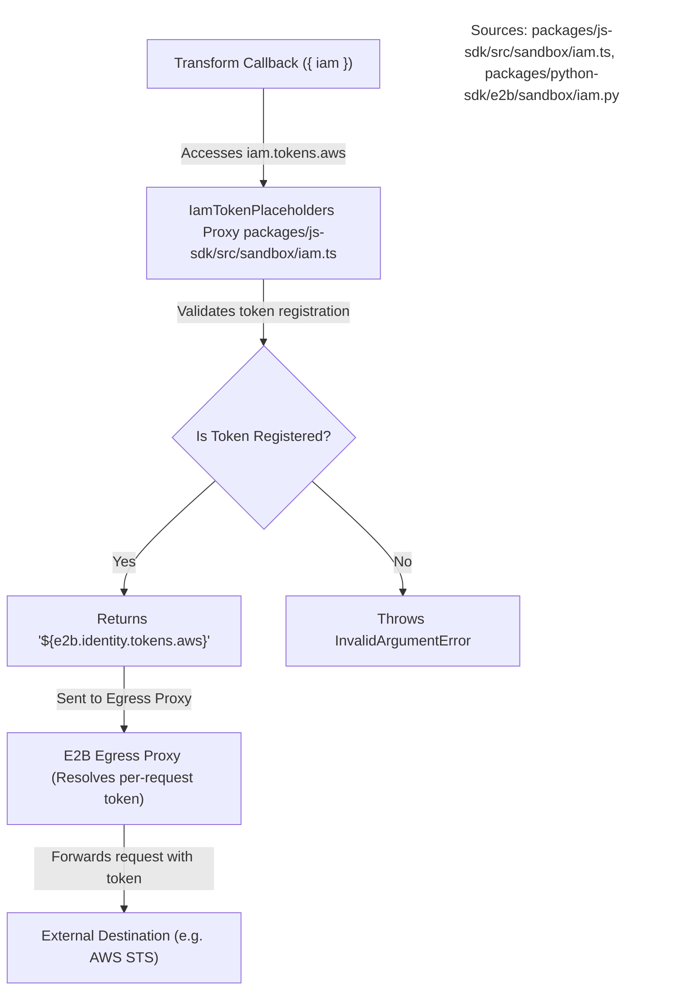

<!-- source: DeepWiki mcp.deepwiki.com · repo e2b-dev/E2B · page 8.2 Secrets and Workload Identity · fetched 2026-10-29 -->

# Secrets and Workload Identity

<details>
<summary>Relevant source files</summary>

The following files were used as context for generating this wiki page:

- [packages/js-sdk/src/api/metadata.ts](packages/js-sdk/src/api/metadata.ts)
- [packages/js-sdk/src/api/schema.gen.ts](packages/js-sdk/src/api/schema.gen.ts)
- [packages/js-sdk/src/sandbox/iam.ts](packages/js-sdk/src/sandbox/iam.ts)
- [packages/js-sdk/src/secret.ts](packages/js-sdk/src/secret.ts)
- [packages/js-sdk/src/volume/client.ts](packages/js-sdk/src/volume/client.ts)
- [packages/js-sdk/tests/sandbox/iam.test.ts](packages/js-sdk/tests/sandbox/iam.test.ts)
- [packages/js-sdk/tests/sandbox/networkTransform.test.ts](packages/js-sdk/tests/sandbox/networkTransform.test.ts)
- [packages/python-sdk/e2b/api/client/models/__init__.py](packages/python-sdk/e2b/api/client/models/__init__.py)
- [packages/python-sdk/e2b/sandbox/iam.py](packages/python-sdk/e2b/sandbox/iam.py)
- [spec/openapi.yml](spec/openapi.yml)

</details>


This page covers the architecture, implementation, and usage of team-scoped **Secrets** and **Workload Identity** (`SandboxIamOpts`) within the E2B codebase. Secrets provide write-only persistent configuration across sandboxes, while workload identity tokens enable secure, dynamic credential injection into network egress requests via network transform callbacks.

---

## 1. The Secret Resource (Write-Only Configuration)

The `Secret` class (`packages/js-sdk/src/secret.ts:156-417` [packages/js-sdk/src/secret.ts]()) manages team-scoped credentials and environmental configuration that outlive individual sandboxes. Secret values are **write-only**: they are accepted when creating or updating a secret via the control plane REST API, but they are never returned by any read surface or metadata endpoint.

### Secret Lifecycle & Operations
Secrets are uniquely identified by either their `secretID` (prefixed with `sec_`) or their canonical lower-case name (`spec/openapi.yml:130-139` [spec/openapi.yml]()). 

- **Creation**: `Secret.create(name, value, opts)` (`packages/js-sdk/src/secret.ts:167-195` [packages/js-sdk/src/secret.ts]()) stores a new secret value under version `1` with optional customer metadata (`SecretCreateOpts`).
- **Updates**: `Secret.update(secret, value, opts)` (`packages/js-sdk/src/secret.ts:207-243` [packages/js-sdk/src/secret.ts]()) stores a new secret version, incrementing the version counter.
- **Metadata Inspection**: Read methods return `SecretInfo` (`packages/js-sdk/src/secret.ts:28-53` [packages/js-sdk/src/secret.ts]()), which includes metadata, version numbers, creation timestamps, and update timestamps, omitting the plaintext secret value entirely.

### Validation Rules
Secret names undergo strict validation before transmission to prevent template injection vulnerabilities within placeholders. Names cannot be empty or contain control characters or brace symbols (`{` or `}`) (`packages/js-sdk/src/secret.ts:15-23` [packages/js-sdk/src/secret.ts]()):

```ts
const INVALID_SECRET_NAME_CHARS = /[{}\p{Cc}]/u

function validateSecretName(name: string): void {
  if (name.length === 0 || INVALID_SECRET_NAME_CHARS.test(name)) {
    throw new InvalidArgumentError(
      `secret name ${JSON.stringify(name)} is not usable...`
    )
  }
}
```



Sources: `packages/js-sdk/src/secret.ts`, `spec/openapi.yml`

---

## 2. Workload Identity and `SandboxIamOpts`

Workload identity configurations (`SandboxIam`) permit sandboxes to assume distinct cloud identities when making egress calls. When instantiating a sandbox via `Sandbox.create`, users can declare tokens mapped to specific audiences and token types (`packages/python-sdk/e2b/api/client/models/__init__.py:32-34` [packages/python-sdk/e2b/api/client/models/__init__.py]()).

### Token Structure
A workload token definition specifies:
- `audience`: The target service audience (e.g., `'sts.amazonaws.com'`).
- `tokenType`: The expected token format (e.g., `'JWT-SVID'`).

These tokens are submitted to the backend as part of the `NewSandbox` payload (`packages/js-sdk/tests/sandbox/iam.test.ts:33-48` [packages/js-sdk/tests/sandbox/iam.test.ts]()).



Sources: `packages/js-sdk/src/sandbox/iam.ts`, `packages/js-sdk/tests/sandbox/iam.test.ts`, `spec/openapi.yml`

---

## 3. Network Transforms and Token Resolution at Egress

To inject short-lived workload identity tokens into outgoing network requests without exposing them statically, E2B supports per-domain network transforms (`SandboxNetworkOpts`). 

### Placeholder Interpolation Grammar
Within network rule transform callbacks, users reference registered tokens using the placeholder syntax `${e2b.identity.tokens.<name>}` (`packages/js-sdk/src/sandbox/iam.ts:75-79` [packages/js-sdk/src/sandbox/iam.ts]()):

```ts
function iamTokenPlaceholder(name: string): string {
  validateIamTokenName(name)
  return `\${e2b.identity.tokens.${name}}`
}
```

The E2B egress proxy reads this exact placeholder format and substitutes a freshly minted credential per request.

### The `iamTokenPlaceholders` Proxy Pattern
Both the JavaScript/TypeScript SDK (`packages/js-sdk/src/sandbox/iam.ts:93-149` [packages/js-sdk/src/sandbox/iam.ts]()) and the Python SDK (`packages/python-sdk/e2b/sandbox/iam.py:47-94` [packages/python-sdk/e2b/sandbox/iam.py]()) implement proxy mapping structures (`IamTokenPlaceholders`) to guard token lookups inside transform callbacks:

1. **Unregistered Token Rejection**: Any attempt to access an unregistered token name throws an `InvalidArgumentError` containing the list of valid registered tokens (`packages/js-sdk/src/sandbox/iam.ts:103-116` [packages/js-sdk/src/sandbox/iam.ts]()).
2. **Runtime Property Guarding**: JavaScript/Python runtimes frequently probe objects for special properties during serialization or coercion (e.g., `toJSON`, `then`, `toString`, `valueOf`). The proxy intercepts these runtime probes (`RUNTIME_PROBED_PROPS`) to ensure safe serialization without triggering false-positive unknown-token errors (`packages/js-sdk/src/sandbox/iam.ts:23-52` [packages/js-sdk/src/sandbox/iam.ts]()).



Sources: `packages/js-sdk/src/sandbox/iam.ts`, `packages/python-sdk/e2b/sandbox/iam.py`, `packages/js-sdk/tests/sandbox/networkTransform.test.ts`

---

