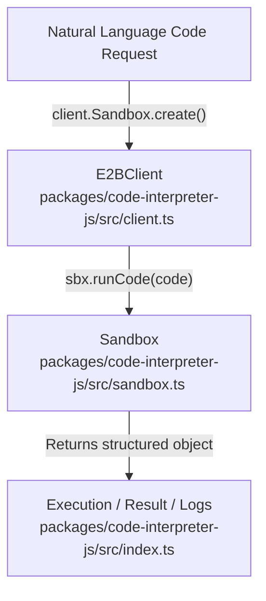
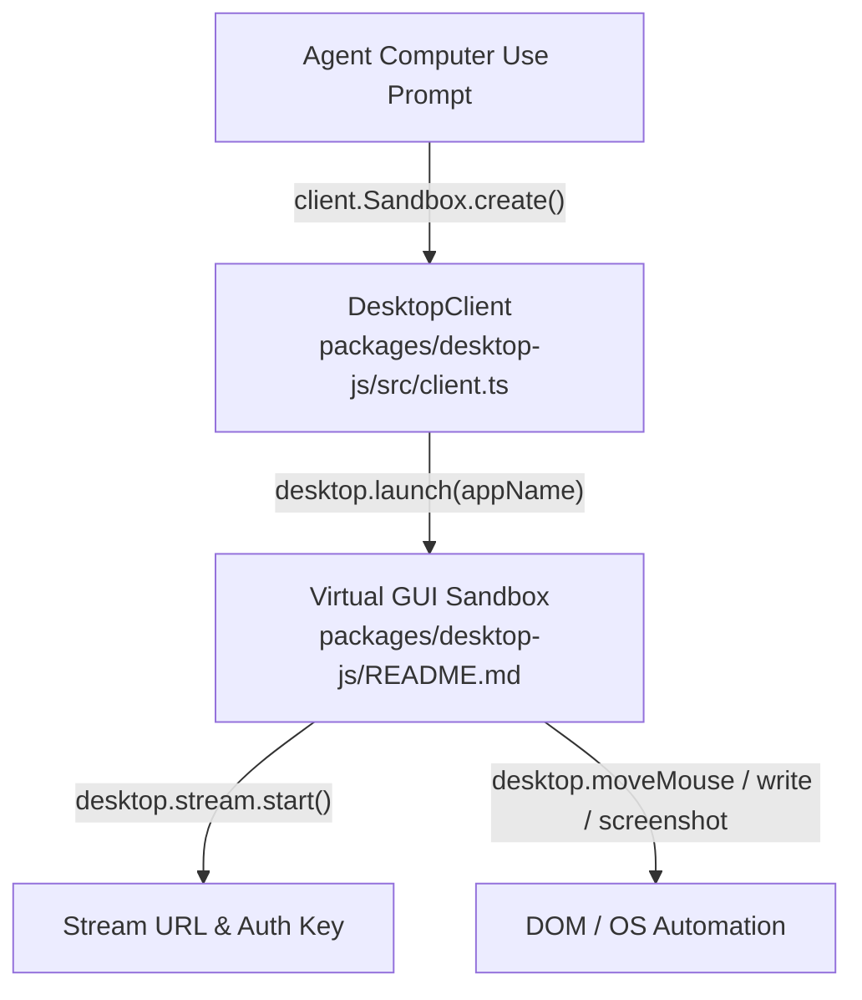

<!-- source: DeepWiki mcp.deepwiki.com · repo e2b-dev/E2B · page 9 Higher-Level SDKs · fetched 2026-10-29 -->

# Higher-Level SDKs

Relevant source files

The following files were used as context for generating this wiki page:

- [packages/code-interpreter-js/README.md](packages/code-interpreter-js/README.md)
- [packages/code-interpreter-js/src/client.ts](packages/code-interpreter-js/src/client.ts)
- [packages/code-interpreter-js/src/index.ts](packages/code-interpreter-js/src/index.ts)
- [packages/code-interpreter-python/README.md](packages/code-interpreter-python/README.md)
- [packages/code-interpreter-python/e2b_code_interpreter/__init__.py](packages/code-interpreter-python/e2b_code_interpreter/__init__.py)
- [packages/code-interpreter-python/e2b_code_interpreter/client.py](packages/code-interpreter-python/e2b_code_interpreter/client.py)
- [packages/desktop-js/README.md](packages/desktop-js/README.md)
- [packages/desktop-js/src/client.ts](packages/desktop-js/src/client.ts)

This page provides a high-level overview of the higher-level SDK packages built on top of the core E2B infrastructure SDKs. These packages—specifically the **Code Interpreter SDK** and the **Desktop SDK**—extend the base `Sandbox` capabilities to support specialized domains like interactive code execution and graphical computer use agents. 

For deep technical details, implementation specifics, and API references, refer to the child pages:
- [Code Interpreter SDK](#9.1)
- [Desktop SDK](#9.2)

---

## 9.1 Code Interpreter SDK

The Code Interpreter SDK packages (`@e2b/code-interpreter` for JavaScript/TypeScript and `e2b-code-interpreter` for Python) extend the core sandbox classes to provide Jupyter-style code execution environments. They enable AI agents to execute code (such as Python or JavaScript), capture stdout/stderr streams, handle rich execution results (including errors, text, and graphical charts), and manage execution contexts.

Both languages expose explicit client wiring through the `E2B` client class (`packages/code-interpreter-js/src/client.ts:37-93`, `packages/code-interpreter-python/e2b_code_interpreter/client.py:23-93`), allowing developers to scope API keys and custom domains independently from environment variables while sharing core resource bindings like volumes and secrets.

For detailed execution messaging, result formats, client configuration patterns, and test layouts, see [Code Interpreter SDK](#9.1).

Sources:
- `packages/code-interpreter-js/README.md:42-74`
- `packages/code-interpreter-python/README.md:43-74`
- `packages/code-interpreter-js/src/client.ts:37-93`
- `packages/code-interpreter-python/e2b_code_interpreter/client.py:23-93`

---

## 9.2 Desktop SDK

The Desktop SDK (`@e2b/desktop`) provides virtual desktop environments designed for AI-driven "Computer Use" agents (`packages/desktop-js/README.md:1-5`). It extends the core sandbox infrastructure to support launching GUI applications (such as browsers or text editors), interacting via precise mouse and keyboard controls, capturing screenshots, and streaming the virtual desktop session over secure WebRTC or VNC-backed endpoints (`packages/desktop-js/README.md:31-232`).

Like the Code Interpreter, the Desktop package provides an explicit `E2B` client class (`packages/desktop-js/src/client.ts:37-93`) to isolate connection options and manage underlying volumes and templates.

For full details on application launching, coordinate-based mouse interactions, keyboard typing speed tuning, screenshot handling, and streaming security, see [Desktop SDK](#9.2).

Sources:
- `packages/desktop-js/README.md:1-232`
- `packages/desktop-js/src/client.ts:37-93`

---

