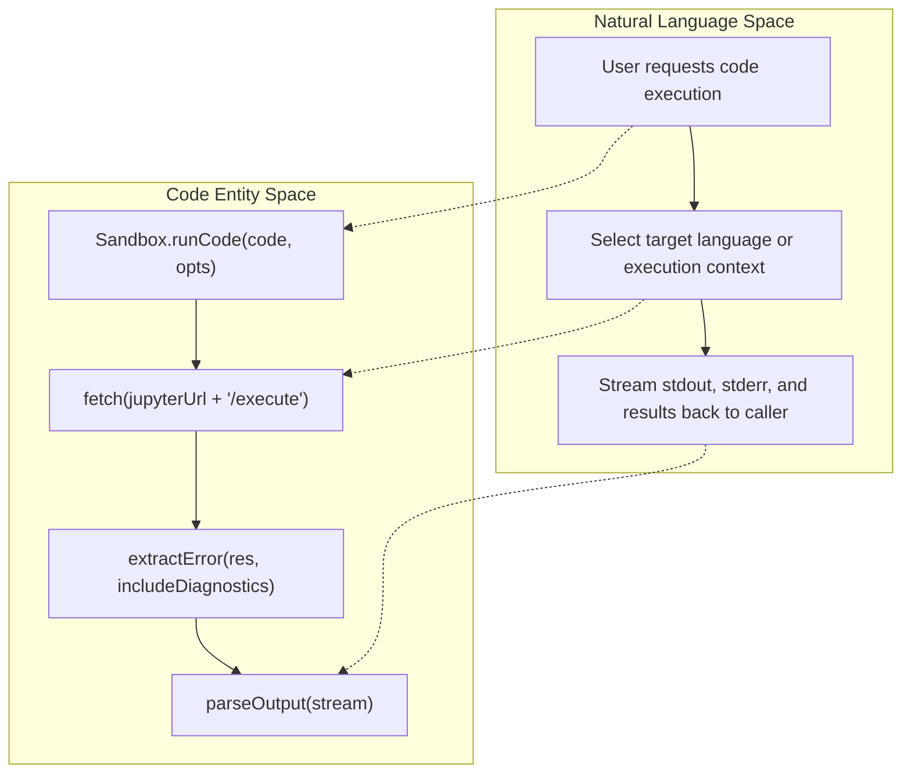
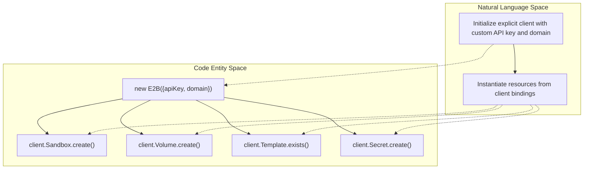

<!-- source: DeepWiki mcp.deepwiki.com · repo e2b-dev/E2B · page 9.1 Code Interpreter SDK · fetched 2026-10-29 -->

# Code Interpreter SDK

Relevant source files

The following files were used as context for generating this wiki page:

- [.github/workflows/code_interpreter_js_tests.yml](.github/workflows/code_interpreter_js_tests.yml)
- [.github/workflows/code_interpreter_python_tests.yml](.github/workflows/code_interpreter_python_tests.yml)
- [.github/workflows/desktop_js_tests.yml](.github/workflows/desktop_js_tests.yml)
- [.github/workflows/desktop_python_tests.yml](.github/workflows/desktop_python_tests.yml)
- [packages/code-interpreter-js/README.md](packages/code-interpreter-js/README.md)
- [packages/code-interpreter-js/package.json](packages/code-interpreter-js/package.json)
- [packages/code-interpreter-js/src/client.ts](packages/code-interpreter-js/src/client.ts)
- [packages/code-interpreter-js/src/index.ts](packages/code-interpreter-js/src/index.ts)
- [packages/code-interpreter-js/src/messaging.ts](packages/code-interpreter-js/src/messaging.ts)
- [packages/code-interpreter-js/src/sandbox.ts](packages/code-interpreter-js/src/sandbox.ts)
- [packages/code-interpreter-js/src/utils.ts](packages/code-interpreter-js/src/utils.ts)
- [packages/code-interpreter-js/tests/runtimes/cloudflare/vitest.config.mts](packages/code-interpreter-js/tests/runtimes/cloudflare/vitest.config.mts)
- [packages/code-interpreter-python/README.md](packages/code-interpreter-python/README.md)
- [packages/code-interpreter-python/e2b_code_interpreter/__init__.py](packages/code-interpreter-python/e2b_code_interpreter/__init__.py)
- [packages/code-interpreter-python/e2b_code_interpreter/client.py](packages/code-interpreter-python/e2b_code_interpreter/client.py)
- [packages/desktop-js/README.md](packages/desktop-js/README.md)
- [packages/desktop-js/src/client.ts](packages/desktop-js/src/client.ts)
- [packages/desktop-js/src/sandbox.ts](packages/desktop-js/src/sandbox.ts)
- [packages/desktop-js/tests/runtimes/cloudflare/vitest.config.mts](packages/desktop-js/tests/runtimes/cloudflare/vitest.config.mts)
- [packages/js-sdk/tests/runtimes/cloudflare/vitest.config.mts](packages/js-sdk/tests/runtimes/cloudflare/vitest.config.mts)
- [vitest.cloudflare.config.mts](vitest.cloudflare.config.mts)

The Code Interpreter SDK (`@e2b/code-interpreter` for JavaScript/TypeScript and `e2b-code-interpreter` for Python) provides stateful, secure, isolated code execution inside E2B sandboxes [packages/code-interpreter-js/package.json:2-5] [packages/code-interpreter-python/README.md:20](). Built on top of the core E2B SDKs (`e2b`), it targets the pre-built `code-interpreter-v1` sandbox template [packages/code-interpreter-js/src/sandbox.ts:131-132]() and exposes Jupyter-style execution messaging, multi-language support (`python`, `javascript`, `typescript`, `r`, `java`, `bash`) [packages/code-interpreter-js/src/sandbox.ts:41-42](), streaming output handlers (`onStdout`, `onStderr`, `onResult`, `onError`) [packages/code-interpreter-js/src/sandbox.ts:48-64](), and explicit client binding.

---

## 1. Core Sandbox Class and Execution API

The entry point for code execution is the `Sandbox` class, which extends the base `e2b` `Sandbox` class [packages/code-interpreter-js/src/sandbox.ts:130](). It overrides `defaultTemplate` to point to `code-interpreter-v1` [packages/code-interpreter-js/src/sandbox.ts:131-132]() and exposes the `runCode` method (`run_code` in Python) [packages/code-interpreter-js/src/sandbox.ts:168]().

### Execution Options and Contexts

The `runCode` method accepts a code string and an optional configuration object (`RunCodeOpts`) [packages/code-interpreter-js/src/sandbox.ts:48-83,168-177](). Code can be executed within a specific language runtime or maintained across execution turns using a `Context` object [packages/code-interpreter-js/src/sandbox.ts:22-35,180-205]().

*Diagram 1: Natural Language to Code Entity mapping for `runCode` execution flow.*

Sources: [`packages/code-interpreter-js/src/sandbox.ts:22-83`]() [`packages/code-interpreter-js/src/sandbox.ts:130-206`]()

---

## 2. Jupyter-Style Messaging and Result Formats

The SDK communicates with the internal Jupyter server running inside the sandbox on `JUPYTER_PORT` via HTTP POST requests to `/execute` [packages/code-interpreter-js/src/sandbox.ts:134-139,238](). Responses are streamed back and parsed into structured execution objects (`Execution`, `Result`, `OutputMessage`, and `ExecutionError`) [packages/code-interpreter-js/src/sandbox.ts:3-10]().

### Request Headers and Authentication

When `runCode` invokes the execution endpoint, it constructs headers containing sandbox identification and access tokens [packages/code-interpreter-js/src/sandbox.ts:224-235]():
- `Content-Type`: `application/json`
- `E2b-Sandbox-Id`: Binds the request to `this.sandboxId`
- `E2b-Sandbox-Port`: Targeted at `JUPYTER_PORT`
- `E2B-Traffic-Access-Token` / `X-Access-Token`: Injected when `trafficAccessToken` or `envdAccessToken` are active.

### Timeout Handling

Timeouts are split into execution-level timeouts (`timeoutMs`, defaulting to 60 seconds) and request-level connection timeouts (`requestTimeoutMs`, defaulting to 30 seconds) [packages/code-interpreter-js/src/sandbox.ts:72-82,213-222](). Abort controllers translate `AbortError` instances into SDK `TimeoutError` exceptions using utility helpers [packages/code-interpreter-js/src/utils.ts:1-21]().

Sources: [`packages/code-interpreter-js/src/sandbox.ts:213-252`]() [`packages/code-interpreter-js/src/utils.ts:1-64`]()

---

## 3. Client Wiring and Namespace Binding

The SDK allows both environment-variable-driven initialization via the top-level `Sandbox` export and explicit configuration via the `E2B` client class [packages/code-interpreter-README.md:52-72](). Creating an explicit `E2B` client instance isolates configuration parameters (such as `apiKey` and `domain`) from other processes or concurrent clients.

*Diagram 2: Natural Language to Code Entity mapping for `E2B` client wiring.*

Sources: [`packages/code-interpreter-js/README.md:52-74`]() [`packages/code-interpreter-python/README.md:51-75`]()

---

## 4. Test Layout and Multi-Runtime Support

Code Interpreter SDK packages are tested across multiple JavaScript and Python runtimes to ensure strict compatibility with Node.js, Bun, Deno, and Cloudflare Workers (`workerd`) [packages/code-interpreter-js/package.json:30-34]() [.github/workflows/code_interpreter_js_tests.yml:35-49]().

### Test Suites and Runtimes
- **Node.js**: Standard execution environment running Vitest (`pnpm test`) [packages/code-interpreter-js/package.json:30]().
- **Bun**: Native execution using `bunx --bun vitest run` [packages/code-interpreter-js/package.json:32]().
- **Deno**: Execution wrapping Deno permissions (`deno run -A ./node_modules/vitest/vitest.mjs run`) [packages/code-interpreter-js/package.json:33]().
- **Cloudflare Workers**: Validates compatibility inside `workerd` using `@cloudflare/vitest-pool-workers` configuration [packages/code-interpreter-js/tests/runtimes/cloudflare/vitest.config.mts:1-7]() [vitest.cloudflare.config.mts:35-40]().

Sources: [`packages/code-interpreter-js/package.json:26-38`]() [.github/workflows/code_interpreter_js_tests.yml:30-120]() [`vitest.cloudflare.config.mts:1-94`]()

---

