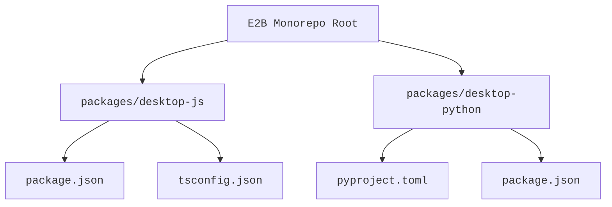
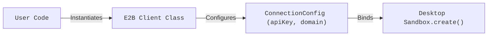
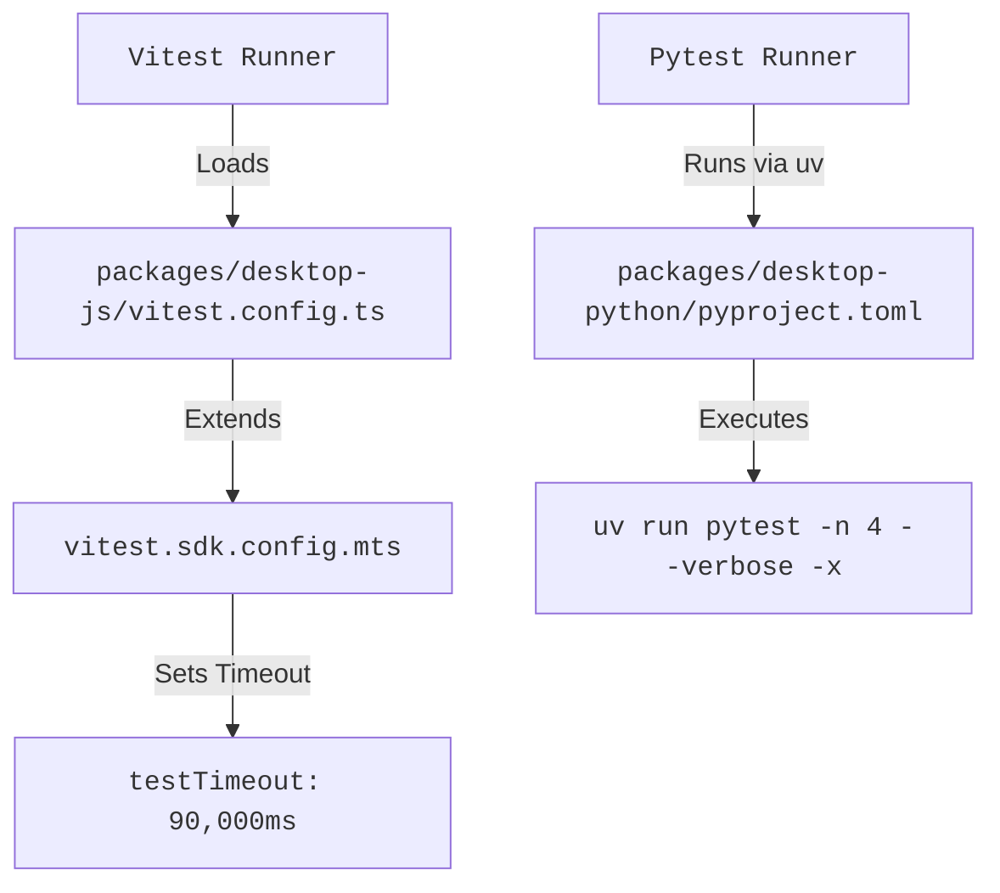

<!-- source: DeepWiki mcp.deepwiki.com · repo e2b-dev/E2B · page 9.2 Desktop SDK · fetched 2026-10-29 -->

# Desktop SDK

Relevant source files

The following files were used as context for generating this wiki page:

- [packages/code-interpreter-js/tsconfig.json](packages/code-interpreter-js/tsconfig.json)
- [packages/code-interpreter-js/tsdown.config.ts](packages/code-interpreter-js/tsdown.config.ts)
- [packages/code-interpreter-js/vitest.config.mts](packages/code-interpreter-js/vitest.config.mts)
- [packages/code-interpreter-python/CHANGELOG.md](packages/code-interpreter-python/CHANGELOG.md)
- [packages/code-interpreter-python/package.json](packages/code-interpreter-python/package.json)
- [packages/code-interpreter-python/pyproject.toml](packages/code-interpreter-python/pyproject.toml)
- [packages/desktop-js/CHANGELOG.md](packages/desktop-js/CHANGELOG.md)
- [packages/desktop-js/package.json](packages/desktop-js/package.json)
- [packages/desktop-js/tsconfig.json](packages/desktop-js/tsconfig.json)
- [packages/desktop-js/tsdown.config.ts](packages/desktop-js/tsdown.config.ts)
- [packages/desktop-js/vitest.config.ts](packages/desktop-js/vitest.config.ts)
- [packages/desktop-python/CHANGELOG.md](packages/desktop-python/CHANGELOG.md)
- [packages/desktop-python/package.json](packages/desktop-python/package.json)
- [packages/desktop-python/pyproject.toml](packages/desktop-python/pyproject.toml)
- [vitest.sdk.config.mts](vitest.sdk.config.mts)

The purpose and scope of this document is to detail the technical architecture, package layout, client configuration, lifecycle management, and testing infrastructure of the `@e2b/desktop` (JavaScript/TypeScript) and `e2b-desktop` (Python) SDK packages. These packages build upon the core E2B SDKs to supply isolated cloud desktop environments equipped with XFCE sessions, GUI application hosting, mouse and keyboard control primitives, and streaming capabilities tailored for AI "Computer Use" agents.

---

## 1. Package Structure and Monorepo Layout

The Desktop SDKs are housed within the E2B monorepo as separate language-specific packages under the `packages/` directory:
- JavaScript/TypeScript: `packages/desktop-js/`
- Python: `packages/desktop-python/`

Both packages depend on their respective core E2B SDK workspaces (`e2b` in JavaScript and `e2b` via UV workspace configuration in Python) and are bundled and published independently to npm and PyPI.

*Figure 1: Natural Language Space to Code Entity Space mapping for Desktop SDK package layout.*

Sources: `packages/desktop-js/package.json:1-72`[], `packages/desktop-python/pyproject.toml:1-49`[], `packages/desktop-python/package.json:1-14`[]

---

## 2. Client Initialization and Explicit Configuration

Recent updates introduce an explicit `E2B` client binding mechanism to the Desktop SDKs. This allows consumers to instantiate a client with explicit connection parameters (such as `apiKey` and `domain`) rather than relying entirely on environment variables (`E2B_API_KEY`, `E2B_DOMAIN`).

*Figure 2: Client configuration data flow for isolated sandbox instantiation.*

### Configuration Behavior
- Multiple client instances are isolated from each other and from the default environment-configured top-level exports.
- Per-call options continue to take precedence over client-level defaults.
- The client exposes the package's specialized desktop `Sandbox` alongside core resources (`Volume`, `Template`, and `Secret`).

Sources: `packages/desktop-js/CHANGELOG.md:3-16`[], `packages/desktop-python/CHANGELOG.md:3-8`[]

---

## 3. Sandbox Lifecycle and GUI Application Launch

Desktop sandboxes initialize an isolated Linux environment complete with an XFCE graphical desktop session. The SDK lifecycle guarantees that desktop services are fully operational before returning control to the caller.

### Key Lifecycle Considerations
- **XFCE Session Readiness**: Initialization routines wait explicitly for the XFCE session to be fully active and ready before returning the newly created Desktop sandbox instance to user code.
- **Error Cleanup**: If desktop startup or session initialization fails during sandbox creation, the initialization workflow automatically executes cleanup procedures to terminate and release the sandbox.

Sources: `packages/desktop-js/CHANGELOG.md:17-22`[], `packages/desktop-python/CHANGELOG.md:9-14`[]

---

## 4. Desktop Interaction Capabilities

The `@e2b/desktop` and `e2b-desktop` packages expose high-level abstractions designed for autonomous AI agents performing computer-use tasks:
- **GUI Application Launching**: Spawning desktop applications within the XFCE display server.
- **Mouse & Keyboard Control**: Sending input events (clicks, moves, keystrokes) mapped to the virtual display.
- **Screenshots & Streaming**: Capturing frame buffers and streaming desktop visuals (leveraging dependencies like `pillow` in Python).

| Capability | JS/TS Package (`@e2b/desktop`) | Python Package (`e2b-desktop`) |
| :--- | :--- | :--- |
| Base Dependency | `e2b` (workspace) | `e2b>=2.44.0,<3.0.0` [packages/desktop-python/pyproject.toml:10]() |
| Image Processing | Built-in canvas/native tooling | `pillow>=12.0.0,<13` [packages/desktop-python/pyproject.toml:12]() |
| HTTP & Requests | Native fetch / Axios-compatible | `requests>=2.32.3,<3` [packages/desktop-python/pyproject.toml:11]() |

Sources: `packages/desktop-js/package.json:69-71`[], `packages/desktop-python/pyproject.toml:9-13`[]

---

## 5. Testing Infrastructure and CI

Testing desktop sandboxes requires extended timeout allowances and specialized test runners due to the overhead of spinning up virtual machines and graphical environments.

### Test Configurations
- **JavaScript Test Runner**: Uses Vitest configured via `packages/desktop-js/vitest.config.ts` [packages/desktop-js/vitest.config.ts:1-16]() combined with `vitest.sdk.config.mts` [vitest.sdk.config.mts:1-29](), enforcing a test timeout of `90,000ms`.
- **Python Test Runner**: Uses `pytest` orchestrated via `uv` with parallel execution (`pytest-xdist`), defined in `packages/desktop-python/package.json` [packages/desktop-python/package.json:5-13]().

*Figure 3: Test runner architecture and configuration flow for Desktop SDKs.*

Sources: `packages/desktop-js/vitest.config.ts:1-16`[], `vitest.sdk.config.mts:1-29`[], `packages/desktop-python/package.json:5-13`[]

---

