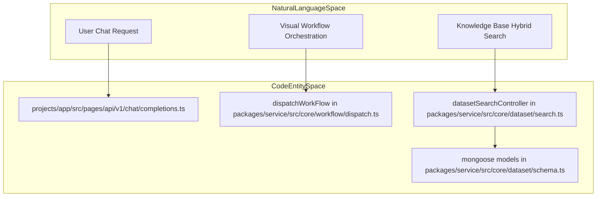

<!-- source: DeepWiki mcp.deepwiki.com · repo labring/FastGPT · page 1 Introduction to FastGPT · fetched 2026-10-29 -->

# Introduction to FastGPT

<details>
<summary>Relevant source files</summary>

The following files were used as context for generating this wiki page:

- [.github/imgs/image.png](.github/imgs/image.png)
- [.github/imgs/logo-left.svg](.github/imgs/logo-left.svg)
- [README.md](README.md)
- [README_en.md](README_en.md)
- [README_id.md](README_id.md)
- [README_ja.md](README_ja.md)
- [README_th.md](README_th.md)
- [README_vi.md](README_vi.md)
- [document/README.md](document/README.md)
- [document/app/[lang]/(docs)/layout.tsx](document/app/[lang]/(docs)/layout.tsx)
- [document/components/docs/CommercialContactDialog.tsx](document/components/docs/CommercialContactDialog.tsx)
- [document/content/guide/version/commercial.en.mdx](document/content/guide/version/commercial.en.mdx)
- [document/content/guide/version/commercial.mdx](document/content/guide/version/commercial.mdx)

</details>


## Purpose and Scope

This document provides a high-level introduction to FastGPT, an AI Agent building platform that enables visual workflow orchestration, knowledge base management, and AI-powered application development [README.md:16-17](). This page covers the system's core purpose, architectural overview, and major functional components. 

As a parent page, this document summarizes the top-level concepts of FastGPT. For detailed information on specific subsystems, refer to the child pages:
- For out-of-the-box features including RAG, workflow orchestration, agents/skills, knowledge base management, and OpenAPI capabilities, see [Core Features and Capabilities](#1.1).
- For high-level architectural diagrams showing frontend, backend services, data layer, sandboxes, and external integrations, see [System Architecture Overview](#1.2).

Sources: [README.md:16-17](), [README_en.md:16-17]()

---

## Core Purpose and Positioning

FastGPT is positioned as an open-source AI Agent building platform that combines out-of-the-box RAG capabilities with visual workflow orchestration [README.md:16-17](). It abstracts complex LLM interaction layers, providing developers and enterprise users with tools to build, debug, and operate advanced AI applications without extensive infrastructure setup. The platform bridges the gap between raw large language models and production-grade business logic through polyglot persistence, modular plugin systems, and standardized OpenAPI surfaces.

For a detailed breakdown of specific capabilities such as hybrid retrieval, node templates, and OpenAPI endpoints, see [Core Features and Capabilities](#1.1).

Sources: [README.md:16-111](), [README_en.md:16-111]()

---

## System Architecture Overview

The FastGPT codebase is structured as a `pnpm` monorepo consisting of shared global libraries (`@fastgpt/global`), backend service logic (`@fastgpt/service`), user interface packages (`@fastgpt/web`), and standalone runtime projects such as `projects/app` and `projects/mcp_server` [projects/app/package.json:30-32](). 

The following diagrams illustrate how natural language workflows and user requests map to specific code entities and architectural layers across the codebase.

### Natural Language to Code Entity Space Mapping


Sources: [projects/app/package.json:1-86](), [packages/service/package.json:1-73]()

### System Architecture and Service Layer

```mermaid
graph TB
    subgraph "ClientLayer"
        NextApp[""projects/app (Next.js Frontend)""]
        McpServer[""projects/mcp_server (Express MCP Server)""]
    end

    subgraph "BackendServiceLayer"
        GlobalPkg["""@fastgpt/global (Zod Schemas & Types)""]
        ServicePkg["""@fastgpt/service (Core Business Logic)""]
        WebPkg["""@fastgpt/web (Shared UI Components)""]
    end

    subgraph "DataLayer"
        Mongo[""MongoDB (Structured Data)""]
        VectorDB[""Vector DB (PGVector / Milvus / OceanBase)""]
        RedisDal[""Redis (packages/dal / BullMQ)""]
        S3Storage[""S3 Compatible Storage""]
    end

    NextApp --> WebPkg
    NextApp --> ServicePkg
    McpServer --> GlobalPkg
    ServicePkg --> GlobalPkg
    ServicePkg --> Mongo
    ServicePkg --> VectorDB
    ServicePkg --> RedisDal
    ServicePkg --> S3Storage
```
Sources: [packages/global/package.json:1-30](), [packages/service/package.json:1-73](), [projects/app/package.json:1-86]()

For a comprehensive review of architectural layers, sandboxes, and data persistence, see [System Architecture Overview](#1.2).

Sources: [packages/service/package.json:9-73](), [projects/app/package.json:19-86]()

---

