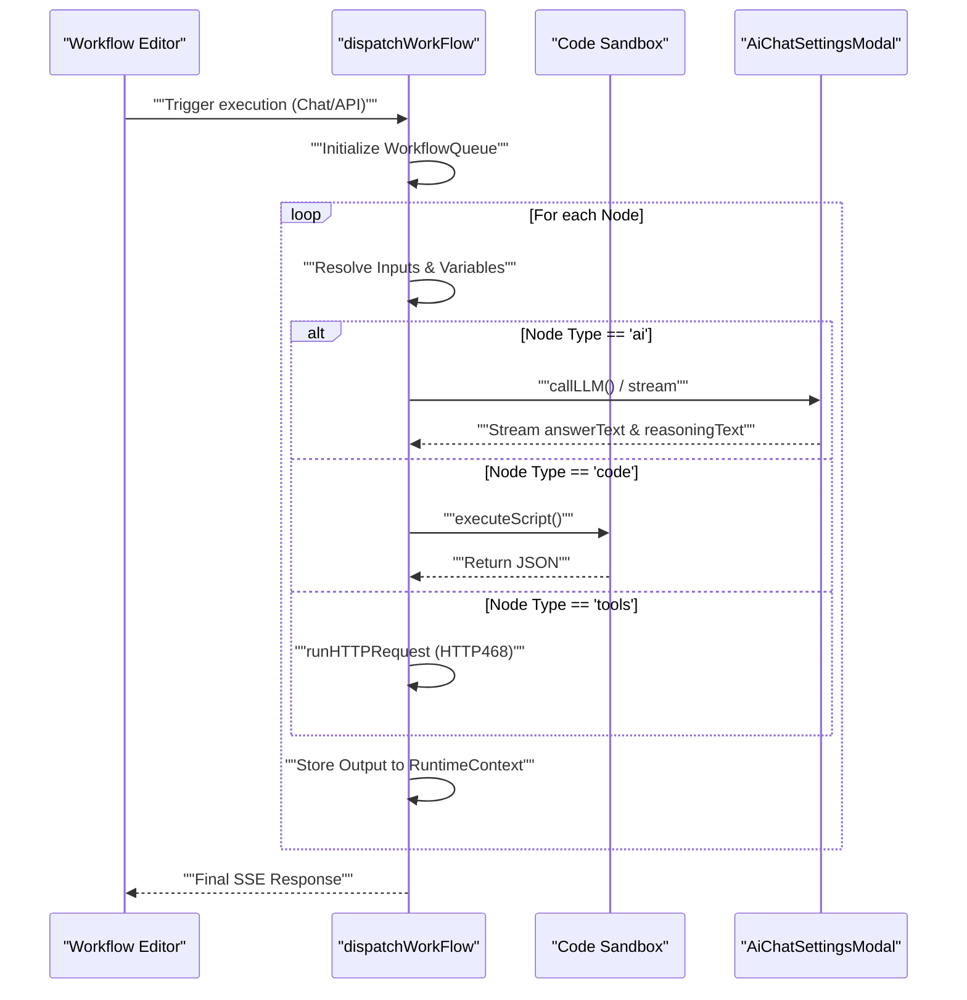

<!-- source: DeepWiki mcp.deepwiki.com · repo labring/FastGPT · page 1.1 Core Features and Capabilities · fetched 2026-10-29 -->

# Core Features and Capabilities

<details>
<summary>Relevant source files</summary>

The following files were used as context for generating this wiki page:

- [.github/imgs/image.png](.github/imgs/image.png)
- [.github/imgs/logo-left.svg](.github/imgs/logo-left.svg)
- [README.md](README.md)
- [README_en.md](README_en.md)
- [README_id.md](README_id.md)
- [README_ja.md](README_ja.md)
- [README_th.md](README_th.md)
- [README_vi.md](README_vi.md)
- [document/README.md](document/README.md)
- [document/app/[lang]/(docs)/layout.tsx](document/app/[lang]/(docs)/layout.tsx)
- [document/components/docs/CommercialContactDialog.tsx](document/components/docs/CommercialContactDialog.tsx)
- [document/content/guide/version/commercial.en.mdx](document/content/guide/version/commercial.en.mdx)
- [document/content/guide/version/commercial.mdx](document/content/guide/version/commercial.mdx)
- [packages/global/openapi/core/app/folder/api.ts](packages/global/openapi/core/app/folder/api.ts)
- [packages/global/openapi/core/app/folder/index.ts](packages/global/openapi/core/app/folder/index.ts)
- [packages/web/components/common/Icon/constants.ts](packages/web/components/common/Icon/constants.ts)
- [packages/web/components/common/MyModal/EditFolderModal.tsx](packages/web/components/common/MyModal/EditFolderModal.tsx)
- [packages/web/components/common/MySlider/InputSlider.tsx](packages/web/components/common/MySlider/InputSlider.tsx)
- [packages/web/i18n/en/app.json](packages/web/i18n/en/app.json)
- [packages/web/i18n/en/common.json](packages/web/i18n/en/common.json)
- [packages/web/i18n/ko-KR/common.json](packages/web/i18n/ko-KR/common.json)
- [packages/web/i18n/zh-CN/app.json](packages/web/i18n/zh-CN/app.json)
- [packages/web/i18n/zh-CN/common.json](packages/web/i18n/zh-CN/common.json)
- [packages/web/i18n/zh-Hant/app.json](packages/web/i18n/zh-Hant/app.json)
- [packages/web/i18n/zh-Hant/common.json](packages/web/i18n/zh-Hant/common.json)
- [projects/app/src/components/core/ai/AISettingModal/index.tsx](projects/app/src/components/core/ai/AISettingModal/index.tsx)
- [projects/app/src/pages/api/core/app/folder/create.ts](projects/app/src/pages/api/core/app/folder/create.ts)
- [projects/app/src/pages/dashboard/agent/index.tsx](projects/app/src/pages/dashboard/agent/index.tsx)
- [projects/app/src/pages/dashboard/tool/index.tsx](projects/app/src/pages/dashboard/tool/index.tsx)

</details>


## Purpose and Scope

FastGPT is an AI Agent building platform designed to provide a complete suite of tools for developing, deploying, and managing complex AI applications. It offers out-of-the-box capabilities for data processing and model invocation while enabling sophisticated workflow orchestration through a visual interface. This document details the platform's core features, including its RAG (Retrieval-Augmented Generation) system, workflow engine, and Model Context Protocol (MCP) integration.

Sources: [README.md:16-17](), [README_en.md:16-17]()

---

## Feature Categories Overview

FastGPT's capabilities are categorized into functional modules that bridge high-level natural language requirements with technical code implementations.

### System Mapping Diagram
The following diagram illustrates how natural language intents map to specific system components and code entities.

```mermaid
graph TB
    subgraph "FastGPT Platform"
        Workflow[""Workflow Orchestration"<br/>"@fastgpt/web/core/workflow""]
        RAG[""RAG & Dataset System"<br/>"@fastgpt/service/core/dataset""]
        AI[""AI Integration"<br/>"@fastgpt/service/core/ai""]
        MCP[""MCP Server"<br/>"projects/mcp_server""]
        API[""OpenAPI Surface"<br/>"projects/app/src/pages/api/v1""]
    end

    subgraph "Natural Language Space"
        NL1[""Search my PDF files""]
        NL2[""If user says hello, reply hi""]
        NL3[""Call my external API""]
    end

    subgraph "Code Entity Space"
        CE1[""DatasetSearch Node""]
        CE2[""dispatchWorkFlow""]
        CE3[""HTTP468 Node""]
        CE4[""ChatCompletions API""]
    end

    NL1 --> CE1
    NL2 --> CE2
    NL3 --> CE3
    
    Workflow --> CE2
    Workflow --> CE3
    RAG --> CE1
    API --> CE4
    MCP --> CE2
```

**Core Feature Matrix**

| Category | Key Capabilities | Code Reference |
|----------|-----------------|----------------|
| **Workflow** | Visual node editing, conditional branching, loops | `FlowNodeTypeEnum` [packages/global/core/workflow/constants.ts:1-25]() |
| **Knowledge Base** | Multi-format parsing, hybrid search, re-ranking | `DatasetTypeEnum` [projects/app/src/pages/dataset/list/index.tsx:29-29]() |
| **AI Integration** | LLM streaming, tool calling, vision support | `AiChatModule` [projects/app/src/components/core/ai/AISettingModal/index.tsx:1-40]() |
| **MCP Protocol** | SSE-based tool discovery and execution | `projects/mcp_server` [README.md:74]() |
| **OpenAPI** | GPT-aligned completions, Dataset CRUD | `projects/app/src/pages/api/v1` [README_en.md:113]() |

Sources: [README.md:63-111](), [README_en.md:63-111](), [projects/app/src/pages/dataset/list/index.tsx:29-29]()

---

## Visual Workflow Orchestration

FastGPT uses a React Flow-based visual editor to allow users to build logic chains. These workflows are executed by the dispatch engine, which handles node-by-node execution and state management.

### Workflow Node Categories
Nodes are categorized into functional templates that define their inputs, outputs, and execution logic, such as AI chat components managing LLM context, prompts, and reasoning tokens [projects/app/src/components/core/ai/AISettingModal/index.tsx:106-136]().

| Category | Type Constant | Description |
|--------------|--------------|-----------------|
| **System Input** | `systemInput` | Handles user questions, global variables, and initial file uploads. |
| **AI Functions** | `ai` | Core LLM nodes, text extraction, and question optimization (`AiChatSettingsModal`). |
| **Interactive** | `interactive` | Nodes that pause execution for user selection or form input. |
| **Tools** | `tools` | Dataset search, HTTP requests, and code sandboxes. |
| **Logic/Other** | `other` | If-Else branches, Array loops, and variable updates. |

Sources: [projects/app/src/components/core/ai/AISettingModal/index.tsx:106-136](), [README.md:70-76]()

### Execution Flow
The execution engine resolves data dependencies using variable resolution patterns, ensuring that each node has access to the outputs of its predecessors.



Sources: [projects/app/src/components/core/ai/AISettingModal/index.tsx:1-40](), [README_en.md:70-76]()

---

## Dataset and Knowledge Base System

The RAG system (Retrieval-Augmented Generation) enables AI to answer questions based on private, structured, or unstructured data managed through dataset controllers and folder APIs [projects/app/src/pages/api/core/app/folder/create.ts:29-50]().

### Data Ingestion and Processing
FastGPT supports a wide range of data sources and formats, managed through folder hierarchies and dataset permissions:
- **Common**: Standard file-based knowledge bases (PDF, MD, HTML, DOCX, etc.).
- **Website**: Automated web crawling and content synchronization.
- **API**: Real-time data retrieval from external endpoints.
- **Enterprise**: Integrations with platforms like Feishu or Yuque.

Sources: [README.md:85-92](), [projects/app/src/pages/api/core/app/folder/create.ts:29-50]()

### Advanced Retrieval
The retrieval pipeline is designed for high accuracy through multi-stage processing:
1. **Hybrid Retrieval**: Combines vector-based semantic search with keyword-based full-text search.
2. **Re-ranking**: Uses specialized models to refine the relevance of retrieved chunks.
3. **Citation Handling**: Provides references back to the original data chunks in the chat interface [packages/web/i18n/en/common.json:127]().

Sources: [README.md:90](), [packages/web/i18n/en/common.json:127]()

---

## OpenAPI and MCP Integration

FastGPT exposes its capabilities through standardized interfaces to ensure compatibility with the broader AI ecosystem.

### OpenAPI Surface
The platform provides an OpenAI-compatible API, allowing it to be used as a backend for existing tools and system integrations.
- **Chat Completions**: Endpoints supporting streaming and JSON modes for standard model interactions.
- **Dataset CRUD**: Full programmatic access to knowledge base management and collections.

Sources: [README.md:94-98](), [README_en.md:112-115]()

### Model Context Protocol (MCP)
FastGPT implements the MCP server protocol, enabling bidirectional tool usage.
- **Tool Exposure**: FastGPT workflows and applications can be exposed as tools to external AI clients via `@modelcontextprotocol/sdk`.
- **Discovery**: Uses SSE (Server-Sent Events) for tool discovery and schema negotiation.

Sources: [README.md:74](), [packages/web/i18n/en/app.json:16-22]()

---

## Operational Capabilities

FastGPT includes features designed for enterprise-grade deployment and monitoring.

| Feature | Description | Code Implementation |
|---------|-------------|---------------------|
| **Permission System** | Role-based access control (RBAC) for apps and datasets. | `authApp` [projects/app/src/pages/api/core/app/folder/create.ts:13-13]() |
| **Billing & Credits** | Token-based usage tracking and resource quotas. | `FAQ.ai_point_a` [packages/web/i18n/en/common.json:30-33]() |
| **Monitoring** | Complete call chain logs and application evaluation tools. | `app_evaluation` [packages/web/i18n/en/common.json:110]() |
| **Multimodal** | Support for vision models and voice (STT/TTS) interaction. | `MultimodalValue` [projects/app/src/components/core/ai/AISettingModal/index.tsx:41-44]() |

Sources: [README.md:100-111](), [packages/web/i18n/en/common.json:30-33](), [projects/app/src/pages/api/core/app/folder/create.ts:13-13](), [projects/app/src/components/core/ai/AISettingModal/index.tsx:41-44]()

---

