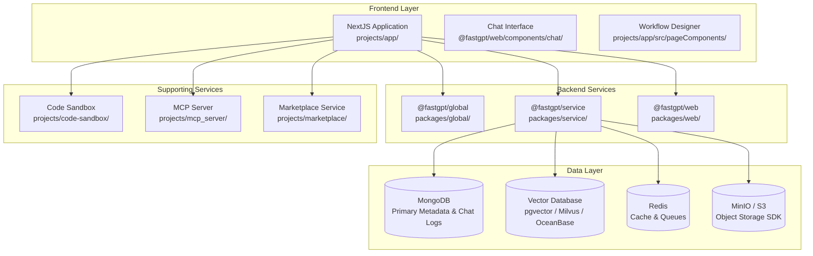
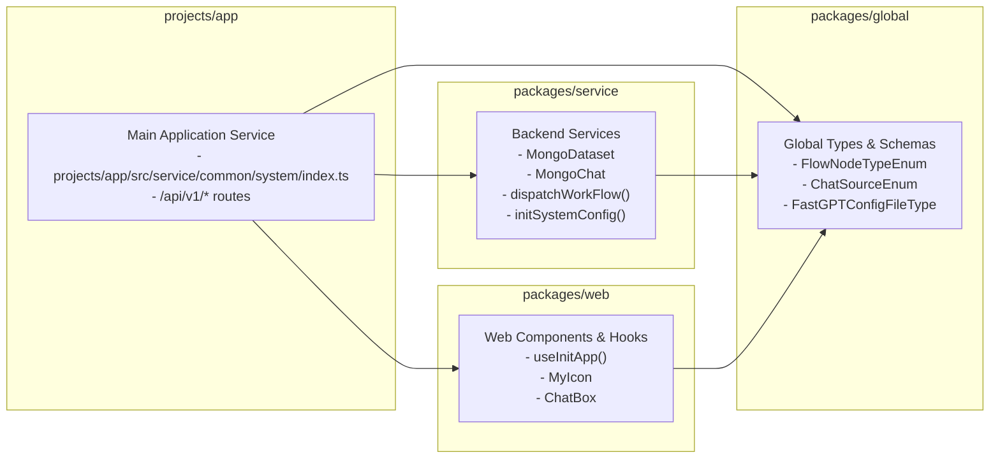
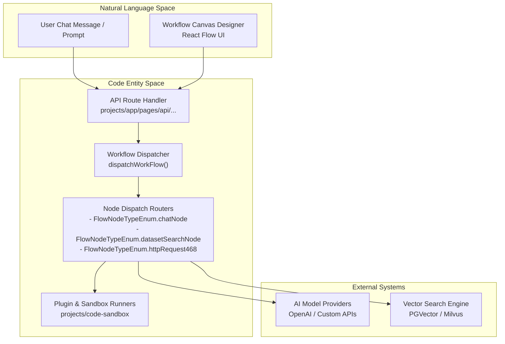
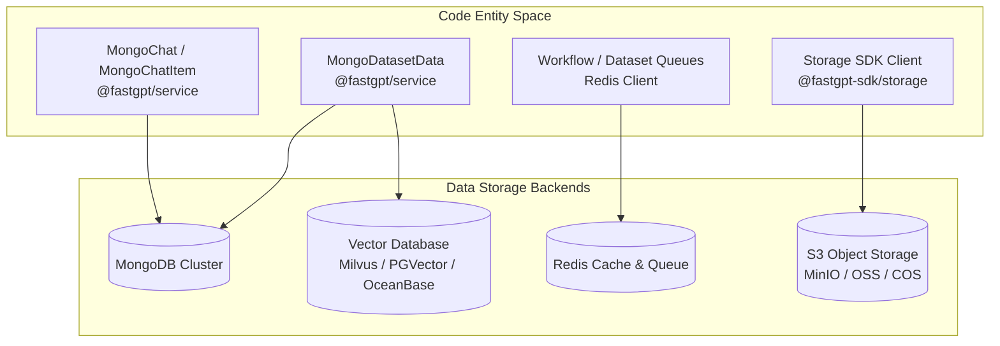
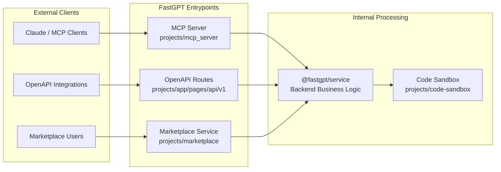

<!-- source: DeepWiki mcp.deepwiki.com · repo labring/FastGPT · page 1.2 System Architecture Overview · fetched 2026-10-29 -->

# System Architecture Overview

Relevant source files

The following files were used as context for generating this wiki page:

- [document/package.json](document/package.json)
- [package.json](package.json)
- [packages/global/common/string/tools.ts](packages/global/common/string/tools.ts)
- [packages/global/core/workflow/runtime/utils.ts](packages/global/core/workflow/runtime/utils.ts)
- [packages/global/package.json](packages/global/package.json)
- [packages/global/test/common/string/tools.test.ts](packages/global/test/common/string/tools.test.ts)
- [packages/global/test/core/workflow/runtime/utils.test.ts](packages/global/test/core/workflow/runtime/utils.test.ts)
- [packages/service/core/ai/utils.ts](packages/service/core/ai/utils.ts)
- [packages/service/core/workflow/dispatch/abandoned/runApp.ts](packages/service/core/workflow/dispatch/abandoned/runApp.ts)
- [packages/service/core/workflow/dispatch/child/runApp.ts](packages/service/core/workflow/dispatch/child/runApp.ts)
- [packages/service/core/workflow/dispatch/index.ts](packages/service/core/workflow/dispatch/index.ts)
- [packages/service/core/workflow/dispatch/plugin/run.ts](packages/service/core/workflow/dispatch/plugin/run.ts)
- [packages/service/core/workflow/dispatch/tools/answer.ts](packages/service/core/workflow/dispatch/tools/answer.ts)
- [packages/service/core/workflow/dispatch/tools/http468.ts](packages/service/core/workflow/dispatch/tools/http468.ts)
- [packages/service/package.json](packages/service/package.json)
- [packages/service/test/common/string/textSplitter.test.ts](packages/service/test/common/string/textSplitter.test.ts)
- [packages/service/test/core/ai/llm/toolCall.test.ts](packages/service/test/core/ai/llm/toolCall.test.ts)
- [packages/web/package.json](packages/web/package.json)
- [pnpm-lock.yaml](pnpm-lock.yaml)
- [pnpm-workspace.yaml](pnpm-workspace.yaml)
- [projects/app/package.json](projects/app/package.json)
- [projects/marketplace/Dockerfile](projects/marketplace/Dockerfile)
- [projects/marketplace/package.json](projects/marketplace/package.json)
- [projects/mcp_server/Dockerfile](projects/mcp_server/Dockerfile)
- [projects/mcp_server/package.json](projects/mcp_server/package.json)
- [scripts/icon/package.json](scripts/icon/package.json)

This page provides a high-level architectural overview of the FastGPT platform, covering its core system components, service layers, data flows, and infrastructure integrations. FastGPT is an AI Agent building platform offering visual workflow orchestration, knowledge base management, and conversational AI capabilities powered by a service-oriented monorepo architecture.

## Platform Overview

FastGPT is structured as a pnpm monorepo containing a Next.js application (`projects/app`), Node.js backend services (`@fastgpt/service`), core data/type packages (`@fastgpt/global`, `@fastgpt/dal`), UI libraries (`@fastgpt/web`), and specialized runtimes/sandboxes (`projects/code-sandbox`, `projects/mcp_server`, `projects/marketplace`).

Title: FastGPT Platform High-Level Architecture

Sources: [pnpm-workspace.yaml:1-18](), [projects/app/package.json:31-151]()

## Core Service Architecture

The backend and shared logic are modularized into packages within the monorepo workspace (`pnpm-workspace.yaml`), enforcing strict boundaries between global definitions, service execution, web components, and storage adapters.

| Package / Project | Path | Key Responsibilities |
|-------------------|------|---------------------|
| `@fastgpt/global` | `packages/global/` | Shared types, Zod schemas, OpenAPI contracts, and constants (`FlowNodeTypeEnum`) [packages/global/package.json:1-40](). |
| `@fastgpt/service` | `packages/service/` | Backend business logic, Mongoose models, vector DB adapters, and workflow dispatchers [packages/service/package.json:1-100](). |
| `@fastgpt/web` | `packages/web/` | Reusable React components, Chakra UI bindings, hooks (`useInitApp`), and client utilities [packages/web/package.json:1-65](). |
| `@fastgpt/dal` | `packages/dal/` | Redis data access layer, caching, and rate limiting. |
| `@fastgpt-sdk/storage` | `sdk/storage/` | Unified S3-compatible object storage wrapper supporting MinIO, Aliyun OSS, and Tencent COS [sdk/storage/package.json:1-58](). |

Title: Package Dependency and Code Entity Mapping

Sources: [packages/global/package.json:1-40](), [packages/service/package.json:1-100](), [projects/app/package.json:31-151]()

## Workflow Execution System (Natural Language to Code Entity Space)

The visual workflow engine bridges user-facing natural language inputs and canvas configurations to concrete code entities (`dispatchWorkFlow`, node type enums, and handler functions). 

Title: Workflow Execution Flow Mapping

Sources: [projects/app/package.json:31-151](), [packages/service/package.json:1-100](), [packages/service/core/workflow/dispatch/index.ts:134-157]()

## Data Architecture

FastGPT implements a multi-database architecture tailored to handle relational metadata, unstructured knowledge chunks, high-dimensional vectors, and binary asset storage.

| Storage System | Underlying Technology | Code Entities & SDKs | Purpose |
|----------------|----------------------|----------------------|---------|
| **Primary Database** | MongoDB | `mongoose`, `MongoChat`, `MongoDataset` | Stores application configurations, user metadata, chat history, and dataset indices. |
| **Vector Database** | PGVector, Milvus, Zilliz, OceanBase | Vector DB Adapters in `@fastgpt/service` | Stores and queries high-dimensional vector embeddings for RAG retrieval. |
| **Cache & Queue** | Redis | `ioredis`, `@fastgpt/dal` | Manages distributed locking, rate-limiting, session cache, and BullMQ task queues. |
| **Object Storage** | MinIO / S3 / OSS / COS | `@fastgpt-sdk/storage` [sdk/storage/package.json:1-58]() | Handles file uploads, document archives, and static assets. |

Title: Data Layer Entity Mapping

Sources: [packages/service/package.json:1-100]()

## External Integration Gateways

FastGPT acts as an integration hub, offering multiple entry points and protocols for external systems, clients, and AI agents.

1. **OpenAPI Gateway**: Exposes standard OpenAI-compatible endpoints (`/api/v1/chat/completions`) and dataset management APIs with Zod schema validation [packages/global/package.json:1-40]().
2. **Model Context Protocol (MCP) Server**: Implements an Express + SSE server (`projects/mcp_server`) using `@modelcontextprotocol/sdk` to expose FastGPT apps as native tools to AI assistants [projects/mcp_server/Dockerfile:1-1]().
3. **Marketplace Service**: Provides Next.js-based app and tool package distribution through `projects/marketplace` [projects/marketplace/Dockerfile:1-1]().
4. **Code and Agent Sandboxes**: Isolates code execution and agent tool runners via `projects/code-sandbox` and sandbox SDK adapters [pnpm-workspace.yaml:1-18]().

Title: External Integration Architecture

Sources: [projects/mcp_server/Dockerfile:1-1](), [projects/marketplace/Dockerfile:1-1](), [pnpm-workspace.yaml:1-18]()

---

