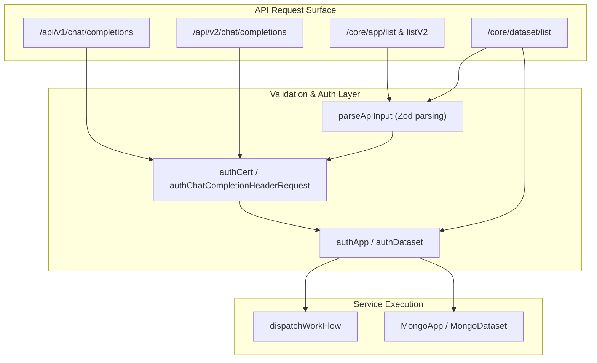
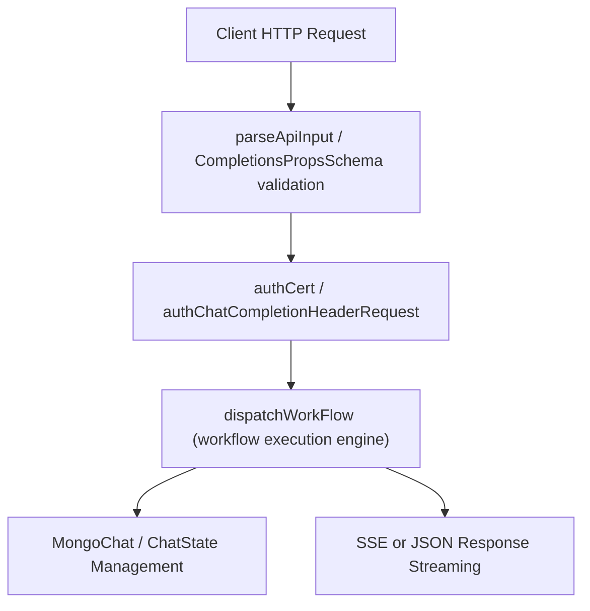
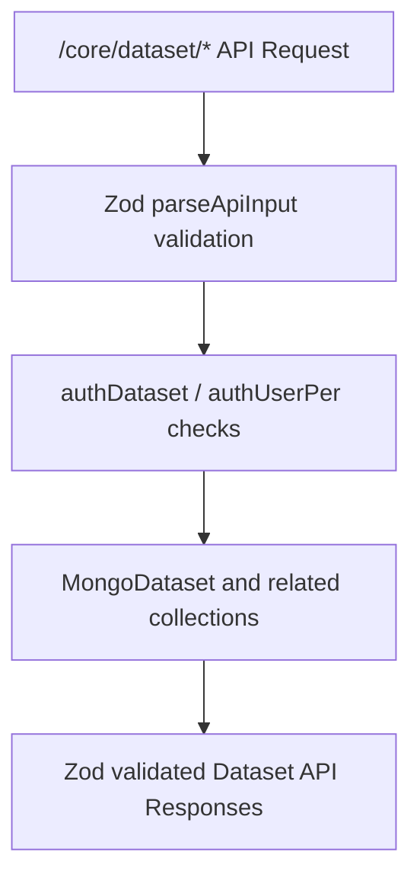
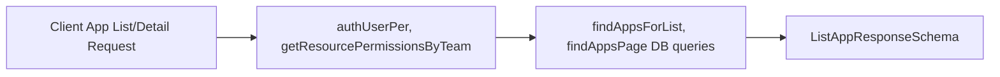
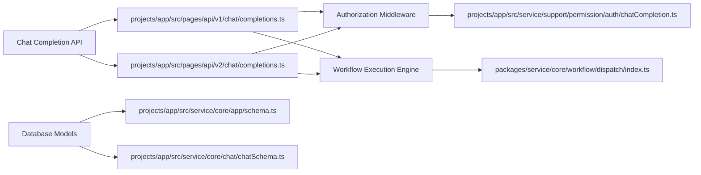
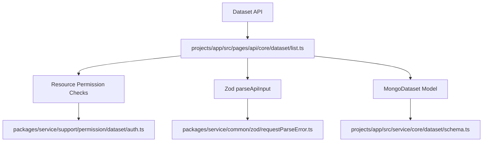

<!-- source: DeepWiki mcp.deepwiki.com · repo labring/FastGPT · page 10 API System and External Integrations · fetched 2026-10-29 -->

# API System and External Integrations

Relevant source files

The following files were used as context for generating this wiki page:

- [packages/service/core/workflow/dispatch/interactive/formInput.ts](packages/service/core/workflow/dispatch/interactive/formInput.ts)
- [packages/service/core/workflow/dispatch/interactive/userSelect.ts](packages/service/core/workflow/dispatch/interactive/userSelect.ts)
- [projects/app/src/pageComponents/app/detail/WorkflowComponents/Flow/nodes/render/RenderDebug/NodeDebugResponse.tsx](projects/app/src/pageComponents/app/detail/WorkflowComponents/Flow/nodes/render/RenderDebug/NodeDebugResponse.tsx)
- [projects/app/src/pageComponents/app/detail/WorkflowComponents/context/index.tsx](projects/app/src/pageComponents/app/detail/WorkflowComponents/context/index.tsx)
- [projects/app/src/pages/api/core/chat/chatTest.ts](projects/app/src/pages/api/core/chat/chatTest.ts)
- [projects/app/src/pages/api/core/workflow/debug.ts](projects/app/src/pages/api/core/workflow/debug.ts)
- [projects/app/src/pages/api/v1/chat/completions.ts](projects/app/src/pages/api/v1/chat/completions.ts)
- [projects/app/src/pages/api/v2/chat/completions.ts](projects/app/src/pages/api/v2/chat/completions.ts)
- [projects/app/src/web/common/api/fetch.ts](projects/app/src/web/common/api/fetch.ts)

This page presents a high-level overview of the FastGPT API system, encompassing its RESTful endpoints for chat completions, datasets, and app management along with external integration points. The API design focuses on secure, extensible service interfaces that enable AI-powered conversational workflows, knowledge base manipulation, application lifecycle management, and analytics export.

FastGPT leverages Next.js API routes combined with a rich middleware stack for input validation, authentication, and workflow dispatch. This architecture allows it to expose OpenAI-compatible chat completion endpoints and tailor them for internal workflow execution pipelines.

For comprehensive technical details, please refer to the child pages covering each major API area:

- [Chat Completion APIs](#10.1) — /api/v1 and /api/v2 chat completions, chatTest, stop endpoint, streaming vs JSON responses
- [Dataset APIs](#10.2) — Dataset CRUD, collections, data APIs, permission filtering, and OpenAPI zod contracts
- [Application Management APIs](#10.3) — App listing, details, versioning, publishing, folders, workflow debug endpoints
- [Chat Log Export and Analytics](#10.4) — Chat log export, AppLogKeysEnum, CSV generation, tracking, audit events
- [OpenAPI Schemas and API Keys](#10.5) — packages/global/openapi zod contracts, parseApiInput pattern, API key auth and UI management

---

## API Architecture Overview

FastGPT's API layer is implemented as a collection of Next.js API routes that interface with core backend services. The routing system supports both synchronous JSON and streaming responses (SSE), critical for AI chat completions with real-time token streaming.

Incoming requests undergo layered processing:

1. **Input validation:** Using Zod schemas and the `parseApiInput` helper, the API ensures precise typing and contract conformance for request bodies.
2. **Authentication & authorization:** Permission checks using `authCert`, `authApp`, and `authDataset` middleware guard access based on API keys, team membership, or outlink tokens.
3. **Workflow-based execution:** Core logic integrates deeply with the `dispatchWorkFlow` function which orchestrates node-level dispatch, data resolution, and runtime state tracking.
4. **Data access layers:** Persistent state is managed through models like `MongoApp` and `MongoDataset`, tightly coupling API operations with internal database schemas.

Sources: [projects/app/src/pages/api/v1/chat/completions.ts:1-180](), [projects/app/src/pages/api/v2/chat/completions.ts:1-180](), [projects/app/src/pages/api/core/app/list.ts:39-63](), [projects/app/src/pages/api/core/dataset/list.ts:31-50]()

---

## Chat Completion APIs

The chat completion APIs provide OpenAI-compatible interfaces at `/api/v1/chat/completions` and `/api/v2/chat/completions`. They accept well-typed requests conforming to OpenAPI contracts with support for:

- Chat message inputs and variable bindings.
- Support for outlink authentication tokens to enable shared chat scenarios.
- Streaming token-by-token responses using Server-Sent Events (SSE).
- Response enrichment with skill references and dataset citations.
- Tracking and updating usage metrics and chat generation status.
- Integration with FastGPT's workflow dispatch engine for executing defined app workflows on chat input.

These endpoints parse and normalize chat messages into internal runtime structures, perform permission and balance checks, then dispatch workflows that generate AI completions or invoke tools.

The ecosystem also includes specialized endpoints such as `/api/core/chat/chatTest` for interactive debugging tests and `/api/core/chat/stop` to cancel streaming chat responses gracefully.

For comprehensive API contract specifications, streaming vs. JSON behaviors, and usage scenarios, see the dedicated [Chat Completion APIs](#10.1) page.

Sources: [projects/app/src/pages/api/v1/chat/completions.ts:98-179](), [projects/app/src/pages/api/v2/chat/completions.ts:97-179](), [projects/app/src/pages/api/core/chat/chatTest.ts:1-180]()

---

## Dataset APIs

FastGPT's knowledge base and dataset subsystem expose RESTful endpoints for dataset creation, updating, querying, and deletion. These APIs handle complex permission checks leveraging team groups and organizational ACLs to filter accessible dataset resources.

Key features include:

- Dataset and collection management with MongoDB-based schemas (`MongoDataset`).
- Fine-grained access control via `authDataset` middleware integration.
- Use of Zod-based OpenAPI contracts ensuring stable request/response validation.
- Support for data ingestion and embedding generation pipelines interfaced through internal services.

For detailed schema definitions, collection API endpoints, filtering examples, and permission management, see the [Dataset APIs](#10.2) child page.

Sources: [projects/app/src/pages/api/core/dataset/list.ts:31-164](), [packages/service/support/permission/dataset/auth.ts:103-136]()

---

## Application Management APIs

Application lifecycle APIs provide endpoints for listing apps, retrieving details, handling versioning, publishing, and organizing folder structures. These endpoints enforce team-level authorization and embed logic for multi-level permissions aligned with teams, groups, and organizations.

Prominent features:

- Listing endpoints `/core/app/list` and `/core/app/listV2` with permission-aware filtering.
- Versioning support exposing draft and published app versions.
- Workflow debug endpoints invoking internal `dispatchWorkFlow` engine with elevated debugging context.
- Support for workflow configuration retrieval aligning with app metadata.

For a detailed rundown of parameters, resource filtering, debug tooling, and version management, see [Application Management APIs](#10.3).

Sources: [projects/app/src/pages/api/core/app/list.ts:39-195](), [projects/app/src/pages/api/core/app/listV2.ts:33-185](), [projects/app/src/pages/api/core/workflow/debug.ts:1-140]()

---

## Chat Log Export and Analytics

FastGPT supports exporting chat logs and analytics for audit and reporting.

- The system defines export key enums (`AppLogKeysEnum`) to standardize output fields.
- The chat transcript data can be serialized to CSV for offline analysis.
- Usage tracking integrates with wallet and usage record services to accumulate AI point consumption statistics.
- Audit events and telemetry data are captured via internal tracking middleware.

Admins and systems can leverage these export APIs and analytics endpoints to monitor usage patterns and detect anomalies.

For comprehensive export formats, CSV generation mechanisms, and tracking event definitions, see the [Chat Log Export and Analytics](#10.4) child page.

Sources: [projects/app/src/pages/api/v1/chat/completions.ts:26-38]()

---

## OpenAPI Schemas and API Keys

FastGPT centralizes OpenAPI contract definitions using Zod schemas located under `packages/global/openapi`. This facilitates:

- Strongly typed request and response validation via `parseApiInput`.
- Consistent API contract evolution with backward compatibility.
- API key issuance and management through frontend UI and server-side auth middleware.
- Integration of API key usage tracking and quota enforcement.

This layer underpins all external API access and streamlines frontend-backend contract synchronization.

For detailed schema layout, runtime parsing patterns, and the API key management UI, see [OpenAPI Schemas and API Keys](#10.5).

Sources: [packages/global/openapi/core/chat/completion/api.ts:50-115](), [projects/app/src/pages/api/core/app/list.ts:20-40]()

---

# Bridging Natural Language Space to Code Entity Space

The following diagrams associate FastGPT system components with concrete code entities and their interactions to clarify mapping from architectural concepts to source code.

---

This overview aims to situate FastGPT’s API design and external integration points in the context of code entities and system responsibilities. For full implementation and usage details, consult the respective child pages referenced at the start of this document.

Sources:  
- projects/app/src/pages/api/v1/chat/completions.ts  
- projects/app/src/pages/api/v2/chat/completions.ts  
- projects/app/src/pages/api/core/chat/chatTest.ts  
- projects/app/src/pages/api/core/workflow/debug.ts  
- projects/app/src/pages/api/core/app/list.ts  
- projects/app/src/pages/api/core/dataset/list.ts  
- packages/service/core/workflow/dispatch/interactive/userSelect.ts  
- packages/service/core/workflow/dispatch/interactive/formInput.ts  
- projects/app/src/web/common/api/fetch.ts

---

