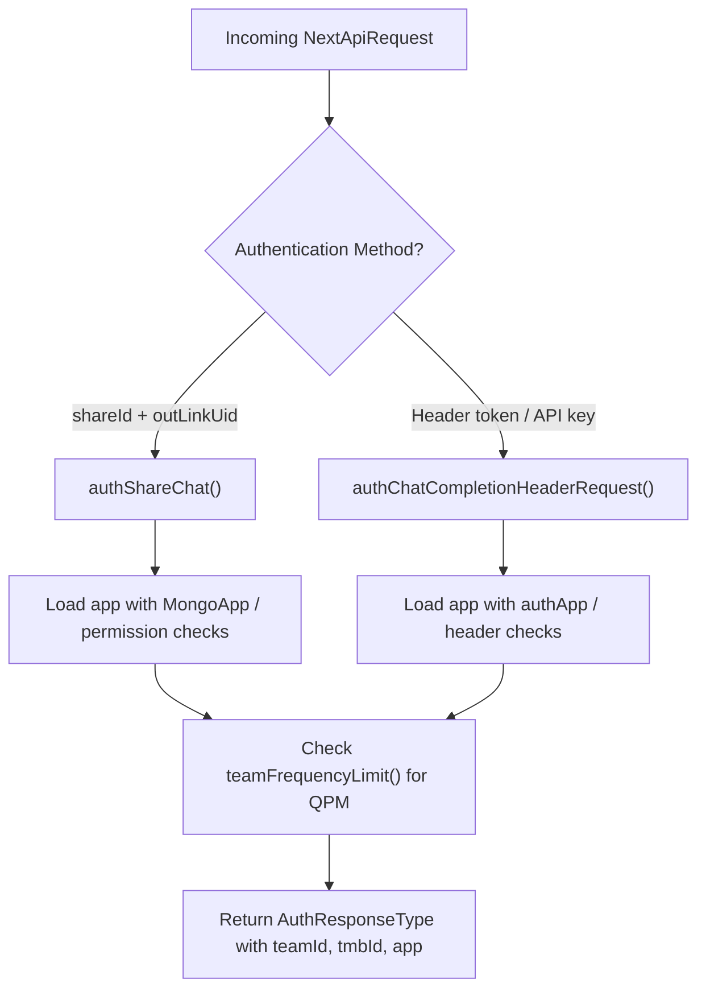
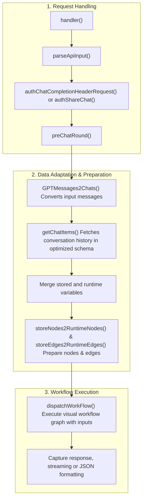
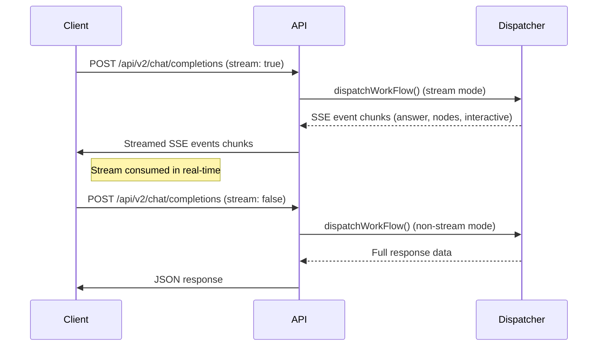
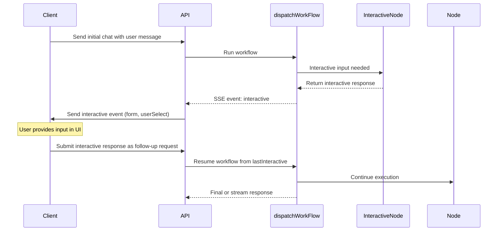
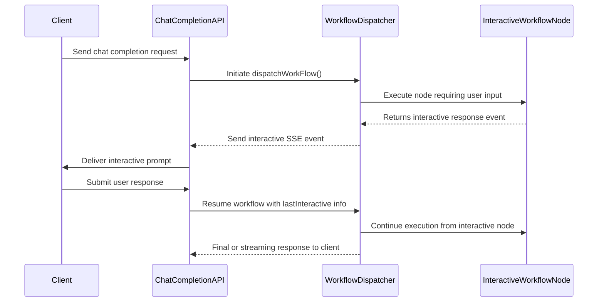

<!-- source: DeepWiki mcp.deepwiki.com · repo labring/FastGPT · page 10.1 Chat Completion APIs · fetched 2026-10-29 -->

# Chat Completion APIs

Relevant source files

The following files were used as context for generating this wiki page:

- [packages/service/core/workflow/dispatch/interactive/formInput.ts](packages/service/core/workflow/dispatch/interactive/formInput.ts)
- [packages/service/core/workflow/dispatch/interactive/userSelect.ts](packages/service/core/workflow/dispatch/interactive/userSelect.ts)
- [projects/app/src/pageComponents/app/detail/WorkflowComponents/Flow/nodes/render/RenderDebug/NodeDebugResponse.tsx](projects/app/src/pageComponents/app/detail/WorkflowComponents/Flow/nodes/render/RenderDebug/NodeDebugResponse.tsx)
- [projects/app/src/pageComponents/app/detail/WorkflowComponents/context/index.tsx](projects/app/src/pageComponents/app/detail/WorkflowComponents/context/index.tsx)
- [projects/app/src/pages/api/core/chat/chatTest.ts](projects/app/src/pages/api/core/chat/chatTest.ts)
- [projects/app/src/pages/api/core/workflow/debug.ts](projects/app/src/pages/api/core/workflow/debug.ts)
- [projects/app/src/pages/api/v1/chat/completions.ts](projects/app/src/pages/api/v1/chat/completions.ts)
- [projects/app/src/pages/api/v2/chat/completions.ts](projects/app/src/pages/api/v2/chat/completions.ts)
- [projects/app/src/web/common/api/fetch.ts](projects/app/src/web/common/api/fetch.ts)

## Purpose and Scope

This document provides a detailed technical overview of the FastGPT chat completion APIs which enable interaction with FastGPT AI applications via HTTP. These APIs accept user messages, execute complex AI-driven workflows, and return generated chat responses. They support:

- Two API versions (`/api/v1` legacy and `/api/v2` modern) with rich feature sets.
- A workflow testing endpoint (`chatTest`) for debugging workflow nodes.
- A stop endpoint to abort ongoing streaming responses.
- Both streaming Server-Sent Events (SSE) and standard JSON response modes.
- Interactive workflows requiring user input during execution.
- Detailed response metadata including node-level outputs.

These chat completion APIs serve as the primary communication interface for external clients integrating with FastGPT, including frontend UI, SDKs, and third-party tools.

Sources:  
`projects/app/src/pages/api/v1/chat/completions.ts:1-180`  
`projects/app/src/pages/api/v2/chat/completions.ts:1-180`  
`projects/app/src/pages/api/core/chat/chatTest.ts:1-180`

---

## API Endpoints Overview

| Endpoint                          | Status    | Purpose                                 | Implementation Highlights                                         |
|----------------------------------|-----------|-----------------------------------------|------------------------------------------------------------------|
| `/api/v1/chat/completions`       | Legacy    | Standard chat completions API            | Includes full workflow node response data (`responseAllData`) when detailed info requested. Supports stream and JSON modes. |
| `/api/v2/chat/completions`       | Current   | Enhanced chat completions with modular control | Supports streaming with resumable streams, flexible detail controls, and refined node response retention. |
| `/api/core/chat/chatTest`         | Internal  | Workflow debug/testing endpoint          | Allows testing chat completions with custom workflow nodes and configurations during development/debugging. |
| `/api/v2/chat/stop`              | Current   | Stop in-progress streaming completion    | Allows client to signal cancellation of ongoing chat generation to save resources and terminate streaming. |

Both chat completions endpoints share a common core of authentication, message adaptation, and workflow dispatch logic primarily handled by the `dispatchWorkFlow` function.

Sources:  
`projects/app/src/pages/api/v1/chat/completions.ts:1-100`  
`projects/app/src/pages/api/v2/chat/completions.ts:1-100`  
`projects/app/src/pages/api/core/chat/chatTest.ts:1-80`

---

## Request Authentication Flow

Authentication is a critical first step ensuring request validity and permission checks. FastGPT supports multiple authentication mechanisms depending on request context:

- **Share Chat Authentication**: When `shareId` and `outLinkUid` are present (share link scenario), authentication is delegated to `authShareChat` which validates tokens and access.
- **Header Token or API Key**: Standard authentication for API callers using tokens or keys via `authChatCompletionHeaderRequest`.
- **App Permissions**: Loads the application context and verifies team membership, rate limits, and permissions via `authApp`.

The flow is as follows:

This layered auth model supports public share chats, secured API keys, and internal team membership flows transparently.

Sources:  
`projects/app/src/pages/api/v1/chat/completions.ts:135-170`  
`projects/app/src/pages/api/v2/chat/completions.ts:135-170`

---

## Request Format & Validation

Requests to chat completions must conform to strict schemas (Zod-based) defined in `@fastgpt/global/openapi/core/chat/completion/api`. The main validated fields include:

| Parameter          | Type        | Description                                                      |
|--------------------|-------------|------------------------------------------------------------------|
| `chatId`           | `string`    | Unique conversation ID; a new chat is created if omitted.        |
| `appId`            | `string`    | FastGPT App identifier to route the request.                     |
| `messages`         | `array`     | OpenAI chat format message list containing roles and content.    |
| `stream`           | `boolean`  | If true, responds via SSE streaming; otherwise JSON.             |
| `detail`           | `boolean`  | Indicates if full node-level responses are included.             |
| `variables`        | `object`    | Global variables or workflow input bindings for the request.     |
| `retainDatasetCite`| `boolean`  | Whether to keep dataset citation information in response.        |
| `responseChatItemId`| `string`   | Client-generated chat item ID for response tracking (optional).  |
| `authProxy`        | `boolean`  | Flag to indicate proxy authentication mode (optional).           |
| `outLinkAuthData`  | `object`   | Authentication data if request comes from share links.           |

The API parses and validates all input at the entrypoint to avoid malformed or unauthorized requests.

Sources:  
`projects/app/src/pages/api/v1/chat/completions.ts:93-112`  
`projects/app/src/pages/api/v2/chat/completions.ts:90-115`

---

## Request Processing Flow

Upon successful authentication and validation, the API processes the chat completion request through several phases:

Key Points:  
- **Message Adaptation** transforms OpenAI standard message format into FastGPT’s internal `ChatItemType` format for consistency.  
- **Chat History Retrieval** uses MongoDB queries fetching recent messages for context with limits derived from workflow nodes.  
- **Workflow Dispatch** executes the comprehensive workflow graph representing the chat application logic, including AI calls, plugins, and integrations.

Sources:  
`projects/app/src/pages/api/v1/chat/completions.ts:100-180`  
`projects/app/src/pages/api/v2/chat/completions.ts:100-180`  
`projects/app/src/pages/api/core/chat/chatTest.ts:64-180`

---

## Streaming vs JSON Responses

FastGPT chat completions support two modes of delivering AI-generated output:

### Streaming Responses (SSE)

- Enabled by setting `stream: true` in the request.
- The server opens a Server-Sent Events connection.
- The streaming context is initialized with `createWorkflowStreamResponseContext`.
- Partial output chunks are sent as events during workflow node execution.
- Multiple event types stream progressively, including:
  - `answer`: Incremental text tokens with possible `reasoning_content`.
  - `fastAnswer`: Fast-path node's direct output.
  - `flowNodeResponse` / `flowNodeStatus`: Status updates per node execution.
  - `toolCall`, `toolParams`, `toolResponse`: Events for invoked tools/functions.
  - `interactive`: Prompts for user input during interactive workflows.
- Client-side handling uses `handleEventSourceData` in `fetch.ts` for parsing events, enqueueing tokens, and controlling typing speed.

### JSON Responses

- Occur when `stream: false` or no streaming requested.
- Workflow executes completely before responding.
- Node response trees are finalized and filtered by `filterWorkflowFinalResponseData`.
- The response includes:
  - Standard OpenAI-like chat message response structure.
  - Additional metadata `responseData` with detailed node outputs.
  - Tokens count and other usage metadata.
- Used for simpler synchronous integration or debugging.

Sources:  
`projects/app/src/web/common/api/fetch.ts:100-212`  
`projects/app/src/pages/api/v1/chat/completions.ts:90-130`  
`projects/app/src/service/core/workflow/nodeResponse.ts:67-98`

---

## Interactive Workflow Support

The chat completion APIs fully support workflows that include interactive nodes requiring user input like forms and selections. Workflow execution pauses at these nodes and yields interaction prompts.

### Mechanism:

- During workflow dispatch, interactive nodes return an `interactive` SSE event with input parameters.
- The API sends this event to the client indicating input required.
- The client collects user input and sends a follow-up request with `lastInteractive` data to resume the workflow.
- The workflow resumes from the specified entry node(s) using `getWorkflowEntryNodeIds`.
- The last interactive value is retrieved from history by `getLastInteractiveValue`.

Supported interactive node types examples from `dispatchUserSelect` and `dispatchFormInput`:  
- **UserSelect** node: user selects from predefined options.  
- **FormInput** node: user submits form data JSON. Includes file selections with file preview URL handling.

Sources:  
`projects/app/src/pages/api/v1/chat/completions.ts:15-23`  
`packages/service/core/workflow/dispatch/interactive/userSelect.ts:1-65`  
`packages/service/core/workflow/dispatch/interactive/formInput.ts:1-160`

---

## Persistence, Stop Endpoint, and Usage Tracking

### Chat Round Finalization

After workflow execution completes or fails:

- If successful, `finalizeChatRound` persists the chat messages, node response trees, and updates chat record states including token counts.
- If failed, `failChatRound` handles error cases and records partial states accordingly.
- These ensure chat continuity and analytics.

### Stop Streaming Endpoint

- Endpoint `/api/v2/chat/stop` is provided to abort active streaming completions.
- Implemented by updating `ChatGenerateStatusEnum` status and cancelling ongoing execution with abort controllers.
- This conserves server resources and provides user control.

### Usage Accounting

- API key usage is tracked by `updateApiKeyUsage` to enforce quotas.
- Share link usage is recorded via `addOutLinkUsage`.
- App-level usage and analytics are logged with `recordAppUsage`.

These metrics enable billing, rate limiting, and auditing functionality.

Sources:  
`projects/app/src/pages/api/v1/chat/completions.ts:25-45`  
`projects/app/src/pages/api/v2/chat/completions.ts:68-72`  
`packages/service/core/chat/nodeResponseStorage.ts:1-16`

---

# Architecture Diagrams Bridging Natural Language and Code Entities

### Diagram 1: Chat Completion API - High-Level Flow from Request to Workflow Dispatch

```mermaid
graph LR
    Req["Client HTTP Request\n/api/v1 or /api/v2/chat/completions"]
    Auth["Authentication Layer\n(authShareChat / authChatCompletionHeaderRequest)"]
    LoadApp["Load App & Permission Check\nMongoApp / authApp"]
    RateLimit["Rate Limit Check\nt eamFrequencyLimit()"]
    Parse["Input Parsing & Validation\nparseApiInput() + CompletionsPropsSchema"]
    Adapt["Message Adaptation\nGPTMessages2Chats()"]
    LoadHist["Load Chat History\ngetChatItems()"]
    PrepareVars["Merge and Prepare Variables\nMongoChat variables + request vars"]
    RuntimeNodes["Prepare Runtime Nodes & Edges\nstoreNodes2RuntimeNodes() / storeEdges2RuntimeEdges()"]
    Dispatch["Workflow Dispatch\n dispatchWorkFlow()"]
    StreamRes["Streaming Response Context\ncreateWorkflowStreamResponseContext()"]
    FinalResp["Generate Final Response\nfilterWorkflowFinalResponseData() for JSON"]

    Req --> Auth --> LoadApp --> RateLimit --> Parse --> Adapt --> LoadHist --> PrepareVars --> RuntimeNodes --> Dispatch
    Dispatch -->|stream: true| StreamRes --> Req
    Dispatch -->|stream: false| FinalResp --> Req
```

### Diagram 2: Interactive Node Flow in Chat Completion Workflow

These diagrams link the conceptual client API flow with code entities such as `dispatchWorkFlow`, authentication functions, and streaming context creators.

---

# Summary

This page detailed the chat completion APIs foundational to FastGPT, describing the versions, endpoints, authentication, request validation, processing pipeline, and response modes. The streaming vs JSON response handling and interactive workflow support were explained with key functions and flow diagrams. Stop endpoints and usage tracking mechanisms were also covered to explain system robustness and operational control.

For deeper understanding of the underlying workflow execution engine, see section **4.2 Workflow Execution Engine**. For API contract details, refer to the OpenAPI schema packages.

---

Sources:  
- `projects/app/src/pages/api/v1/chat/completions.ts:1-180`  
- `projects/app/src/pages/api/v2/chat/completions.ts:1-180`  
- `projects/app/src/pages/api/core/chat/chatTest.ts:1-180`  
- `projects/app/src/web/common/api/fetch.ts:1-212`  
- `packages/service/core/workflow/dispatch/interactive/userSelect.ts:1-65`  
- `packages/service/core/workflow/dispatch/interactive/formInput.ts:1-160`  
- `projects/app/src/service/core/workflow/nodeResponse.ts:67-98`  
- `projects/app/src/pages/api/core/chat/chatTest.ts:64-180`  
- `projects/app/src/pages/api/core/workflow/debug.ts:30-139`

---

