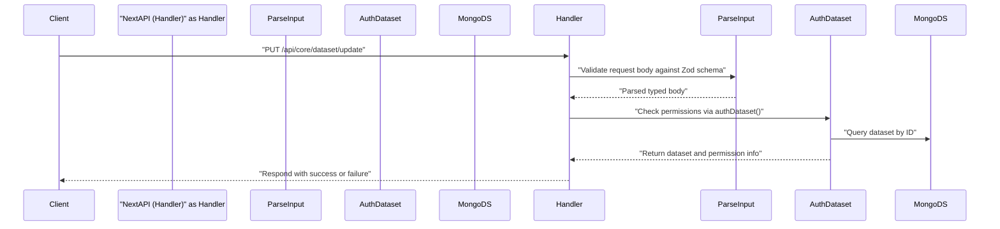
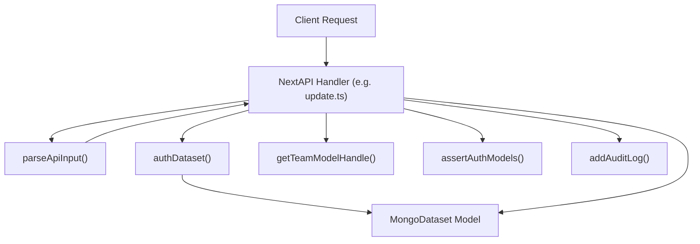
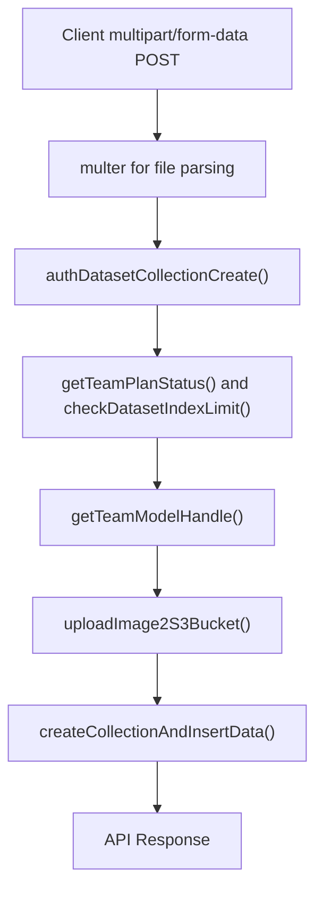

<!-- source: DeepWiki mcp.deepwiki.com · repo labring/FastGPT · page 10.2 Dataset APIs · fetched 2026-10-29 -->

# Dataset APIs

<details>
<summary>Relevant source files</summary>

The following files were used as context for generating this wiki page:

- [packages/global/common/error/code/skill.ts](packages/global/common/error/code/skill.ts)
- [packages/global/core/ai/skill/type.ts](packages/global/core/ai/skill/type.ts)
- [packages/global/core/app/version/type.ts](packages/global/core/app/version/type.ts)
- [packages/global/core/dataset/type.ts](packages/global/core/dataset/type.ts)
- [packages/global/openapi/core/dataset/api.ts](packages/global/openapi/core/dataset/api.ts)
- [packages/global/openapi/core/dataset/collection/createApi.ts](packages/global/openapi/core/dataset/collection/createApi.ts)
- [packages/service/core/ai/skill/manage/folder.ts](packages/service/core/ai/skill/manage/folder.ts)
- [packages/service/core/ai/skill/manage/query.ts](packages/service/core/ai/skill/manage/query.ts)
- [packages/service/core/ai/skill/model/schema.ts](packages/service/core/ai/skill/model/schema.ts)
- [packages/web/components/common/UserBox/index.tsx](packages/web/components/common/UserBox/index.tsx)
- [projects/app/src/components/common/folder/SelectOneResource.tsx](projects/app/src/components/common/folder/SelectOneResource.tsx)
- [projects/app/src/pageComponents/dashboard/Container.tsx](projects/app/src/pageComponents/dashboard/Container.tsx)
- [projects/app/src/pageComponents/dashboard/ReferencedAppsPopover.tsx](projects/app/src/pageComponents/dashboard/ReferencedAppsPopover.tsx)
- [projects/app/src/pageComponents/dashboard/agent/List.tsx](projects/app/src/pageComponents/dashboard/agent/List.tsx)
- [projects/app/src/pageComponents/dashboard/agent/context.tsx](projects/app/src/pageComponents/dashboard/agent/context.tsx)
- [projects/app/src/pageComponents/dashboard/skill/List.tsx](projects/app/src/pageComponents/dashboard/skill/List.tsx)
- [projects/app/src/pageComponents/dataset/list/context.tsx](projects/app/src/pageComponents/dataset/list/context.tsx)
- [projects/app/src/pages/api/core/ai/skill/create.ts](projects/app/src/pages/api/core/ai/skill/create.ts)
- [projects/app/src/pages/api/core/ai/skill/detail.ts](projects/app/src/pages/api/core/ai/skill/detail.ts)
- [projects/app/src/pages/api/core/ai/skill/list.ts](projects/app/src/pages/api/core/ai/skill/list.ts)
- [projects/app/src/pages/api/core/ai/skill/update.ts](projects/app/src/pages/api/core/ai/skill/update.ts)
- [projects/app/src/pages/api/core/app/update.ts](projects/app/src/pages/api/core/app/update.ts)
- [projects/app/src/pages/api/core/dataset/collection/create.ts](projects/app/src/pages/api/core/dataset/collection/create.ts)
- [projects/app/src/pages/api/core/dataset/collection/create/images.ts](projects/app/src/pages/api/core/dataset/collection/create/images.ts)
- [projects/app/src/pages/api/core/dataset/create.ts](projects/app/src/pages/api/core/dataset/create.ts)
- [projects/app/src/pages/api/core/dataset/folder/create.ts](projects/app/src/pages/api/core/dataset/folder/create.ts)
- [projects/app/src/pages/api/core/dataset/update.ts](projects/app/src/pages/api/core/dataset/update.ts)
- [projects/app/test/api/core/ai/skill/list.test.ts](projects/app/test/api/core/ai/skill/list.test.ts)
- [projects/app/test/api/core/app/batch.test.ts](projects/app/test/api/core/app/batch.test.ts)
- [projects/app/test/api/core/dataset/collection/create/inheritPermission.test.ts](projects/app/test/api/core/dataset/collection/create/inheritPermission.test.ts)
- [projects/app/test/api/core/dataset/create.test.ts](projects/app/test/api/core/dataset/create.test.ts)
- [projects/app/test/api/core/dataset/folder/create.test.ts](projects/app/test/api/core/dataset/folder/create.test.ts)

</details>


This page provides an in-depth technical overview of the Dataset APIs in FastGPT covering Dataset CRUD, collection management, data operations, permission-filtered lists, and OpenAPI zod contracts that govern validation and typing. These APIs form key building blocks for managing knowledge bases and underpin the permission system, data lifecycle, and integration with frontends and workflow services.

---

## Purpose and Scope

Dataset APIs in FastGPT serve to:

- Create, read, update, and delete datasets (knowledge bases) and data collections.
- Manage dataset folders with hierarchical organization.
- Handle collections of various types including files, links, text, images, and API-based datasets.
- Update dataset data chunks and configure chunking/training settings.
- Enforce fine-grained permission controls by leveraging the internal permission/authenticator middleware.
- Provide typed request/response contracts via Zod schemas integrated with OpenAPI for automatic validation and documentation.
- Support batch operations, metadata tagging, re-training collections, and data export.

They act as an abstraction layer between the web UI, workflow execution engine, and the underlying MongoDB storage layer, with vector/embedding model configuration tightly coupled into dataset create/update flows.

---

## Authentication and Authorization

The Dataset APIs enforce secure access through:

- `authDataset()`: Confirms team membership and permissions to view or modify datasets.
- `authDatasetData()`: Ensures write permission to individual dataset data chunks.
- `authDatasetCollectionCreate()`: Used when creating collections, applies specific creation permissions.
- Permission constants like `WritePermissionVal`, `ReadPermissionVal`, and `TeamDatasetCreatePermissionVal`.
- Model usage is verified via `assertAuthModels()` ensuring that AI models selected comply with team authorization.
- Permissions flow through the entire request lifecycle to prevent unauthorized reads or writes.

### Authentication Request Flow Example

Below is an example sequence for a typical dataset update API showing validation and auth flow:



**Sources:** [projects/app/src/pages/api/core/dataset/update.ts:33-99](), [projects/app/src/pages/api/core/dataset/create.ts:30-153]()

---

## Dataset CRUD API Implementation

### Create Dataset

- **Route:** `POST /api/core/dataset/create`
- The handler validates input with `CreateDatasetBodySchema` (OpenAPI Zod).
- Invokes `authDataset` or `authUserPer` based on presence or absence of a parent folder.
- Model IDs (vector, agent, vision-language) are validated via team model handles.
- Enforces team dataset creation limits.
- Creates the dataset document in MongoDB with calculated model IDs and sets up default collaborators.
- Logs audit events asynchronously for tracking.

Key function: `handler(req: ApiRequestProps)`

### Update Dataset

- **Route:** `PUT /api/core/dataset/update`
- Supports moving datasets between folders by reusing the `moveDataset()` service.
- Updates dataset properties: name, avatar, intro, models, configurations, chunk settings, auto-sync toggles.
- Revalidates model permissions using `assertAuthModels()`.
- On chunk setting changes for Website type datasets, relevant indexing data is deleted to trigger re-indexing.
- Audit logs track changes, and the operation runs within a Mongo session for atomicity.

Key function: `handler(req: ApiRequestProps<UpdateDatasetBody>)`

### Delete Dataset

- **Route:** `DELETE /api/core/dataset/delete`
- Enforces permission check.
- Cleans all dataset-related data, including collections and chunks.
- Audit logs deletion events.

---

## Collection APIs

Collections are conceptual subdivisions inside datasets, and there are multiple APIs to create, update, and manage collections of different data types.

### Create Collection

- Multiple endpoints depending on the collection source:
  - `.create`: general collection creation (folders, virtual collections).
  - `.create/fileId`: create from existing file by S3 key.
  - `.create/localFile`: upload local file multipart form data.
  - `.create/link`: create collection from URL link.
  - `.create/text`: create from raw text content.
  - `.create/images`: create from uploaded images (with permission limiting and image model verification).
- All creation APIs validate input via Zod schemas extending `ApiCreateCollectionBaseSchema`.
- Collections support tags, chunk/training configurations, and inherit permissions flags.
- Permissions are checked through `authDatasetCollectionCreate()` enforcing dataset-level controls.
- Team dataset index limits are enforced when ingesting new collections.
- Image collections perform extra validation for model capability on VLM or image embedding.

Key example: Handler for image collections uploads files using middleware, performs dataset auth, uploads images to S3, and creates the collection with inserted data.

---

## Dataset Data Update API

- **Route:** `PUT /api/core/dataset/data/update`
- Validates input to update chunk fields (`q`, `a`, vector embeddings).
- Authenticates data and collection via `authDatasetData`.
- Supports updating embedding vector indexes and uses embedding generation token counters.
- Replaces S3 keys with preview URLs for returned chunk content.
- Returns updated chunk info using `UpdateDatasetDataResponseSchema` to client.

---

## Permission-Filtered Lists

Dataset APIs support filtered listing of datasets and collections considering:

- Team membership and dataset read/write permission levels.
- Creator/tmbId filters.
- Folder hierarchy based search.
- Pagination and sorting.
- Returned list items omit unauthorized datasets or data.

The client-side function `getDatasets()` wraps the list API applying permission filtering using `filterDatasetsByTmbId()` server-side.

---

## OpenAPI Zod Contracts

FastGPT defines API input/output schemas using `zod` and exports them as OpenAPI contract components under:

- `@fastgpt/global/openapi/core/dataset/api.ts` (Dataset API contracts)
- `@fastgpt/global/core/dataset/type.ts` (Core dataset types and constants schemas)
- `@fastgpt/global/openapi/core/dataset/collection/createApi.ts` (Collections create API schemas)

These provide complete field-level descriptions, optional/required flags, and validation rules used by both API handlers and runtime request parsing middleware `parseApiInput()`.

Example snippet from Create Dataset API contract:

```ts
export const CreateDatasetBodySchema = z.object({
  parentId: ParentIdSchema.optional(),
  type: z.enum(DatasetTypeEnum),
  name: z.string(),
  intro: z.string(),
  avatar: z.string().optional(),
  vectorModelId: z.string().optional(),
  agentModelId: z.string().optional(),
  vlmModelId: z.string().nullable().optional(),
  apiDatasetServer: ApiDatasetServerSchema.optional(),
  sangforFileParseConfig: sangforFileParseConfigSchema.optional(),
  inheritPermission: InheritPermissionInputSchema.default(true)
});
```

---

## Data Flow Diagrams Bridging Natural Language and Code Entities

### 1. Dataset Permission Flow



### 2. Collection Creation Pipeline (Example: Image Collection Create)



**Sources:**  
- [projects/app/src/pages/api/core/dataset/create.ts:30-153]()  
- [projects/app/src/pages/api/core/dataset/update.ts:38-200]()  
- [projects/app/src/pages/api/core/dataset/collection/create/images.ts:32-131]()  
- [packages/global/openapi/core/dataset/api.ts:31-204]()  
- [packages/global/openapi/core/dataset/collection/createApi.ts:1-151]()  
- [projects/app/src/pages/api/core/dataset/folder/create.ts:26-89]()  
- [projects/app/src/pages/api/core/dataset/collection/export.ts:20-159]()  

---

## Summary Table of Key Dataset APIs

| API Route                            | Method | Description                                   | Input Schema                            | Output Schema                     |
| ---------------------------------- | ------ | --------------------------------------------- | ------------------------------------- | -------------------------------- |
| `/core/dataset/create`              | POST   | Create new dataset                            | `CreateDatasetBodySchema`              | `CreateDatasetResponseSchema`     |
| `/core/dataset/update`              | PUT    | Update dataset details or move folder        | `UpdateDatasetBodySchema`              | void                             |
| `/core/dataset/delete`              | DELETE | Delete dataset                               | `DeleteDatasetQuerySchema`             | void                             |
| `/core/dataset/detail`              | GET    | Retrieve dataset details                      | `GetDatasetDetailQuerySchema`          | `DatasetItemSchema`               |
| `/core/dataset/list`                | POST   | List datasets with filters                    | `ListDatasetQuerySchema`               | `ListDatasetResponseSchema`      |
| `/core/dataset/collection/create`  | POST   | Create collection (folder/virtual)            | `CreateCollectionBodySchema`           | `CreateCollectionResponseSchema` |
| `/core/dataset/collection/create/fileId` | POST | Create collection from fileId                 | `CreateCollectionByFileIdBodySchema`  | `CreateCollectionResponseSchema` |
| `/core/dataset/collection/create/localFile` | POST | Upload local file to create collection       | `CreateCollectionByLocalFileBodySchema` | `CreateCollectionResponseSchema` |
| `/core/dataset/collection/create/images` | POST | Create image collection with uploaded images | `CreateImageCollectionFormSchema`     | `CreateCollectionWithResultResponseType` |
| `/core/dataset/data/update`         | PUT    | Update data chunk info                        | `UpdateDatasetDataBodySchema`          | `UpdateDatasetDataResponseSchema` |
| `/core/dataset/collection/export`   | GET    | Export collection data as CSV with rate-limit | `GetExportDatasetQuerySchema`           | CSV Stream                       |

---

## Client Usage and Context Integration

In the web UI and dashboard components:

- Dataset lists and operations use hooks and context such as `useRequest`, `useContextSelector`, and dedicated Dataset List stores.
- Actions like `postCreateDataset()` and `putDatasetById()` reside in `projects/app/src/web/core/dataset/api.ts`.
- Batch move/delete and multi-select features integrate through these APIs.
- Permission icons and editing modals are tied into these APIs with error handling and success feedback.
- Search and filter states persist across navigation with typed filters.

---

# Appendix

### Key Server-side Helper Modules for Dataset APIs

- `authDataset`: supports authentication and permissions for datasets.
- `authDatasetCollectionCreate`: guards creation APIs.
- `mongoSessionRun`: runs multi-document Mongo sessions for atomic writes.
- `moveDataset`: unified move logic with permission inheritance validation.
- `addAuditLog`: records audit events asynchronously.
- Model handle getters and asserts from `getTeamModelHandle()` and `assertAuthModels()` ensure LLM/embedding model access rights.
- `parseApiInput()`: middleware utility for strict zod validation with API error handling.
- S3 helper utilities handle avatar and file storage operations.

---

# Summary

The Dataset APIs of FastGPT are robust, permission-aware, and designed with strong validation contracts. They enable hierarchical management of knowledge bases and collections with fine control over AI models, chunking, and indexing configurations. Integrated authorization layers ensure secure multi-tenant access with comprehensive audit logging.

By leveraging typed Zod schemas as OpenAPI contracts, the APIs provide predictable and machine-verifiable request/response shapes, enhancing security, developer productivity, and client code generation.

---

**Sources:**  
- [projects/app/src/pages/api/core/dataset/create.ts:1-154]()  
- [projects/app/src/pages/api/core/dataset/update.ts:1-193]()  
- [projects/app/src/pages/api/core/dataset/folder/create.ts:1-89]()  
- [projects/app/src/pages/api/core/dataset/data/update.ts:1-126]()  
- [projects/app/src/pages/api/core/dataset/collection/create/images.ts:1-137]()  
- [packages/global/openapi/core/dataset/api.ts:1-204]()  
- [packages/global/openapi/core/dataset/collection/createApi.ts:1-151]()  
- [projects/app/src/web/core/dataset/api.ts:25-90]()

---

