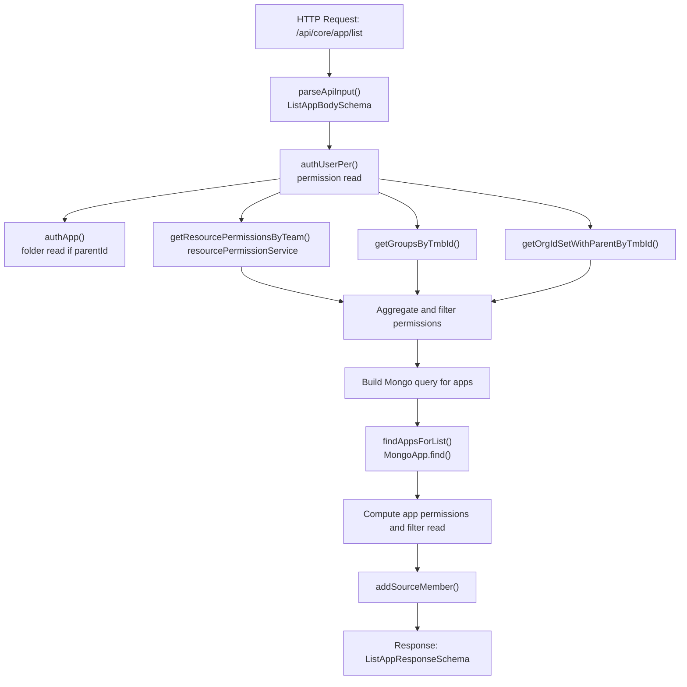
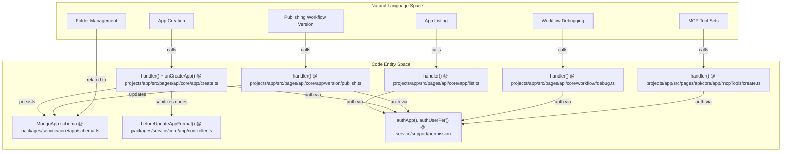

<!-- source: DeepWiki mcp.deepwiki.com · repo labring/FastGPT · page 10.3 Application Management APIs · fetched 2026-10-29 -->

# Application Management APIs

<details>
<summary>Relevant source files</summary>

The following files were used as context for generating this wiki page:

- [packages/global/common/zod/index.ts](packages/global/common/zod/index.ts)
- [packages/global/openapi/core/app/common/api.ts](packages/global/openapi/core/app/common/api.ts)
- [packages/global/openapi/core/app/common/index.ts](packages/global/openapi/core/app/common/index.ts)
- [packages/global/openapi/core/chat/completion/api.ts](packages/global/openapi/core/chat/completion/api.ts)
- [packages/global/test/common/zod/index.test.ts](packages/global/test/common/zod/index.test.ts)
- [packages/global/test/openapi/core/app/common/api.test.ts](packages/global/test/openapi/core/app/common/api.test.ts)
- [packages/global/test/openapi/core/chat/completion/api.test.ts](packages/global/test/openapi/core/chat/completion/api.test.ts)
- [packages/service/core/app/controller.ts](packages/service/core/app/controller.ts)
- [packages/service/core/app/entity.ts](packages/service/core/app/entity.ts)
- [packages/service/core/app/schema.ts](packages/service/core/app/schema.ts)
- [packages/service/core/app/version/schema.ts](packages/service/core/app/version/schema.ts)
- [packages/service/support/permission/teamLimit.ts](packages/service/support/permission/teamLimit.ts)
- [packages/service/test/core/app/entity.test.ts](packages/service/test/core/app/entity.test.ts)
- [packages/service/test/support/permission/teamLimit.test.ts](packages/service/test/support/permission/teamLimit.test.ts)
- [projects/app/src/pages/account/info/index.tsx](projects/app/src/pages/account/info/index.tsx)
- [projects/app/src/pages/api/core/app/create.ts](projects/app/src/pages/api/core/app/create.ts)
- [projects/app/src/pages/api/core/app/httpTools/create.ts](projects/app/src/pages/api/core/app/httpTools/create.ts)
- [projects/app/src/pages/api/core/app/list.ts](projects/app/src/pages/api/core/app/list.ts)
- [projects/app/src/pages/api/core/app/listV2.ts](projects/app/src/pages/api/core/app/listV2.ts)
- [projects/app/src/pages/api/core/app/mcpTools/create.ts](projects/app/src/pages/api/core/app/mcpTools/create.ts)
- [projects/app/src/pages/api/core/app/pin.ts](projects/app/src/pages/api/core/app/pin.ts)
- [projects/app/src/pages/api/core/app/version/list.ts](projects/app/src/pages/api/core/app/version/list.ts)
- [projects/app/src/pages/api/core/app/version/publish.ts](projects/app/src/pages/api/core/app/version/publish.ts)
- [projects/app/src/pages/api/core/dataset/list.ts](projects/app/src/pages/api/core/dataset/list.ts)
- [projects/app/src/pages/api/support/user/team/plan/getTeamPlanStatus.ts](projects/app/src/pages/api/support/user/team/plan/getTeamPlanStatus.ts)
- [projects/app/src/pages/dataset/list/index.tsx](projects/app/src/pages/dataset/list/index.tsx)
- [projects/app/src/service/core/app/delete.ts](projects/app/src/service/core/app/delete.ts)
- [projects/app/test/api/core/app/copy.test.ts](projects/app/test/api/core/app/copy.test.ts)
- [projects/app/test/api/core/app/delete.test.ts](projects/app/test/api/core/app/delete.test.ts)
- [projects/app/test/api/core/app/list.test.ts](projects/app/test/api/core/app/list.test.ts)
- [projects/app/test/api/core/app/quotaTestUtils.ts](projects/app/test/api/core/app/quotaTestUtils.ts)
- [projects/app/test/api/core/app/transitionWorkflow.test.ts](projects/app/test/api/core/app/transitionWorkflow.test.ts)
- [projects/app/test/api/support/user/team/plan/getTeamPlanStatus.test.ts](projects/app/test/api/support/user/team/plan/getTeamPlanStatus.test.ts)

</details>


This page details the design, implementation, and data flow of FastGPT's Application Management APIs. These APIs support core functionalities including application listing, retrieval of application details, versioning, publishing, folder management, and debugging workflow executions. They ensure proper permission enforcement and efficient interactions with the underlying MongoDB schema and auxiliary services.

---

## 1. Application Listing and Searching

The application listing API provides paginated, permission-aware querying of applications and folders belonging to the user's team. It supports flexible filtering based on parent folder, app type(s), search keywords, and pinned apps prioritization.

### Implementation Overview

The route handler is located at `projects/app/src/pages/api/core/app/list.ts`. Key responsibilities and flow:

- **Input Validation:** Using `parseApiInput` validated by the `ListAppBodySchema` from the global OpenAPI schemas.
- **Authentication and Authorization:** 
  - User permissions are validated via `authUserPer` to ensure read access.
  - If a `parentId` filter is present, the folder's read permission is validated with `authApp`.
  - Aggregates all resource permission entries for the team and the user's groups/orgs.
- **Query Construction:** Builds MongoDB queries filtering on team ID, app type, search keywords (name or intro), parent folder, and creator membership.
- **Data Retrieval:** Calls `findAppsForList` (service layer function) that fetches apps from `MongoApp` collection with appropriate fields and filters.
- **Post-Processing:** 
  - Computes per-app permissions combining direct (`tmbId`) and indirect (groups/orgs) roles.
  - Flags apps as private if collaborators restrict access.
  - Filters out apps without read permission.
  - Enriches results with source member data.

### Data Flow Mermaid Diagram



Sources: [projects/app/src/pages/api/core/app/list.ts:39-195](), [packages/service/core/app/schema.ts:1-179]()

---

## 2. Application Creation and Data Model (`MongoApp`)

Applications including folders and tools are represented by the `MongoApp` schema in MongoDB. The schema describes a hierarchical tree structure with parent references, permission inheritance flags, version references, and metadata.

### Core Schema Highlights

- `parentId`: References parent app/folder, enabling folder hierarchy [packages/service/core/app/schema.ts:29-33]()
- `teamId` and `tmbId`: Identify owning team and team member user [packages/service/core/app/schema.ts:34-43]()
- `type`: Enum for app categorization (e.g., workflow, simple app, folder, tool) [packages/service/core/app/schema.ts:48-52]()
- `version`: Version schema (`v1`, `v2`) for backward compatibility [packages/service/core/app/schema.ts:53-56]()
- `publishedVersionId`: Pointer to active published workflow version [packages/service/core/app/schema.ts:118-121]()
- `inheritPermission`: Boolean flag for permission inheritance from parent folder [packages/service/core/app/schema.ts:122-125]()
- Soft delete flag `deleteTime` for non-destructive removal tracking [packages/service/core/app/schema.ts:140-143]()

### Application Creation Flow

The creation API handler is in `projects/app/src/pages/api/core/app/create.ts`. It performs:

- **Permission Checks:** Validates write/create permissions via `authApp` or user-level `authUserPer`.
- **Quota Enforcement:** Checks team app type limits by category (app, tool, folder) using `checkTeamAppTypeLimit`.
- **Parent Folder Validation:** Ensures tool apps are created under tool folders and workflow apps under workflow folders.
- **Workflow Migration:** Normalizes workflow data using `migrateWorkflowToCurrent`.
- **Model Authorization:** Filters AI models accessible to the team/user.
- **Format Validation:** Calls `beforeUpdateAppFormat` to sanitize nodes, remove edit state, and clear secret inputs.
- **Extract Resources:** Scans the workflow for resource references for later permission enforcement.
- **Database Persistence:** Creates the app document in `MongoApp`, initial version in `MongoAppVersion`.
- **Audit Logging and Tracking:** Emits audit events and usage tracking.

### Workflow Node Formatting

The function `beforeUpdateAppFormat` (found in `packages/service/core/app/controller.ts`) is critical to ensure input secrecy and data consistency before saving. It:

- Formats dataset selection inputs preserving only snapshot display data.
- Processes skill selection input types.
- Strips sensitive values from tool secret inputs.
- Retrieves client-side tool previews to sanitize nested inputs.
  
### Architecture Diagram

```mermaid
graph TD
  API[Create App API <br/> projects/app/src/pages/api/core/app/create.ts]
  Auth[authApp / authUserPer]
  Quota[checkTeamAppTypeLimit]
  Workflow[Workflow Migrate <br/> migrateWorkflowToCurrent()]
  ModelAuth[getAuthorizedModelIds]
  Format[beforeUpdateAppFormat()]
  Extract[extractAppResources()]
  DB[MongoApp & MongoAppVersion]
  Audit[Audit & Tracking]

  API --> Auth --> Quota --> Workflow --> ModelAuth --> Format --> Extract --> DB --> Audit
```

Sources: [projects/app/src/pages/api/core/app/create.ts:1-204](), [packages/service/core/app/schema.ts:1-179](), [packages/service/core/app/controller.ts:50-163]()

---

## 3. Application Publishing and Versioning

### Publishing Endpoint

Publishing creates a new application version, optionally marking it as "published", which activates that version for runtime use.

- **Path:** `projects/app/src/pages/api/core/app/version/publish.ts`
- **Input:** Nodes, edges, chat config, publish flag, version name, and autosave flag.
- **Auth:** Write permission enforced on the app.
- **Workflow Migration & Formatting:** Workflow is normalized and nodes formatted (`migrateWorkflowToCurrent`, `beforeUpdateAppFormat`).
- **Model Authorization:** Ensures referenced AI models are authorized for use.
- **Resource Extraction:** Extracts referenced datasets, skills, etc. for permission checks.
- **Transaction:** Creates a new version entry (`MongoAppVersion`) and updates `MongoApp` with the new published version id, version type, schedules, and timestamps.
- **Parent Folder Update:** Updates folder timestamps recursively.
- **Audit Logging:** Logs the publishing event asynchronously.

### Publishing Data Flow

```mermaid
graph TD
  Req[Publish Request <br/> projects/app/src/pages/api/core/app/version/publish.ts]
  Auth[authApp Write Permission]
  Migrate[migrateWorkflowToCurrent()]
  ModelAuth[getAuthorizedModelIds()]
  Format[beforeUpdateAppFormat()]
  Extract[extractAppResources()]
  Tx[Mongo Transaction]
  CreateVersion[MongoAppVersion.create()]
  UpdateApp[MongoApp.updateOne()]
  FolderUpdate[updateParentFoldersUpdateTime()]
  Audit[addAuditLog()]

  Req --> Auth --> Migrate --> ModelAuth --> Format --> Extract --> Tx
  Tx --> CreateVersion --> UpdateApp
  UpdateApp --> FolderUpdate
  FolderUpdate --> Audit
```

Sources: [projects/app/src/pages/api/core/app/version/publish.ts:1-207]()

---

## 4. Application Folder Management and Permissions

Applications may be organized hierarchically via folders (`AppTypeEnum.folder`, `AppTypeEnum.toolFolder`). Folder permissions propagate to contained applications if `inheritPermission` is true.

- Folder creation and modification validate the folder depth limits and user write permissions.
- The listing API supports querying and filtering apps by parent folder.
- Permission checks cascade, combining folder ACLs with resource-level ACLs when inheritance applies.

The permission model is enforced through multiple layers (e.g., `authApp`, `authUserPer`), cooperating with the resource permission repository and user team/org/group permission aggregation.

Sources: [projects/app/src/pages/api/core/app/list.ts:39-195](), [packages/service/core/app/controller.ts:166-175](), [packages/service/support/permission/app/auth.ts]()

---

## 5. MCP Tool Sets Creation

Special API supports creating MCP protocol toolsets exposed as MCP tools:

- **Route:** `projects/app/src/pages/api/core/app/mcpTools/create.ts`
- **Inputs:** Tool list, URL, header secrets, avatar, naming, parent.
- **Authorization:** Write permission check on parent or user-level create permission.
- **Internal URL Validation:** Ensures MCP URLs are not pointing to internal/private network IPs.
- **Node Creation:** Encodes the MCP tool nodes for storage.
- **Calls:** Reuses `onCreateApp` from standard app creates.
- **Audit Logging:** Tracks creation with MCP tool type.

Sources: [projects/app/src/pages/api/core/app/mcpTools/create.ts:1-82]()

---

## 6. Workflow Debugging Endpoint

Allows performing debug runs of workflows without publishing a new app version.

- **Route:** `projects/app/src/pages/api/core/workflow/debug.ts`
- **Auth:** Requires read permission on `appId`.
- **Resource Context:** Builds temporary runtime resource context via `prepareWorkflowDebugResourceContext`.
- **File Input Query:** Prepares files that nodes depend on.
- **Workflow Dispatch:** Calls `dispatchWorkFlow` with `mode: debug`, passing nodes, edges, variables, input history.
- **Response:** Returns a parsed workflow debug response matching the OpenAPI schema.

### Debug Workflow Data Flow

```mermaid
graph LR
  Req["Request: WorkflowDebugBodySchema"]
  Auth["authCert() & authApp() (read)"]
  Draft["getAppDraftWorkflow() or request chatConfig"]
  Resource["prepareWorkflowDebugResourceContext()"]
  Files["prepareWorkflowFileQuery()"]
  Dispatch["dispatchWorkFlow(mode='debug')"]
  Resp["WorkflowDebugResponseSchema"]

  Req --> Auth --> Draft --> Resource --> Files --> Dispatch --> Resp
```



Sources: [projects/app/src/pages/api/core/workflow/debug.ts:1-146]()

---

## 7. Permission Enforcement and Role Resolution

Permissions for applications enforce fine-grained access control based on team member ID (`tmbId`), groups, org hierarchy, and role assignments.

- Reads permissions combine direct resource ACL entries (`resourcePermissionRepo`) and inherited folder permissions if enabled.
- Special treatment applies for hidden apps to prevent unauthorized chat log reads.
- Aggregated roles use utility functions like `sumPer` to compute effective access.
- Permissions influence list filtering, resource access, and runtime behavior.

---

## 8. Workflow Node Templates and UI Integration

While not a direct API, the system supports listing and inserting pre-defined node templates in workflow editors, including system nodes, team tools, and plugins.

- Hook `useNodeTemplates` pulls paginated templates from backend endpoints (`getTeamAppTemplatesV2`, `getAppToolTemplates`).
- Modal `NodeTemplatesModal.tsx` leverages this hook to render nodes for insertion.
- Templates are categorized by types, such as - basic, myTools, systemPlugins.

Sources: [projects/app/src/pageComponents/app/detail/WorkflowComponents/Flow/components/NodeTemplates/useNodeTemplates.tsx:1-200](), [projects/app/src/pageComponents/app/detail/WorkflowComponents/Flow/NodeTemplatesModal.tsx:1-129]()

---

# Summary Diagram: Natural Language Concepts to Code Entities



---

# References

- `projects/app/src/pages/api/core/app/list.ts` (lines 1-197)
- `projects/app/src/pages/api/core/app/create.ts` (lines 1-204)
- `projects/app/src/pages/api/core/app/version/publish.ts` (lines 1-207)
- `projects/app/src/pages/api/core/app/mcpTools/create.ts` (lines 1-83)
- `projects/app/src/pages/api/core/workflow/debug.ts` (lines 1-146)
- `packages/service/core/app/schema.ts` (lines 1-179)
- `packages/service/core/app/controller.ts` (lines 50-163)
- `packages/service/support/permission/app/auth.ts`
- `projects/app/src/pageComponents/app/detail/WorkflowComponents/Flow/components/NodeTemplates/useNodeTemplates.tsx`
- `projects/app/src/pageComponents/app/detail/WorkflowComponents/Flow/NodeTemplatesModal.tsx`

Sources: As above throughout the page.

---

