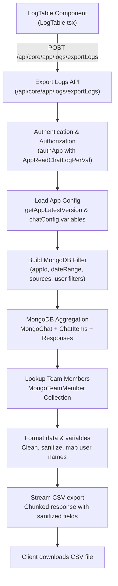
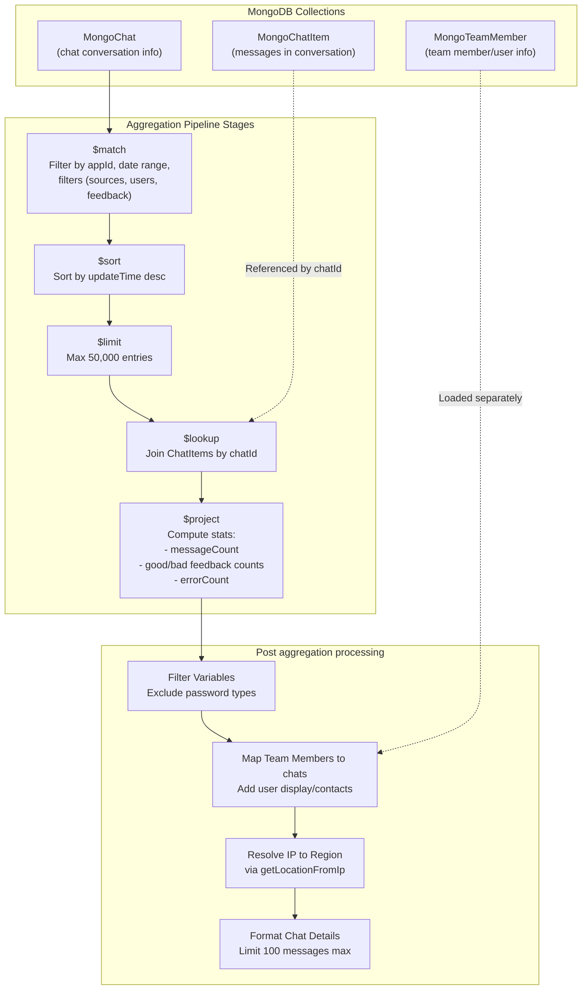
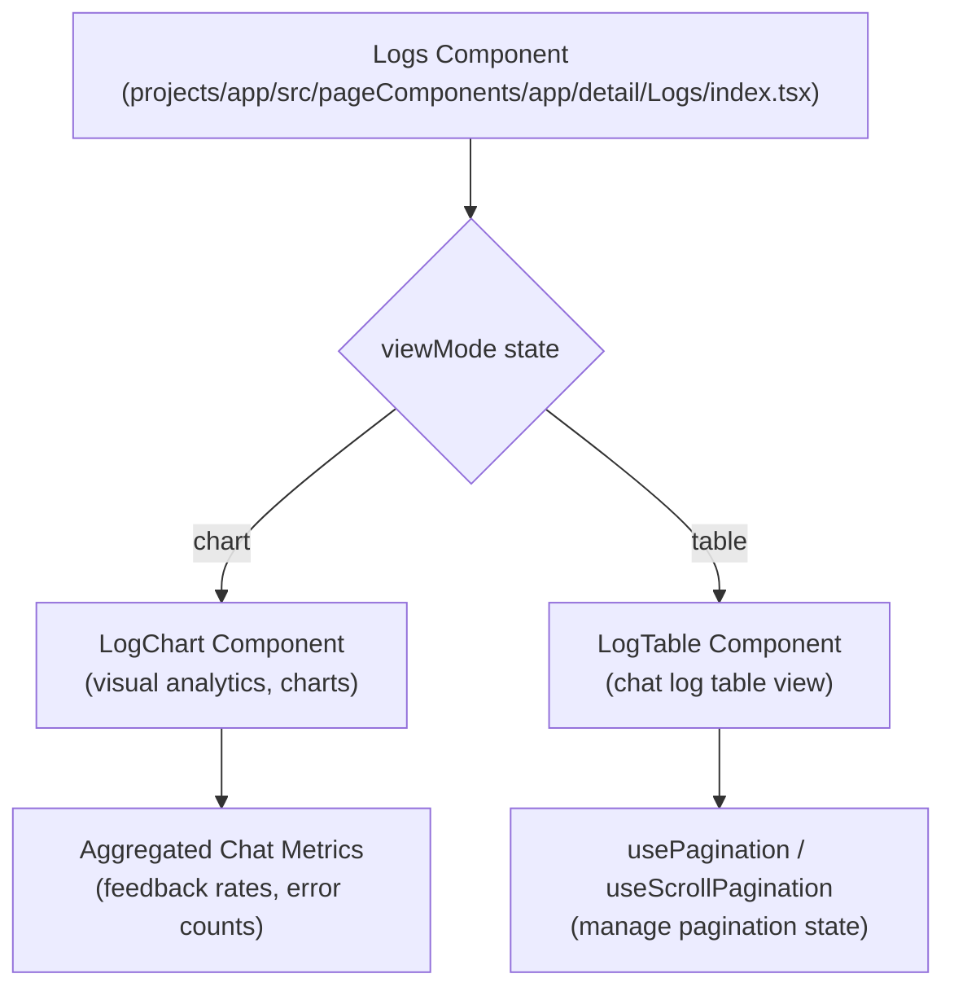
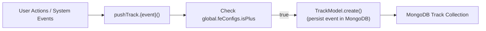
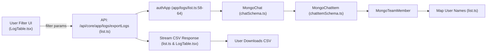
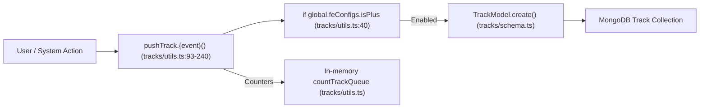

<!-- source: DeepWiki mcp.deepwiki.com · repo labring/FastGPT · page 10.4 Chat Log Export and Analytics · fetched 2026-10-29 -->

# Chat Log Export and Analytics

Relevant source files

The following files were used as context for generating this wiki page:

- [packages/global/common/middle/tracks/constants.ts](packages/global/common/middle/tracks/constants.ts)
- [packages/global/openapi/support/user/team/enterpriseAuth/api.ts](packages/global/openapi/support/user/team/enterpriseAuth/api.ts)
- [packages/global/support/outLink/type.ts](packages/global/support/outLink/type.ts)
- [packages/global/support/user/team/enterpriseAuth/utils.ts](packages/global/support/user/team/enterpriseAuth/utils.ts)
- [packages/global/test/openapi/support/user/team/enterpriseAuth/api.test.ts](packages/global/test/openapi/support/user/team/enterpriseAuth/api.test.ts)
- [packages/service/common/cache/index.ts](packages/service/common/cache/index.ts)
- [packages/service/common/middle/tracks/utils.ts](packages/service/common/middle/tracks/utils.ts)
- [packages/service/support/outLink/compatibility.ts](packages/service/support/outLink/compatibility.ts)
- [packages/service/support/outLink/schema.ts](packages/service/support/outLink/schema.ts)
- [packages/service/test/support/permission/publish/authLink.test.ts](packages/service/test/support/permission/publish/authLink.test.ts)
- [projects/app/src/pageComponents/account/team/EnterpriseAuth/Modal.tsx](projects/app/src/pageComponents/account/team/EnterpriseAuth/Modal.tsx)
- [projects/app/src/pageComponents/account/team/EnterpriseAuth/index.tsx](projects/app/src/pageComponents/account/team/EnterpriseAuth/index.tsx)
- [projects/app/src/pageComponents/account/team/EnterpriseAuth/useEnterpriseAuthFormFlow.ts](projects/app/src/pageComponents/account/team/EnterpriseAuth/useEnterpriseAuthFormFlow.ts)
- [projects/app/src/pageComponents/app/detail/Logs/LogTable.tsx](projects/app/src/pageComponents/app/detail/Logs/LogTable.tsx)
- [projects/app/src/pages/api/core/ai/agent/createQuestionGuide.ts](projects/app/src/pages/api/core/ai/agent/createQuestionGuide.ts)
- [projects/app/src/pages/api/core/app/logs/list.ts](projects/app/src/pages/api/core/app/logs/list.ts)
- [projects/app/src/pages/api/support/user/account/tokenLogin.ts](projects/app/src/pages/api/support/user/account/tokenLogin.ts)
- [projects/app/src/service/support/permission/auth/outLink.ts](projects/app/src/service/support/permission/auth/outLink.ts)
- [projects/app/src/web/support/outLink/api.ts](projects/app/src/web/support/outLink/api.ts)
- [projects/app/test/pageComponents/account/team/EnterpriseAuth/shared.test.ts](projects/app/test/pageComponents/account/team/EnterpriseAuth/shared.test.ts)
- [projects/app/test/pageComponents/account/team/EnterpriseAuth/utils.test.ts](projects/app/test/pageComponents/account/team/EnterpriseAuth/utils.test.ts)
- [projects/app/test/service/support/permission/auth/outLink.test.ts](projects/app/test/service/support/permission/auth/outLink.test.ts)
- [test/mocks/common/redis.ts](test/mocks/common/redis.ts)

This document describes the implementation details of chat log export, analytics, tracking, and audit event capabilities in FastGPT. The system supports configurable CSV export of chat logs with fine-grained filtering, aggregation, and field selection via `AppLogKeysEnum`. Tracking and audit logs use a dedicated event system (`pushTrack`) with MongoDB persistence. This page explains the data flow, key classes/functions, and interactions involved.

## Purpose and Scope

The chat log export and analytics system enables:

- Exporting chat conversation logs to CSV files with rich filtering capabilities.
- Customizing export columns through `AppLogKeysEnum`.
- Filtering logs by date range, chat source, user/team filter, feedback, error counts, and search.
- Aggregated metrics (message counts, feedback statistics) joined across chats and chat items.
- Tracking of usage and system events for audit and telemetry purposes via `pushTrack`.
- Serving data endpoints supporting frontend UI components: log tables, analytics charts.

This page details:
- Data aggregation pipelines used to compose export data
- Enum and configuration for export fields (`AppLogKeysEnum`)
- CSV streaming and formatting logic
- Tracking and audit event implementation
- Associated components facilitating export and analytics

Sources: [projects/app/src/pageComponents/app/detail/Logs/index.tsx:18-112](), [packages/service/core/chat/chatSchema.ts:16-148](), [packages/service/common/middle/tracks/utils.ts:39-240]()

---

## System Architecture and Data Flow

The chat log export system is architected with client UI components that trigger backend API requests to fetch filtered chat logs potentially spanning tens of thousands of records. The backend performs MongoDB aggregations over `MongoChat`, `MongoChatItem`, and related collections to compute export data.

### Export Request Flow

**Details:**

- The frontend `LogTable` React component collects user-specified filters and log field selections, then invokes the export API.
- The backend API performs app permission checks (`authApp`) validating the caller has permission to read chat logs.
- The app's latest version config is retrieved to get chat variables for enriching log data.
- Filters including appId, date ranges, sources (chat channels), user/team filters (tmbIds, outLinkUids), search keywords, feedback and error filters are combined into a MongoDB query.
- Aggregation pipeline queries `MongoChat` with `$lookup` on `ChatItemCollectionName` and response collections to gather message counts, feedback, and metadata.
- Team member information is loaded to resolve user display names and contact info.
- Variables in chat logs are post-processed to remove sensitive types (e.g., password) and format values.
- CSV rows are streamed incrementally to the client with sanitized strings and formatted chat details.

Sources: [projects/app/src/pageComponents/app/detail/Logs/index.tsx:95-102](), [packages/service/core/chat/chatSchema.ts:150-204](), [projects/app/src/pages/api/core/app/logs/list.ts:34-194]()

---

## AppLogKeysEnum Configuration

`AppLogKeysEnum` enumerates the log fields that can be included or excluded by the user in exported CSV files. Each enum value corresponds to a specific log column/key with associated data source and i18n key for UI display.

### Common Export Fields

| Enum Key           | I18n Translation Key      | Description                                | Data Source / Notes                            |
|--------------------|---------------------------|--------------------------------------------|-----------------------------------------------|
| `createdTime`       | `logs_keys_createdTime`   | Chat creation or last update timestamp     | `MongoChat.updateTime`                         |
| `source`            | `logs_keys_source`        | Chat source channel (API, share, online)   | `MongoChat.source`                             |
| `user`              | `logs_keys_user`          | User identifier or IP                       | `MongoChat.metadata.userId` or IP location    |
| `region`            | `logs_keys_region`        | User geographical region derived from IP  | via `getLocationFromIp()`                       |
| `title`             | `logs_keys_title`         | Chat session title                          | `MongoChat.customTitle` or default `title`   |
| `messageCount`      | `logs_keys_messageCount`  | Total number of messages in the chat       | Aggregated counts from chat items              |
| `feedback`          | `logs_keys_feedback`      | User feedback (good/bad)                    | Aggregated from chat item responses             |
| `customFeedback`    | `logs_keys_customFeedback`| Any custom feedback content                 | Aggregated from chat item custom feedbacks     |
| `annotatedCount`    | `logs_keys_annotatedCount`| Count of annotated answers in the chat     | From chat item evaluations                       |
| `chatDetails`       | `logs_keys_chatDetails`   | Full conversation text/content              | Formatted collection of chat messages          |

These keys are used to dynamically build CSV export headers and determine which fields to include in the row serialization.

Sources: [projects/app/src/pageComponents/app/detail/Logs/LogTable.tsx:29-35](), [packages/service/core/chat/chatSchema.ts:45-96]()

---

## Data Aggregation Pipeline Details

The backend query leverages MongoDB aggregations to gather chat data efficiently and supports complex filters and computed fields.

### Aggregation Pipeline Overview

- The pipeline matches `MongoChat` entries filtered by appId, date filters, source and user filters.
- A `$lookup` joins chat messages from `MongoChatItem` collection keyed by `chatId`.
- Project stage computes aggregated metrics: total messages, feedback counts, error counts.
- Additional post-processing steps include filtering out sensitive variables, resolving user names via team members, and geolocation from IP logs.
- A cap limits detailed chat message formatting for export performance.

### Indexes and Redundant Fields

Mongo schema for `MongoChat` contains redundant fields updated on chat item changes to optimize filter queries:

- `hasGoodFeedback` and `hasBadFeedback` flags enable quick filtering for chats with feedback.
- `hasUnreadGoodFeedback` and `hasUnreadBadFeedback` for unread feedback filtering.
- `errorCount` tracks errors in AI or system responses.

Indexes defined on these flags and `updateTime` enhance query performance.

Sources: [projects/app/src/pages/api/core/app/logs/list.ts:30-194](), [packages/service/core/chat/chatSchema.ts:100-109, 150-271]()

---

## CSV Generation and Formatting

The export endpoint generates CSV by streaming rows to the HTTP response.

- Only enabled fields from `AppLogKeysEnum` are serialized.
- Variable outputs are scrubbed to exclude password types for security.
- Chat text in `chatDetails` is formatted via `formatJsonString` and sanitized with `sanitizeCsvField` to prevent injection.
- Header rows use localized titles joined from selected keys.
- Use of streaming avoids memory bottlenecks on large exports.

Sources: [projects/app/src/pageComponents/app/detail/Logs/LogTable.tsx:151-180](), [packages/service/core/chat/chatSchema.ts:16-96]()

---

## Analytics Features and UI Components

### Overview

The chat log views include both tabular list and analytics chart render modes, allowing detailed exploration or summary visualization of chat metrics, feedback trends, and error rates.

- `Logs/index.tsx` coordinates the view mode and loads necessary data.
- `LogTable.tsx` provides the interactive chat record list with filtering.
- Chart and analytics components visualize aggregated metrics.
- Pagination supports incremental data fetching.

Sources: [projects/app/src/pageComponents/app/detail/Logs/index.tsx:18-112](), [packages/web/hooks/usePagination.tsx:57-89]()

---

## Tracking and Audit Events

FastGPT maintains an extensible tracking system to log usage analytics and audit events, essential for monitoring system use and user activities.

### `pushTrack` Utility

The `pushTrack` object encapsulates push methods for various event types. Each method wraps creation of a MongoDB `TrackModel` document storing event data.

- Tracks are only recorded if the commercial feature flag `global.feConfigs.isPlus` is enabled.
- There is a deduplication cache for daily active user events.
- Certain events (e.g., `datasetSearch`, `teamChatQPM`) are pushed as counters aggregated in-memory before batch database writes.
- Admin cron jobs and client-side error events are tracked as well.
- Events cover login, app creation, dataset operations, system tool runs, enterprise authorization workflows, account cancellation, and more.

### Key Track Events

| Event Name                   | Description                                    |
|------------------------------|------------------------------------------------|
| `login`                      | User login analytics with auth type info      |
| `dailyUserActive`            | Daily active user deduplication tracking      |
| `createApp`                  | New app creation event                         |
| `createDataset`              | Dataset creation event                         |
| `countAppNodes`              | Counts node types in apps for analytics       |
| `runSystemTool`              | System tool execution event                    |
| `datasetSearch`              | Counting dataset search usage per dataset     |
| `teamChatQPM`                | Team chat query per minute throttling tracking|
| `enterpriseAuthStart`        | Enterprise authorization flow start           |
| `enterpriseAuthBenefitGrant` | Benefit grant event during enterprise auth    |
| `accountCancellationSubmitSuccess` | User submits account cancellation successfully|
| `accountCancellationCancelSuccess` | User cancels account cancellation request |

Sources: [packages/service/common/middle/tracks/utils.ts:39-240](), [packages/global/common/middle/tracks/constants.ts:1-32]()

---

## Summary

The Chat Log Export and Analytics subsystem in FastGPT combines:

- Rich filtering and aggregation pipelines over MongoDB chat and message collections.
- Flexible export field customization controlled through `AppLogKeysEnum`.
- Secure and scalable CSV export with client-side streaming and variable sanitization.
- Interactive frontend components for viewing logs and analytics with pagination and filtering.
- Comprehensive event tracking via `pushTrack` to audit user and system activities.

This subsystem provides crucial observability and data export features to administrators and power users for maintaining and analyzing chat usage within FastGPT.

---

# Appendix: Key Code References

| Topic                      | File / Lines                         |
|----------------------------|------------------------------------|
| Export Logs API Handler    | `projects/app/src/pages/api/core/app/logs/list.ts:34-194`          |
| Log Table UI               | `projects/app/src/pageComponents/app/detail/Logs/LogTable.tsx:1-184`  |
| Chat Schema & Aggregates   | `packages/service/core/chat/chatSchema.ts:1-271`                   |
| Track Utility (`pushTrack`) | `packages/service/common/middle/tracks/utils.ts:39-240`              |
| Track Enum `TrackEnum`     | `packages/global/common/middle/tracks/constants.ts:1-32`            |
| OutLink Auth (User Filter)  | `projects/app/src/service/support/permission/auth/outLink.ts:1-118` |

---

# Diagrams for NL to Code Entity Bridge

### Chat Log Export Flow (NL terms → Code entities)

### Tracking Events Flow (NL terms → Code entities)

Sources: Aggregated from [projects/app/src/pageComponents/app/detail/Logs/index.tsx](), [packages/service/common/middle/tracks/utils.ts](), [projects/app/src/pages/api/core/app/logs/list.ts](), [projects/app/src/pageComponents/app/detail/Logs/LogTable.tsx]()

---

