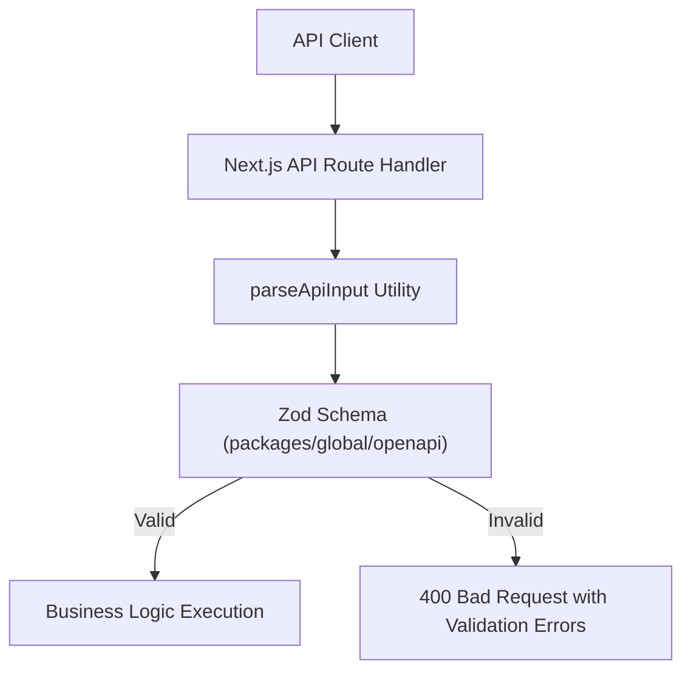
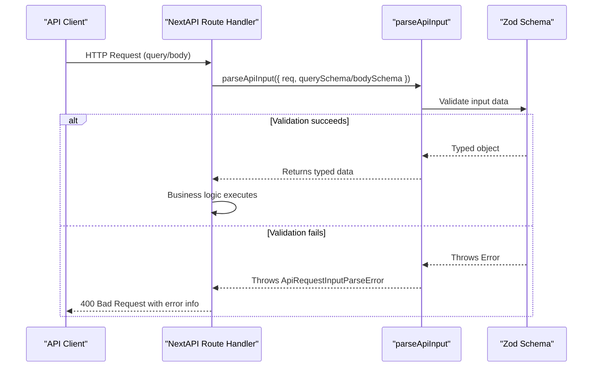
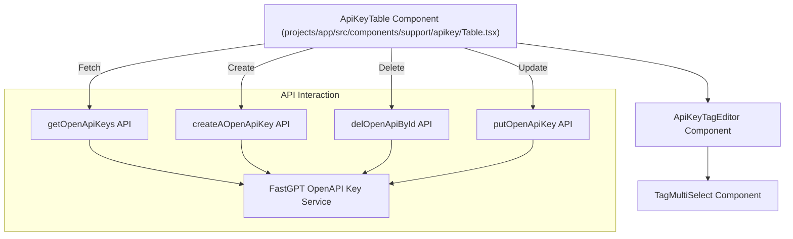
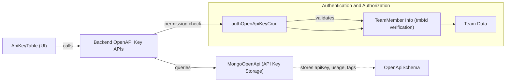

<!-- source: DeepWiki mcp.deepwiki.com · repo labring/FastGPT · page 10.5 OpenAPI Schemas and API Keys · fetched 2026-10-29 -->

# OpenAPI Schemas and API Keys

<details>
<summary>Relevant source files</summary>

The following files were used as context for generating this wiki page:

- [document/content/self-host/upgrading/4-17/4173.en.mdx](document/content/self-host/upgrading/4-17/4173.en.mdx)
- [document/content/self-host/upgrading/4-17/4173.mdx](document/content/self-host/upgrading/4-17/4173.mdx)
- [packages/global/common/error/code/openapi.ts](packages/global/common/error/code/openapi.ts)
- [packages/global/common/type/utils.ts](packages/global/common/type/utils.ts)
- [packages/global/openapi/admin/wallet/bill/invoice/api.ts](packages/global/openapi/admin/wallet/bill/invoice/api.ts)
- [packages/global/openapi/api.ts](packages/global/openapi/api.ts)
- [packages/global/openapi/core/ai/model/channel/api.ts](packages/global/openapi/core/ai/model/channel/api.ts)
- [packages/global/openapi/core/ai/skill/api.ts](packages/global/openapi/core/ai/skill/api.ts)
- [packages/global/test/openapi/api.test.ts](packages/global/test/openapi/api.test.ts)
- [packages/service/common/api/pagination.ts](packages/service/common/api/pagination.ts)
- [packages/service/support/permission/auth/openapi.ts](packages/service/support/permission/auth/openapi.ts)
- [packages/service/support/user/team/teamMemberSchema.ts](packages/service/support/user/team/teamMemberSchema.ts)
- [packages/service/test/common/api/pagination.test.ts](packages/service/test/common/api/pagination.test.ts)
- [packages/web/components/common/Icon/icons/common/lineChange.svg](packages/web/components/common/Icon/icons/common/lineChange.svg)
- [packages/web/components/common/Icon/icons/modal/changePer.svg](packages/web/components/common/Icon/icons/modal/changePer.svg)
- [packages/web/components/common/Textarea/CodeEditor/Editor.tsx](packages/web/components/common/Textarea/CodeEditor/Editor.tsx)
- [packages/web/components/common/Textarea/CodeEditor/index.tsx](packages/web/components/common/Textarea/CodeEditor/index.tsx)
- [packages/web/hooks/useConfirm.tsx](packages/web/hooks/useConfirm.tsx)
- [projects/app/src/components/common/Modal/EditResourceModal.tsx](projects/app/src/components/common/Modal/EditResourceModal.tsx)
- [projects/app/src/components/common/Modal/SaveAndPublishModal.tsx](projects/app/src/components/common/Modal/SaveAndPublishModal.tsx)
- [projects/app/src/components/common/folder/MoveModal.tsx](projects/app/src/components/common/folder/MoveModal.tsx)
- [projects/app/src/components/core/ai/requestId/index.tsx](projects/app/src/components/core/ai/requestId/index.tsx)
- [projects/app/src/components/support/apikey/Table.tsx](projects/app/src/components/support/apikey/Table.tsx)
- [projects/app/src/components/support/permission/ChangeOwnerModal/index.tsx](projects/app/src/components/support/permission/ChangeOwnerModal/index.tsx)
- [projects/app/src/components/support/permission/ConfigPerModal/index.tsx](projects/app/src/components/support/permission/ConfigPerModal/index.tsx)
- [projects/app/src/pages/api/support/openapi/create.ts](projects/app/src/pages/api/support/openapi/create.ts)
- [projects/app/src/pages/api/support/openapi/delete.ts](projects/app/src/pages/api/support/openapi/delete.ts)
- [projects/app/src/pages/api/support/openapi/list.ts](projects/app/src/pages/api/support/openapi/list.ts)
- [projects/app/src/pages/api/support/openapi/update.ts](projects/app/src/pages/api/support/openapi/update.ts)
- [projects/app/src/pages/api/support/outLink/create.ts](projects/app/src/pages/api/support/outLink/create.ts)
- [projects/app/src/pages/api/support/outLink/list.ts](projects/app/src/pages/api/support/outLink/list.ts)
- [projects/app/src/pages/api/support/outLink/update.ts](projects/app/src/pages/api/support/outLink/update.ts)
- [projects/app/src/web/support/user/team/api.ts](projects/app/src/web/support/user/team/api.ts)

</details>


This section provides a comprehensive technical overview of FastGPT's OpenAPI schema definitions, the runtime input validation pattern using Zod, and the API key management UI and authentication mechanism. It describes how schema contracts are structured, how input parsing enforces strong typing and validation, and how API keys support secure external API access with user-friendly management features.

---

## 1. OpenAPI Schemas and Zod Contract Layout (`packages/global/openapi`)

FastGPT defines all its API contracts using **Zod schemas** within the `packages/global/openapi` package. This design choice ensures type safety, declarative validation, and synchronized API contracts across frontend clients and backend services.

### Schema Organization and Usage

- **Hierarchical structure per domain:** The schemas are grouped logically by concern, such as AI skills, model channels, datasets, system common types, admin wallet invoices, and more. Each domain folder holds APIs describing request query/body and response data as Zod schema exports.
- **Reused types:** Common types like object IDs, pagination parameters, boolean flags, enums, and nested complex objects are separately defined and imported across APIs.
- **Meta annotations:** Many schemas include metadata (`meta()`) for OpenAPI documentation generation, which describes fields (e.g., "resource ID", "page size limit"), default values, and field examples.
- **Pagination support:** Shared schemas describe offset- and cursor-based pagination patterns (`PaginationSchema` and `LinkedPaginationSchema`) with strict page size limits (max 500) to maintain consistent API usability.
- **Response schemas:** Standardized response envelope schemas include total counts and item lists ([LinkedListResponseSchema](packages/global/openapi/api.ts)) to enforce response shape consistency.

### Example Schema Snippet

The core pagination schema with page size limits:
```typescript
export const PaginationSchema = z.object({
  pageSize: IntSchema.positive().max(500).optional(),
  offset: IntSchema.optional().describe('偏移量(与页码二选一)'),
  pageNum: IntSchema.positive().optional().describe('页码(与偏移量二选一)')
});
```

### Data Flow Diagram for Schema Validation



This flow reflects how incoming requests are validated immediately with Zod schemas, ensuring incorrect requests are rejected early to prevent invalid data propagation.

*Sources: [packages/global/openapi/api.ts](), [packages/global/openapi/core/ai/skill/api.ts](), [projects/app/src/pages/api/common/system/getInitData.ts:14-73]()*


---

## 2. The `parseApiInput` Pattern for Request Validation

FastGPT employs a helper called `parseApiInput` to parse and validate incoming API requests against the Zod schemas.

### Pattern Details

- Wrapped in API route middleware or at the start of handlers to:
  - Extract the request's `body` and `query` parameters.
  - Validate them against specified Zod schemas for query or body separately.
  - If validation fails, throw a custom error (`ApiRequestInputParseError`) that results in a 400 response.
- Returns fully typed objects that downstream handler functions can trust without additional runtime checks.

### Example Usage

Within an API handler, request validation looks like:

```typescript
const { bufferId } = parseApiInput({
  req,
  querySchema: GetSystemInitDataQuerySchema
}).query;
```

If input is invalid, the handler never proceeds.

### Pagination Request Parsing

A utility `parsePaginationRequest` demonstrates this approach by:
- Prioritizing `body` parameters over `query`.
- Applying the common pageSize limit.
- Calculating `offset` from `pageNum`.
- Throwing detailed errors for invalid page size or format.

```typescript
export const parsePaginationRequest = (req: NodeApiRequest) => {
  const fromBody = Object.keys(req.body ?? {}).some((k) => ['pageSize', 'pageNum', 'offset'].includes(k));
  const pageSize = fromBody
    ? parseApiInput({ req: { body: req.body, query: req.query }, bodySchema: PaginationPageSizeRequestSchema }).body.pageSize
    : parseApiInput({ req: { body: req.body, query: req.query }, querySchema: PaginationPageSizeRequestSchema }).query.pageSize;
  const { pageNum = 1, offset } = fromBody ? req.body : req.query;
  return {
    pageSize,
    offset: offset !== undefined && offset !== '' ? Number(offset) : (Number(pageNum) - 1) * Number(pageSize)
  };
};
```

### Sequence Diagram for Input Parsing



*Sources: [packages/service/common/api/pagination.ts](), [projects/app/src/pages/api/common/system/getInitData.ts:14-73](), [packages/global/openapi/api.ts]()*


---

## 3. API Key Management UI and Authentication Control

FastGPT exposes API keys to allow authenticated external access to OpenAPI endpoints. The web UI to manage these keys is implemented primarily in the React component `ApiKeyTable` located in `projects/app/src/components/support/apikey/Table.tsx`.

### Features of `ApiKeyTable`

- **Listing and Pagination**: Queries keys with support for filters, search by keywords, sorting by create/last-used time or remaining points (conditional on user plan flags).
- **Tag Management**: Supports tags for keys, enabling grouping/filtering tracked by reusable components like `ApiKeyTagEditor`, `TagMultiSelect`, and `TagDisplayList`.
- **Creation & Deletion**: Users can create, update, delete, and copy API keys via API calls.
- **Security**: API keys are masked visually (showing only asterisks and the last 4 chars) when displayed.
- **Usage Limits and Expiry**: Allows specifying max usage points and expiration timestamps.
- **Responsive UI**: Uses Chakra UI components with modals, switching UI modes between 'account' or 'publish'.

### Key Data Flow and Function Calls



### Authentication Logic for API Key Management

- The authorization model enforces that only the **creating team member** can view, copy, update or delete their own API keys.
- Team owners or app owners do not have cross-member privileges over API keys; this is a design decision for multi-tenant security.
- The authentication logic, including validation and permission checks, is implemented in the backend `authOpenApiKeyCrud` function, which verifies the API key ownership by cross-checking team member identity and team association.

### Code Insights in Auth

```typescript
export async function authOpenApiKeyCrud({ id, ...props }: AuthModeType & { id: string }) {
  const result = await parseHeaderCert(props);
  const { tmbId, teamId } = result;
  const { permission: tmbPer } = await getTmbInfoByTmbId({ tmbId });

  const { openapi, permission } = await (async () => {
    const openapi = await MongoOpenApi.findOne({ _id: id, teamId });
    if (!openapi) {
      throw OpenApiErrEnum.unExist;
    }
    if (String(openapi.teamId) !== teamId || String(openapi.tmbId) !== tmbId) {
      throw OpenApiErrEnum.unAuth;
    }
    return { openapi, permission: tmbPer };
  })();

  return {
    ...result,
    openapi,
    permission
  };
}
```

### API Key Masking Helper

```typescript
const maskApiKey = (apiKey: string) => {
  if (apiKey.startsWith('******')) return apiKey;
  return `******${apiKey.slice(-4)}`;
};
```

### Diagram Bridging UI and Backend API Key Entities



This shows how the frontend component interacts with backend APIs, which validate user identity and team membership before returning or altering API keys.

---

### Summary Table: OpenAPI Keys Management Components

| Component / Function          | Role / Description                                  | File Location                                          |
| ---------------------------- | ------------------------------------------------- | ----------------------------------------------------- |
| `ApiKeyTable`                | Main React UI component to list, create, manage keys | `projects/app/src/components/support/apikey/Table.tsx` |
| `ApiKeyTagEditor`            | UI to assign and manage tags for API keys          | Same as above                                         |
| `maskApiKey`                 | Utility to obfuscate API keys in UI                 | Same as above                                         |
| API Functions (`getOpenApiKeys`, `createAOpenApiKey`, etc.) | API calls interacting with backend OpenApi key service | `projects/app/src/web/support/openapi/api.ts`        |
| `authOpenApiKeyCrud`         | Backend authorization logic for managing API keys  | `packages/service/support/permission/auth/openapi.ts` |

---

## Summary

FastGPT's API system uses Zod-powered OpenAPI schemas for robust typing and validation of all API inputs and outputs, with helper utilities like `parseApiInput` ensuring clean error handling and type correctness seamlessly integrated into Next.js API routes.

The API key management subsystem provides a secure yet feature-rich UI for key lifecycle management, enforcing strict ownership and permission models via backend authorization checks that tightly bind API keys to individual team members.

This cohesive design enables FastGPT to expose a predictable, safe, and convenient OpenAPI surface for external integrations and internal consistency.

---

*Sources:*

- [packages/global/openapi/api.ts]()
- [packages/global/openapi/core/ai/skill/api.ts]()
- [packages/service/common/api/pagination.ts]()
- [projects/app/src/pages/api/common/system/getInitData.ts:14-73]()
- [projects/app/src/components/support/apikey/Table.tsx:1-219]()
- [packages/service/support/permission/auth/openapi.ts:1-53]()

---

