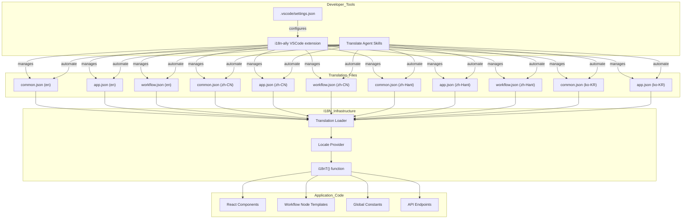
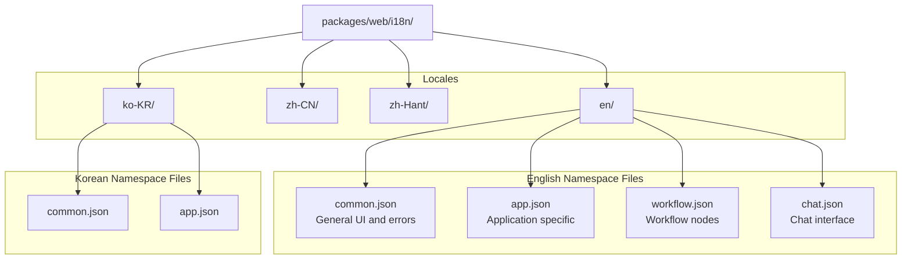
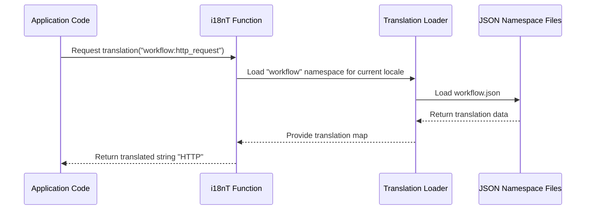
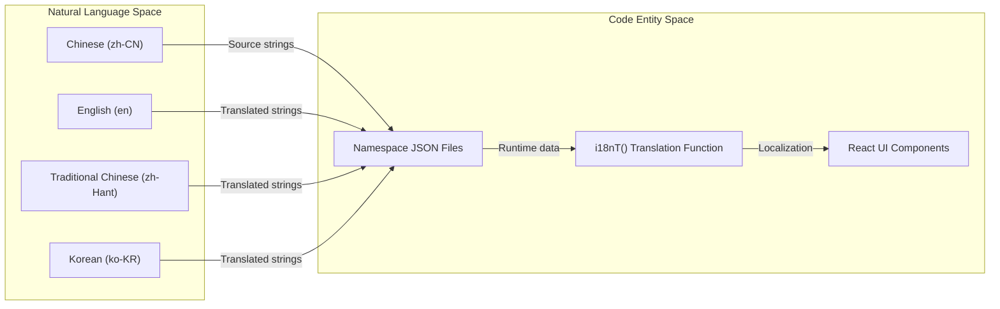

<!-- source: DeepWiki mcp.deepwiki.com · repo labring/FastGPT · page 11.1 Internationalization System · fetched 2026-10-29 -->

# Internationalization System

<details>
<summary>Relevant source files</summary>

The following files were used as context for generating this wiki page:

- [packages/global/openapi/core/app/folder/api.ts](packages/global/openapi/core/app/folder/api.ts)
- [packages/global/openapi/core/app/folder/index.ts](packages/global/openapi/core/app/folder/index.ts)
- [packages/web/components/common/Icon/constants.ts](packages/web/components/common/Icon/constants.ts)
- [packages/web/components/common/MyModal/EditFolderModal.tsx](packages/web/components/common/MyModal/EditFolderModal.tsx)
- [packages/web/components/common/MySelect/MultipleRowSelect.tsx](packages/web/components/common/MySelect/MultipleRowSelect.tsx)
- [packages/web/components/common/MySlider/InputSlider.tsx](packages/web/components/common/MySlider/InputSlider.tsx)
- [packages/web/hooks/useI18n.ts](packages/web/hooks/useI18n.ts)
- [packages/web/i18n/en/account.json](packages/web/i18n/en/account.json)
- [packages/web/i18n/en/app.json](packages/web/i18n/en/app.json)
- [packages/web/i18n/en/common.json](packages/web/i18n/en/common.json)
- [packages/web/i18n/ko-KR/common.json](packages/web/i18n/ko-KR/common.json)
- [packages/web/i18n/zh-CN/account.json](packages/web/i18n/zh-CN/account.json)
- [packages/web/i18n/zh-CN/app.json](packages/web/i18n/zh-CN/app.json)
- [packages/web/i18n/zh-CN/common.json](packages/web/i18n/zh-CN/common.json)
- [packages/web/i18n/zh-Hant/account.json](packages/web/i18n/zh-Hant/account.json)
- [packages/web/i18n/zh-Hant/app.json](packages/web/i18n/zh-Hant/app.json)
- [packages/web/i18n/zh-Hant/common.json](packages/web/i18n/zh-Hant/common.json)
- [packages/web/i18n/zh-Hant/publish.json](packages/web/i18n/zh-Hant/publish.json)
- [projects/app/next-i18next.config.js](projects/app/next-i18next.config.js)
- [projects/app/src/components/core/ai/AISettingModal/index.tsx](projects/app/src/components/core/ai/AISettingModal/index.tsx)
- [projects/app/src/pages/api/core/app/folder/create.ts](projects/app/src/pages/api/core/app/folder/create.ts)
- [projects/app/src/pages/dashboard/agent/index.tsx](projects/app/src/pages/dashboard/agent/index.tsx)
- [projects/app/src/pages/dashboard/tool/index.tsx](projects/app/src/pages/dashboard/tool/index.tsx)

</details>


This document describes FastGPT's internationalization (i18n) system, which provides multi-language support across the application. The system supports multiple locale-specific JSON namespace files and is integrated with developer tooling such as `i18n-ally` and internal translation skills.

---

## System Architecture

The i18n system in FastGPT is designed to modularize language resources and facilitate easy translation and access within the codebase.

### Key Concepts

- **Namespace JSON files:** Translation strings are stored in JSON files grouped by namespace (e.g., `common`, `app`, `workflow`) and separated per language (locale).
- **Supported Languages:** At minimum, supported locales include `en` (English), `zh-CN` (Simplified Chinese), `zh-Hant` (Traditional Chinese), and `ko-KR` (Korean).
- **i18nT function:** The main runtime translation lookup function supports accessing keys by namespace and variable interpolation.
- **i18n-ally:** A VSCode extension configured to enable easy translation management with instant preview, key usage hints, and extraction.
- **Translate Skills:** Agentic skills that help automate translation workflows integrated in development pipelines.

### High-Level Architecture

Below is a high-level system overview highlighting language files, the translation loader, the runtime translation function, developer tools, and code entity consumers.



**Sources:** [packages/web/i18n/en/common.json:1-20](), [packages/web/i18n/zh-CN/common.json:1-20](), [packages/web/i18n/zh-Hant/common.json:1-20](), [packages/web/i18n/ko-KR/common.json:1-20]()

---

## Directory Structure and File Organization

The translations are organized under `packages/web/i18n/`, with subdirectories named by locale code. Each locale directory contains namespace JSON files storing semantically grouped strings.



### Supported Languages

| Language Code | Language Name       | Directory            | Primary Usage Region           |
| ------------- | ------------------- | -------------------- | ----------------------------- |
| `en`          | English             | `packages/web/i18n/en/`       | International                 |
| `zh-CN`       | Simplified Chinese  | `packages/web/i18n/zh-CN/`    | Mainland China                |
| `zh-Hant`     | Traditional Chinese | `packages/web/i18n/zh-Hant/`  | Taiwan, Hong Kong             |
| `ko-KR`       | Korean              | `packages/web/i18n/ko-KR/`    | South Korea                  |

**Sources:** [packages/web/i18n/en/common.json:1-10](), [packages/web/i18n/zh-CN/common.json:1-10](), [packages/web/i18n/zh-Hant/common.json:1-10](), [packages/web/i18n/ko-KR/common.json:1-10]()

---

## Namespace Organization

Translations are grouped into namespaces, each stored in their own JSON file per language. Typical namespace files include `common.json`, `app.json`, and others for specific features.

| Namespace | File               | Purpose                                     | Key Examples                              |
| --------- | ------------------ | -------------------------------------------|------------------------------------------|
| `common`  | `common.json`       | General UI text, messages, errors          | `Action`, `Cancel`, `code_error.*`       |
| `app`     | `app.json`          | Application-related terms and UI text      | `Create_dataset`, `Tool_name`             |
| `workflow`| `workflow.json`     | Workflow editor and node-related terms     | `template.ai_chat`, `http_request`        |
| `chat`    | `chat.json`         | Chat UI and runtime messages                | `chat_history`, `ai_reasoning`            |

This modular organization enables selective loading and ease of translation management.

**Sources:** [packages/web/i18n/en/common.json:3-145](), [packages/web/i18n/en/app.json:2-38]()

---

## Translation Key Structure

Keys use a flat style with dot notation to indicate hierarchy and semantic groups. Keys are case-sensitive and follow consistent lexical patterns.

### Key Naming Patterns

| Pattern          | Description                     | Example                                  |
|------------------|---------------------------------|------------------------------------------|
| Simple TitleCase  | Basic UI labels                | `"Action": "Action"`                     |
| Dot notation     | Semantic grouping and hierarchy | `"FAQ.ai_point_q": "What are AI points?"` |
| Snake_case       | Multi-word identifiers          | `"add_new_param": "Add new param"`      |
| Error codes      | Structured error message keys   | `"code_error.app_error.not_exist"`       |

### Common JSON Key Categories

```mermaid
graph TB
    CommonKeys["common.json Keys"]
    
    subgraph Actions
        Actions["Action<br/>Add<br/>Cancel<br/>Confirm<br/>Delete<br/>Edit"]
    end
    
    subgraph Errors
        ErrorCodes["code_error.account_error<br/>code_error.app_error.*<br/>code_error.chat_error.*<br/>code_error.error_code.*"]
    end
    
    subgraph FAQ
        FAQKeys["FAQ.ai_point_q<br/>FAQ.dataset_compute_q<br/>FAQ.qpm_q"]
    end
    
    CommonKeys --> Actions
    CommonKeys --> ErrorCodes
    CommonKeys --> FAQKeys
```

**Sources:** [packages/web/i18n/en/common.json:2-173]()

---

## i18nT Translation Function

The `i18nT()` function is the primary runtime API to fetch translations. It supports namespace-scoped keys, variable interpolation, and fallback mechanisms.

### Function Usage Examples

```typescript
// Simple key in the current namespace
i18nT('Action')

// Key with explicit namespace prefix (cross-namespace)
i18nT('workflow:http_request')

// Key with variable interpolation
i18nT('chat:chat_chatId', { chatId: '123456' })
// returns: "Session Id: 123456"
```

### Translation Lookup Flow



**Sources:** [packages/global/core/workflow/template/system/aiChat/index.ts:22-55]()

---

## Code Usage Patterns

The i18n system is deeply integrated within FastGPT's frontend and workflow node templates.

### Workflow Node Template Usage

Workflow nodes declare important UI strings using i18n keys. For example, the `AiChatModule` defines its display `name`, `intro`, and outputs with translation keys:

| Field        | i18n Key                                | English Text                    |
|--------------|---------------------------------------|--------------------------------|
| Node Name    | `workflow:template.ai_chat`            | "AI Chat"                      |
| Node Intro   | `workflow:template.ai_chat_intro`      | "AI conversation node ..."     |
| Output Label | `common:core.module.output.label.New context` | "New context"           |

This enables the workflow editor UI and node metadata to be localized reactively.

**Sources:** [packages/global/core/workflow/template/system/aiChat/index.ts:52-168]()

### Error Message Localization

Backend and frontend errors use a structured key pattern under `code_error.*` in `common.json`. Example error keys and messages:

| Key                              | English Message                   |
|---------------------------------|---------------------------------|
| `code_error.account_error`       | "Incorrect account name or password"        |
| `code_error.app_error.not_exist` | "App Does Not Exist"                       |
| `code_error.error_code.404`       | "Request Not Found"                        |
| `code_error.error_message.510`   | "Account balance insufficient"             |

This consistent mapping helps keep error text centralized and easy to translate.

**Sources:** [packages/web/i18n/en/common.json:136-163]()

---

## Developer Tooling: i18n-ally and Translate Skills

FastGPT uses the VSCode `i18n-ally` extension for translation file management. It is configured via `.vscode/settings.json` for key extraction, file path structure, and language syncing.

Additionally, internal translate skills residing in the `.agents` workspace automate translation tasks and syncing between source and target languages.

### Translation Management Flow



This layered abstraction from natural languages to code entities helps maintain translation integrity and developer productivity.

**Sources:** [packages/web/i18n/en/common.json:1](), [packages/web/i18n/zh-CN/common.json:1](), [packages/web/i18n/zh-Hant/common.json:1](), [packages/web/i18n/ko-KR/common.json:1]()

---

## Icon Internationalization

Language indicator icons are registered in the icon constants map for use in UI components, enhancing the user experience with visual locale cues.

| Icon Key                        | Path Reference                                   |
|--------------------------------|-------------------------------------------------|
| `common/language/en`            | `./icons/common/language/en.svg`                 |
| `common/language/zh`            | `./icons/common/language/zh.svg`                 |
| `common/language/America`       | `./icons/common/language/America.svg`            |
| `common/language/China`         | `./icons/common/language/China.svg`              |
| `common/language/SouthKorea`    | `./icons/common/language/SouthKorea.svg`         |

These icons visually identify language options in menus and language selectors in the UI.

**Sources:** [packages/web/components/common/Icon/constants.ts:71-76]()

---

## Best Practices for Translation Keys

- **Use existing keys**: Always check `common.json` first before adding new keys to avoid duplicates, especially for basic UI terms like "Confirm" or "Cancel".
- **Namespace selection**: Place keys relevant to UI framework in `common.json`, feature-specific keys in their respective namespaces (`workflow`, `app`, etc.).
- **Variable naming**: Use descriptive variable placeholders (e.g., `{{total}}`, `{{chatId}}`) and keep usage consistent.
- **Error codes**: Map backend error codes to `code_error.*` keys for centralized error message management.
- **Keep keys consistent**: Follow the established naming conventions to ensure tooling like `i18n-ally` works optimally.

**Sources:** [packages/web/i18n/en/common.json:3-16](), [packages/web/i18n/en/app.json:14]()

---

# Summary

FastGPT’s internationalization system employs a robust architecture combining namespace-based JSON translation files for multiple languages, a flexible translation runtime function `i18nT()`, and developer tooling support with `i18n-ally` and translation skills automation. This setup facilitates consistent, scalable localization management and integration throughout the application, including UI components, workflow nodes, error handling, and user interaction layers.

# End of Section 11.1 Internationalization System

---

