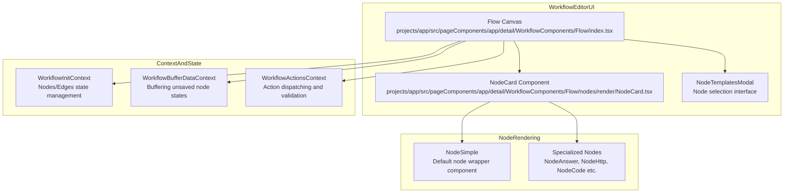
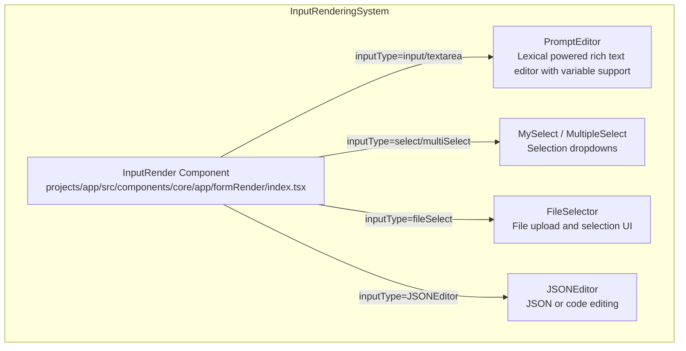
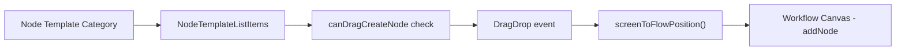
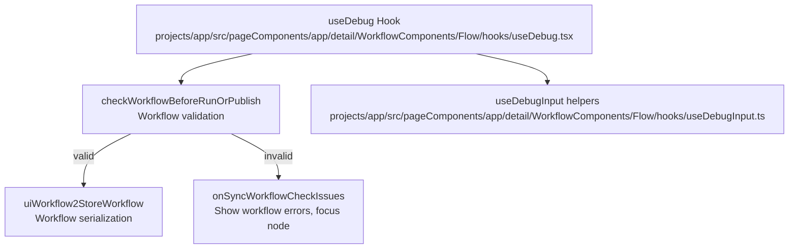
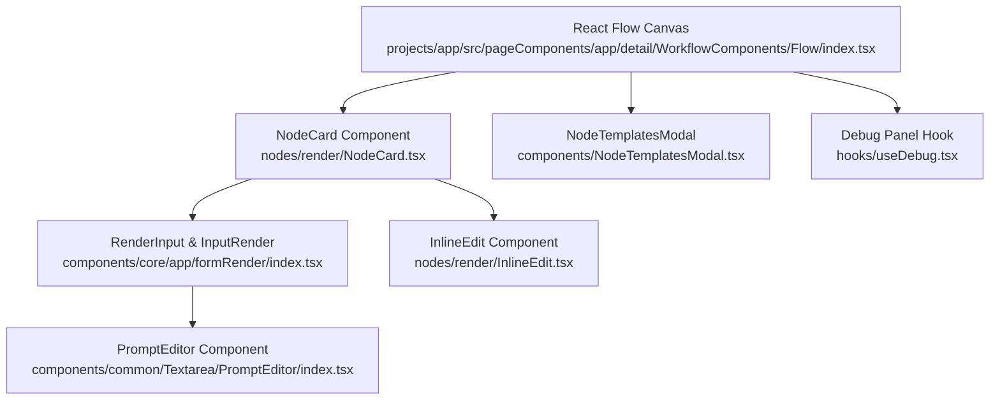
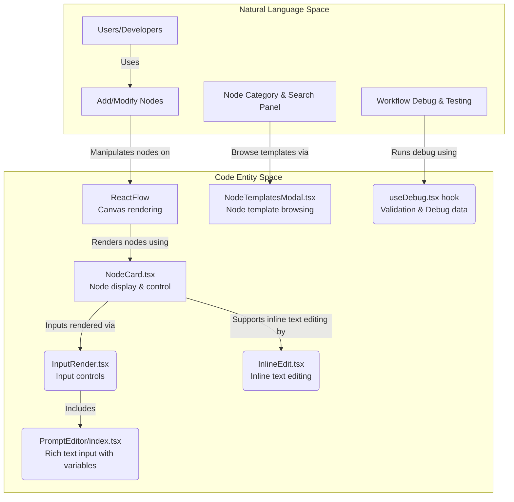

<!-- source: DeepWiki mcp.deepwiki.com · repo labring/FastGPT · page 11.2 Workflow Editor UI · fetched 2026-10-29 -->

# Workflow Editor UI

Relevant source files

The following files were used as context for generating this wiki page:

- [document/content/self-host/upgrading/4-14/41411.mdx](document/content/self-host/upgrading/4-14/41411.mdx)
- [document/content/self-host/upgrading/4-14/41415.mdx](document/content/self-host/upgrading/4-14/41415.mdx)
- [document/content/self-host/upgrading/4-14/41416.en.mdx](document/content/self-host/upgrading/4-14/41416.en.mdx)
- [document/content/self-host/upgrading/4-14/41416.mdx](document/content/self-host/upgrading/4-14/41416.mdx)
- [packages/global/core/workflow/constants.ts](packages/global/core/workflow/constants.ts)
- [packages/global/core/workflow/node/constant.ts](packages/global/core/workflow/node/constant.ts)
- [packages/service/core/app/version/controller.ts](packages/service/core/app/version/controller.ts)
- [packages/service/core/workflow/dispatch/plugin/runOutput.ts](packages/service/core/workflow/dispatch/plugin/runOutput.ts)
- [packages/web/components/common/MySelect/index.tsx](packages/web/components/common/MySelect/index.tsx)
- [packages/web/components/core/plugin/tool/TagFilterBox.tsx](packages/web/components/core/plugin/tool/TagFilterBox.tsx)
- [packages/web/components/core/workflow/NodeInputSelect.tsx](packages/web/components/core/workflow/NodeInputSelect.tsx)
- [packages/web/i18n/en/workflow.json](packages/web/i18n/en/workflow.json)
- [packages/web/i18n/zh-CN/workflow.json](packages/web/i18n/zh-CN/workflow.json)
- [packages/web/i18n/zh-Hant/workflow.json](packages/web/i18n/zh-Hant/workflow.json)
- [projects/app/src/components/common/secret/HeaderAuthConfig.tsx](projects/app/src/components/common/secret/HeaderAuthConfig.tsx)
- [projects/app/src/pageComponents/app/create/AppTypeCard.tsx](projects/app/src/pageComponents/app/create/AppTypeCard.tsx)
- [projects/app/src/pageComponents/app/detail/Workflow/components/SearchButton.tsx](projects/app/src/pageComponents/app/detail/Workflow/components/SearchButton.tsx)
- [projects/app/src/pageComponents/app/detail/WorkflowComponents/Flow/NodeTemplatesModal.tsx](projects/app/src/pageComponents/app/detail/WorkflowComponents/Flow/NodeTemplatesModal.tsx)
- [projects/app/src/pageComponents/app/detail/WorkflowComponents/Flow/NodeTemplatesPopover.tsx](projects/app/src/pageComponents/app/detail/WorkflowComponents/Flow/NodeTemplatesPopover.tsx)
- [projects/app/src/pageComponents/app/detail/WorkflowComponents/Flow/components/Container.tsx](projects/app/src/pageComponents/app/detail/WorkflowComponents/Flow/components/Container.tsx)
- [projects/app/src/pageComponents/app/detail/WorkflowComponents/Flow/components/FlowController.tsx](projects/app/src/pageComponents/app/detail/WorkflowComponents/Flow/components/FlowController.tsx)
- [projects/app/src/pageComponents/app/detail/WorkflowComponents/Flow/components/NodeTemplates/header.tsx](projects/app/src/pageComponents/app/detail/WorkflowComponents/Flow/components/NodeTemplates/header.tsx)
- [projects/app/src/pageComponents/app/detail/WorkflowComponents/Flow/components/NodeTemplates/useNodeTemplates.tsx](projects/app/src/pageComponents/app/detail/WorkflowComponents/Flow/components/NodeTemplates/useNodeTemplates.tsx)
- [projects/app/src/pageComponents/app/detail/WorkflowComponents/Flow/index.tsx](projects/app/src/pageComponents/app/detail/WorkflowComponents/Flow/index.tsx)
- [projects/app/src/pageComponents/app/detail/WorkflowComponents/Flow/nodes/render/InlineEdit.tsx](projects/app/src/pageComponents/app/detail/WorkflowComponents/Flow/nodes/render/InlineEdit.tsx)
- [projects/app/src/pageComponents/app/detail/WorkflowComponents/Flow/nodes/render/NodeCard.tsx](projects/app/src/pageComponents/app/detail/WorkflowComponents/Flow/nodes/render/NodeCard.tsx)
- [projects/app/src/web/common/utils/errorLogger.ts](projects/app/src/web/common/utils/errorLogger.ts)

## Purpose and Scope

This document provides a comprehensive technical overview of the Workflow Editor UI in FastGPT. It details the implementation of the visual workflow editor using React Flow, the `NodeCard` component for node rendering and interaction, the node templates panel for discovering and adding workflow nodes, rendering mechanisms for input/output controls including prompt editors, and the debug panel for workflow validation and testing. This leaf page covers how these components integrate to offer a powerful, flexible interface for designing AI workflows.

---

## Editor Architecture Overview

The Workflow Editor UI is a React-based application built predominantly around the `reactflow` library, which provides a canvas-based graph editor for managing nodes and edges. The editor leverages multiple React Contexts for state management and separation of concerns:

- **WorkflowInitContext** manages the primary nodes and edges state.
- **WorkflowBufferDataContext** manages buffered changes — unsaved or intermediate modifications.
- **WorkflowActionsContext** dispatches actions that trigger node/edge state updates, error updates, and workflow validation.

The editor uses dynamic imports and memoization to optimize rendering heavy or complex node types.

### Key Implementation Details

- The main canvas and nodes are implemented in `projects/app/src/pageComponents/app/detail/WorkflowComponents/Flow/index.tsx`.
- Nodes are registered in a mapping from `FlowNodeTypeEnum` to React components where most specialized nodes are loaded lazily with `next/dynamic` to improve initial load times.
- `NodeCard` wraps individual nodes, managing node display, folding, debug output, and error state presentations using React state and context.
- On initial rendering, or when nodes change, the canvas attempts to center and zoom automatically fitting all nodes visible by calling `fitView()` from React Flow.
- Node interactions like double-click unfold nodes and recenter the canvas onto the specified node.

**Sources:**
- [projects/app/src/pageComponents/app/detail/WorkflowComponents/Flow/index.tsx:1-130]()
- [projects/app/src/pageComponents/app/detail/WorkflowComponents/Flow/nodes/render/NodeCard.tsx:1-181]()

---

## RenderInput and PromptEditor System

RenderInput governs how input fields on workflow nodes are rendered. Based on the input's type (`FlowNodeInputTypeEnum`) and value semantics (`WorkflowIOValueTypeEnum`), it delegates rendering responsibility to specialized input components.

### Details:

- `InputRender` is the main switchboard that reads an input's `inputType` prop and renders subcomponents accordingly, including `PromptEditor` for rich text with variable references, select dropdowns, and file upload components.
- `PromptEditor` is built on Lexical, supporting syntax like `{{$nodeId.key$}}` for variable references and provides token count awareness suitable for prompt engineering in AI workflows [packages/web/components/common/Textarea/PromptEditor/index.tsx:11-27]().
- The `Reference` input type shows a filtered list of compatible upstream node outputs for users to reference as inputs. It uses the `useReference` hook to provide this filtered data for a multiple selection UI [projects/app/src/pageComponents/app/detail/WorkflowComponents/Flow/nodes/render/RenderInput/templates/Reference.tsx:55-178]().
- Value types (string, boolean, object, array, etc.) are governed by `WorkflowIOValueTypeEnum` and `FlowNodeInputTypeEnum` constants for consistency across nodes.

**Sources:**
- [projects/app/src/components/core/app/formRender/index.tsx:1-211]()
- [projects/app/src/pageComponents/app/detail/WorkflowComponents/Flow/nodes/render/RenderInput/templates/Reference.tsx:55-178]()

---

## Node Template and Search UI

Node templates provide a structured way for users to browse, search, and select nodes to add to their workflows.

| Template Category  | Description                                      | Data Source / API                             |
|-------------------|------------------------------------------------|----------------------------------------------|
| Basic             | Core basic node templates like AI, search, logic | `basicNodeTemplates` from workflow buffer context [useNodeTemplates.tsx:36-40]() |
| System Tools      | Official FastGPT system tools                    | `getAppToolTemplates()` API call [useNodeTemplates.tsx:126-130]() |
| My Tools          | User-created tools and tool sets                 | `getTeamAppTemplatesV2()` API call with folder filtering [useNodeTemplates.tsx:101-109]() |
| Agent             | Other FastGPT apps that can be invoked as child workflows | Same `getTeamAppTemplatesV2()`, filtered by app types [useNodeTemplates.tsx:113-122]() |

### Interaction and Drag/Drop

- Templates can be selected or dragged onto the canvas. The draggable behavior is controlled by `canDragCreateNode` which disallows dragging folders, tool sets in some contexts, or restricted nodes [NodeTemplates/list.tsx:103-104]().
- When a template is dropped, its screen coordinates are converted to canvas coordinates using `screenToFlowPosition` utility to precisely place the new node on the workflow canvas [NodeTemplates/list.tsx:162-170]().

**Sources:**
- [projects/app/src/pageComponents/app/detail/WorkflowComponents/Flow/components/NodeTemplates/list.tsx:76-170]()
- [projects/app/src/pageComponents/app/detail/WorkflowComponents/Flow/components/NodeTemplates/useNodeTemplates.tsx:16-138]()

---

## Debug Panel and Execution Testing

The editor incorporates a debug subsystem allowing users to validate and test workflows or individual nodes prior to publishing.

### Core Functions:

- `flowData2StoreDataAndCheck` validates the workflow graph, populates an issue map, and either centers view on the first error node or proceeds to convert the UI workflow into store nodes for backend use [useDebug.tsx:114-171]().
- `checkInputShouldRenderInDebug` determines which node inputs appear in debug forms, excluding those that are connected upstream or are not user-inputtable in debug mode [useDebugInput.ts:140-159]().
- `getWorkflowStartDebugQuery` aggregates inputs from debug form fields to compose initial chat queries and file uploads for workflow start nodes [useDebugInput.ts:85-117]().

---

## Inline Editing and UI Utilities

For seamless user experience, the editor provides inline editing capabilities and various input controls:

- `InlineEdit` component supports inline editing of single-line or multi-line text fields such as node names or descriptions. It handles edit state transitions, commit on blur/enter, and revert on escape [InlineEdit.tsx:18-201]().
- `FileSelector` UI enables file upload and selection for datasets or other user inputs within workflow nodes or the debug panel, including support for S3 presigned URL integration [FileSelector/index.tsx:167-199]().

---

# Code Entity to UI Feature Mapping

This diagram relates core system names and code entities with their concrete UI features in the Workflow Editor:

---

# Natural Language to Code Space Bridge: Workflow Editor UI

---

# Summary

The Workflow Editor UI in FastGPT is a sophisticated system built on React and React Flow to visually create and manage AI workflow nodes and their connections. It includes:

- A **React Flow canvas** that renders nodes and edges interactively.
- The **NodeCard** component wrapping each node, managing state, error display, and interaction handlers.
- A **Node Templates** panel and modal for filtering, searching, and dragging nodes onto the canvas.
- A flexible **RenderInput** system that chooses input UI components based on input types, including a rich **PromptEditor** with variable referencing.
- A robust **debugging subsystem** to validate workflows, highlight issues, and simulate inputs before deployment.
- UI utility components like **InlineEdit** for quick text edits and **FileSelector** for file input handling.

This architecture balances modularity, reuse, and performance optimization, enabling users to build complex AI-driven workflows visually.

---

## Sources

- [projects/app/src/pageComponents/app/detail/WorkflowComponents/Flow/index.tsx:1-130]()
- [projects/app/src/pageComponents/app/detail/WorkflowComponents/Flow/nodes/render/NodeCard.tsx:1-181]()
- [projects/app/src/components/core/app/formRender/index.tsx:1-211]()
- [projects/app/src/pageComponents/app/detail/WorkflowComponents/Flow/nodes/render/RenderInput/templates/Reference.tsx:55-178]()
- [projects/app/src/pageComponents/app/detail/WorkflowComponents/Flow/components/NodeTemplates/list.tsx:76-170]()
- [projects/app/src/pageComponents/app/detail/WorkflowComponents/Flow/components/NodeTemplates/useNodeTemplates.tsx:16-138]()
- [projects/app/src/pageComponents/app/detail/WorkflowComponents/Flow/hooks/useDebug.tsx:58-171]()
- [projects/app/src/pageComponents/app/detail/WorkflowComponents/Flow/hooks/useDebugInput.ts:1-220]()
- [projects/app/src/pageComponents/app/detail/WorkflowComponents/Flow/nodes/render/InlineEdit.tsx:18-201]()
- [packages/web/components/common/Textarea/PromptEditor/index.tsx:11-27]()
- [projects/app/src/components/core/app/FileSelector/index.tsx:167-199]()

---

