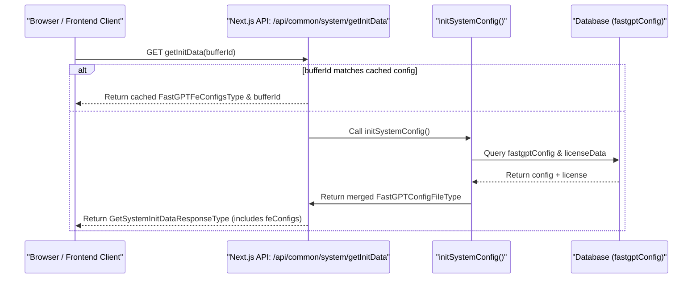
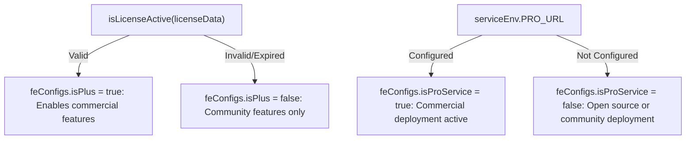

<!-- source: DeepWiki mcp.deepwiki.com · repo labring/FastGPT · page 11.3 Feature Flags and Configuration · fetched 2026-10-29 -->

# Feature Flags and Configuration

<details>
<summary>Relevant source files</summary>

The following files were used as context for generating this wiki page:

- [document/content/self-host/config/env.en.mdx](document/content/self-host/config/env.en.mdx)
- [document/content/self-host/config/env.mdx](document/content/self-host/config/env.mdx)
- [packages/global/common/system/types/index.ts](packages/global/common/system/types/index.ts)
- [packages/global/openapi/common/system/api.ts](packages/global/openapi/common/system/api.ts)
- [packages/service/env.ts](packages/service/env.ts)
- [packages/service/support/permission/memberGroup/teamDefaultGroup.ts](packages/service/support/permission/memberGroup/teamDefaultGroup.ts)
- [packages/service/test/env.test.ts](packages/service/test/env.test.ts)
- [packages/service/test/support/permission/memberGroup/teamDefaultGroup.test.ts](packages/service/test/support/permission/memberGroup/teamDefaultGroup.test.ts)
- [packages/service/test/support/user/team/controller.test.ts](packages/service/test/support/user/team/controller.test.ts)
- [projects/app/.env.template](projects/app/.env.template)
- [projects/app/src/env.ts](projects/app/src/env.ts)
- [projects/app/src/pageComponents/admin/config/ImportPluginModal.tsx](projects/app/src/pageComponents/admin/config/ImportPluginModal.tsx)
- [projects/app/src/pageComponents/admin/config/ToolProvider.tsx](projects/app/src/pageComponents/admin/config/ToolProvider.tsx)
- [projects/app/src/pages/config/tool/marketplace.tsx](projects/app/src/pages/config/tool/marketplace.tsx)
- [projects/app/src/pages/dashboard/systemTool/index.tsx](projects/app/src/pages/dashboard/systemTool/index.tsx)
- [projects/app/src/service/common/system/index.ts](projects/app/src/service/common/system/index.ts)

</details>


This document provides a comprehensive technical overview of FastGPT’s feature flags, configuration types, initialization flows, and how these configurations are used throughout the system to control both frontend and backend behavior in detail. It explains key configuration types such as `FastGPTFeConfigsType`, the role of the commercial license flag `isPlus`, and various `show_*` flags that determine conditional UI and execution features. Additionally, it includes data flow diagrams to clarify the connections between environment variables, system configuration, and runtime flag usage.

Sources:  
[packages/global/common/system/types/index.ts:1-200](),  
[projects/app/src/service/common/system/index.ts:1-170](),  
[projects/app/src/pages/api/common/system/getInitData.ts:14-73](),  
[projects/app/src/pageComponents/app/detail/WorkflowComponents/Flow/nodes/render/RenderInput/index.tsx:102-110](),  
[packages/service/env.ts:1-167](),  
[projects/app/.env.template:1-206]()

---

## 1. Configuration Type Hierarchy and Schema

FastGPT organizes its system configuration into layered types:

- **`FastGPTConfigFileType`**: The root config object encapsulating both frontend configuration flags and backend environment parameters.
- **`FastGPTFeConfigsType`**: The frontend-facing feature flags and UI control flags.
- **`SystemEnvType`**: Backend worker environment limits, concurrency settings, file upload size caps, and service integration keys.

This strict typing enables frontend features to selectively enable or disable UI portions based on license or environment, while backend workers enforce limits and connect to integrations securely.

### Configuration Type Relationships

```mermaid
graph LR
    A[FastGPTConfigFileType]
    A --> B[feConfigs: FastGPTFeConfigsType]
    A --> C[systemEnv: SystemEnvType]
    A --> D[subPlans: SubPlanSchema[]]
```

### Key `FastGPTFeConfigsType` Feature Flag Snippet

`FastGPTFeConfigsType` includes flags controlling marketplace visibility, dataset enhancements, agent sandbox features, UI toggles, and limits:

- `isPlus` (boolean): Commercial license active or not.
- `isProService` (boolean): Indicates commercial service deployed (`PRO_URL` configured).
- Various `show_*` booleans controlling feature visibility (e.g. `show_git`, `show_coupon`, `show_agent_sandbox`).
- `limit`: Limits like `uploadFileMaxSize`, `workflowParallelRunMaxConcurrency`, etc.

```typescript
export type FastGPTFeConfigsType = {
  isPlus?: boolean;
  isProService?: boolean;
  show_git?: boolean;
  show_coupon?: boolean;
  show_agent_sandbox?: boolean;
  enable_team_plugin_upload?: boolean;
  limit: {
    uploadFileMaxSize: number;
    uploadFileMaxAmount: number;
    workflowParallelRunMaxConcurrency: number;
    maxFolderDepth: number;
    skillSandboxMaxBytes: number;
    exportDatasetLimitMinutes: number;
  };
  // ... many other UI, login, and integration flags
};
```

This type schema is defined with Zod loose object validation in  
`packages/global/common/system/types/index.ts:59-199`() and is used in system config initialization in  
`projects/app/src/service/common/system/index.ts:94-117`().

Sources:  
[packages/global/common/system/types/index.ts:52-199](),  
[projects/app/src/service/common/system/index.ts:94-117]()

---

## 2. Configuration Initialization and Delivery Flow

FastGPT loads system configuration at runtime from the database and environment variables. This config drives global feature flags and environment limits for both backend and frontend.

### Initialization Flow Overview



- The server merges default feature flags with database-stored overrides and license validity.
- License validity checks determine the `isPlus` flag.
- Environment variables (via `serviceEnv` from `packages/service/env.ts`) provide service endpoint URLs.
- The result is cached globally (`global.feConfigs`) for efficient reuse.

### System Initialization Function

The main loader is `initSystemConfig()` in `projects/app/src/service/common/system/index.ts` which:

- Loads fastgptConfig and license data from DB (`getFastGPTConfigFromDB()`).
- Checks license validity via `isLicenseActive()`.
- Combines environment variables and DB config into final `FastGPTConfigFileType`.
- Sets global variables like `global.feConfigs`.

Sources:  
[projects/app/src/service/common/system/index.ts:72-165](),  
[projects/app/src/pages/api/common/system/getInitData.ts:14-73]()

---

## 3. Feature Flags: `isPlus`, `isProService`, and Many `show_*` Flags

FastGPT uses feature flags to selectively enable or disable UI elements and backend logic. Two primary commercial flags are:

| Flag        | Description                                                                                                       |
|-------------|-------------------------------------------------------------------------------------------------------------------|
| `isPlus`    | Indicates if a commercial license is valid and active, enabling advanced features. Derived from license data.     |
| `isProService` | Indicates if the system is deployed with commercial backend service (`PRO_URL` configured). Different from license. |

### License and Deployment Flag Logic



This separation enables the UI and workflow logic to differentiate among:

- Community open-source deployments without commercial features.
- Community deployments connected to commercial service but no license.
- Commercial deployments with active license enabling all premium features.

### Representative `show_*` Flags

Several `show_*` flags govern the presence of key UI features and integrations:

| Flag Name                 | Purpose / Effect                                        |
|---------------------------|--------------------------------------------------------|
| `show_git`                | Show GitHub project link and star counts.              |
| `show_coupon`             | Enables display of coupon/discount voucher UI.         |
| `show_discount_coupon`    | Toggle display of discount coupons.                     |
| `show_agent_sandbox`      | Enables the Agent Sandbox code-execution UI.           |
| `show_agent_sandbox_free_tip` | Shows a “free trial” tip label on sandbox UI.       |
| `show_dataset_enhance`    | Enables dataset content enhancement features.          |
| `pluginRemoteDebug`       | Allows remote debug of custom plugins in team context. |

These flags are injected into the frontend via the system configuration API and influence client rendering behavior.

Sources:  
[packages/global/common/system/types/index.ts:59-199](),  
[projects/app/src/service/common/system/index.ts:139-165]()

---

## 4. Environment Variables and Limits from `serviceEnv`

The system environment variables defined in `packages/service/env.ts` are validated, typed, and exposed as `serviceEnv`. These include critical configuration keys and numerical limits used throughout the backend and frontend.

### Example Environment Variables Related to Features and Limits

| Env Var                      | Type           | Description                                                                                             |
|------------------------------|----------------|-----------------------------------------------------------------------------------------------------|
| `PRO_URL`                    | URL (optional) | Commercial service base URL; presence enables `isProService` flag.                                   |
| `PRO_TOKEN`                  | string (opt.)  | Token for secure API calls to commercial service.                                                    |
| `AGENT_SANDBOX_PROVIDER`     | enum           | Agent Sandbox implementation provider (e.g., `sealosdevbox`, `opensandbox`).                         |
| `AGENT_SANDBOX_SHOW_FREE_TIP`| boolean        | Controls whether the free tip label is shown for sandbox instances.                                  |
| `UPLOAD_FILE_MAX_SIZE`        | integer (bytes)| Maximum allowed file upload size for the knowledge base.                                            |
| `WORKFLOW_PARALLEL_MAX_CONCURRENCY` | integer | Maximum number of parallel workflow nodes that can run concurrently.                                 |
| `MAX_FOLDER_DEPTH`             | integer        | Maximum allowed nesting depth for folders.                                                          |

These are part of `serviceEnv` created in `packages/service/env.ts` and used in `projects/app/src/service/common/system/index.ts` to populate default limits in `feConfigs.limit`.

Sources:  
[packages/service/env.ts:30-170](),  
[projects/app/.env.template:1-206]()

---

## 5. Frontend Usage: Conditional Rendering Using Feature Flags

On the frontend side, feature flags from `feConfigs` control UI rendering paths. For example, workflow nodes use `isPlus` to restrict availability of advanced node inputs:

```typescript
// Snippet from RenderInput/index.tsx
const filterProInputs = useMemo(() => {
  return flowInputList.filter(input => {
    if (input.isPro && !feConfigs?.isPlus) return false;
    return true;
  });
}, [feConfigs?.isPlus, flowInputList]);
```

Here, inputs marked with `isPro` are hidden if the commercial license flag `isPlus` is false.

### Feature Flags in React State

The client app initializes `feConfigs` via `useInitApp` hook calling the server API `/api/common/system/getInitData`. This config governs:

- Visibility of premium features.
- Showing or hiding banners or tips.
- Enabling/disabling marketplace components.
- Deciding if the Agent sandbox UI modules appear.

### Example of `show_agent_sandbox` flag controlling feature visibility

When the `show_agent_sandbox` flag is false, frontend components related to the agent sandbox environment do not render or connect.

Sources:  
[projects/app/src/pageComponents/app/detail/WorkflowComponents/Flow/nodes/render/RenderInput/index.tsx:102-110](),  
[projects/app/src/service/common/system/index.ts:144-165]()

---

## 6. Backend Use: Enforcing Limits and Feature Controls

On the backend, environment limits from `serviceEnv` and flags from `feConfigs.limit` are enforced in workflow execution services, dataset import processes, and sandbox runtime controls.

Typical usages include:

- Limiting concurrent workflow runs (`workflowParallelRunMaxConcurrency`).
- Enforcing file upload size and count limits for datasets.
- Controlling sandbox resource caps (CPU, memory from env).
- Adjusting behavior depending on license (e.g., extended quotas if `isPlus` is true).

These limits are read from the global cached config which merges DB settings with environment variable defaults.

Sources:  
[projects/app/src/service/common/system/index.ts:94-117](),  
[packages/service/env.ts:30-170]()

---

## 7. Summary Diagram: Feature Flags Flow from Environment to Frontend

```mermaid
graph TD
    ENV[Environment Variables <br/> (serviceEnv in packages/service/env.ts)]
    DB[Database Config <br/> (fastgptConfig from MongoDB)]
    INIT["initSystemConfig() <br/> (projects/app/src/service/common/system/index.ts)"]
    GLOBAL["Global Cache <br/> global.feConfigs"]
    API["getInitData API <br/> (projects/app/src/pages/api/common/system/getInitData.ts)"]
    FE["Frontend App <br/> uses feConfigs"]

    ENV --> INIT
    DB --> INIT
    INIT --> GLOBAL
    GLOBAL --> API
    API --> FE
```

This diagram shows how environment variables and saved DB config are merged by `initSystemConfig()` during server startup or on-demand. The merged config is cached globally and served via the `getInitData` API. The frontend consumes this configuration to conditionally enable or disable features based on license, plan, and deployment.

---

## 8. Summary Diagram: Mapping Natural Language Terms to Code Entities for Feature Flags

```mermaid
graph LR
  Nat1["'Commercial license is active'"] -->|Code: isLicenseActive()| PlusFlag["feConfigs.isPlus (boolean)"]
  Nat2["'Deployed with commercial backend'"] -->|Code: serviceEnv.PRO_URL set| ProServiceFlag["feConfigs.isProService (boolean)"]
  Nat3["'Show application marketplace'"] -->|Flag| ShowAppStoreFlag["feConfigs.show_appStore (boolean)"]
  Nat4["'Agent sandbox enabled'"] -->|Flag| ShowAgentSandboxFlag["feConfigs.show_agent_sandbox (boolean)"]
  Nat5["'Max parallel workflows'"] -->|Env Var| WorkflowConcurrency["serviceEnv.WORKFLOW_PARALLEL_MAX_CONCURRENCY (number)"]
  Nat6["'Max upload file size'"] -->|Env Var| UploadFileSize["serviceEnv.UPLOAD_FILE_MAX_SIZE (number)"]

  PlusFlag -.-> FrontendBehavior["Frontend UI Controls (hide Pro-only inputs)"]
  ShowAgentSandboxFlag -.-> FrontendBehavior
  ProServiceFlag -.-> BackendBehavior["Backend flow gating & license checks"]
  WorkflowConcurrency -.-> BackendBehavior
  UploadFileSize -.-> BackendBehavior
```

This diagram connects real-world concepts around features, permissions, and deployment to their corresponding configuration flags and environment variable names used in the codebase.

---

# References and Source Files

- Type schema and flag definitions: `packages/global/common/system/types/index.ts:1-200`  
- Configuration initialization and global caching: `projects/app/src/service/common/system/index.ts:1-170`  
- Frontend conditional rendering with feature flag `isPlus`: `projects/app/src/pageComponents/app/detail/WorkflowComponents/Flow/nodes/render/RenderInput/index.tsx:102-110`  
- Environment variable schema and validation: `packages/service/env.ts:1-167`  
- Environment variable template and descriptions: `projects/app/.env.template:1-206`  
- API handler serving config data: `projects/app/src/pages/api/common/system/getInitData.ts:14-73`  

---

This page fully documents the implementation, usage, and data flow of feature flags and configuration in FastGPT, providing developers with a precise understanding of how flags are derived, consumed, and how they influence system behavior.

---

