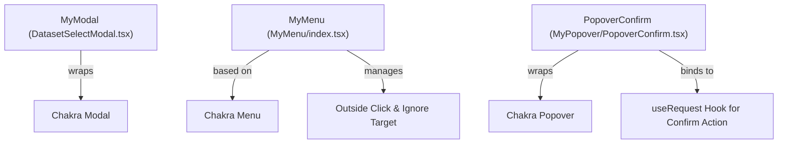
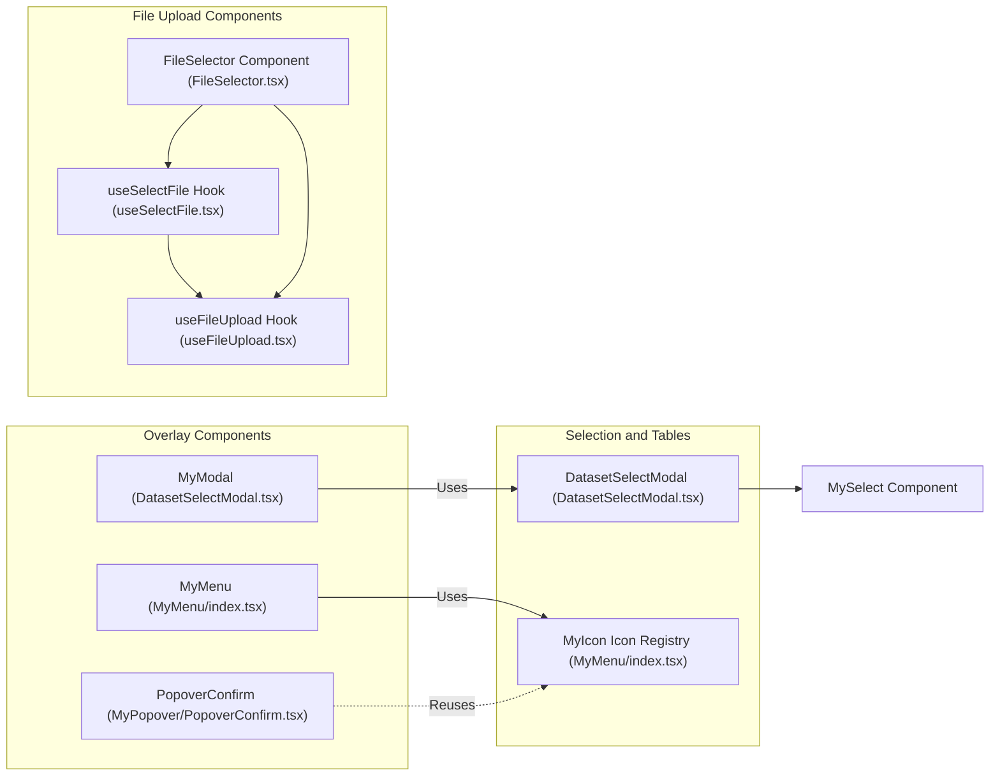

<!-- source: DeepWiki mcp.deepwiki.com · repo labring/FastGPT · page 11.4 Shared Web Component Library · fetched 2026-10-29 -->

# Shared Web Component Library

Relevant source files

The following files were used as context for generating this wiki page:

- [packages/global/common/string/time.ts](packages/global/common/string/time.ts)
- [packages/global/common/time/timezone.ts](packages/global/common/time/timezone.ts)
- [packages/global/openapi/support/wallet/bill/invoice/api.ts](packages/global/openapi/support/wallet/bill/invoice/api.ts)
- [packages/global/support/wallet/bill/type.ts](packages/global/support/wallet/bill/type.ts)
- [packages/global/test/openapi/core/dataset.test.ts](packages/global/test/openapi/core/dataset.test.ts)
- [packages/global/test/openapi/support/wallet/api.test.ts](packages/global/test/openapi/support/wallet/api.test.ts)
- [packages/service/core/ai/skill/utils.ts](packages/service/core/ai/skill/utils.ts)
- [packages/service/support/user/team/invitationLink/type.ts](packages/service/support/user/team/invitationLink/type.ts)
- [packages/service/test/core/ai/skill/skillMdBuilder.test.ts](packages/service/test/core/ai/skill/skillMdBuilder.test.ts)
- [packages/web/components/common/FixedTable/index.tsx](packages/web/components/common/FixedTable/index.tsx)
- [packages/web/components/common/Icon/icons/common/help.svg](packages/web/components/common/Icon/icons/common/help.svg)
- [packages/web/components/common/Icon/icons/core/dataset/commonDatasetColor.svg](packages/web/components/common/Icon/icons/core/dataset/commonDatasetColor.svg)
- [packages/web/components/common/Icon/icons/core/dataset/commonDatasetOutline.svg](packages/web/components/common/Icon/icons/core/dataset/commonDatasetOutline.svg)
- [packages/web/components/common/Icon/icons/core/dataset/externalDatasetColor.svg](packages/web/components/common/Icon/icons/core/dataset/externalDatasetColor.svg)
- [packages/web/components/common/Icon/icons/core/dataset/externalDatasetOutline.svg](packages/web/components/common/Icon/icons/core/dataset/externalDatasetOutline.svg)
- [packages/web/components/common/Icon/icons/core/dataset/otherDataset.svg](packages/web/components/common/Icon/icons/core/dataset/otherDataset.svg)
- [packages/web/components/common/Icon/icons/core/dataset/websiteDatasetColor.svg](packages/web/components/common/Icon/icons/core/dataset/websiteDatasetColor.svg)
- [packages/web/components/common/Icon/icons/core/dataset/websiteDatasetOutline.svg](packages/web/components/common/Icon/icons/core/dataset/websiteDatasetOutline.svg)
- [packages/web/components/common/MyMenu/index.tsx](packages/web/components/common/MyMenu/index.tsx)
- [packages/web/components/common/MyPopover/PopoverConfirm.tsx](packages/web/components/common/MyPopover/PopoverConfirm.tsx)
- [packages/web/components/common/MySelect/TimezoneSelect.tsx](packages/web/components/common/MySelect/TimezoneSelect.tsx)
- [packages/web/components/common/VersionPublisherPopover/index.tsx](packages/web/components/common/VersionPublisherPopover/index.tsx)
- [packages/web/i18n/en/skill.json](packages/web/i18n/en/skill.json)
- [packages/web/i18n/zh-CN/skill.json](packages/web/i18n/zh-CN/skill.json)
- [packages/web/i18n/zh-Hant/skill.json](packages/web/i18n/zh-Hant/skill.json)
- [packages/web/styles/theme.ts](packages/web/styles/theme.ts)
- [packages/web/test/components/common/FixedTableLayout.test.ts](packages/web/test/components/common/FixedTableLayout.test.ts)
- [projects/app/src/components/common/folder/SlideCard.tsx](projects/app/src/components/common/folder/SlideCard.tsx)
- [projects/app/src/components/core/ai/PriceTiersLabel.tsx](projects/app/src/components/core/ai/PriceTiersLabel.tsx)
- [projects/app/src/components/core/dataset/SearchParamsTip.tsx](projects/app/src/components/core/dataset/SearchParamsTip.tsx)
- [projects/app/src/pageComponents/account/bill/BillTable.tsx](projects/app/src/pageComponents/account/bill/BillTable.tsx)
- [projects/app/src/pageComponents/account/bill/InvoiceHeaderForm.tsx](projects/app/src/pageComponents/account/bill/InvoiceHeaderForm.tsx)
- [projects/app/src/pageComponents/account/bill/InvoiceTable.tsx](projects/app/src/pageComponents/account/bill/InvoiceTable.tsx)
- [projects/app/src/pageComponents/account/team/Audit/index.tsx](projects/app/src/pageComponents/account/team/Audit/index.tsx)
- [projects/app/src/pageComponents/account/team/Invite/CreateInvitationModal.tsx](projects/app/src/pageComponents/account/team/Invite/CreateInvitationModal.tsx)
- [projects/app/src/pageComponents/account/team/Invite/InviteModal.tsx](projects/app/src/pageComponents/account/team/Invite/InviteModal.tsx)
- [projects/app/src/pageComponents/account/usage/Dashboard.tsx](projects/app/src/pageComponents/account/usage/Dashboard.tsx)
- [projects/app/src/pageComponents/account/usage/UsageDetail.tsx](projects/app/src/pageComponents/account/usage/UsageDetail.tsx)
- [projects/app/src/pageComponents/account/usage/UsageTable.tsx](projects/app/src/pageComponents/account/usage/UsageTable.tsx)
- [projects/app/src/pageComponents/app/detail/PublishHistoriesSlider.tsx](projects/app/src/pageComponents/app/detail/PublishHistoriesSlider.tsx)
- [projects/app/src/pageComponents/app/detail/WorkflowComponents/Flow/nodes/NodeWorkflowStart.tsx](projects/app/src/pageComponents/app/detail/WorkflowComponents/Flow/nodes/NodeWorkflowStart.tsx)
- [projects/app/src/pageComponents/app/detail/WorkflowComponents/context/workflowPersistenceContext.tsx](projects/app/src/pageComponents/app/detail/WorkflowComponents/context/workflowPersistenceContext.tsx)
- [projects/app/src/pageComponents/dashboard/skill/CreateSkillModal.tsx](projects/app/src/pageComponents/dashboard/skill/CreateSkillModal.tsx)
- [projects/app/src/pageComponents/dashboard/skill/ImportSkillModal.tsx](projects/app/src/pageComponents/dashboard/skill/ImportSkillModal.tsx)
- [projects/app/src/pageComponents/dataset/detail/CollectionCard/Context.tsx](projects/app/src/pageComponents/dataset/detail/CollectionCard/Context.tsx)
- [projects/app/src/pageComponents/dataset/detail/Info/index.tsx](projects/app/src/pageComponents/dataset/detail/Info/index.tsx)
- [projects/app/src/pageComponents/model/Log/index.tsx](projects/app/src/pageComponents/model/Log/index.tsx)
- [projects/app/src/pageComponents/model/ModelConfigTable.tsx](projects/app/src/pageComponents/model/ModelConfigTable.tsx)
- [projects/app/src/pages/account/usage/index.tsx](projects/app/src/pages/account/usage/index.tsx)

## Purpose and Scope

This page documents the shared web component library primarily housed in the `@fastgpt/web` package and project-level UI components within the `projects/app/src/components` directory. It includes reusable, composable UI components and hooks that form the foundation of FastGPT frontend applications. The library comprises:

- Core UI components such as `MySelect`, `MyModal`, and `MyMenu`.
- Hook-based utilities including pagination hooks.
- An icon registry (`MyIcon`) mapping semantic names to SVG assets.
- File upload and selection components and hooks, for robust file ingestion workflows.

These components are designed to build consistent interfaces throughout FastGPT’s apps, sharing state management conventions, styling (mostly via Chakra UI), and interaction patterns.

Sources:  
[projects/app/src/components/core/app/DatasetSelectModal.tsx:1-54,46-114,182-194](),  
[packages/web/components/common/MyMenu/index.tsx:1-54,202-288](),  
[packages/web/components/common/MyPopover/PopoverConfirm.tsx:1-158](),  
[projects/app/src/web/common/file/hooks/useSelectFile.tsx:5-41](),  
[projects/app/src/components/core/chat/ChatContainer/ChatBox/hooks/useFileUpload.tsx:53-100](),  
[projects/app/src/pageComponents/dataset/detail/Import/components/FileSelector.tsx:20-77]()

---

## Modals, Overlays, and Menus

FastGPT uses overlay components as foundational UI interaction patterns for modal dialogs, dropdown menus, and popovers. These components are based on Chakra UI primitives but wrapped to enforce consistency in styling, behavior, and integrations with system state.

### `MyModal`

- Provides a modal dialog with configurable header icons, title, footer slots, size constraints, and loading states.
- Wraps Chakra UI Modal and implements consistent spacing and typography.
- Usage example includes dataset selection UI with embedded dataset vector model consistency checking.
- Supports minimum width enforcement and loading overlays.

### `MyMenu`

- A flexible dropdown menu component built on Chakra UI’s Menu primitives.
- Supports configurable triggers (`hover` or `click`), sizes (`mini`, `xs`, `sm`, `md`), and menu item types (`primary`, `danger`, `gray`, `grayBg`) with distinct styling states for hover, focus, active, and disabled.
- Implements positioning strategies supporting absolute or fixed positioning (to handle scroll containers and overflow containment).
- Integrates outside click detection with the ability to ignore outside clicks on certain targets via data attributes.
- Menu items support optional icons, descriptions, disabled states with tooltips, and click handlers.
- Supports lazy mounting of menu contents for performance.

### `PopoverConfirm`

- Inline confirmation popovers for critical user confirmation (e.g., delete actions).
- Built on Chakra UI Popover with control over placement, content, trigger, and confirm/cancel buttons.
- Uses the `useRequest` hook to bind confirm actions to asynchronous requests, displaying loading states during execution.
- Supports two types: informational and delete, each with custom icon and button styling.
- Provides keyboard focus management and close-on-blur behavior.

**Diagram: Overlay and Menu Component Architecture**

Sources:  
[projects/app/src/components/core/app/DatasetSelectModal.tsx:182-194](),  
[packages/web/components/common/MyMenu/index.tsx:202-288](),  
[packages/web/components/common/MyPopover/PopoverConfirm.tsx:20-87]()

---

## Selection and Input Components

The shared library provides components to facilitate selection mechanisms, including dataset pickers and general dropdowns.

### `DatasetSelectModal`

- A modal UI for browsing and selecting knowledge base datasets.
- Supports hierarchical folder navigation with `parentIdInPath` props.
- Validates vector model compatibility among selected datasets using `activeVectorModelId`.
- Maintains synchronization between selected dataset IDs and info objects.
- Integrates a search/filter input to rapidly filter datasets.
- Demonstrates combined usage of selection state with UI overlays.

### `MySelect`

- A standardized select dropdown with form-friendly APIs.
- Used for filtering, configuration, and form controls with consistent styling.

### Search Inputs

- Include a debounced search input optimized for filtering large tables or lists.
- Typically integrated into modals or selection panels for quick filtering.

Sources:  
[projects/app/src/components/core/app/DatasetSelectModal.tsx:29-114]()

---

## File Upload and Selection Components and Hooks

The library encapsulates complex file selection and upload flows to address diverse file ingestion requirements across the app.

### `useSelectFile` Hook

- Provides an API around a hidden native `<input type="file" />` element.
- Supports configuration of file accept types, multiple file selection, and max file count.
- Manages dynamic "key" updating for react reconciliation to cope with browsers ignoring `accept` changes.
- Exposes a `selectFile` method to programmatically trigger file dialogs.
- Calls back with selected files after change events.

### `useFileUpload` Hook

- Manages file uploads with S3 pre-signed URLs and cancellation support via `AbortController`.
- Receives a field array of current uploaded files, limits on count/size, and configuration.
- Provides upload progress, error handling, and file removal callbacks.
- Encapsulates multipart upload logic and task references, suitable for integration with UI state stores.

### `FileSelector` Component

- A drag-and-drop file upload component supporting directory traversal via `webkitGetAsEntry`.
- Validates total selected file size and count against team plan limits and system config quotas.
- Supports explicit onChange handlers for files and folders.
- Offers UI feedback for drag and drop states and prevents default browser behaviors as needed.

```mermaid
graph TD
    useSelectFile["useSelectFile (useSelectFile.tsx)"] -->|creates| HiddenInput["<input type=file> with dynamic key"]
    HiddenInput -->|fires| onSelect["onChange callback with files"]
    
    useFileUpload["useFileUpload (useFileUpload.tsx)"] --> UploadTask["Upload with AbortController & S3 presigned URLs"]
    UploadTask -->|controls| UploadProgress
    UploadTask -->|supports| CancelTask
    
    FileSelector["FileSelector (FileSelector.tsx)"] --> DropZone["Drag & Drop area"]
    DropZone --> DirectoryTraversal["Parse folders with webkitGetAsEntry"]
    DropZone --> Validation["Validation on file size & count"]
    Validation -->|valid files| onChangeFiles
    
    onSelect --> useFileUpload
    onChangeFiles --> useFileUpload
```

**Diagram: File Selection and Upload Data Flow**

Sources:  
[projects/app/src/web/common/file/hooks/useSelectFile.tsx:5-41](),  
[projects/app/src/components/core/chat/ChatContainer/ChatBox/hooks/useFileUpload.tsx:53-100](),  
[projects/app/src/pageComponents/dataset/detail/Import/components/FileSelector.tsx:20-77]()

---

## Icon Registry and Table Components

### `MyIcon`

- Centralized icon registry based on the `IconNameType` union type.
- Maps icon names and categories to SVG sources, enabling consistent icon usage across components.
- Supports icon variants including dataset-type icons, common icons, and UI element icons.
- Used heavily by menu items, buttons, tooltips, and status indicators.

### Tables and Pagination Hooks

- Offers standardized table components for displaying tabular data with fixed headers.
- Integrates pagination hooks to manage paged data fetching and navigation.
- Used in account billing, usage details, and dataset listing interfaces.

Sources:  
[packages/web/components/common/MyMenu/index.tsx:17](),  
[projects/app/src/components/core/app/DatasetSelectModal.tsx:46-114]()

---

## Component to Code Association Diagram

**Diagram: High-Level Association of Shared UI Components to Code Entities**

Sources:  
[projects/app/src/components/core/app/DatasetSelectModal.tsx](),  
[packages/web/components/common/MyMenu/index.tsx](),  
[packages/web/components/common/MyPopover/PopoverConfirm.tsx](),  
[projects/app/src/web/common/file/hooks/useSelectFile.tsx](),  
[projects/app/src/components/core/chat/ChatContainer/ChatBox/hooks/useFileUpload.tsx](),  
[projects/app/src/pageComponents/dataset/detail/Import/components/FileSelector.tsx]()

---

## Summary

The Shared Web Component Library in FastGPT provides robust, composable UI building blocks including:

- Overlay and menu components (`MyModal`, `MyMenu`, `PopoverConfirm`) built on Chakra UI with feature enhancements.
- Selection primitives (`MySelect`, `DatasetSelectModal`) for dataset and option pickers.
- File ingestion tools (`useSelectFile`, `useFileUpload`, `FileSelector`), supporting drag-drop, directory traversal, and S3 multipart upload.
- An icon registry (`MyIcon`) and tables/pagination infrastructure for consistent data presentation.

These components embody FastGPT's principles of reusability, accessibility, and seamless integration, enabling consistent UI/UX across the platform.

---

# Appendix: Important File References

| Component / Hook         | File Path / Lines                                    |
|-------------------------|-----------------------------------------------------|
| `MyModal`               | `projects/app/src/components/core/app/DatasetSelectModal.tsx:182-194` |
| `MyMenu`                | `packages/web/components/common/MyMenu/index.tsx:202-288`              |
| `PopoverConfirm`        | `packages/web/components/common/MyPopover/PopoverConfirm.tsx:20-87`    |
| `DatasetSelectModal`    | `projects/app/src/components/core/app/DatasetSelectModal.tsx:1-114`    |
| `useSelectFile` hook    | `projects/app/src/web/common/file/hooks/useSelectFile.tsx:5-41`        |
| `useFileUpload` hook    | `projects/app/src/components/core/chat/ChatContainer/ChatBox/hooks/useFileUpload.tsx:53-100` |
| `FileSelector` component| `projects/app/src/pageComponents/dataset/detail/Import/components/FileSelector.tsx:20-77` |
| `Icon Registry` (`MyIcon`)| `packages/web/components/common/MyMenu/index.tsx:17`                  |

Sources: All above files combined.

---

