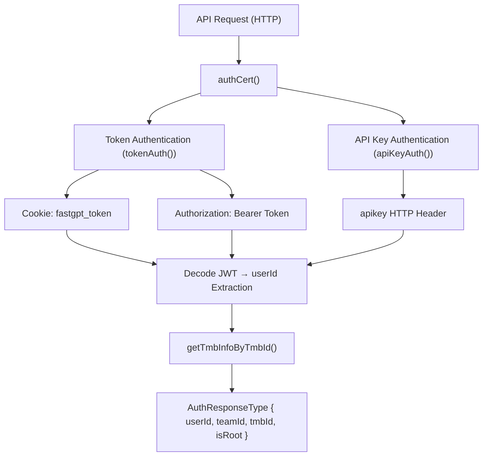
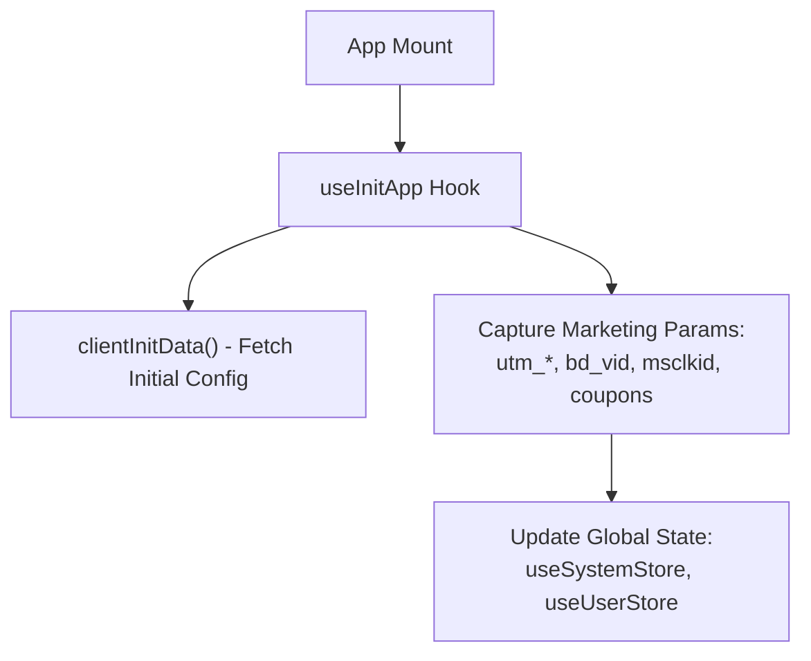
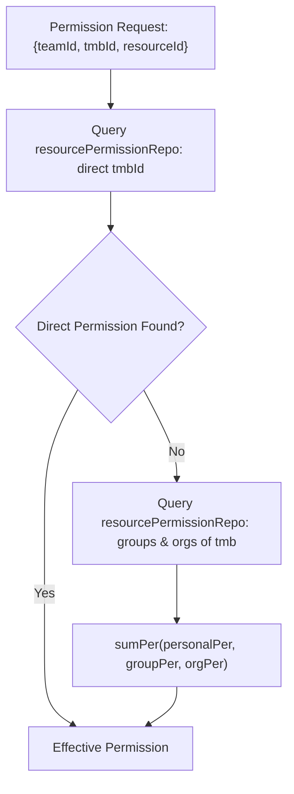
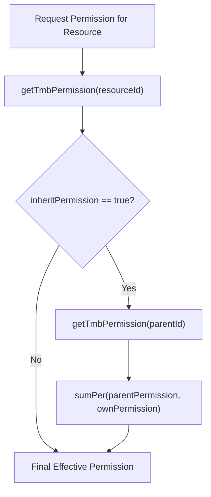
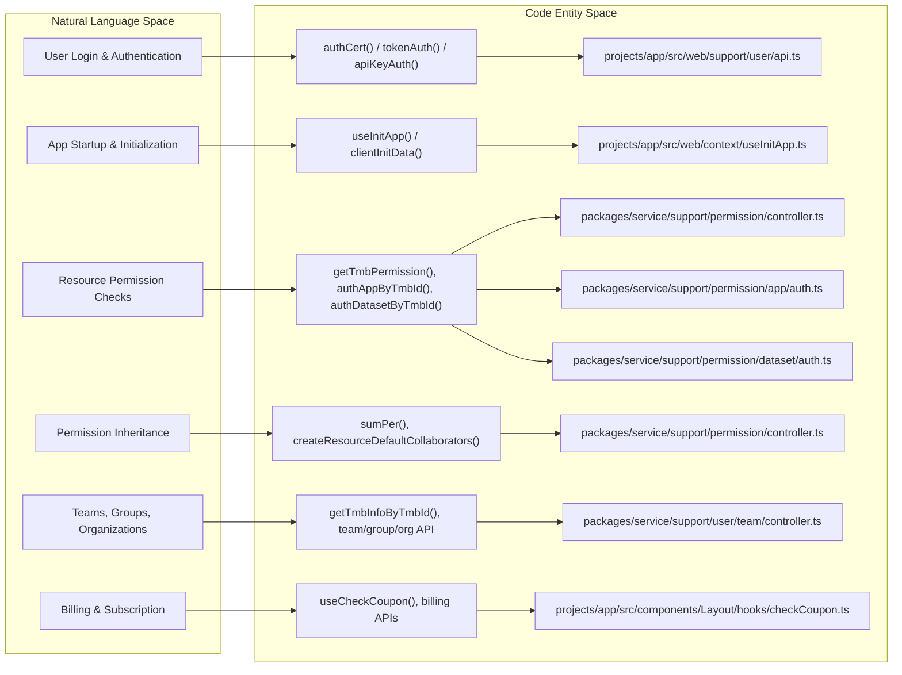

<!-- source: DeepWiki mcp.deepwiki.com · repo labring/FastGPT · page 12 Authentication and Permission Management · fetched 2026-10-29 -->

# Authentication and Permission Management

Relevant source files

The following files were used as context for generating this wiki page:

- [packages/service/core/dataset/schema.ts](packages/service/core/dataset/schema.ts)
- [packages/service/env.util.ts](packages/service/env.util.ts)
- [packages/service/global.d.ts](packages/service/global.d.ts)
- [packages/service/support/permission/app/auth.ts](packages/service/support/permission/app/auth.ts)
- [packages/service/support/permission/controller.ts](packages/service/support/permission/controller.ts)
- [packages/service/support/permission/dataset/auth.ts](packages/service/support/permission/dataset/auth.ts)
- [packages/service/support/permission/repository/resourcePermissionRepo.ts](packages/service/support/permission/repository/resourcePermissionRepo.ts)
- [packages/service/support/permission/resourcePermissionService.ts](packages/service/support/permission/resourcePermissionService.ts)
- [packages/service/support/user/systemUser.ts](packages/service/support/user/systemUser.ts)
- [packages/service/support/user/team/controller.ts](packages/service/support/user/team/controller.ts)
- [packages/service/test/support/permission/app/auth.test.ts](packages/service/test/support/permission/app/auth.test.ts)
- [packages/service/test/support/permission/controller.test.ts](packages/service/test/support/permission/controller.test.ts)
- [packages/service/test/support/permission/resourcePermissionRepo.test.ts](packages/service/test/support/permission/resourcePermissionRepo.test.ts)
- [packages/service/test/support/user/systemUser.test.ts](packages/service/test/support/user/systemUser.test.ts)
- [projects/app/src/instrumentation-node.ts](projects/app/src/instrumentation-node.ts)
- [projects/app/src/pageComponents/dataset/detail/Import/commonProgress/Upload.tsx](projects/app/src/pageComponents/dataset/detail/Import/commonProgress/Upload.tsx)
- [projects/app/test/api/core/dataset/collection/create/reTrainingCollection.test.ts](projects/app/test/api/core/dataset/collection/create/reTrainingCollection.test.ts)

This document provides a high-level overview of FastGPT's authentication and permission management system. It explains how users and teams authenticate, how resources such as apps and datasets are secured with fine-grained permissions, and the hierarchical structure of permissions including inheritance. This system is essential for controlling access across FastGPT's multiple resource types and collaboration entities.

For in-depth technical details, see the child pages:
- [User and Team Authentication](#12.1)
- [Application Initialization Flow](#12.2)
- [Resource Permission System](#12.3)
- [Permission Inheritance Model](#12.4)
- [Teams, Organizations and Audit Logs](#12.5)
- [Billing, Plans and Usage](#12.6)

---

## System Overview

FastGPT employs a comprehensive authentication and authorization framework that enables:

- Multiple login methods and API key support for authentication.
- Role-Based Access Control (RBAC) for resources such as apps, datasets, collections, and teams.
- Permission assignment at user, member group, and organization unit levels.
- Permission inheritance to simplify authorization for nested resources like folders.

All resource access operations enforce permission checks using this system to maintain secure and compliant access policies.

**Sources:**  
[packages/service/support/permission/controller.ts:30-121]()  
[packages/service/support/permission/app/auth.ts:27-179]()  
[packages/service/support/permission/dataset/auth.ts:37-146]()  
[packages/service/support/user/team/controller.ts:42-202]()  

---

## User and Team Authentication

FastGPT supports diverse authentication methods, abstracted via a centralized login provider system that transparently authenticates requests coming from API tokens, cookies, or authorization headers.

Multiple login options are implemented via frontend APIs and components, including:
- **Password Login:** Standard username/password authentication.
- **OAuth and SSO:** Google, GitHub, Microsoft, and custom SSO providers.
- **WeChat Login:** QR-code scan authentication flow.
- **Fast Login and Registration:** Quick token-based login and email/phone registration.

Refer to the child page [User and Team Authentication](#12.1) for comprehensive details on supported login flows and registration tracking.

**Sources:**  
[projects/app/src/web/support/user/api.ts:35-57]()  
[projects/app/src/pages/login/provider.tsx:154-162]()  
[projects/app/src/pageComponents/login/LoginForm/FormLayout.tsx:58-86]()  
[projects/app/src/pageComponents/login/RegisterForm.tsx:74-91]()  
[projects/app/src/pageComponents/login/LoginForm/WechatForm.tsx:36-73]()  

---

## Application Initialization Flow

Upon app startup, FastGPT runs an initialization sequence that captures marketing parameters, fetches system configuration, and updates global frontend state stores.

The `useInitApp` hook reads URL query marketing parameters and stores them for session persistence. Concurrently, `clientInitData()` loads vital system configurations (`feConfigs`) that drive feature flags and user context state.

For details on the initialization lifecycle, see [Application Initialization Flow](#12.2).

**Sources:**  
[projects/app/src/web/context/useInitApp.ts:36-47,100-120,148-179]()  
[projects/app/src/web/support/marketing/utils.ts:9-124]()  

---

## Resource Permission System

FastGPT’s permission system centrally manages access rights using a permission repository collection named `resource_permissions`. Permissions are assigned at several granularity levels: individual team members, member groups, and organizations.

### Permission Data Model

| Field | Type | Description |
|-------|------|-------------|
| `teamId` | `ObjectId` | Team owning the resource |
| `resourceType` | `String` (Enum) | Resource kind (e.g. `app`, `dataset`, `team`) |
| `resourceId` | `ObjectId` | Specific resource ID within the team |
| `permission` | `Number` | Numeric permission value representing roles (Owner, Manage, Read, etc.) |
| `tmbId` | `ObjectId?` | (Optional) Specific team member |
| `groupId` | `ObjectId?` | (Optional) Member group permission |
| `orgId` | `ObjectId?` | (Optional) Organization unit permission |

### Permission Resolution Logic

When checking a member's permission on a resource, the system first tries to find explicit personal permissions (`tmbId`), falling back on permissions inherited from all member groups and organizations the user belongs to. These permissions are combined using the permission summation utility `sumPer`.

For example, the controller function `getTmbPermission` implements this logic to obtain effective permissions [packages/service/support/permission/controller.ts:30-79]().

For detailed logic of permission checks for apps and datasets including special cases (e.g., hidden apps), see [Resource Permission System](#12.3) and child page [Resource Permission System](#12.3).

**Sources:**  
[packages/service/support/permission/controller.ts:30-121]()  
[packages/service/support/permission/app/auth.ts:48-146]()  
[packages/service/support/permission/dataset/auth.ts:37-146]()  

---

## Permission Inheritance Model

Resources like apps, datasets, or collections can be arranged in folder hierarchies. Permissions may be inherited from parent folders, simplifying administration and ensuring consistent access policies.

### Inheritance Computation

Permission checks consider inheritance as follows:

When new resources are created, default collaborators are assigned by transforming parent resource owners/managers into appropriate roles in the child resource. The creator is assigned as the explicit owner.

Refer to `createResourceDefaultCollaborators` in the permission controller for the implementation details [packages/service/support/permission/controller.ts:181-213]().

For comprehensive details, see [Permission Inheritance Model](#12.4).

**Sources:**  
[packages/service/support/permission/controller.ts:103-104]()  
[packages/service/support/permission/controller.ts:181-213]()  
[packages/service/support/permission/app/auth.ts:48-146]()  
[packages/service/support/permission/dataset/auth.ts:37-146]()  

---

## Teams, Organizations and Audit Logs

FastGPT’s collaboration model structures users into teams, groups, and organizations for scalable permission and membership management.

- Team owners manage members with varying roles.
- Groups aggregate members for bulk permission assignments.
- Organizations manage enterprise-wide hierarchies.

Audit logging provisions capture changes in membership, permissions, and ownership transfers to meet enterprise compliance needs.

The system supports APIs and UI components for member/group/org management and member synchronization via endpoints such as `postSyncMembers` and searching via `getSearchMembersOrgsGroups` [projects/app/src/web/support/user/api.ts:107-121]().

For more information, see the child page [Teams, Organizations and Audit Logs](#12.5).

**Sources:**  
[projects/app/src/web/support/user/api.ts:107-121]()  
[packages/service/support/user/team/controller.ts:42-202]()  

---

## Billing, Plans and Usage

FastGPT integrates billing and usage tracking tightly with the authentication and permission system. User subscription plans, AI points, and wallet balances determine service limits and access.

Coupon auto-redeem is implemented via the `useCheckCoupon` hook and integrated into user state refresh flows.

Invoices, coupons, and pricing pages maintain billing UI and API visibility.

See the child page [Billing, Plans and Usage](#12.6) for details on billing models and APIs.

**Sources:**  
[projects/app/src/components/Layout/hooks/checkCoupon.ts]()  
[projects/app/src/components/Layout/index.tsx:139-140]()  

---

# Summary Diagram: Authentication and Permission Management in Code

This diagram bridges the main user-oriented authentication and permission concepts with the key code modules responsible for implementing these features.

---

This concludes the high-level overview of FastGPT's Authentication and Permission Management system. For comprehensive technical details, interface documentation, and code examples, navigate to the listed child pages.

---

