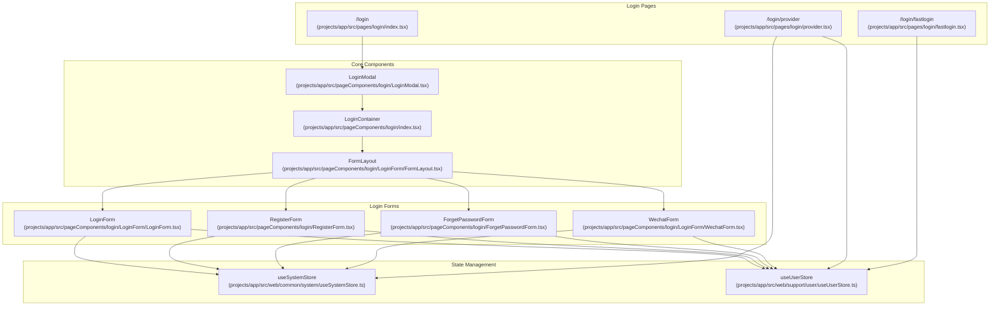
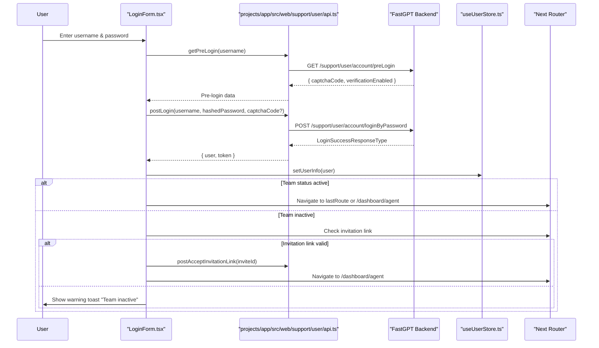
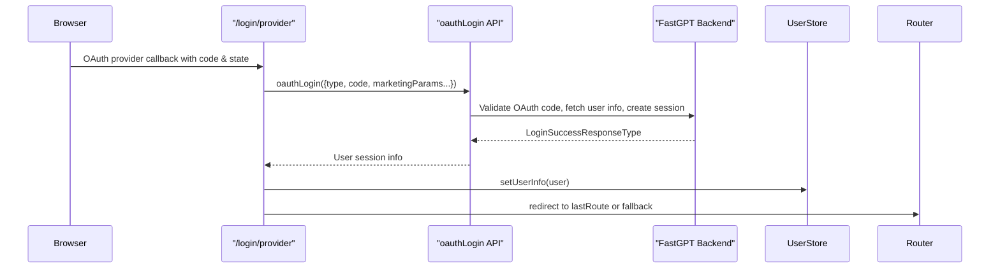
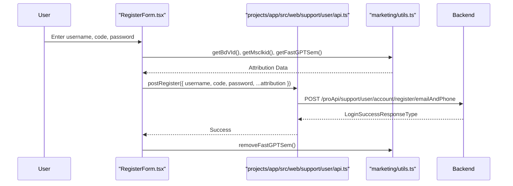
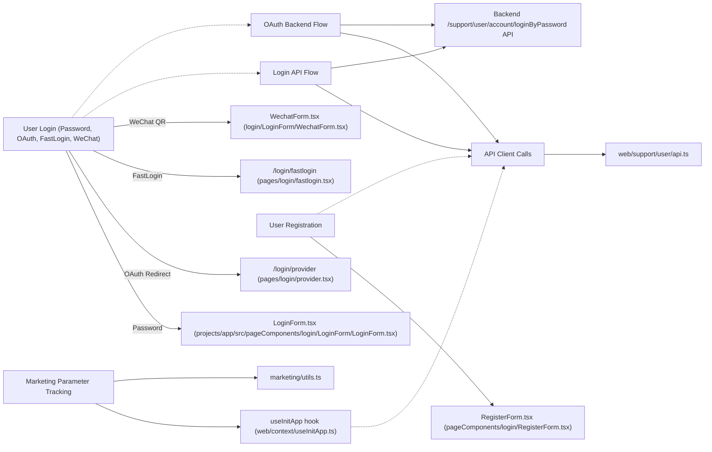
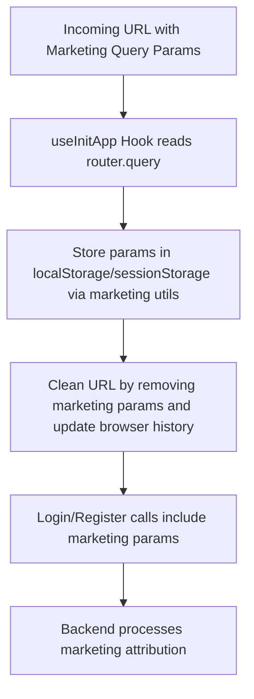

<!-- source: DeepWiki mcp.deepwiki.com · repo labring/FastGPT · page 12.1 User and Team Authentication · fetched 2026-10-29 -->

# User and Team Authentication

<details>
<summary>Relevant source files</summary>

The following files were used as context for generating this wiki page:

- [document/content/guide/admin/sso.en.mdx](document/content/guide/admin/sso.en.mdx)
- [document/content/guide/admin/sso.mdx](document/content/guide/admin/sso.mdx)
- [packages/global/openapi/core/ai/sandbox/api.ts](packages/global/openapi/core/ai/sandbox/api.ts)
- [packages/global/openapi/core/ai/sandbox/index.ts](packages/global/openapi/core/ai/sandbox/index.ts)
- [packages/global/openapi/support/user/account/login/api.ts](packages/global/openapi/support/user/account/login/api.ts)
- [packages/global/openapi/support/user/account/login/index.ts](packages/global/openapi/support/user/account/login/index.ts)
- [packages/global/openapi/support/user/account/password/api.ts](packages/global/openapi/support/user/account/password/api.ts)
- [packages/global/openapi/support/wallet/bill/api.ts](packages/global/openapi/support/wallet/bill/api.ts)
- [packages/global/support/wallet/sub/coupon/constants.ts](packages/global/support/wallet/sub/coupon/constants.ts)
- [packages/global/support/wallet/sub/coupon/type.ts](packages/global/support/wallet/sub/coupon/type.ts)
- [packages/service/common/dingtalk/accessToken.ts](packages/service/common/dingtalk/accessToken.ts)
- [packages/service/core/chat/pushChatLog.ts](packages/service/core/chat/pushChatLog.ts)
- [packages/service/core/dataset/apiDataset/dingtalkDataset/api.ts](packages/service/core/dataset/apiDataset/dingtalkDataset/api.ts)
- [packages/service/core/dataset/apiDataset/feishuDataset/api.ts](packages/service/core/dataset/apiDataset/feishuDataset/api.ts)
- [packages/service/core/dataset/apiDataset/yuqueDataset/api.ts](packages/service/core/dataset/apiDataset/yuqueDataset/api.ts)
- [packages/service/support/user/session.ts](packages/service/support/user/session.ts)
- [packages/service/support/wallet/coupon/schema.ts](packages/service/support/wallet/coupon/schema.ts)
- [packages/service/test/common/dingtalk/accessToken.test.ts](packages/service/test/common/dingtalk/accessToken.test.ts)
- [packages/service/test/common/dingtalk/accessTokenInternal.test.ts](packages/service/test/common/dingtalk/accessTokenInternal.test.ts)
- [packages/service/test/core/dataset/apiDataset/dingtalkDataset/api.test.ts](packages/service/test/core/dataset/apiDataset/dingtalkDataset/api.test.ts)
- [packages/service/test/core/dataset/apiDataset/feishuDatasetInternal.test.ts](packages/service/test/core/dataset/apiDataset/feishuDatasetInternal.test.ts)
- [packages/service/test/core/dataset/apiDataset/yuqueDatasetInternal.test.ts](packages/service/test/core/dataset/apiDataset/yuqueDatasetInternal.test.ts)
- [projects/app/src/components/Layout/index.tsx](projects/app/src/components/Layout/index.tsx)
- [projects/app/src/components/Select/I18nLngSelector.tsx](projects/app/src/components/Select/I18nLngSelector.tsx)
- [projects/app/src/components/support/user/safe/SendCodeAuthModal.tsx](projects/app/src/components/support/user/safe/SendCodeAuthModal.tsx)
- [projects/app/src/pageComponents/account/AccountContainer.tsx](projects/app/src/pageComponents/account/AccountContainer.tsx)
- [projects/app/src/pageComponents/chat/SandboxEditor/api.ts](projects/app/src/pageComponents/chat/SandboxEditor/api.ts)
- [projects/app/src/pageComponents/chat/SandboxEditor/components/FileTree.tsx](projects/app/src/pageComponents/chat/SandboxEditor/components/FileTree.tsx)
- [projects/app/src/pageComponents/login/ForgetPasswordForm.tsx](projects/app/src/pageComponents/login/ForgetPasswordForm.tsx)
- [projects/app/src/pageComponents/login/LoginForm/FormLayout.tsx](projects/app/src/pageComponents/login/LoginForm/FormLayout.tsx)
- [projects/app/src/pageComponents/login/LoginForm/LoginForm.tsx](projects/app/src/pageComponents/login/LoginForm/LoginForm.tsx)
- [projects/app/src/pageComponents/login/LoginForm/WechatForm.tsx](projects/app/src/pageComponents/login/LoginForm/WechatForm.tsx)
- [projects/app/src/pageComponents/login/LoginModal.tsx](projects/app/src/pageComponents/login/LoginModal.tsx)
- [projects/app/src/pageComponents/login/RegisterForm.tsx](projects/app/src/pageComponents/login/RegisterForm.tsx)
- [projects/app/src/pageComponents/login/index.tsx](projects/app/src/pageComponents/login/index.tsx)
- [projects/app/src/pages/api/core/ai/sandbox/upload.ts](projects/app/src/pages/api/core/ai/sandbox/upload.ts)
- [projects/app/src/pages/api/support/user/account/loginByPassword.ts](projects/app/src/pages/api/support/user/account/loginByPassword.ts)
- [projects/app/src/pages/login/fastlogin.tsx](projects/app/src/pages/login/fastlogin.tsx)
- [projects/app/src/pages/login/index.tsx](projects/app/src/pages/login/index.tsx)
- [projects/app/src/pages/login/provider.tsx](projects/app/src/pages/login/provider.tsx)
- [projects/app/src/web/context/useInitApp.ts](projects/app/src/web/context/useInitApp.ts)
- [projects/app/src/web/support/marketing/utils.ts](projects/app/src/web/support/marketing/utils.ts)
- [projects/app/src/web/support/user/api.ts](projects/app/src/web/support/user/api.ts)
- [projects/app/src/web/support/user/hooks/useSendCode.tsx](projects/app/src/web/support/user/hooks/useSendCode.tsx)
- [projects/app/test/api/core/ai/sandbox/upload.test.ts](projects/app/test/api/core/ai/sandbox/upload.test.ts)
- [projects/app/test/pageComponents/login/LoginForms.test.ts](projects/app/test/pageComponents/login/LoginForms.test.ts)

</details>


## Purpose and Scope

This document describes FastGPT's user authentication system and team integration, covering frontend login methods (including password, OAuth, SSO, WeChat, and fast login), user registration, password recovery, and marketing parameter tracking. It provides detailed explanations on the implementation, key components, data flow, and the integration pattern between frontend and backend services.

For related topics such as application initialization and resource permission management, refer respectively to [12.2 Application Initialization Flow]() and [12.3 Resource Permission System]().

---

## Overview

FastGPT supports diverse user login methods to accommodate various user scenarios:

- **Password-based login** supporting username, email, or phone number with optional login verification challenges.
- **OAuth 2.0 authentication** with providers like Google, GitHub, Microsoft, corporate SSO, and other third-party identity platforms.
- **SSO integration and external member synchronization**, enabling connection to enterprise identity providers and directory systems.
- **WeChat QR code login** primarily for the Chinese user base.
- **Fast login** for one-click authentication using pre-issued tokens.
- **User registration** with verification code validation.
- **Password recovery** allowing users to reset passwords with verification codes.

User marketing and attribution data from URL parameters are tracked during app initialization and injected into login or registration requests to enable acquisition analytics.

---

## Architecture: Authentication Entry Points and Components

The following diagram shows key frontend entry points and components involved in user authentication flows, highlighting source files and their relationships.



Sources: Projects:  
 - `projects/app/src/pages/login/index.tsx:1-58`  
 - `projects/app/src/pageComponents/login/index.tsx:1-134`  
 - `projects/app/src/pageComponents/login/LoginForm/FormLayout.tsx:1-86`  
 - `projects/app/src/web/common/system/useSystemStore.ts` (referenced)  
 - `projects/app/src/web/support/user/useUserStore.ts` (referenced)

---

## Password-Based Authentication

### Flow Description

Users enter their username (email or phone) and password to authenticate. The login form first issues a **pre-login request** to fetch potential security metadata (such as CAPTCHA requirements) and ensure the security state before submitting credentials.

The password is hashed on the client side before transmission (`hashStr` function) to ensure secure handling.

If login verification (2FA or similar) is enabled for the user, a login challenge is created, requiring an additional verification step.

Upon successful login, the user info is stored in `useUserStore`, and the user is redirected to the last visited route or a default dashboard.

If the user's team status is inactive, the system checks for an invitation link to allow joining the team before granting access.

### Key API and Functions

- `getPreLogin(username)`: Fetches pre-login metadata (captcha, rate limit info) to inform UI behavior.  
- `postLogin({username, password, ...})`: Sends login request with hashed password.  
- `hashStr(password)`: Client-side SHA-256 hashing for password.  
- `assertPasswordLoginUser()`, `createLoginChallenge()`: Backend logic to manage login challenges if verification is required.  
- `completePasswordLogin()`, `finishPasswordLogin()`: Backend steps to finalize login, issue sessions and tokens.

### Sequence Diagram



Sources:  
- `projects/app/src/web/support/user/api.ts:43-61`  
- `projects/app/src/pages/login/index.tsx:13-58`  
- `projects/app/src/pages/api/support/user/account/loginByPassword.ts:29-97`

---

## OAuth 2.0 Integration

### Supported Providers

FastGPT integrates various OAuth providers enabling users to login with existing external identities:

| Provider   | Config Key                        | Redirect Flow Example                                      |
|------------|---------------------------------|-----------------------------------------------------------|
| Google     | `feConfigs.oauth.google`         | `https://accounts.google.com/o/oauth2/v2/auth`            |
| GitHub     | `feConfigs.oauth.github`         | `https://github.com/login/oauth/authorize`                |
| Microsoft  | `feConfigs.oauth.microsoft`      | `https://login.microsoftonline.com/{tenant}/oauth2/v2.0/authorize` |
| WeChat     | `feConfigs.oauth.wechat`          | Via QR code scanning                                      |
| SSO        | `feConfigs.sso.url`              | Custom SSO endpoint                                       |

### Frontend OAuth Flow

The `FormLayout` component dynamically lists available OAuth login buttons, reading from `feConfigs.oauth` and invoking login redirects on button clicks.

The OAuth callback endpoint `/login/provider` handles authentication responses asynchronously:

- It extracts OAuth callback query params such as `code` and `state`.
- Performs additional verification or account cancellation workflows depending on the current `loginStore.flow` state.
- Calls backend API `oauthLogin` to exchange OAuth tokens for FastGPT sessions, passing along marketing parameters captured during initialization.
- On success, updates user state and redirects accordingly.
- Handles errors with appropriate toast notifications.

### Sequence Diagram for OAuth Callback



Sources:  
- `projects/app/src/pageComponents/login/LoginForm/FormLayout.tsx:16-86`  
- `projects/app/src/pages/login/provider.tsx:1-180`  
- `projects/app/src/web/support/user/api.ts:48-61`

---

## WeChat QR Code Login

WeChat login uses QR code scanning for authentication, suitable for Chinese users:

- `getWXLoginQR` generates a login session and QR code URL.
- The frontend displays the QR code.
- `getWXLoginResult` polls the backend for the scan/authorization result.
- After scan and approval, backend returns login success data including user info and tokens.
- The login flow injects marketing parameters similarly to other login methods.

Sources:  
- `projects/app/src/web/support/user/api.ts:73-79`  
- `projects/app/src/pageComponents/login/index.tsx:26-44`

---

## Fast Login

Fast login allows one-click login using pre-established authentication tokens.

The client calls `postFastLogin` API with the token and marketing parameters.

Successful responses provide user info, and the client updates local user session state.

Sources:  
- `projects/app/src/web/support/user/api.ts:53-56`

---

## User Registration

### Flow Description

Users can register accounts using email or phone number verification:

- Users provide `username`, verification `code`, and `password`.
- Marketing attribution parameters are attached to the registration request (e.g., `bd_vid`, `msclkid`, `fastgpt_sem`).
- The backend verifies the code and creates the user account.
- Successful registration acts as a login, returning session details.
- Marketing tracking data is cleared after registration.

### Sequence Diagram



Sources:  
- `projects/app/src/web/support/user/api.ts:83-100`  
- `projects/app/src/pageComponents/login/RegisterForm.tsx:31-95`

---

## Password Recovery

Password reset is available via email or phone with a verification code:

- Users enter account ID (email/phone), verification code, and new password.
- The frontend uses `postFindPassword` API to submit the reset request.
- Upon success, user is logged in automatically.
- The UI includes validation for password strength and code correctness.

Sources:  
- `projects/app/src/pageComponents/login/ForgetPasswordForm.tsx:1-210`  
- `projects/app/src/web/support/user/api.ts:101-118`

---

## Marketing Parameter Tracking

FastGPT captures marketing tracking parameters from the user’s entry URL and stores them for use in login, registration, and analytics.

### Tracked Parameters

The app tracks the following parameters defined in `MARKETING_PARAMS`:

- `bd_vid` (Baidu visitor ID)
- `msclkid` (Microsoft click ID)
- `k` (search keyword)
- `visitor_id`
- `sourceDomain`
- UTM parameters: `utm_source`, `utm_medium`, `utm_content`, `utm_workflow`
- `couponCode`

### Implementation Details

1. **Extraction & Storage**  
   During app initialization, the `useInitApp` React hook extracts these parameters from the URL's query string and stores them in localStorage or sessionStorage using wrappers (e.g., `setBdVId`, `setUtmParams`) defined in `marketing/utils.ts`.

2. **URL Cleaning**  
   After capturing these parameters, they are stripped from the browser URL by reconstructing the clean path and calling `router.replace()` to avoid repeated tracking.

3. **Injection into API Calls**  
   Stored marketing parameters are sent alongside login and registration API calls to attribute users correctly.

### Code Flow Overview

```mermaid
flowchart TB
  URLQuery[URL with marketing params]<--uses-- useInitApp[useInitApp in projects/app/src/web/context/useInitApp.ts]
  useInitApp--extracts-->MarketingStorage[localStorage/sessionStorage helpers in marketing/utils.ts]
  useInitApp--strips-->RouterReplace["router.replace(clean URL)"]
  MarketingStorage--provides-->LoginAPI[Login/Register API calls]
  LoginAPI--passes->Backend["Backend processes user & tracks marketing"]
```

---

## SSO and External Member System Integration

FastGPT supports standard SSO protocols with external member system synchronization, handled by a dedicated `fastgpt-sso-service` adapter and standard interfaces in fastgpt-pro. Supported protocols include Lark (Feishu), WeCom, DingTalk, SAML, OAuth2, and LDAP.

- SSO service converts external auth flows to FastGPT's login sessions.
- Member sync handles import/update of organizational structures.
- Configuration is done via environment variables for internal SSO service and frontend admin UI for button/icon customization.

For deployment and configuration details, see the [SSO & 外部成员同步 guide](/document/content/guide/admin/sso.mdx).

---

## Application Initialization and Marketing Integration

The `useInitApp` hook (`projects/app/src/web/context/useInitApp.ts`) initializes global app state on client start:

- Fetches app config, scripts, system title.
- Tracks global marketing parameters from the URL, storing them using `setBdVId`, `setMsclkid`, `setUtmWorkflow`, and others in localStorage or sessionStorage.
- Tracks coupon codes from URL.
- Cleans up the URL to remove these marketing parameters after capture.
- Sets error tracking for uncaught window errors.
- Schedules refresh of GitHub stars and config reload at intervals.

This hook is fundamental for marketing attribution tracking integration and enables passing these parameters during login and registration requests.

---

## Post-Login Processing

After a successful login (via any method), the following steps occur:

- The user info and session token are stored in `useUserStore`.
- If user belongs to a team that is inactive, the system checks if an invitation link exists:
  - If yes, calls the invitation accept API to activate membership.
  - If no, notify the user of inactive team and prevent navigation.
- The app redirects the user to their last visited page or the dashboard.

The app `Layout` component (`projects/app/src/components/Layout/index.tsx`) protects routes based on user login status and license restrictions (for admins), also verifying model configurations after login.

---

## Summary Table of Key Files and Responsibilities

| File | Purpose |
|-------|---------|
| `projects/app/src/pages/login/index.tsx` | Main login page, orchestrates password login and forwarding to modal |
| `projects/app/src/pages/login/provider.tsx` | OAuth callback handler, processes external login responses |
| `projects/app/src/pageComponents/login/index.tsx` | Authentication UI container that manages login methods selection |
| `projects/app/src/pageComponents/login/LoginForm/FormLayout.tsx` | Provides layout and button rendering for login alternatives (password, OAuth, WeChat) |
| `projects/app/src/web/support/user/api.ts` | API client wrapper for all authentication-related backend endpoints |
| `projects/app/src/web/context/useInitApp.ts` | Hook that initializes app on client including marketing tracking and global config |
| `projects/app/src/components/Layout/index.tsx` | Application layout enforcing login and license guards post-login |

---

# Diagrams Summary

## Mapping Natural Language Features to Code Entities (Authentication)



## Marketing Parameters Extraction & Injection



---

This completes the detailed documentation of FastGPT's user and team authentication system, covering all major login methods, registration, marketing tracking, and SSO integration at the frontend and backend level.

# Sources

- `projects/app/src/pages/login/index.tsx:1-58`  
- `projects/app/src/pages/login/provider.tsx:1-180`  
- `projects/app/src/pageComponents/login/index.tsx:1-134`  
- `projects/app/src/pageComponents/login/LoginForm/FormLayout.tsx:1-86`  
- `projects/app/src/web/support/user/api.ts:1-124`  
- `projects/app/src/web/context/useInitApp.ts:1-196`  
- `projects/app/src/components/Layout/index.tsx:1-192`  
- `document/content/guide/admin/sso.mdx:1-299`

---

