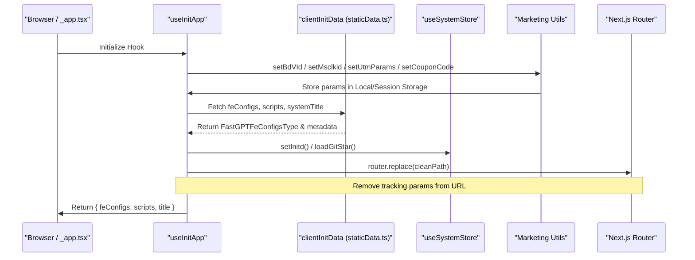
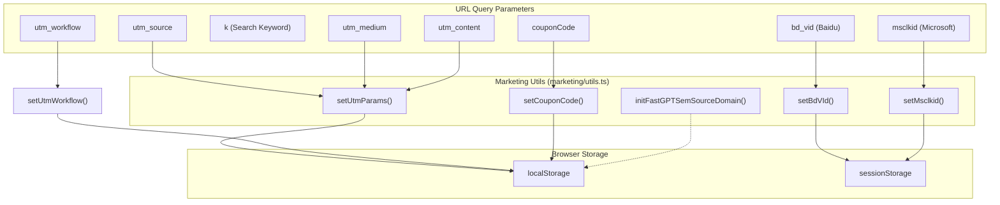
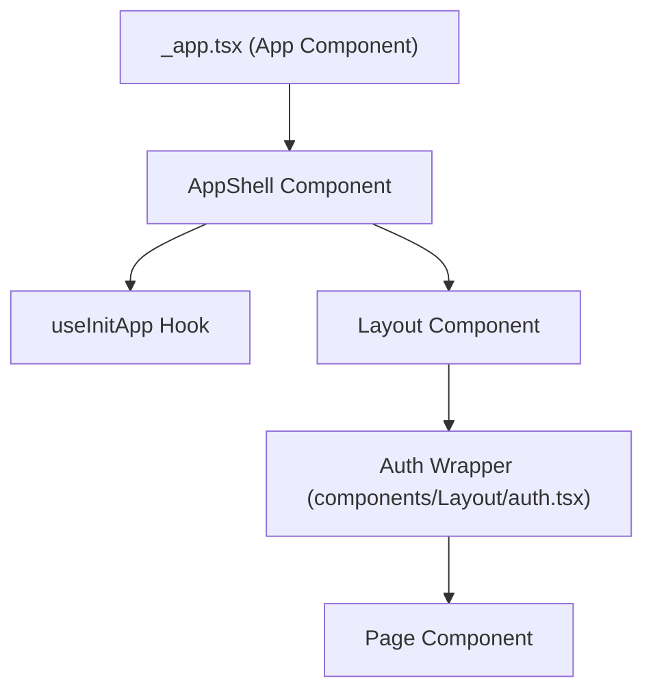

<!-- source: DeepWiki mcp.deepwiki.com · repo labring/FastGPT · page 12.2 Application Initialization Flow · fetched 2026-10-29 -->

# Application Initialization Flow

<details>
<summary>Relevant source files</summary>

The following files were used as context for generating this wiki page:

- [projects/app/src/components/Layout/index.tsx](projects/app/src/components/Layout/index.tsx)
- [projects/app/src/components/support/user/safe/SendCodeAuthModal.tsx](projects/app/src/components/support/user/safe/SendCodeAuthModal.tsx)
- [projects/app/src/pageComponents/login/ForgetPasswordForm.tsx](projects/app/src/pageComponents/login/ForgetPasswordForm.tsx)
- [projects/app/src/pageComponents/login/LoginForm/FormLayout.tsx](projects/app/src/pageComponents/login/LoginForm/FormLayout.tsx)
- [projects/app/src/pageComponents/login/LoginForm/LoginForm.tsx](projects/app/src/pageComponents/login/LoginForm/LoginForm.tsx)
- [projects/app/src/pageComponents/login/LoginForm/WechatForm.tsx](projects/app/src/pageComponents/login/LoginForm/WechatForm.tsx)
- [projects/app/src/pageComponents/login/LoginModal.tsx](projects/app/src/pageComponents/login/LoginModal.tsx)
- [projects/app/src/pageComponents/login/RegisterForm.tsx](projects/app/src/pageComponents/login/RegisterForm.tsx)
- [projects/app/src/pageComponents/login/index.tsx](projects/app/src/pageComponents/login/index.tsx)
- [projects/app/src/pages/_app.tsx](projects/app/src/pages/_app.tsx)
- [projects/app/src/pages/login/fastlogin.tsx](projects/app/src/pages/login/fastlogin.tsx)
- [projects/app/src/pages/login/index.tsx](projects/app/src/pages/login/index.tsx)
- [projects/app/src/pages/login/provider.tsx](projects/app/src/pages/login/provider.tsx)
- [projects/app/src/web/common/system/api.ts](projects/app/src/web/common/system/api.ts)
- [projects/app/src/web/context/useInitApp.ts](projects/app/src/web/context/useInitApp.ts)
- [projects/app/src/web/support/marketing/utils.ts](projects/app/src/web/support/marketing/utils.ts)
- [projects/app/src/web/support/user/api.ts](projects/app/src/web/support/user/api.ts)
- [projects/app/src/web/support/user/hooks/useSendCode.tsx](projects/app/src/web/support/user/hooks/useSendCode.tsx)
- [projects/app/test/pageComponents/login/LoginForms.test.ts](projects/app/test/pageComponents/login/LoginForms.test.ts)

</details>


## Purpose and Scope

This document describes the detailed application initialization flow executed by FastGPT when the client (browser) loads the application. It specifically focuses on the `useInitApp` hook, the fetching of initial client data (`clientInitData`), the capture and persistence of marketing parameters, and global state setup used throughout the app. Additionally, it covers how the `Layout` shell integrates with this initialization to drive secondary application lifecycle behaviors including internationalization, license/model checks, and notifications.

The purpose of this flow is to ensure essential system configuration, user tracking, and environment states are ready and synchronized before the main user experience begins.

---

## Overview

The initialization is primarily managed by the React hook `useInitApp`, which runs inside the root app provider context. On initial mount, it performs these key tasks:

1. Capture marketing parameters from query URL (e.g., Baidu/MS click IDs, UTM parameters, coupon codes).
2. Store these marketing parameters in browser storage (localStorage or sessionStorage).
3. Fetch the static client initialization data via `clientInitData()` API which includes frontend system configurations (`feConfigs`), page title, external scripts, and feature flags.
4. Update global states such as setting the "initialized" flag and loading external resources (e.g. GitHub stars).
5. Setup window error tracking hooks.
6. Clean the URL to remove marketing/tracking query parameters by replacing the browser history state.
7. Poll `clientInitData()` periodically every 5 minutes to refresh system state.

The `Layout` component acts as the main application shell and consumes the initialized configuration to manage UI visibility, language settings, license checks, unread notifications, and coupon handling.

### System Initialization Sequence Diagram



**Sources:**
- [projects/app/src/web/context/useInitApp.ts:49-186]()
- [projects/app/src/pages/_app.tsx:14-24]()

---

## useInitApp Hook Implementation

The `useInitApp` hook is responsible for bootstrapping the client-side app state. It is called at the root of the React tree to perform initialization side effects and supply configuration data.

### Core Logic Components

| Entity | Description | Location |
|--------|-------------|----------|
| `MARKETING_PARAMS` | List of query keys for marketing tracking like `bd_vid`, `msclkid`, UTM parameters, and coupon codes. | [useInitApp.ts:36-47]() |
| `getPathWithoutMarketingParams()` | Removes all marketing params from the router query and returns a clean path to replace the URL. | [useInitApp.ts:57-85]() |
| `initFetch()` | Async function that calls `clientInitData()` to fetch frontend configs and updates global store state, also sets page title. | [useInitApp.ts:87-107]() |
| `useRequest(initFetch, {...})` | Executes `initFetch` once and repeats the call every 5 minutes to refresh configs. | [useInitApp.ts:129-133]() |
| `Marketing Parameter Capture & Persistence` | Extract marketing params from query, save to localStorage/sessionStorage, and initiate URL cleanup by `router.replace`. | [useInitApp.ts:136-188]() |

### Marketing Parameter Capture and Storage Behavior

- Captures parameters like `bd_vid`, `msclkid`, `utm_source`, `utm_medium`, `utm_content`, `utm_workflow`, and `couponCode`.
- Saves IDs `bd_vid` and `msclkid` to **sessionStorage**.
- Saves UTM workflow and other UTM parameters, plus coupon codes, to **localStorage**.
- Calls `initFastGPTSemSourceDomain()` to capture the document referrer as source domain if not explicitly set.
- Removes marketing parameters from URL using a `router.replace()` call to avoid cluttering the address bar.
- Guards to ensure this logic executes only once per client session.

### Return Values

The hook exports:

- `feConfigs`: frontend system configuration object.
- `scripts`: external scripts to load dynamically.
- `title`: system page title to display in the browser tab.

---

## Marketing Parameter Capture

FastGPT tracks marketing analytics parameters for attribution and promotional tracking.

### Marketing Data Flow Diagram



### Implementation Highlights

- Functions to persist data are found in `projects/app/src/web/support/marketing/utils.ts`.
- The marketing parameters are parsed and stored during the first app mount inside `useInitApp`.
- This data is later sent with registration and login API requests to support marketing attribution.

**Sources:**
- [projects/app/src/web/context/useInitApp.ts:138-179]()
- [projects/app/src/web/support/marketing/utils.ts:1-124]()
- [projects/app/src/web/support/user/api.ts:83-93]()

---

## Global State and Layout Shell Initialization

After `useInitApp` completes its work, the app transitions to rendering the layout and page components.

### Layout Component Responsibilities

The `Layout` component (defined in `projects/app/src/components/Layout/index.tsx`) consumes system state and runs various secondary initialization and validation tasks:

- **Language Setup**  
  Syncs user or shared chat default languages via `setUserDefaultLng()` and `setShareDefaultLng()`.  
- **License and Model Configuration Checks**  
  For root users, validates if admin license is active and if LLM and Embedding models are configured. It may redirect to config page on issues.  
- **Coupon Auto-Redemption**  
  Checks for coupon codes and tries to redeem them using the `useCheckCoupon` hook.  
- **Unread Notifications**  
  Polls unread message counts for the logged-in user periodically if the commercial ("Plus") license is active.  
- **Route Management & Last Route Tracking**  
  Tracks the last visited route for navigation flow management.

### Application Component Hierarchy Diagram



This structure ensures that system-level initialization (`InitApp`) happens at the top-level context, followed by the layout shell that renders consistent UI elements like navbar, modals, and conditional wrappers.

**Sources:**
- [projects/app/src/pages/_app.tsx:14-24]()
- [projects/app/src/components/Layout/index.tsx:70-191]()

---

## Login and OAuth Provider Initialization Interaction

The initialization flow interfaces tightly with login pages and OAuth provider callbacks:

- The login page (`/login`) and provider callback page (`/login/provider`) rely on capturing initial system state (`feConfigs`) to display UI accordingly.
- On OAuth provider callback (`/login/provider.tsx`), the app uses stored information and query parameters to validate login, account cancellation, or password change flows and redirect appropriately.
- After successful login, user info is saved to global state and the user is redirected to the last accessed or fallback route.
- The login flow resets user model catalogs and triggers any post-login initialization required.

**Sources:**
- [projects/app/src/pages/login/index.tsx:13-58]()
- [projects/app/src/pages/login/provider.tsx:1-180]()

---

## Observability and Error Tracking Initialization

`useInitApp` installs a global error listener on the `window` object during mount:

- The error listener captures uncaught JavaScript errors.
- It tracks details such as user agent, platform, app name, error object, and the current URL.
- Errors are reported to the Umami analytics tool for centralized error tracking.

This listener is set up once per page load and cleaned up on unmount.

**Sources:**
- [projects/app/src/web/context/useInitApp.ts:109-127]()

---

## Configuration Data Structure

The main configuration object used during initialization is `feConfigs`, which controls feature flags, UI appearance, and external integrations.

| Key | Description |
|------|-------------|
| `isPlus` | Boolean flag enables commercial "Plus" features like usage logs and notifications. |
| `systemTitle` | The application brand title displayed in browser tab and headers. |
| `scripts` | Array of external scripts to dynamically inject for third-party services or analytics. |
| `oauth` | OAuth provider configurations (Google, GitHub, Microsoft, WeChat) with enable flags and client IDs. |
| `sso` | Single Sign-On configuration including URLs and display names for enterprise login. |
| `loginGuideDocUrl` | Optional URL for login guide documentation shown on login pages. |
| Other flags | Various system features like WeCom login, error tracking, and coupons are toggled here. |

This config is fetched through the `clientInitData` API called in `useInitApp`.

**Sources:**
- [projects/app/src/web/context/useInitApp.ts:87-107]()
- [projects/app/src/pageComponents/login/LoginForm/FormLayout.tsx:10-80]()

---

# Summary

The Application Initialization Flow consists of:

- **Client Initialization with `useInitApp` hook:** Fetches system configurations, captures marketing/tracking parameters, sets global state, and cleans up the URL.
- **Marketing/Tracking Parameter Management:** Persists tracking IDs and UTM/coupon data in browser storage for attribution and analytics continuity.
- **Secondary Initialization in Layout:** Synchronizes internationalization, validates licenses/models, polls notifications, and manages UI states.
- **OAuth and Login Interactions:** Coordinate login state and redirects with stored initialization data.
- **Observability Init:** Sets a global error handler for analytics and tracking.
- **Config Data Structure:** Feeds frontend feature toggles and important runtime parameters through `feConfigs`.

This flow ensures that all foundational data and context necessary for rendering pages and managing user sessions are available before users start interacting with the app.

---

# Appendix: Key Functions and Data Flows

```mermaid
flowchart TD
    A[Client URL Query Params] -->|marketing params| B[useInitApp Hook]
    B -->|calls| C[clientInitData API]
    C -->|returns| D[feConfigs, scripts, systemTitle]
    B -->|update| E[useSystemStore Global State]
    B -->|sets| F[Marketing Utils Store (localStorage/sessionStorage)]
    B -->|from| G[next/router with router.replace]
    B -->|sets| H[document.title]

    E -->|read| I[Layout Component]
    I -->|call| J[useCheckCoupon Hook]
    I -->|call| K[Language Setup and License Checks]
    I --> L[Render Navbar, Modals, Auth, Page]

    M[Login Flow] -->|depends on| D
    M -->|update userInfo| E
```

---

**Sources:**

- [projects/app/src/web/context/useInitApp.ts]()
- [projects/app/src/components/Layout/index.tsx]()
- [projects/app/src/pages/_app.tsx]()
- [projects/app/src/web/support/marketing/utils.ts]()
- [projects/app/src/pages/login/index.tsx]()
- [projects/app/src/pages/login/provider.tsx]()
- [projects/app/src/web/support/user/api.ts]()

---

