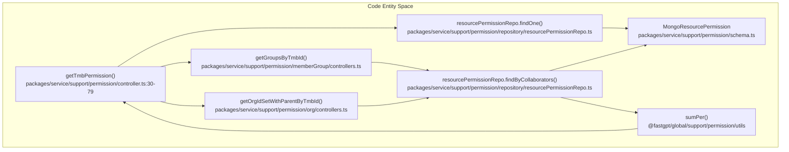
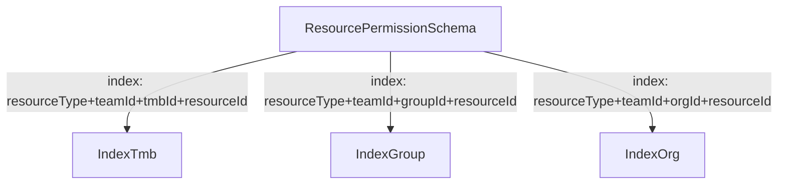
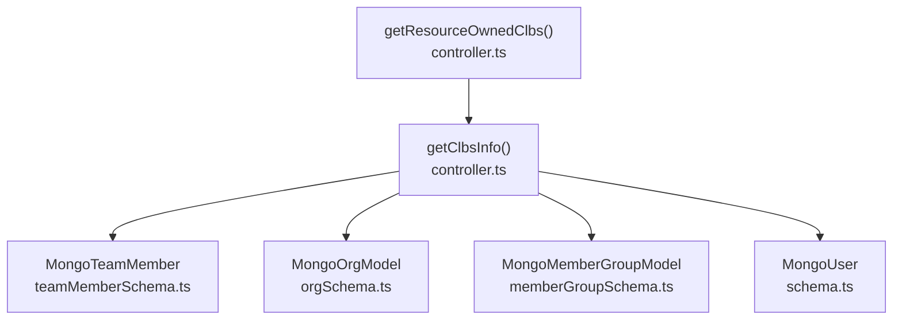
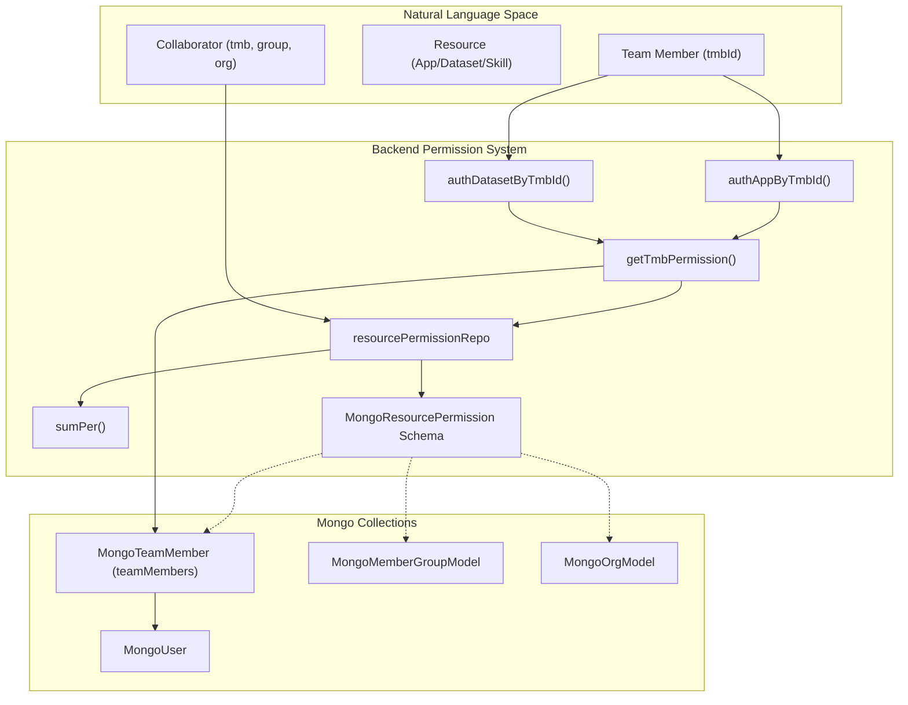

<!-- source: DeepWiki mcp.deepwiki.com · repo labring/FastGPT · page 12.3 Resource Permission System · fetched 2026-10-29 -->

# Resource Permission System

<details>
<summary>Relevant source files</summary>

The following files were used as context for generating this wiki page:

- [packages/global/common/error/code/app.ts](packages/global/common/error/code/app.ts)
- [packages/global/common/error/code/dataset.ts](packages/global/common/error/code/dataset.ts)
- [packages/service/core/dataset/controller.ts](packages/service/core/dataset/controller.ts)
- [packages/service/core/dataset/delete/processor.ts](packages/service/core/dataset/delete/processor.ts)
- [packages/service/core/dataset/schema.ts](packages/service/core/dataset/schema.ts)
- [packages/service/env.util.ts](packages/service/env.util.ts)
- [packages/service/global.d.ts](packages/service/global.d.ts)
- [packages/service/support/permission/app/auth.ts](packages/service/support/permission/app/auth.ts)
- [packages/service/support/permission/controller.ts](packages/service/support/permission/controller.ts)
- [packages/service/support/permission/dataset/auth.ts](packages/service/support/permission/dataset/auth.ts)
- [packages/service/support/permission/repository/resourcePermissionRepo.ts](packages/service/support/permission/repository/resourcePermissionRepo.ts)
- [packages/service/support/permission/resourcePermissionService.ts](packages/service/support/permission/resourcePermissionService.ts)
- [packages/service/support/permission/schema.ts](packages/service/support/permission/schema.ts)
- [packages/service/support/user/systemUser.ts](packages/service/support/user/systemUser.ts)
- [packages/service/support/user/team/controller.ts](packages/service/support/user/team/controller.ts)
- [packages/service/test/core/dataset/delete/processor.test.ts](packages/service/test/core/dataset/delete/processor.test.ts)
- [packages/service/test/support/permission/app/auth.test.ts](packages/service/test/support/permission/app/auth.test.ts)
- [packages/service/test/support/permission/controller.test.ts](packages/service/test/support/permission/controller.test.ts)
- [packages/service/test/support/permission/resourcePermissionRepo.test.ts](packages/service/test/support/permission/resourcePermissionRepo.test.ts)
- [packages/service/test/support/user/systemUser.test.ts](packages/service/test/support/user/systemUser.test.ts)
- [packages/web/hooks/useTableMultipleSelect.tsx](packages/web/hooks/useTableMultipleSelect.tsx)
- [packages/web/i18n/ko-KR/dataset.json](packages/web/i18n/ko-KR/dataset.json)
- [projects/app/src/components/core/ai/ModelTable/index.tsx](projects/app/src/components/core/ai/ModelTable/index.tsx)
- [projects/app/src/components/support/permission/MemberManager/MemberItemCard.tsx](projects/app/src/components/support/permission/MemberManager/MemberItemCard.tsx)
- [projects/app/src/components/support/permission/MemberManager/RoleSelect.tsx](projects/app/src/components/support/permission/MemberManager/RoleSelect.tsx)
- [projects/app/src/components/support/permission/MemberManager/context.tsx](projects/app/src/components/support/permission/MemberManager/context.tsx)
- [projects/app/src/components/support/user/team/OrgTags/index.tsx](projects/app/src/components/support/user/team/OrgTags/index.tsx)
- [projects/app/src/instrumentation-node.ts](projects/app/src/instrumentation-node.ts)
- [projects/app/src/pageComponents/account/team/PermissionManage/index.tsx](projects/app/src/pageComponents/account/team/PermissionManage/index.tsx)
- [projects/app/src/pageComponents/dataset/detail/Import/commonProgress/Upload.tsx](projects/app/src/pageComponents/dataset/detail/Import/commonProgress/Upload.tsx)
- [projects/app/src/pages/api/core/app/del.ts](projects/app/src/pages/api/core/app/del.ts)
- [projects/app/src/pages/api/core/dataset/delete.ts](projects/app/src/pages/api/core/dataset/delete.ts)
- [projects/app/test/api/core/dataset/collection/create/reTrainingCollection.test.ts](projects/app/test/api/core/dataset/collection/create/reTrainingCollection.test.ts)
- [projects/app/test/components/support/permission/MemberManager/RoleSelect.test.ts](projects/app/test/components/support/permission/MemberManager/RoleSelect.test.ts)

</details>


## Purpose and Scope

This document describes the **Resource Permission System** in FastGPT, which implements a granular permission model controlling access to core resources such as applications (apps), datasets, and skills. It supports multiple levels of authorization by combining:

- Direct permissions assigned to individual team members
- Permissions inherited from member groups and organizational units
- Folder-based and hierarchical inheritance of permissions
- Collaborator management and roles (Owner, Manager, Reader, etc.)

This page covers the detailed implementation of permission data structures, key permission resolution functions, collaborator metadata management, and key components used in access control checks.

For related topics on authentication and broader team/org management, see sections [12.1 User and Team Authentication](12.1), and for permission inheritance details see [12.4 Permission Inheritance Model](12.4).

---

## Permission Resolution Architecture & Data Flow

The permission system operates as a middleware layer between the API endpoints receiving requests and the underlying MongoDB models storing resource information. It determines the effective permission of a team member (`tmbId`) on a resource by querying ACL entries both directly and indirectly assigned via groups and orgs.

### Permission Retrieval Flow



The workflow:

- The main function `getTmbPermission` fetches a team member’s permission for a resource.
- It first queries directly assigned permissions for the `tmbId`.
- If no direct permission, it concurrently fetches groups and organizations memberships for the member.
- It then queries ACLs for these groups and orgs and aggregates their permissions.
- The aggregation sums bitmask roles to produce effective permissions.

**Sources:**  
`packages/service/support/permission/controller.ts:30-79`  
`packages/service/support/permission/schema.ts:14-56`

---

## `MongoResourcePermission` Schema and Indexes

The core ACL records are stored in MongoDB under the `resource_permissions` collection, defined by the Mongoose schema `ResourcePermissionSchema`. Each document represents an ACL entry for a resource and associates permission roles to a collaborator (team member, group, or organization).

### Schema Fields

| Field | Type | Description |
|-------|------|-------------|
| `teamId` | ObjectId | Team owning the resource (`TeamCollectionName`) [lines 15-19] |
| `tmbId` | ObjectId (optional) | Team member ID for direct assignment [lines 20-23] |
| `groupId` | ObjectId (optional) | Member group ID for group-based permissions [lines 24-27] |
| `orgId` | ObjectId (optional) | Organization ID for org-level permissions [lines 28-31] |
| `resourceType` | String | Discriminator for resource type, from enum `PerResourceTypeEnum` [lines 32-36] |
| `permission` | Number | Bitmask representing permissions/roles granted [lines 40-43] |
| `resourceId` | ObjectId (optional) | The actual resource instance's id [lines 45-48] |
| `resourceName` | String (optional) | Used instead of id for resources identified by name [lines 50-55] |

### Virtuals and Indexes

- Virtuals allow population of detailed collaborator info (team member, group, or org) in queries [lines 58-75].
- Multiple unique partial indexes guarantee uniqueness of collaborations by collaborator and resource [lines 77-319].



**Sources:**  
`packages/service/support/permission/schema.ts:12-236`

---

## Permission Resolution Logic (`getTmbPermission` and Bitmask Aggregation)

The main function for resolving permissions is:

### `getTmbPermission`

```ts
async function getTmbPermission({
  resourceType,
  teamId,
  tmbId,
  resourceId
}): Promise<PermissionValueType | undefined> {
  // 1. Try to find personal direct permission for team member
  const personalPermission = await resourcePermissionRepo.findOne({
    resourceType,
    teamId,
    resourceId,
    collaborator: { tmbId }
  });

  if (personalPermission !== undefined) {
    return personalPermission;
  }

  // 2. Fetch groups and orgs memberships for the team member concurrently
  const [groups, orgIds] = await Promise.all([
    getGroupsByTmbId({ tmbId, teamId }),
    getOrgIdSetWithParentByTmbId({ tmbId, teamId })
  ]);

  // 3. Query permissions assigned to groups/orgs on this resource
  const permissions = await resourcePermissionRepo.findByCollaborators({
    resourceType,
    teamId,
    resourceId,
    collaborators: [
      ...groups.map(group => ({ groupId: String(group._id) })),
      ...Array.from(orgIds).map(orgId => ({ orgId: String(orgId) }))
    ]
  });

  // 4. Aggregate all inherited permissions using bitwise OR
  return sumPer(...permissions.map(item => item.permission));
}
```

- Priority is personal > group > organization
- If no record found returns `undefined`
- Uses `sumPer` utility to perform bitwise OR to combine roles.

This method is also used to batch resolve permissions for multiple resource IDs in `getTmbPermissionMap` which handles 1000 resources per batch and merges personal and inherited permissions.

---

## Collaborator Metadata & ACL Management (`getClbsInfo` and `getResourceOwnedClbs`)

To present ACL collaborators with rich information (name, avatar), FastGPT provides helper functions:



### Key Functions

- **`getResourceOwnedClbs`** — fetches all direct ACL entries for a resource, filtering by resource type, team, and resource ID [lines 126-150].
- **`getResourceOwnedClbsByResourceIds`** — batch fetch ACL entries for multiple resources within a team [lines 153-172].
- **`getClbsInfo`** — batches lookup and enriches collaborator items by querying underlying user/group/org collections:
  - Queries `MongoTeamMember` for team member info (name, avatar, userId)
  - Queries `MongoOrgModel` for organization info
  - Queries `MongoMemberGroupModel` for group info
  - Uses `MongoUser` for user/username resolution
  - Resolves default avatars if missing
  - Constructs `Permission` instances for role interpretation [lines 174-196].
- **`createResourceDefaultCollaborators`** — sets initial ACL records for resources upon creation to assign ownership [lines 199-213].

This layered approach allows avoiding N+1 database queries and aggregates collaborator display info consistently.

**Sources:**  
`packages/service/support/permission/controller.ts:126-213`

---

## Application and Dataset Permission Authentication

FastGPT provides specialized permission authentication functions for apps and datasets, for example:

### `authAppByTmbId`

- Validates and retrieves app resource permissions for a team member `tmbId`.
- Checks resource existence, team membership, and owner status.
- Supports inheritance from parent folder permissions.
- Handles special app types like `hidden`, changing permission rules accordingly.
- Grants owner role if `tmbId` matches app owner or team owner (except agent users).
- Returns effective `AppPermission` object for downstream enforcement [packages/service/support/permission/app/auth.ts:48-146].

### `authDatasetByTmbId`

- Similar to app auth but for dataset resources.
- Verifies dataset existence and membership.
- Supports permission inheritance from parent folders.
- Validates required permission bits.
- Uses `DatasetPermission` class to encapsulate roles [packages/service/support/permission/dataset/auth.ts:38-110].

These auth functions utilize the generic underlying ACL resolution method `getTmbPermission` and apply domain-specific logic for ownership and inherited permissions.

**Sources:**  
`packages/service/support/permission/app/auth.ts:48-146`  
`packages/service/support/permission/dataset/auth.ts:38-110`

---

## Permission Roles and Bitmask Model

Role permissions are encoded as bitmasks (`number` values) to efficiently represent multiple privileges per user. Roles cover common cases:

| Role Name          | Description                                   | Representation/Use                                  |
|--------------------|-----------------------------------------------|---------------------------------------------------|
| `OwnerRoleVal`       | Full control over resource (edit, delete)     | Used to identify owners who have implicit rights. |
| `ManageRoleVal`      | Manage collaborators and settings              | Middle-level management roles.                     |
| `ReadRoleVal`        | View/read access only                           | Basic permissions to consume resource content.    |
| `WritePermissionVal` | Write/edit access                              | Permission to modify objects.                       |

The `Permission` classes (e.g., `AppPermission`, `DatasetPermission`, generic `Permission`) encapsulate bitmask checks and convenience methods like `hasReadPer`, `hasWritePer`, and `isOwner`.

Bitmask aggregation is performed with the utility `sumPer` which combines multiple permission values by bitwise OR.

**Sources:**  
`packages/service/support/permission/controller.ts`  
`packages/service/support/permission/app/auth.ts`  
`packages/service/support/permission/dataset/auth.ts`

---

## Collaborator Management UI Context

The frontend uses a React context provider `CollaboratorContextProvider` to manage collaborator data and permission updates in the UI:

- Loads collaborators and parent collaborators asynchronously.
- Supports roles translation via role constants lists.
- Handles collaborators update, deletion, and UI refresh.
- Integrates with API by calling props passed handlers [projects/app/src/components/support/permission/MemberManager/context.tsx].

This decouples UI components from core permission controller logic, allowing rich collaborator management interfaces with role-based labels and permission updates.

**Sources:**  
`projects/app/src/components/support/permission/MemberManager/context.tsx`

---

## System User and Agent User Considerations

- Agent users are special built-in developer accounts represented as team members.
- Their IDs are globally cached to protect against permission bypass.
- Root user and agent users are initialized with lease-controlled creation logic ensuring consistency in distributed deployments [packages/service/support/user/systemUser.ts].
- Apps created by agent users require explicit ACL checks even for root or team owner — no implicit ownership granted [packages/service/support/permission/app/auth.ts].

---

# Summary Diagram: Natural Language to Code Entity Mapping



This diagram links user/resource concepts in natural language to key backend code entities involved in permission resolution, showing flow from authentication layers down to MongoDB models.

---

# Summary

FastGPT's resource permission system implements a complex, yet performant multi-layer access control model:

- Resources have permission ACLs stored in MongoDB with entries for individuals, groups, and orgs.
- Permissions aggregate bitmask roles with owner, manager, and reader semantics.
- Permissions are inherited optionally via parent folders.
- Collaborator metadata is enriched for UI consumption.
- Special handling exists for built-in agent users and root auth.
- Permission resolution is centralized in `getTmbPermission` and used by app/dataset auth services.

This ensures flexible yet secure authorization for collaborative resource management.

---

# References (Code Citations)

- `packages/service/support/permission/controller.ts:30-121`  
- `packages/service/support/permission/schema.ts:12-236`  
- `packages/service/support/permission/app/auth.ts:48-146`  
- `packages/service/support/permission/dataset/auth.ts:38-110`  
- `projects/app/src/components/support/permission/MemberManager/context.tsx`  
- `packages/service/support/user/systemUser.ts`

---

