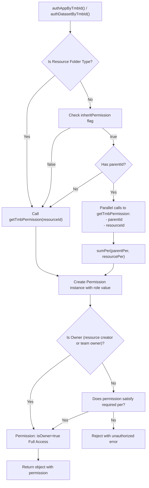
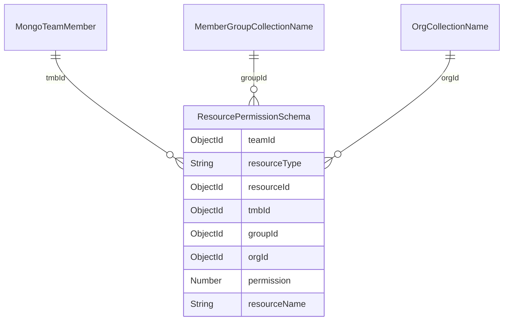

<!-- source: DeepWiki mcp.deepwiki.com · repo labring/FastGPT · page 12.4 Permission Inheritance Model · fetched 2026-10-29 -->

# Permission Inheritance Model

<details>
<summary>Relevant source files</summary>

The following files were used as context for generating this wiki page:

- [packages/service/core/dataset/schema.ts](packages/service/core/dataset/schema.ts)
- [packages/service/env.util.ts](packages/service/env.util.ts)
- [packages/service/global.d.ts](packages/service/global.d.ts)
- [packages/service/support/permission/app/auth.ts](packages/service/support/permission/app/auth.ts)
- [packages/service/support/permission/app/resource.ts](packages/service/support/permission/app/resource.ts)
- [packages/service/support/permission/controller.ts](packages/service/support/permission/controller.ts)
- [packages/service/support/permission/dataset/auth.ts](packages/service/support/permission/dataset/auth.ts)
- [packages/service/support/permission/repository/resourcePermissionRepo.ts](packages/service/support/permission/repository/resourcePermissionRepo.ts)
- [packages/service/support/permission/resourcePermissionService.ts](packages/service/support/permission/resourcePermissionService.ts)
- [packages/service/support/user/systemUser.ts](packages/service/support/user/systemUser.ts)
- [packages/service/support/user/team/controller.ts](packages/service/support/user/team/controller.ts)
- [packages/service/test/support/permission/app/auth.test.ts](packages/service/test/support/permission/app/auth.test.ts)
- [packages/service/test/support/permission/controller.test.ts](packages/service/test/support/permission/controller.test.ts)
- [packages/service/test/support/permission/resourcePermissionRepo.test.ts](packages/service/test/support/permission/resourcePermissionRepo.test.ts)
- [packages/service/test/support/user/systemUser.test.ts](packages/service/test/support/user/systemUser.test.ts)
- [projects/app/src/instrumentation-node.ts](projects/app/src/instrumentation-node.ts)
- [projects/app/src/migration/tasks/4171/20260916_backfill_app_resource_snapshots/index.ts](projects/app/src/migration/tasks/4171/20260916_backfill_app_resource_snapshots/index.ts)
- [projects/app/src/migration/tasks/4171/20260916_backfill_app_resource_snapshots/service.ts](projects/app/src/migration/tasks/4171/20260916_backfill_app_resource_snapshots/service.ts)
- [projects/app/src/pageComponents/dataset/detail/Import/commonProgress/Upload.tsx](projects/app/src/pageComponents/dataset/detail/Import/commonProgress/Upload.tsx)
- [projects/app/test/api/core/dataset/collection/create/reTrainingCollection.test.ts](projects/app/test/api/core/dataset/collection/create/reTrainingCollection.test.ts)
- [projects/app/test/migration/tasks/4171/20260916_backfill_app_resource_snapshots/index.test.ts](projects/app/test/migration/tasks/4171/20260916_backfill_app_resource_snapshots/index.test.ts)
- [projects/app/test/migration/tasks/4171/20260916_backfill_app_resource_snapshots/service.test.ts](projects/app/test/migration/tasks/4171/20260916_backfill_app_resource_snapshots/service.test.ts)

</details>


## Purpose and Scope

This page provides detailed technical documentation for FastGPT's permission inheritance model which governs hierarchical folder-based permission management for resources such as Apps and Datasets. It explains how permissions are inherited from parent folders, how the effective permission of a resource is computed combining inherited and direct permissions, and the key functions/classes involved like `sumPer` and `getTmbPermission`.

This document complements the general [Resource Permission System (12.3)](12.3) and user authentication docs ([User and Team Authentication (12.1)](12.1)).

---

## Core Concepts

### `inheritPermission` Flag

Each resource (app, dataset, etc.) contains an `inheritPermission` boolean flag that controls whether the resource inherits permissions from its parent folder:

- When `true`, the resource's effective permissions are computed as an aggregate of its parent's permissions plus any direct permissions assigned specifically to the resource.
- When `false`, the resource's effective permissions are only based on direct assignments without inheritance.

This provides granular control allowing folder-level permissions to cascade automatically to child resources if desired.

---

### Folder Hierarchy and Permission Inheritance

Resources are stored in a hierarchical parent-child tree, where folders can contain other folders and resources. The model supports:

- **Folder resources** acting as permission containers.
- **Non-folder resources** optionally inheriting permissions from their folder ancestors.
- Permission queries consult both the resource's ACL and its parent folder's ACL if inheritance is enabled.

---

### Permission Aggregation via `sumPer`

The utility function `sumPer` performs permission aggregation by bitwise OR (logical addition), ensuring that the user’s effective permission across different permission sources (personal, group, org, parent folder) is the **maximum** permission available.

Example:

- If parent folder grants `Read` (bit value 1) and the resource itself grants `Write` (bit value 2), `sumPer` yields `Read + Write` (bitwise OR = 3).

This additive model ensures permission inheritance is cumulative.

---

## Permission Resolution Algorithm

The core algorithm calculates a *team member's* effective permission on a resource by:

1. Checking **personal permissions** for the resource.
2. If missing, checking **group permissions** (team member’s groups).
3. Checking **organization permissions** (nested org hierarchy).
4. If the resource has `inheritPermission: true` and a parent folder exists, recursively obtain the parent’s permission and combine (sum) it with the resource permission.
5. Compare the aggregated permission against the requested permission and allow/deny access accordingly.

---

### Entry Points: Resource Authorization Functions

- `authAppByTmbId()`: Authorizes an app for a team member, computes effective permission, considers inheritance and special app types like "hidden" apps. Returns the app including a permission object. [packages/service/support/permission/app/auth.ts:48-146]()
  
- `authDatasetByTmbId()`: Similar logic for datasets, validating permissions and inheritance from parent collection/folder. [packages/service/support/permission/dataset/auth.ts:38-111]()

Both functions use `getTmbPermission()` to fetch permissions and use `sumPer` to aggregate permissions.

---

### `authAppByTmbId()` Permission Check Flow

This function illustrates inheritance in action for apps:

- Loads app metadata and team member info.
- Checks if `inheritPermission` is set and app has a `parentId`.
- If yes, calls `getTmbPermission()` twice:
  - Once for the folder (parent resource)
  - Once for the app itself
- Combines permissions by `sumPer` to compute effective role.
- Special treatment for hidden apps where only read access is granted with restrictions on chat logs.
- Ownership is set if the app creator matches the team member, or team owner if applicable.
- Throws authorization errors if the effective permission does not satisfy required permission.

---

### Permission Lookup with `getTmbPermission()`

The backbone of permission retrieval is `getTmbPermission()`:

1. **Personal Permission Lookup:** Queries `resourcePermissionRepo` for personal ACL record for the member.
2. **Group & Org Permission Lookup:** If no personal permission is found, fetches all groups the member belongs to + relevant org IDs.
3. **Permission Aggregation:** Aggregates all group+org permissions using `sumPer`.
4. **Return:** Returns the final permission or 0 if none found.

This efficiently implements the hierarchical and additive nature of permissions.

---

## Bridging Natural Language to Code Entities

### Diagram 1: Permission Resolution Data Flow in Code



**Sources:**
- [packages/service/support/permission/app/auth.ts:48-146]()
- [packages/service/support/permission/controller.ts:30-79]()

---

## Key Functions and Classes

### `getTmbPermission(opts)`

Fetches a team member's highest permission value on a resource.

- Personal ACL for member (highest priority)
- Fallbacks to groups/org aggregate permission using `sumPer`
- Returns numeric permission bits or undefined

```ts
export const getTmbPermission = async ({ resourceType, teamId, tmbId, resourceId }) => {
  // Personal permission lookup in resourcePermissionRepo
  // If missing, fetch groups/orgs & permission aggregation
  // Return sumPer result or 0
};
```
Located at [packages/service/support/permission/controller.ts:30-79]()

---

### `sumPer(...perms)`

Utility to combine multiple permission bit masks by bitwise OR, returning the union of permissions.

Example:
```ts
sumPer(ReadPermissionVal, WritePermissionVal) === (ReadPermissionVal | WritePermissionVal)
```

Located at [packages/service/support/permission/utils.ts:9]() (imported and used extensively)

---

### `AppPermission` / `DatasetPermission` Classes

Encapsulate permission roles and flags with helper methods such as `checkPer()` to validate if the permission satisfies the requested permission level, and `addRole()` to add extra permission bits (e.g., read for favorites).

Used in [packages/service/support/permission/app/auth.ts:48-146](), [packages/service/support/permission/dataset/auth.ts:38-111]()

---

## Permission Data Model

### ResourcePermissionSchema

- Stored in MongoDB collection `resource_permissions`
- Fields:
  - `teamId`: Team association
  - `resourceType`: Type of resource (app, dataset, team, etc.)
  - `resourceId`: Unique resource id
  - Collaborator identifiers:
    - `tmbId`: team member id for personal permission
    - `groupId`: group id for group permissions
    - `orgId`: org id for org-level permissions
  - `permission`: Numeric permission bits
  - `resourceName`: Optional

### Indexes and Constraints

- Compound indexes on (`resourceType`, `teamId`, `resourceId`, `tmbId`, `groupId`, `orgId`) optimize lookups
- Strict schema validation enforces allowed resource type values and collaborator id exclusivity

Diagram:



**Sources:**
- [packages/service/support/permission/schema.ts:14-159]()

---

## Effective Permission Computation Examples

### App Authorization Example (`authAppByTmbId`)

- Check if app exists and belongs to team
- For `inheritPermission=true` on non-folder type with parentId, fetch parent folder permission + app permission and combine
- Account for ownership by app creator or team owner
- Add read roles if app is marked favorite or quick access
- Final permission checked against requested permission per
- Hidden apps grant read permission but restrict log access based on manage permission

---

### Dataset Authorization Example (`authDatasetByTmbId`)

- Similar to app, but considers Dataset folder type and collection-level permissions
- Validates dataset ownership and team membership
- Checks inheritance on dataset parent folder if applicable
- Summation of parent and child permissions yields effective access rights

---

## Summary Table of Permission Inheritance Rules

| Rule | Description | Source Reference |
|-------|-------------|-----------------|
| Permission Priority | Personal ACL > Group ACL > Organization ACL | [getTmbPermission()] packages/service/support/permission/controller.ts:30-79 |
| Inheritance Flag | `inheritPermission` enables parent folder permission inheritance | [authAppByTmbId()] packages/service/support/permission/app/auth.ts:48-146 |
| Additive Permission | Permissions from parent + direct combined by `sumPer` (bitwise OR) | [sumPer()] packages/service/support/permission/utils.ts |
| Owner Override | App creator or team owner gets `isOwner` flag granting full access | [authAppByTmbId()] packages/service/support/permission/app/auth.ts |
| Read Access for Favorites | Favorite or quick-access apps get appended read permissions | [authAppByTmbId()] packages/service/support/permission/app/auth.ts |
| Hidden App Restrictions | Hidden apps allow read to team members, but restrict log access to managers | [authAppByTmbId()] packages/service/support/permission/app/auth.ts |

---

## Additional Diagrams: Bridging Natural Language to Code

### Diagram 2: Folder Inheritance and Permission Aggregation for Apps

```mermaid
flowchart TD
    Folder["Parent Folder Resource"] -->|Permission| FolderACL[getTmbPermission(parentId)]
    App["App Resource"]
    App -->|Direct Permission| AppACL[getTmbPermission(appId)]
    FolderACL -.->|sumPer| CombinedPermission[sumPer(folderPer, appPer)]
    AppACL -.->|sumPer| CombinedPermission
    CombinedPermission --> AppPermissionObj[new AppPermission({ role: CombinedPermission })]
    AppPermissionObj --> AuthResult["Authorization result in authAppByTmbId()"]
```

**Sources:**
- [packages/service/support/permission/app/auth.ts:48-146]()
- [packages/service/support/permission/controller.ts:30-79]()

---

## Summary

FastGPT’s permission inheritance model effectively supports hierarchical permission delegation with strong support for additive permissions, resource ownership, and fine-grained access control. The blend of direct resource permissions and inherited folder permissions balances flexibility with scalable security administration.

Key functions like `getTmbPermission` and `sumPer` implement the core logic, while authorization entry points such as `authAppByTmbId` and `authDatasetByTmbId` orchestrate permission retrieval and enforcement across resource types.

---

### References

- `authAppByTmbId` and permission aggregation: [packages/service/support/permission/app/auth.ts:48-146]()
- Permission controller and `getTmbPermission`: [packages/service/support/permission/controller.ts:30-79]()
- Dataset auth and inheritance: [packages/service/support/permission/dataset/auth.ts:38-111]()
- Permission schema: [packages/service/support/permission/schema.ts:14-159]()
- Permission utils (`sumPer`): imported in multiple files, see [packages/service/support/permission/app/auth.ts:22]() for usage example

---

This concludes the detailed technical documentation for FastGPT’s Permission Inheritance Model.

---

