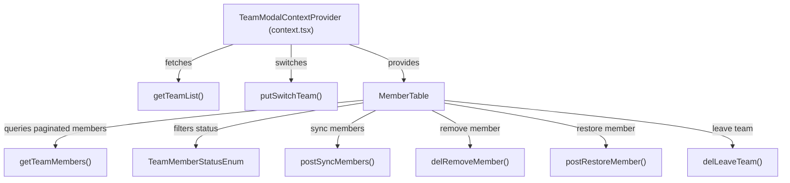
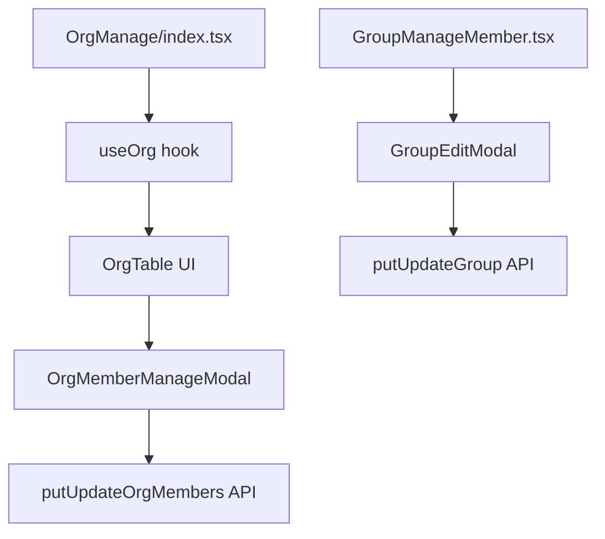
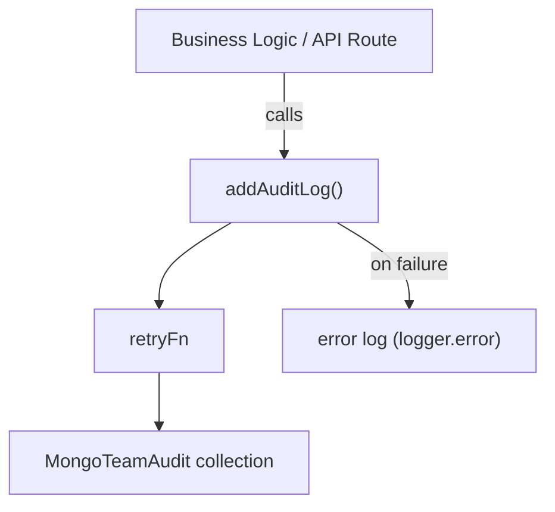

<!-- source: DeepWiki mcp.deepwiki.com · repo labring/FastGPT · page 12.5 Teams, Organizations and Audit Logs · fetched 2026-10-29 -->

# Teams, Organizations and Audit Logs

<details>
<summary>Relevant source files</summary>

The following files were used as context for generating this wiki page:

- [packages/global/openapi/support/user/team/api.ts](packages/global/openapi/support/user/team/api.ts)
- [packages/global/openapi/support/user/team/member/api.ts](packages/global/openapi/support/user/team/member/api.ts)
- [packages/global/support/user/account/cancellation/type.ts](packages/global/support/user/account/cancellation/type.ts)
- [packages/global/support/user/audit/constants.ts](packages/global/support/user/audit/constants.ts)
- [packages/global/support/user/team/type.ts](packages/global/support/user/team/type.ts)
- [packages/global/support/user/type.ts](packages/global/support/user/type.ts)
- [packages/global/test/openapi/support/user/account/login/api.test.ts](packages/global/test/openapi/support/user/account/login/api.test.ts)
- [packages/global/test/openapi/support/user/api.test.ts](packages/global/test/openapi/support/user/api.test.ts)
- [packages/service/support/user/audit/util.ts](packages/service/support/user/audit/util.ts)
- [packages/service/support/user/controller.ts](packages/service/support/user/controller.ts)
- [packages/service/test/support/user/audit/util.test.ts](packages/service/test/support/user/audit/util.test.ts)
- [packages/web/i18n/en/account_team.json](packages/web/i18n/en/account_team.json)
- [packages/web/i18n/ko-KR/account_team.json](packages/web/i18n/ko-KR/account_team.json)
- [packages/web/i18n/zh-CN/account_team.json](packages/web/i18n/zh-CN/account_team.json)
- [packages/web/i18n/zh-Hant/account_team.json](packages/web/i18n/zh-Hant/account_team.json)
- [packages/web/support/user/audit/constants.ts](packages/web/support/user/audit/constants.ts)
- [projects/app/src/components/support/activity/ActivityAdModal.tsx](projects/app/src/components/support/activity/ActivityAdModal.tsx)
- [projects/app/src/components/support/permission/MemberManager/MemberModal.tsx](projects/app/src/components/support/permission/MemberManager/MemberModal.tsx)
- [projects/app/src/pageComponents/account/TeamSelector.tsx](projects/app/src/pageComponents/account/TeamSelector.tsx)
- [projects/app/src/pageComponents/account/team/GroupManage/GroupInfoModal.tsx](projects/app/src/pageComponents/account/team/GroupManage/GroupInfoModal.tsx)
- [projects/app/src/pageComponents/account/team/GroupManage/GroupManageMember.tsx](projects/app/src/pageComponents/account/team/GroupManage/GroupManageMember.tsx)
- [projects/app/src/pageComponents/account/team/GroupManage/GroupTransferOwnerModal.tsx](projects/app/src/pageComponents/account/team/GroupManage/GroupTransferOwnerModal.tsx)
- [projects/app/src/pageComponents/account/team/GroupManage/index.tsx](projects/app/src/pageComponents/account/team/GroupManage/index.tsx)
- [projects/app/src/pageComponents/account/team/MemberTable.tsx](projects/app/src/pageComponents/account/team/MemberTable.tsx)
- [projects/app/src/pageComponents/account/team/OrgManage/OrgInfoModal.tsx](projects/app/src/pageComponents/account/team/OrgManage/OrgInfoModal.tsx)
- [projects/app/src/pageComponents/account/team/OrgManage/OrgMemberManageModal.tsx](projects/app/src/pageComponents/account/team/OrgManage/OrgMemberManageModal.tsx)
- [projects/app/src/pageComponents/account/team/OrgManage/OrgMoveModal.tsx](projects/app/src/pageComponents/account/team/OrgManage/OrgMoveModal.tsx)
- [projects/app/src/pageComponents/account/team/OrgManage/index.tsx](projects/app/src/pageComponents/account/team/OrgManage/index.tsx)
- [projects/app/src/pageComponents/account/team/TransferOwnershipModal.tsx](projects/app/src/pageComponents/account/team/TransferOwnershipModal.tsx)
- [projects/app/src/pageComponents/account/team/context.tsx](projects/app/src/pageComponents/account/team/context.tsx)
- [projects/app/src/pages/account/team/index.tsx](projects/app/src/pages/account/team/index.tsx)
- [projects/app/src/pages/api/core/app/detail.ts](projects/app/src/pages/api/core/app/detail.ts)
- [projects/app/src/web/support/user/loginRedirect/index.ts](projects/app/src/web/support/user/loginRedirect/index.ts)
- [projects/app/src/web/support/user/team/group/api.ts](projects/app/src/web/support/user/team/group/api.ts)
- [projects/app/src/web/support/user/team/org/api.ts](projects/app/src/web/support/user/team/org/api.ts)
- [projects/app/src/web/support/user/team/org/hooks/useOrg.tsx](projects/app/src/web/support/user/team/org/hooks/useOrg.tsx)
- [projects/app/test/api/core/app/detail.test.ts](projects/app/test/api/core/app/detail.test.ts)
- [projects/app/test/api/support/user/account/tokenLogin.test.ts](projects/app/test/api/support/user/account/tokenLogin.test.ts)
- [projects/app/test/web/support/user/loginRedirect.test.ts](projects/app/test/web/support/user/loginRedirect.test.ts)
- [projects/code-sandbox/src/pool/base-process-pool.ts](projects/code-sandbox/src/pool/base-process-pool.ts)
- [projects/code-sandbox/test/unit/base-process-pool.test.ts](projects/code-sandbox/test/unit/base-process-pool.test.ts)

</details>


## Purpose and Scope
This page documents the technical implementation of FastGPT’s multi-tenant collaboration system, covering team member management, hierarchical organization (department) trees, member groups, granular permission controls, ownership transfer semantics, and the audit logging subsystem. These features enable enterprise-grade tenancy isolation, administrative tracking, and role-based access control (RBAC).

---

## 1. Team Management and Member UI

FastGPT organizes users into teams, where each user can belong to multiple teams with distinct roles (`owner`, `admin`, `member`) and statuses (`active`, `leave`, `forbidden`). The team session and switching state are centrally managed by the `TeamModalContextProvider` React context component. It:

- Fetches the active team list via the API function `getTeamList()`.
- Provides a method `onSwitchTeam()` that calls `putSwitchTeam()` to update the user's active team on the backend.
- Resets cached chat state and manages route changes on effective switching.

The provider is defined in `projects/app/src/pageComponents/account/team/context.tsx` and manages state such as loading indicators, the currently editable team for settings, and team size (member count) [projects/app/src/pageComponents/account/team/context.tsx:46-90]().

Team members within a selected team are listed in the `MemberTable` component, implementing:

- Server-paginated loading using the hook `useScrollPagination` that queries the backend API `getTeamMembers`.
- Status filtering via `TeamMemberStatusEnum` values (`active`, `leave`, `forbidden`).
- Member search filter and debounce/throttle mechanisms.
- Member actions such as syncing members (`postSyncMembers`), removing members (`delRemoveMember`), restoring members (`postRestoreMember`), and leaving teams (`delLeaveTeam`).
- Editing member display names by managers calling `putUpdateMemberNameByManager()`.


*Figure 1: Team global context and member table interaction flow.*

Sources:  
- `projects/app/src/pageComponents/account/team/context.tsx:46-90`  
- `projects/app/src/pageComponents/account/team/MemberTable.tsx:56-170`  

---

## 2. Organizations (Departments) and Member Groups

FastGPT extends team membership with hierarchical organizational units ("organizations" or departments) and user groups to facilitate structured resource management.

### Organization Management

- The `OrgManage` UI is based on the `OrgTable` component that displays organizational units as navigable paths and lists sub-orgs and members.
- The organizational hierarchy is managed by the `useOrg` hook, which fetches org and member data.
- Org members and sub-orgs can be added, removed, or moved with APIs like `deleteOrg()`, `deleteOrgMember()`, and `putUpdateOrgMembers()`.
- Org member management modals (`OrgMemberManageModal`) enable granular control of memberships and roles within organizations [projects/app/src/pageComponents/account/team/OrgManage/index.tsx:74-135]() and related modals [projects/app/src/pageComponents/account/team/OrgManage/OrgMemberManageModal.tsx:23-88]().  

### Group Management

- Groups are collections of team members managed independently from orgs, used primarily for permission control and sharing.
- The `GroupManageMember` and `GroupEditModal` components allow owner/admin users to manage group membership and roles (`owner`, `admin`, `member`) [projects/app/src/pageComponents/account/team/GroupManage/GroupManageMember.tsx:33-110]().


*Figure 2: Organization and group management workflow.*

Sources:  
- `projects/app/src/pageComponents/account/team/OrgManage/index.tsx:74-135`  
- `projects/app/src/pageComponents/account/team/OrgManage/OrgMemberManageModal.tsx:23-88`  
- `projects/app/src/pageComponents/account/team/GroupManage/GroupManageMember.tsx:33-110`  

---

## 3. Ownership Transfer Semantics

Ownership transfer is a critical operation supported at both team and group levels with proper validation to ensure safe administrative handoff.

- **Group Ownership Transfer**: Handled by the `GroupTransferOwnerModal` component. It allows transferring ownership to a new group member while optionally retaining the previous owner as `admin`. The API call `putGroupChangeOwner()` performs the update [projects/app/src/pageComponents/account/team/GroupManage/GroupTransferOwnerModal.tsx:15-68]().

- **Team Ownership Transfer**: Similar semantics apply to teams where the owner role can be passed to another member. This involves reassigning privileges and possibly reassigning ownership of team-related resources.

The UI ensures only eligible members are selectable as new owners, and confirmation flows mitigate permission conflicts or accidental removals.

Sources:  
- `projects/app/src/pageComponents/account/team/GroupManage/GroupTransferOwnerModal.tsx:15-68`  

---

## 4. Audit Logging Subsystem

FastGPT tracks administrative and security events via a robust audit logging module, allowing enterprises to review actions and fulfill compliance requirements.

### Implementation Details

- Audit logs are persisted in the MongoDB collection named `MongoTeamAudit` and written via helper functions `addAuditLog` and `addAuditLogs`.
- The module includes built-in retry logic (`retryFn`) to ensure logs are not lost due to transient failures; writes are performed asynchronously without blocking main flows.
- Logs contain structured `metadata` and detail event-specific parameters such as entities changed, actors, timestamps, and old/new state.


*Figure 3: Audit logging write pipeline with retry mechanism.*

### Audit Event Localization and Keys

- Event log messages use localization keys such as `log_change_department`, `log_admin_add_plan`, `log_start_enterprise_auth` defined in localization JSON files.
- The `account_team.json` dictionary for Chinese (Simplified) contains numerous audit log messages templates that support interpolation with metadata for clear human-readable records [packages/web/i18n/zh-CN/account_team.json:126-163]().

Sources:  
- `packages/service/support/user/audit/util.ts:5-139`  
- `packages/web/i18n/zh-CN/account_team.json:126-163`  

---

# Summary Diagram: Connecting UI Features to Backend APIs and Entities

```mermaid
graph TD
    subgraph UI Layer
        MT["MemberTable"]
        OM["OrgManage (OrgTable)"]
        GM["GroupManageMember"]
        TMC["TeamModalContextProvider"]
    end

    subgraph API Layer
        GTL["getTeamList()"]
        GME["getTeamMembers()"]
        PTS["putSwitchTeam()"]
        PSY["postSyncMembers()"]
        DRM["delRemoveMember()"]
        PRM["postRestoreMember()"]
        PUT["putUpdateOrgMembers()"]
        PTG["putUpdateGroup()"]
        PTC["putGroupChangeOwner()"]
        AUD["addAuditLog() / addAuditLogs()"]
    end

    subgraph DB Layer
        TM["TeamMember collection"]
        ORG["Organization collection"]
        GRP["Group collection"]
        AUDIT["MongoTeamAudit collection"]
    end

    TMC -->|fetch teams| GTL
    TMC -->|switch team| PTS

    MT -->|list members| GME
    MT -->|sync| PSY
    MT -->|remove| DRM
    MT -->|restore| PRM

    OM -->|manage org member| PUT
    GM -->|manage group| PTG
    GM -->|change owner| PTC

    API Layer --> DB Layer

    AUD --> AUDIT
```
*Figure 4: High-level mapping of Teams, Organizations, Groups UI components to backend API calls and persistent data collections.*

---

This architecture supports scalable multi-user team management with flexible organizational structures, enterprise role management, and comprehensive auditability, fulfilling key requirements for enterprise AI agent collaboration.

# References

- `projects/app/src/pageComponents/account/team/MemberTable.tsx:1-198`  
- `projects/app/src/pageComponents/account/team/context.tsx:1-124`  
- `projects/app/src/pageComponents/account/team/OrgManage/index.tsx:1-204`  
- `projects/app/src/pageComponents/account/team/OrgManage/OrgMemberManageModal.tsx:1-88`  
- `projects/app/src/pageComponents/account/team/GroupManage/GroupManageMember.tsx:1-198`  
- `projects/app/src/pageComponents/account/team/GroupManage/GroupTransferOwnerModal.tsx:15-68`  
- `packages/service/support/user/audit/util.ts:5-139`  
- `packages/web/i18n/zh-CN/account_team.json:126-163`

---

