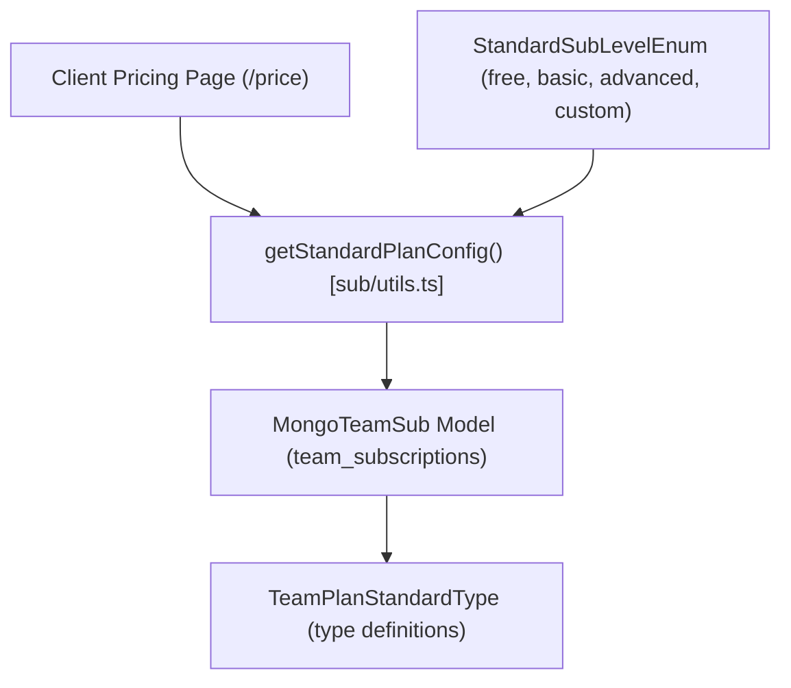
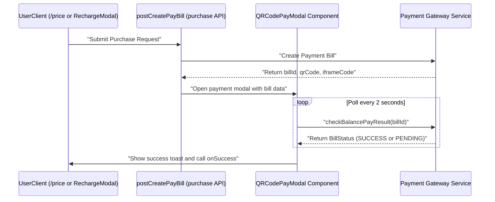
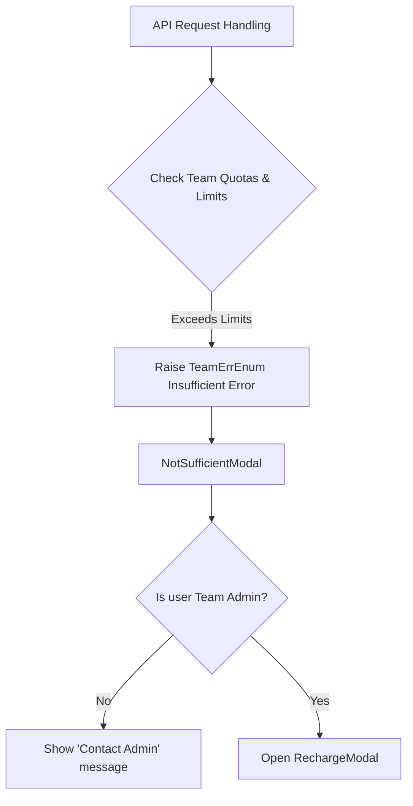
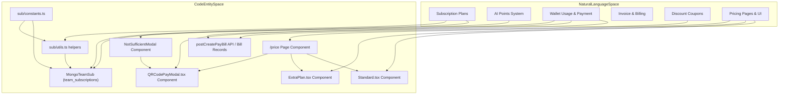

<!-- source: DeepWiki mcp.deepwiki.com · repo labring/FastGPT · page 12.6 Billing, Plans and Usage · fetched 2026-10-29 -->

# Billing, Plans and Usage

<details>
<summary>Relevant source files</summary>

The following files were used as context for generating this wiki page:

- [packages/global/common/string/password.ts](packages/global/common/string/password.ts)
- [packages/global/support/wallet/sub/constants.ts](packages/global/support/wallet/sub/constants.ts)
- [packages/service/support/user/team/teamSchema.ts](packages/service/support/user/team/teamSchema.ts)
- [packages/service/support/wallet/sub/schema.ts](packages/service/support/wallet/sub/schema.ts)
- [packages/service/support/wallet/sub/utils.ts](packages/service/support/wallet/sub/utils.ts)
- [packages/web/i18n/en/account_info.json](packages/web/i18n/en/account_info.json)
- [packages/web/i18n/en/account_inform.json](packages/web/i18n/en/account_inform.json)
- [packages/web/i18n/en/account_setting.json](packages/web/i18n/en/account_setting.json)
- [packages/web/i18n/en/account_usage.json](packages/web/i18n/en/account_usage.json)
- [packages/web/i18n/en/login.json](packages/web/i18n/en/login.json)
- [packages/web/i18n/en/publish.json](packages/web/i18n/en/publish.json)
- [packages/web/i18n/en/user.json](packages/web/i18n/en/user.json)
- [packages/web/i18n/zh-CN/account_info.json](packages/web/i18n/zh-CN/account_info.json)
- [packages/web/i18n/zh-CN/login.json](packages/web/i18n/zh-CN/login.json)
- [packages/web/i18n/zh-Hant/account_info.json](packages/web/i18n/zh-Hant/account_info.json)
- [packages/web/i18n/zh-Hant/account_thirdParty.json](packages/web/i18n/zh-Hant/account_thirdParty.json)
- [packages/web/i18n/zh-Hant/account_usage.json](packages/web/i18n/zh-Hant/account_usage.json)
- [packages/web/i18n/zh-Hant/login.json](packages/web/i18n/zh-Hant/login.json)
- [packages/web/i18n/zh-Hant/user.json](packages/web/i18n/zh-Hant/user.json)
- [projects/app/public/imgs/price/extraDatasetIcon.svg](projects/app/public/imgs/price/extraDatasetIcon.svg)
- [projects/app/src/components/support/wallet/NotSufficientModal/index.tsx](projects/app/src/components/support/wallet/NotSufficientModal/index.tsx)
- [projects/app/src/components/support/wallet/QRCodePayModal.tsx](projects/app/src/components/support/wallet/QRCodePayModal.tsx)
- [projects/app/src/components/support/wallet/StandardPlanContentList.tsx](projects/app/src/components/support/wallet/StandardPlanContentList.tsx)
- [projects/app/src/pageComponents/price/ExtraPlan.tsx](projects/app/src/pageComponents/price/ExtraPlan.tsx)
- [projects/app/src/pageComponents/price/PricePlanTabs.tsx](projects/app/src/pageComponents/price/PricePlanTabs.tsx)
- [projects/app/src/pageComponents/price/Standard.tsx](projects/app/src/pageComponents/price/Standard.tsx)
- [projects/app/src/pages/price/index.tsx](projects/app/src/pages/price/index.tsx)
- [projects/app/src/web/support/wallet/sub/constants.ts](projects/app/src/web/support/wallet/sub/constants.ts)

</details>


## Purpose and Scope

This page documents the technical implementation of FastGPT's billing system encompassing subscription plans, AI points accounting, wallet usage, invoice generation, coupons handling, and pricing pages. It explains the data schema, backend logic for subscriptions and payments, frontend components for plan display and purchase, and usage enforcement mechanisms.

The core entities include team subscription plans (`team_subscriptions`), billing records (bills), coupons, and usage statistics integrated through backend services (`@fastgpt/service`), client UI components (`@fastgpt/web` and `projects/app`), and global types/schema (`@fastgpt/global`).

Sources:
- `packages/service/support/wallet/sub/schema.ts:1-110`
- `packages/service/support/wallet/sub/utils.ts:1-183`
- `projects/app/src/pageComponents/price/Standard.tsx:1-196`
- `projects/app/src/components/support/wallet/QRCodePayModal.tsx:1-223`
- `projects/app/src/components/support/wallet/NotSufficientModal/index.tsx:1-120`
- `projects/app/src/pageComponents/price/ExtraPlan.tsx:1-196`
- `projects/app/src/pages/price/index.tsx:1-199`

---

## Subscription Plans and Tier Model

FastGPT offers a hierarchical subscription model mainly comprised of:

- **Standard Plans**: Team-level subscription tiers such as Free, Basic, Advanced, and Custom.
- **Extra Plans**: Additional purchasable points or dataset storage capacity augmenting base subscriptions.

### Plan Levels and Configuration

Standard plans specify resource and usage quotas like AI points, team members, datasets, API requests limits, storage, and features (e.g., sandbox execution). These are centralized in static configuration and combined with dynamic database records.

Key enums and mappings define subscription types, modes (monthly/yearly), and plan levels:

```ts
enum SubTypeEnum { standard, extraDatasetSize, extraPoints }
enum SubModeEnum { month, year }
enum StandardSubLevelEnum { free, basic, advanced, custom }
```

A runtime helper `getStandardPlanConfig(level: StandardSubLevelEnum)` merges static and database-driven plan info to provide comprehensive client-ready configuration objects representing plan capabilities and limits.

### Data Flow: Client Pricing Page to Plan Config



*Diagram 1: Subscription Plan Configuration Data Flow*

Sources:
- `packages/service/support/wallet/sub/constants.ts:4-109`
- `packages/service/support/wallet/sub/utils.ts:30-88`
- `packages/service/support/wallet/sub/schema.ts:18-109`
- `projects/app/src/pages/price/index.tsx:41-52`
- `projects/app/src/pageComponents/price/Standard.tsx:1-196`

---

## Database Schema: Team Subscriptions

FastGPT represents team subscriptions in MongoDB within the collection `team_subscriptions`, modeled by `MongoTeamSub`. The schema supports three subscription types: standard, extra dataset size, and extra points.

### `MongoTeamSub` Schema Fields Overview

| Field Name               | Type                | Description                                                |
|--------------------------|---------------------|------------------------------------------------------------|
| `teamId`                 | ObjectId            | Reference to the team that owns this subscription          |
| `type`                   | String (enum)       | One of `standard`, `extraDatasetSize`, or `extraPoints`    |
| `startTime`              | Date                | Subscription activation timestamp                           |
| `expiredTime`            | Date                | Subscription expiration timestamp                           |
| `currentSubLevel`        | String (enum)       | Active standard plan level (Free, Basic, Advanced, Custom) |
| `nextSubLevel`           | String (enum)       | Upcoming plan level after renewal                           |
| `currentMode`            | String (enum)       | Billing mode (`month` or `year`)                            |
| `nextMode`               | String (enum)       | Next billing mode                                           |
| `totalPoints`            | Number              | Total AI points allocated                                  |
| `surplusPoints`          | Number              | Remaining AI points balance                                 |
| `maxTeamMember`          | Number              | Maximum allowed team members                                |
| `maxApp`                 | Number              | Maximum allowed app count                                   |
| `maxDataset`             | Number              | Maximum allowed datasets                                    |
| `requestsPerMinute`      | Number              | QPM request limit                                          |
| `chatHistoryStoreDuration`| Number             | Retention duration for chat history (days)                 |
| `maxDatasetSize`         | Number              | Maximum size of datasets (e.g. in MB)                      |
| `websiteSyncPerDataset`  | Number              | Max sync operations per dataset                             |
| `appRegistrationCount`   | Number              | Max number of app registrations allowed                    |
| `auditLogStoreDuration` | Number              | Audit log retention duration                                |
| `ticketResponseTime`     | Number              | Response time SLA for support tickets                       |
| `customDomain`           | Number              | Flag/count for custom domain support                        |
| `enableSandbox`          | Boolean             | Flag whether sandbox runtimes are enabled                   |
| `maxUploadFileSize`      | Number              | Max file upload size (MB)                                  |
| `maxUploadFileCount`     | Number              | Max number of uploaded files                               |
| `currentExtraDatasetSize`| Number              | Additional purchased dataset size                           |

Indexes enforce uniqueness for a team's standard subscription and optimize queries by expiration and type.

Sources:
- `packages/service/support/wallet/sub/schema.ts:18-109`
- `packages/service/support/wallet/sub/utils.ts:51-88`

---

## Payment Flow and QR Code Billing

### Bill Creation and Payment

When a user purchases or renews a plan or buys extra points/dataset storage, the frontend calls `postCreatePayBill` API, which creates a bill record with details including bill id, payment type, and payment data (e.g., QR code string or iframe code).

The payment UI uses the `QRCodePayModal` React component to render the payment method:

- Dynamically renders a QR code or iframe based on the payment type.
- Polls the backend via `checkBalancePayResult` every 2 seconds to check payment status.
- On success, notifies users with a toast and triggers a success callback.

### QRCodePayModal Component Data Flow



*Diagram 2: Payment Bill Creation and QR Code Modal Polling Flow*

Sources:
- `projects/app/src/components/support/wallet/QRCodePayModal.tsx:6-115`
- `projects/app/src/pageComponents/price/ExtraPlan.tsx:64-92`
- `projects/app/src/pageComponents/price/Standard.tsx:135-155`

---

## Usage Limits Enforcement and Insufficient Resource Handling

FastGPT enforces usage limits at API and workflow execution layers based on the team's subscription status, including AI points balances, dataset quotas, app limits, and others.

When a violation occurs (e.g., insufficient AI points), error codes from `TeamErrEnum` (e.g., `aiPointsNotEnough`, `datasetSizeNotEnough`) are thrown and intercepted by the `NotSufficientModal` React component.

### NotSufficientModal Behavior

- Displays an error message tailored to the specific quota exceeded.
- For normal users or visitors, advises contacting the administrator.
- For team administrators, offers a button to open the Recharge Modal for subscription upgrade or point purchase.
- Recharge modal supports seamless purchase of standard plans or extras, with current plan summary and AI points usage progress bar.

### Enforcement Flowchart



*Diagram 3: Resource Limit Enforcement and Insufficient Modal Flow*

Sources:
- `projects/app/src/components/support/wallet/NotSufficientModal/index.tsx:17-120`
- `projects/app/src/components/support/wallet/NotSufficientModal/index.tsx:89-120`

---

## Pricing and Plan UI Components

### Standard Plans UI

The `Standard` React component offers user interfaces for browsing, selecting, and purchasing standard subscription plans:

- Supports month/year subscription modes toggle (`BillingModeSwitch`).
- Reflects team context, WeCom team special treatment, and plan quotas.
- Displays detailed feature lists with components like `StandardPlanContentList`.
- Integrates purchase flow that triggers payment modals and updates plan statuses post-purchase.

### Extra Plans UI

The `ExtraPlan` React component manages extra points and additional dataset purchase UI:

- Allows input of purchase quantity and subscription duration.
- Calculates and displays price dynamically.
- Interacts with payment APIs and renders the `QRCodePayModal` for payment.

### Price Index Page

The main `/price` page aggregates and orchestrates these plan UI components:

- Initializes user info and subscription status on load.
- Allows tabbed browsing between standard and extra points/datasets.
- Manages state for subscription mode selection, purchase resume intents, and login redirects.
- Handles plan purchase success through page refresh and state updates.

Sources:
- `projects/app/src/pageComponents/price/Standard.tsx:1-196`
- `projects/app/src/pageComponents/price/ExtraPlan.tsx:1-196`
- `projects/app/src/pages/price/index.tsx:1-199`

---

## Coupons, Discounts, and Invoices (Overview)

While the detailed coupon and invoice processing logic is not fully covered by the supplied code excerpts, the system supports:

- Discount coupons for plans (visible in UI such as `QRCodePayModal` adjusting displayed tips).
- Billing records that can be queried and paid via multiple payment gateways.
- Pricing pages that display coupon applicability and pricing adjustments.

These integrate with the billing APIs and frontend forms for a full commerce experience.

---

# Summary Architecture Diagram: Natural Language Concepts to Code Entities



*Diagram 4: Domain Concepts to Implementation Artifacts Mapping*

---

# Detailed Components and Key Functions

## Standard Plan Helper Functions (`sub/utils.ts`)

- `getStandardPlanConfig(level: StandardSubLevelEnum): TeamPlanStandardType` — returns the combined plan static config and active subscription record for the specified plan level.
- `buildStandardPlan(standardDbEntry, staticConfig): TeamPlanStandardType` — merges dynamic DB record with static configuration producing a full plan object for client consumption.
- `initTeamFreePlan({teamId, isWecomTeam, session})` — initializes or resets free trial plan records with correct points and time windows.

Sources:
- `packages/service/support/wallet/sub/utils.ts:31-176`

## `QRCodePayModal` (React Component)

- Props include bill data (id, payment method, QR code), optional tip and coupon display.
- Dynamically sizes the QR code canvas for optimal visibility with window resize listener.
- Switches payment methods with asynchronous update calls (`putUpdatePayment`).
- Polls backend for payment success every 2 seconds; shows success toast on completion.

Sources:
- `projects/app/src/components/support/wallet/QRCodePayModal.tsx:1-223`

## `NotSufficientModal`

- Intercepts team error codes related to quota exhaustion.
- Displays descriptive error messages depending on error code.
- Shows a modal to team admins enabling direct navigation to the recharge/plan purchase modal.
- Uses `RechargeModal` for payment and plan upgrades inside the modal.

Sources:
- `projects/app/src/components/support/wallet/NotSufficientModal/index.tsx:17-120`

## Pricing Pages

- `/price` page initializes user and team subscription info.
- Controls tab state and purchase resume intents with hooks.
- Renders main purchase components `Standard` and `ExtraPlan`.
- Includes UI components supporting month/year billing mode toggle and plan cards.

Sources:
- `projects/app/src/pages/price/index.tsx:1-199`
- `projects/app/src/pageComponents/price/Standard.tsx:1-196`
- `projects/app/src/pageComponents/price/ExtraPlan.tsx:1-196`

---

# Conclusion

FastGPT's billing, plans, and usage system is built on a robust MongoDB-backed subscription model, combined with dynamic runtime plan computation, payment bill management supporting multiple pay methods, and rich frontend components for interaction. Enforcement of limits and resource usage is tightly integrated with clear UI feedback and escalation paths for users/admins. Coupon and invoice support further augment this comprehensive commerce infrastructure.

Sources summary:
- `packages/service/support/wallet/sub/schema.ts`
- `packages/service/support/wallet/sub/utils.ts`
- `packages/service/support/wallet/sub/constants.ts`
- `projects/app/src/components/support/wallet/QRCodePayModal.tsx`
- `projects/app/src/components/support/wallet/NotSufficientModal/index.tsx`
- `projects/app/src/pageComponents/price/Standard.tsx`
- `projects/app/src/pageComponents/price/ExtraPlan.tsx`
- `projects/app/src/pages/price/index.tsx`

---

