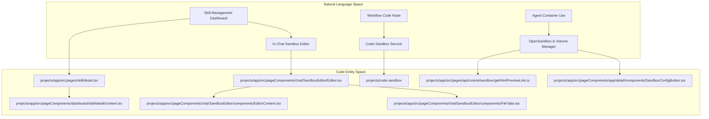
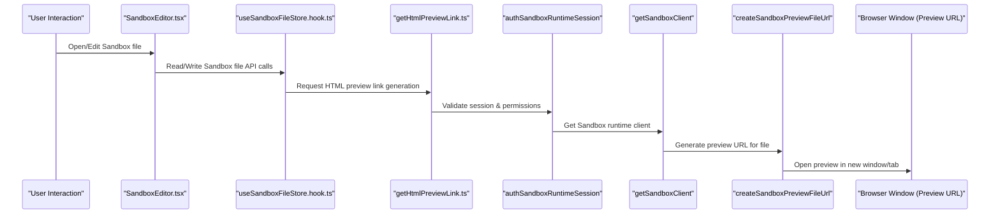

<!-- source: DeepWiki mcp.deepwiki.com · repo labring/FastGPT · page 13 Skills and Sandbox Runtimes · fetched 2026-10-29 -->

# Skills and Sandbox Runtimes

Relevant source files

The following files were used as context for generating this wiki page:

- [packages/global/core/app/tool/constants.ts](packages/global/core/app/tool/constants.ts)
- [packages/global/core/app/tool/type.ts](packages/global/core/app/tool/type.ts)
- [packages/global/core/chat/type.ts](packages/global/core/chat/type.ts)
- [packages/global/core/plugin/tool/type.ts](packages/global/core/plugin/tool/type.ts)
- [packages/global/openapi/core/ai/skill/index.ts](packages/global/openapi/core/ai/skill/index.ts)
- [packages/global/openapi/core/chat/history/api.ts](packages/global/openapi/core/chat/history/api.ts)
- [projects/app/src/components/common/PromptEditor/OptimizerPopover/index.tsx](projects/app/src/components/common/PromptEditor/OptimizerPopover/index.tsx)
- [projects/app/src/components/core/app/DatasetParamsModal.tsx](projects/app/src/components/core/app/DatasetParamsModal.tsx)
- [projects/app/src/pageComponents/app/detail/Edit/ChatAgent/ChatTest.tsx](projects/app/src/pageComponents/app/detail/Edit/ChatAgent/ChatTest.tsx)
- [projects/app/src/pageComponents/app/detail/Edit/SimpleApp/ChatTest.tsx](projects/app/src/pageComponents/app/detail/Edit/SimpleApp/ChatTest.tsx)
- [projects/app/src/pageComponents/app/detail/Logs/DetailLogsModal.tsx](projects/app/src/pageComponents/app/detail/Logs/DetailLogsModal.tsx)
- [projects/app/src/pageComponents/app/detail/WorkflowComponents/Flow/nodes/NodeCode/Copilot.tsx](projects/app/src/pageComponents/app/detail/WorkflowComponents/Flow/nodes/NodeCode/Copilot.tsx)
- [projects/app/src/pageComponents/chat/SandboxEditor/hook.tsx](projects/app/src/pageComponents/chat/SandboxEditor/hook.tsx)
- [projects/app/src/pageComponents/chat/ToolMenu.tsx](projects/app/src/pageComponents/chat/ToolMenu.tsx)
- [projects/app/src/pageComponents/dashboard/skill/detail/preview/SkillPreview.tsx](projects/app/src/pageComponents/dashboard/skill/detail/preview/SkillPreview.tsx)
- [projects/app/src/web/core/skill/api.ts](projects/app/src/web/core/skill/api.ts)
- [projects/app/test/components/core/app/DatasetParamsModal.test.ts](projects/app/test/components/core/app/DatasetParamsModal.test.ts)

## Purpose and Scope

This page provides an architectural overview of FastGPT's **Skill System** and **Sandbox Execution Runtimes**. FastGPT supports robust, isolated environments where AI agents can execute code, manipulate workspaces, run containerized workloads, and debug custom tools via dedicated code sandboxes, agent sandboxes (`sealosdevbox`/`opensandbox`), and in-chat editing interfaces.

As a parent page, this document outlines the high-level responsibilities and relationships among the subsystems. For deep technical implementation details, consult the following child pages:
- [Skill System](#13.1) — Skill data model, versions, packaging/zip export-import, deployment, debug chat and skill dashboards
- [Code Sandbox Service](#13.2) — `projects/code-sandbox`: process pool, isolated Python/JS runners, API and the `codeSandbox` workflow node
- [Agent Sandbox and OpenSandbox](#13.3) — Agent sandbox providers (`sealosdevbox`/`opensandbox`), runtime profiles, proxy sidecar, `volume-manager` and `sandbox-adapter` SDK
- [In-Chat Sandbox Editor](#13.4) — `SandboxEditor` UI: file tree, tabs, editor content, preview links and upload/download APIs

---

## 13.1. Skill System

The Skill System is the core mechanism for defining, packaging, and managing AI agent capabilities in FastGPT. Skills represent self-contained logic units typically written in Python or JavaScript, packaged with their own workspace files, dependencies, and metadata.

Skill lifecycle is tightly integrated with sandbox runtimes:
- Skills are versioned and exportable as ZIP packages.
- Deployment workflows push skill packages into sandboxes for isolated execution.
- Debug chat consoles and dashboards provide runtime monitoring and direct interaction with skill execution.

The Skill Management UI and runtime context providers orchestrate starting, restarting, and upgrading sandboxes running skills, enabling smooth developer experience and operational control.

For complete implementation details, see [Skill System](#13.1).

Sources:
- `projects/app/src/pages/skill/detail.tsx:1-65`
- `projects/app/src/pageComponents/dashboard/skill/detail/context.tsx:1-82`
- `projects/app/src/pageComponents/dashboard/skill/detail/Content.tsx:1-70`

---

## 13.2. Code Sandbox Service

FastGPT's Code Sandbox Service provides a runtime environment optimized for running untrusted or user-scripted code snippets safely. It supports isolated Python and JavaScript execution via a managed process pool, preventing code from impacting the main server process.

Key aspects include:
- API endpoints consumed by workflow nodes of type `codeSandbox`.
- Code runners evaluate snippets or modules in ephemeral or persistent sandboxed processes.
- Native support for worker isolation, timeout controls, and secure execution.

This service is a foundation for lightweight code execution scenarios such as instant script evaluation or small tool runs inside workflows.

For more technical details, see [Code Sandbox Service](#13.2).

Sources:
- `deploy/init.mjs:1-50`
- (Referenced project directory: `projects/code-sandbox`)

---

## 13.3. Agent Sandbox and OpenSandbox

For complex and resource-intensive agent tasks requiring a complete Linux-like environment with container capabilities, FastGPT integrates **Agent Sandbox** runtimes:

- Uses providers such as [`sealosdevbox`](https://github.com/sealosdevbox) and FastGPT's customized `opensandbox`.
- Supports container lifecycle management including startup, status reporting, and upgrade phases.
- Employs proxy sidecars to handle secure API forwarding into the sandbox runtime.
- Integrates with `volume-manager` service to provide persistent storage backed by S3-compatible APIs.
- SDK `sandbox-adapter` provides a standardized interface for sandbox management and interaction.

These sandboxes allow agents to hold long-running workspaces, perform file operations, install missing dependencies, and persist intermediate states.

User-facing UI components like `SandboxConfigButton` allow configuration and runtime switching, exposing easy toggles between local code sandbox and remote agent sandboxes.

For full details, see [Agent Sandbox and OpenSandbox](#13.3).

Sources:
- `projects/app/src/pageComponents/app/detail/components/SandboxConfigButton.tsx:1-35`

---

## 13.4. In-Chat Sandbox Editor

The In-Chat Sandbox Editor (`SandboxEditor`) enables a rich developer experience directly embedded inside chat or skill debugging UIs:

- Presents a file tree showing workspace contents with usual file operations (create, rename, move, delete).
- Provides multiple tabs for open files, supporting editing of source code and scripts.
- Features a Monaco-driven editor component with syntax highlighting, language detection, and binary file handling.
- Supports reading and writing file contents via sandbox runtime RPC APIs.
- Offers HTML preview link generation for outputs and scripts.
- Exposes upload/download APIs for synchronizing files with local clients.
- UI hooks `useSandboxEditor` and `useSandboxStatus` handle modal visibility and sandbox existence detection.

This in-chat IDE helps rapid iterative development, live debugging, and running skills in an interactive manner.

For detailed implementation, see [In-Chat Sandbox Editor](#13.4).

Sources:
- `projects/app/src/pageComponents/chat/SandboxEditor/hook.tsx:1-228`
- `projects/app/src/pageComponents/chat/SandboxEditor/Editor.tsx:1-56`
- `projects/app/src/pageComponents/chat/SandboxEditor/components/EditorContent.tsx:1-37`
- `projects/app/src/pageComponents/chat/SandboxEditor/components/FileTabs.tsx:1-20`
- `projects/app/src/pageComponents/chat/SandboxEditor/utils.tsx:1-15`
- `projects/app/src/pages/api/core/ai/sandbox/getHtmlPreviewLink.ts:1-30`

---

## Architecture Overview: Skills and Sandbox Runtimes

The following diagram bridges the natural language conceptual space to concrete code entities across the FastGPT monorepo for skills and sandboxes:

**Title:** Skills and Sandbox Architecture to Code Entities

Sources:  
- `projects/app/src/pages/skill/detail.tsx:1-65`  
- `projects/app/src/pageComponents/dashboard/skill/detail/context.tsx:1-82`  
- `projects/app/src/pageComponents/chat/SandboxEditor/Editor.tsx:1-56`  
- `projects/app/src/pageComponents/chat/SandboxEditor/components/EditorContent.tsx:1-37`  
- `projects/app/src/pageComponents/chat/SandboxEditor/components/FileTabs.tsx:1-20`  
- `projects/app/src/pages/api/core/ai/sandbox/getHtmlPreviewLink.ts:1-30`  
- `projects/app/src/pageComponents/app/detail/components/SandboxConfigButton.tsx:1-35`  

---

## Sandbox Session and File Interaction Flow

This sequence diagram illustrates the general flow from user interaction within the in-chat sandbox editor to generating a secure HTML preview link via sandbox runtime backend calls:

**Title:** Sandbox Session and File Interaction Flow

Sources:  
- `projects/app/src/pageComponents/chat/SandboxEditor/Editor.tsx:1-56`  
- `projects/app/src/pages/api/core/ai/sandbox/getHtmlPreviewLink.ts:1-30`

---

This page provides the high-level context needed to understand the modular design and interactions of the Skill system and sandbox runtimes in FastGPT. For implementation and development guidance, please refer to the linked child pages.

---

